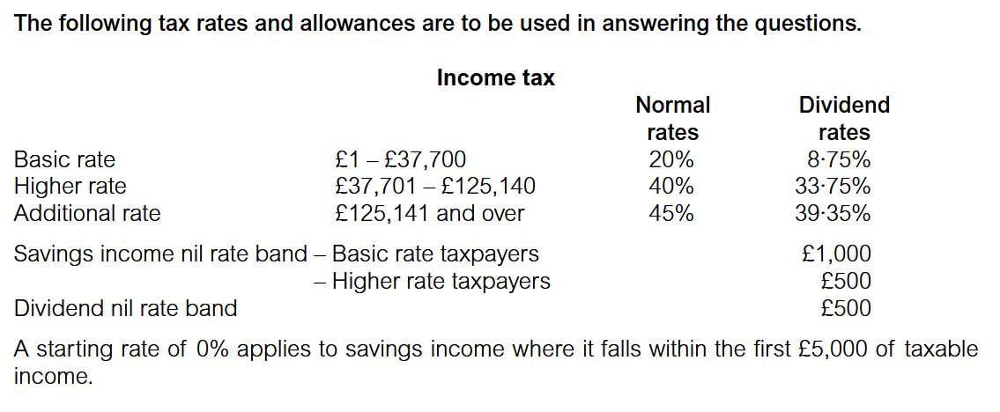
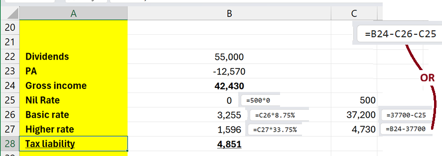

::: {.center data-latex=""}
```{mermaid}
%%| fig-width: 3
%%| fig-align: center
flowchart TD
    %% Nodes
    C("BASIC INCOME TAX COMPUTATION")
    AI("ASSESSABLE INCOME")
    R("RELIEFS")
    AL("ALLOWANCES")
    TI("TAXABLE INCOME")
    TL("INCOME TAX LIABILITY")
    TP("INCOME TAX PAYABLE")

    %% Compact Connections
    C -.-> AI & R & AL
    AI & R & AL -.-> TI
    TI -.-> TL -.-> TP
```
:::

# The scope of income tax

## Basis of assessment

Individuals are assessed to income tax on their income arising in a **tax year**. 

The UK tax year runs from 6 April to 5 April the following year.

- Current Tax Year (2026/27): Began on 6 April 2026 and will end on 5 April 2027.
- Previous Tax Year (2025/26): Ran from 6 April 2025 to 5 April 2026.

## Assessable persons

- All individuals, including children, are chargeable to income tax.
- Both spouses within a married couple and both partners in a civil partnership are treated as separate individuals for the purposes of income tax.

The tax residency status of an individual determines how much income is assessed to UK tax.  
All persons resident for tax purposes in the UK are assessed to UK tax on their worldwide income.

## Personal allowance 

Every taxpayer is entitled to a personal allowance (PA). 

- The PA is an amount of tax-free income that every taxpayer is entitled to each tax year. 
- The amount is reduced, potentially to £Nil, for high income individuals.

## Married couples and civil partners 

There are special rules governing the allocation of income between spouses where assets are jointly owned: 

Generally, income generated from assets jointly owned is split 50:50 between spouses regardless of the actual percentage ownership.

**Election available:** Where jointly owned assets are held other than in a 50:50 ratio, an election can be made to HM Revenue & Customs (HMRC) for the income  to be taxed on the individual spouses according to their actual percentage  ownership.  

Civil partners are treated in the same way as married couples. 

Children under the age of 18 are taxable persons. However, their income typically falls short of their personal allowance in any tax year and therefore no tax liability actually arises on their income. 

# Basic Income Tax Computation 

**Basic pro forma**

The first stage of the income tax computation is to prepare a short statement summarising all **taxable income**. [Peek at the secound stage](#income-tax-liability)

Any exempt income is excluded, but **should be noted as exempt in your answer** to a section C question in the examination.

| Income Category | Examples |
| :--- | :--- |
| Trading income | Self-employment profits |
| Employment income | Salary, bonuses, benefits-in-kind |
| Property income | Rental profits |
| Pension income | State/private pensions |
| Non-savings income | Catch-all for above (often just a sum of first four) |
| Savings income | Bank/building society interest |
| Dividends | Share dividends from UK companies |
| Total income | Add all the above categories to get Total income |
| Less: Reliefs | gift aid donations, pension, trading losses |
| Net income | Net Income before PA |
| Less: Personal Allowance PA | tax-free income |
| Taxable income | Or Tax Base, Total amount Tax rates is applied to |

> In exams, you'll often compute **Trading income** first via an **adjusted profit/ loss** computation, then place the figure here.

[Certain payments](#reliefs) **(Reliefs)** can reduce total income before the personal allowance, e.g.: 

- Qualifying gift aid donations (grossed up)
- Pension contributions (under net pay or relief at source)
- Trading losses relieved against total income (subject to restrictions)

For 2025/26, the standard **personal allowance PA** is £12,570 (unless it changes in future Budget announcements).

Important restrictions:
- Reduced by £1 for every £2 of **Net income** above £100,000
- Completely lost once net income exceeds approx £125,140

## Taxable Income

### Classification of income 

There are a number of different sources of income. For example: 
- Income earned from employment and self-employment 
- Income arising from the ownership of property
- Investment income (e.g. savings income and dividends) 
- Income from pensions
- Income exempt from income tax.

> It is important to classify each source of income correctly **as the tax rules are  different for each source**.  It is also important to correctly classify each source as 'non-savings income', 'savings income' or 'dividend income' **as they are taxed at different rates**. 

### Non-savings income 

Non-savings income comprises earned income and property income. 

Earned income comprises: 

- Trading income – the profit of a trade, profession or vocation of a self-employed individual. 
- Employment income – earnings including salaries, bonuses and other benefits from an office or employment are assessed as employment income. 
- Pension income – income from an occupational or personal pension fund. 
- Property income is typically rental income, but also includes other items such as the income element of a premium on granting a short lease.

### Investment income 

Sources of investment income include: 

- Savings income – usually bank and building society interest
- Dividend income

### Exempt income 

The types of exempt income which may be tested in the examination are: 

- Interest from National Savings and Investments ('NS&I') certificates
- Betting, lottery and premium bonds winnings 
- Income received from an individual savings account (ISA). 

### Reliefs

Reliefs are deducted from an ***individual's total income***. 

They include certain payments that an individual makes and certain losses that may be incurred by an individual. Relief is available by deducting the payments/losses from total income.

The only payments deductible from total income, which are examinable at TX, are certain **qualifying interest payments** and **losses**. 

#### Qualifying interest payments 

Relief is given for **interest paid** on loans incurred **to finance expenditure** for a **qualifying purpose**.

There are a number of qualifying purposes to which the loan must be applied. The only ones relevant to your examination are as follows: 

**Employees**

- The purchase of plant or machinery for use in employment in which the individual is an employee.
- The purchase of shares in an employee-controlled trading company by a full-time employee. 

**Partners**

- The purchase of a share in a partnership, or the contribution to a partnership of capital or a loan. The borrower must be a partner in the partnership. 
- The purchase of plant or machinery for use in the partnership, by a partner. 

Relief is given by deducting the amount of interest paid in a tax year from **total income**.

#### Loss relief 

The amount of relief allowed to be deducted from total income is **restricted**. In TX, this restriction will only be examined in the context of loss relief.

#### Example 1

Anwar and Mila each have total income of £54,000 none of which is savings or dividend income. 

They made the following payments during the tax year 2025/26: 

- Anwar made interest payments during the year totalling £2,000 on his mortgage for his main <strike>private residence</strike>.
- Mila made interest payments of £2,000 on a loan to **invest in a partnership** in which she is a partner. 

Calculate the **Net income** for Anwar and Mila for the tax year 2025/26. 

**Solution**

**Taxable income**

|                                         | Anwar (£) | Mila (£) |
|-----------------------------------------|-----------|----------|
| Total income                            | 54,000    | 54,000   |
| Less: Reliefs – Qualifying interest paid | -         | (2,000)  |
| **Net income**                              | 54,000    | 52,000   |
| Less: PA                                | (12,570)  | (12,570) |
| Taxable income                          | 41,430    | 39,430   |

> Note: Mortgage interest paid for a main private residence is not qualifying interest and therefore not deductible as a relief. 

### Personal allowance Calculation

Every taxpayer (including children) is entitled to a personal allowance (PA). 

- The PA for the tax year 2025/26 is £12,570.
- In the TX examination the PA should always be deducted from the different sources of the taxpayer's net income **in the following order**: 
  - Non-savings income
  - Savings income 
  - Dividend income
- Surplus PA is lost. 
- The PA **cannot be set against capital gains**.
- In certain circumstances, part of the PA can be transferred to a spouse or civil partner 

> The PA is included in the tax rates and allowances provided to you in the examination. 

#### Reduction of personal allowance – high income individuals 

- The PA is gradually reduced for individuals with income in excess of £100,000. 
- The reduction of the PA is based on the taxpayer's Adjusted Net Income (ANI) which is calculated as follows:

| Net income                     |
|--------------------------------|
| Less: Gross gift aid donations (Note) |
| Less: Gross personal pension contributions (Note) |
| Adjusted net income (ANI)      |       


> **Key point:** Adjusted net income is **not** used directly to compute taxable income.  
> It is only used to determine **how much Personal Allowance you are entitled to**.

Where the taxpayer's ANI exceeds £100,000, the PA is reduced by: 

$$
\text{PA reduction} = 50\% \times (ANI - £100,000)
$$

$$
\text{Adjusted PA} = \text{Standard PA} - \text{Reduction}
$$

Standard PA for 2025/26 = **£12,570**  \
A taxpayer with ANI in excess of £125,140 will therefore be entitled to **no PA** at all, as the excess above £100,000 is **twice the PA**. 

#### Why Do We Subtract Gift Aid & Pension Contributions?

Both **gift aid donations** and **personal pension contributions** (relief at source) are treated as if they were paid **after tax** – but for the purpose of checking the £100,000 Personal Allowance threshold, we add back the basic rate tax to make them **gross** and then deduct them from net income.

**Example (2025/26)**

- Net income = £110,000
- Gift aid donation paid = £800 (net)
- Grossed up = £800 ÷ 0.8 = £1,000

**Adjusted net income** = £110,000 – £1,000 = £109,000

Because ANI is still above £100,000, Personal Allowance is reduced by:
$$
(£109,000 – £100,000) ÷ 2 = £4,500
$$

Personal Allowance = £12,570 – £4,500 = **£8,070**

\begin{mdframed}
\textcolor{red}{\textbf{Do not}} deduct gift aid / pension contributions twice:

- They reduce ANI (to calculate PA)
- They also reduce taxable income **via an extended basic rate band** (not by directly deducting from net income again)

\textcolor{red}{Many students lose marks here.}
\end{mdframed}

#### Income tax computation – 2025/26

Ethan received trading income of £110,000 in the tax year 2025/26. He also made gift aid donations of £4,000 (gross). \
Compute Ethan’s taxable income for the tax year 2025/26. 

|                                | £       |
|--------------------------------|---------|
| Trading income (Note)          | 110,000 |
| Less: Adjusted PA (W)          | (9,570) |
| **Taxable income**             | 100,430 |

**Working: Adjusted PA**

|                                      | £       |
|--------------------------------------|---------|
| Basic personal allowance             | 12,570  |
| Net income (Note)                    | 110,000 |
| Less: Gross gift aid donation        | (4,000) |
| **Adjusted net income**              | 106,000 |
| Less: Income limit                   | (100,000) |
| **Reduction of PA (50% × £6,000)**   | 6,000   |
| **Adjusted PA**                      | 9,570   |

**Note:** In this example, as there are no other sources of income and no reliefs, Ethan’s trading income = total income = net income.

## Income tax liability 

The second stage of the income tax computation is to compute the income tax liability on the taxable income. [Peek at the frist stage](#basic-income-tax-computation)

Different rates of tax apply dependent upon the type of income, The income tax liability is calculated on income in a strict order as follows: 

| Income type             | Amount (£) | Tax rates                            |
|-------------------------|------------|--------------------------------------|
| Non-savings income      | X          | @ 20% / 40% / 45%                    |
| Savings income          | X          | @ 0% / 20% / 40% / 45%               |
| Dividend income         | X          | @ 0% / 8.75% / 33.75% / 39.35%       |
| **Income tax liability** |            |                                      |

### Non-savings income 

This section deals with the rates of income tax payable on 'non-savings income' i.e. trading income, employment income, pension income and property income. \
The rates of income tax for the tax year 2025/26 for 'non-savings income' are as follows:

- A basic rate of 20% applies to the first £37,700 of taxable income
- A higher rate of 40% applies where taxable income falls in the range £37,701 to £125,140 
- An additional rate of 45% applies to taxable income in excess of £125,140.

| Level of income                         | Non-savings income |
|-----------------------------------------|--------------------|
| Basic rate band (first £37,700)         | 20%                |
| Higher rate (£37,701 – £125,140)        | 40%                |
| Additional rate (excess over £125,140)  | 45%                |

#### Approach to the income tax computation 

1. Calculate the individual's net income (which may be the same as total income). 
2. Consider the reduction of the PA if ANI exceeds £100,000. 
3. Deduct the appropriate amount of PA to calculate the taxable income.
4. Calculate the income tax liability bearing in mind the basic rate limit of £37,700 and the higher rate limit of £125,140. 

#### Example 1 

Amir has taxable trading income of £21,165 and employment income of £3,000 for the tax year 2025/26. He has no savings or dividend income. 

Calculate Amir’s income tax liability for the tax year 2025/26. 

**Solution**

|                                | £       |
|--------------------------------|---------|
| Trading income                 | 21,165  |
| Employment income              | 3,000   |
| **Total income (= net income)** | 24,165  |
| Less: PA                       | (12,570)|
| **Taxable income**             | 11,595  |
| Income tax liability (£11,595 × 20%) | 2,319   |

#### Example 2

Tala has taxable trading income of £43,765 and employment income of £7,000 for the tax year 2025/26. She has no savings or dividend income. 

Calculate Tala’s income tax liability for the tax year 2025/26. 

**Solution**

|                                |  | £       |
|--------------------------------|--|---------|
| Trading income                 |  | 43,765  |
| Employment income              |  | 7,000   |
| **Total income / net income**  |  | 50,765  |
| Less: PA                       |  | (12,570)|
| **Taxable income**             |  | 38,195  |
| Income tax:                    |  |         |
| Basic rate                     | 37,000 X 20% | 7,540   |
| Higher rate                    | 495 X 40% | 198     |
| **Income tax liability**       | 38,195 | 7,738   |

#### Example 3

Thomas has taxable trading income of £135,000 and employment income of £33,680 for the tax year 2025/26. He does not have any savings income or dividend income.

Calculate Thomas’ income tax liability for the tax year 2025/26. 

**Solution**

|                                                | £         |
|------------------------------------------------|-----------|
| Trading income                                 | 135,000   |
| Employment income                              | 33,680    |
| **Total income**                               | 168,680   |
| Less: Adjusted PA (Note)                       | (0)       |
| **Taxable income**                             | 168,680   |
| Income tax:                                    |           |
| Basic rate (£37,700 × 20%)                     | 7,540     |
| Higher rate (£87,440 × 40%)                    | 34,976    |
| Additional rate (£43,540 × 45%)                | 19,593    |
| **Income tax liability**                       | 62,109    |

> Note: In this example, as total income = net income = ANI, and this exceeds £125,140 (i.e. exceeds £100,000 plus double the PA), the PA is reduced to £Nil.  

> If it is clear that total income equals net income (because there are no reliefs) it is not necessary to use both labels. 

#### Example 4

Fernanda is employed on an annual salary of £100,000 in the tax year 2025/26. 

How much additional income tax would Fernanda have paid if, in addition to her annual salary, she had received a taxable performance bonus of £25,140 during the tax year 2025/26?

**Solution**

Income tax computation 2025/26 – *assuming no bonus* 

|                                                | £         |
|------------------------------------------------|-----------|
| Employment income                              | 100,000   |
| Less: PA (ANI ≤ £100,000)                      | (12,570)  |
| **Total income**                               | 87,430    |
| Income tax:                                    |           |
| Basic rate (£37,700 × 20%)                     | 7,540     |
| Higher rate (£49,730 × 40%)                    | 19,892    |
| **Income tax liability**                       | 27,432    |

Income tax computation 2025/26 – *with bonus of £25,140* 

|                                                | £         |
|------------------------------------------------|-----------|
| Employment income                              | 125,140   |
| Less: PA (ANI ≥ £125,140)                      | (0)       |
| **Total income**                               | 125,140   |
| Income tax:                                    |           |
| Basic rate (£37,700 × 20%)                     | 7,540     |
| Higher rate (£87,440 × 40%)                    | 34,976    |
| **Income tax liability**                       | 42,516    |
| Additional tax (£42,516 – £27,432) (Note)      | 15,084    |

> Note: On an additional taxable income of £25,140, tax of £15,084 has been paid. This represents an effective tax rate of 60% (£15,084/ £25,140). A quicker way to calculate the additional tax is: 

|                                                | £       |
|------------------------------------------------|---------|
| Higher rate tax on additional income (£25,140 × 40%) | 10,056 |
| Lost PA (£12,570 × 40%)                        | 5,028   |
| **Total**                                      | 15,084  |

### Saving income

The primary source of income for most taxpayers is earnings from either employment or self-employment (or a pension, once retired). However, some taxpayers also have ***investment income***. 

We cover the taxation of income from investments in the form of *savings and dividend income*. 

The main types of savings income are bank and building society interest.  \
Other sources of savings income include: 

- Interest from NS&I (National Savings and Investments) accounts, including both NS&I investment accounts and NS&I direct saver accounts.
- Interest from gilt-edged securities, or ‘gilts’ i.e. government bonds, such as treasury stock and exchequer stock. 
- Interest from quoted company loan stock, also called company bonds, debentures or loan notes. 

Remember, income from ***NS&I certificates***, and ***premium bond winnings*** are exempt. 

#### Rates of tax on savings 

Savings income is normally taxed in the same way as ‘non-savings income’ at the basic, higher and additional rates of tax (20%, 40% and 45%).

> However, a starting rate of tax of 0% applies to all taxpayers where savings income falls into the first £5,000 of taxable income. 

> In addition, basic rate and higher rate taxpayers are entitled to a savings income **nil rate band**.  

The savings income nil rate band is: 

- Basic rate taxpayer – £1,000
- Higher rate taxpayer – £500 
- Additional rate taxpayer – £Nil

Savings income is taxed as ***the [next slice]{#middle-slice} of income after ‘non-savings income’*** (i.e. employment income, trading income, pension income and property income). Therefore the rates of tax applicable to savings income depend on the level of taxable ‘non-savings income’. The procedure to follow is: 

1. Calculate income tax on ‘non-savings income’. 
2. Apply the different rates of tax on savings income in the following order: 
      1. Starting rate 
      2. Savings income nil rate band
      3. Normal rates (i.e. basic, higher and additional rates). 

#### Starting rate 

This only applies in *fairly limited situations* i.e. where taxable \underline{‘non-savings income’ is less than £5,000}. If: 

- Taxable ‘non-savings income’ is £Nil – the first £5,000 of taxable savings income is taxed at 0% (in effect received tax free) 
- Taxable ‘non-savings income’ is below £5,000 – savings income falling into the rest of the first £5,000 is taxed at 0% 
- Taxable ‘non-savings income’ is in excess of £5,000 – the 0% starting rate is not applicable.

#### Savings income nil rate band

If there is *further savings* income to tax, consider the savings income nil rate band. If the taxpayer is: 

- A basic rate taxpayer – the next £1,000 falls in the savings income nil rate band and is taxed at 0% 
- A higher rate taxpayer – the next £500 falls in the savings income nil rate band and is taxed at 0% 
- An additional rate taxpayer i.e. taxable income is £125,140 or more – the savings income nil rate band is not applicable. 

> To determine whether the taxpayer is a basic, higher or additional rate taxpayer, ascertain the highest tax band that the taxable income falls within. 

For example, a taxpayer with taxable income of £45,000 is a higher rate taxpayer as the individual has taxable income falling into the higher rate band of £37,701 to £125,140.

#### Normal rates 

If there is further savings income to tax, apply the normal savings rates as follows: 

- The basic rate of 20% applies to savings income falling within the \underline{basic rate band (BRB)}, i.e. the first £37,700 of taxable income.
- The higher rate of 40% applies to savings income falling within the \underline{higher rate band (HRB)}, i.e. taxable income in the range £37,701 to £125,140.
- The additional rate of 45% applies to savings income where taxable income exceeds £125,140. 

> Note that the BRB and HRB are first reduced by ‘non-savings income’ and savings income that has been taxed at the starting rate and the savings income nil rate.

> The above procedure may seem complicated but if you use the ***columnar layout*** of the income tax computation (as shown on the following page) it is relatively easy to determine which rates to apply. 

#### Income tax Saving & Non-saving computation 

Where an individual has different sources of income, set up a computation (as below) \underline{using columns for each type of income} to ensure that you: 

1. calculate the income tax liability on the different sources of income in the correct order, and
2. apply the correct rates of income tax. 

Income tax computation

|                                | Non-savings income | Savings income | Dividends | Total |
|--------------------------------|--------------------|----------------|-----------|-------|
| **Trading income**             | X                  |                |           | X     |
| **Employment income**          | X                  |                |           | X     |
| **Pension income**             | X                  |                |           | X     |
| **Property income**            | X                  |                |           | X     |
| **Savings income**             | X                  |                |           | X     |
| **Dividends**                  |                    | X              | X         | X     |
| **Total income**               | X                  | X              | X         | X     |
| **Less: Reliefs**              | (X)                | (X)            | (X)       | (X)   |
| **Net income**                 | X                  | X              | X         | X     |
| **Less: PA**                   | (X)                | (X)            | (X)       | (X)   |
| **Taxable income**             | X                  | X              | X         | X     |

Remember that in the TX examination the PA and reliefs are deducted from income in the following order: 

1. Non-savings income
2. Savings income
3. Dividend income

#### Example 1

Jane received bank interest of £3,000 during the tax year 2025/26.

Calculate Jane’s income tax liability assuming she also had employment income in the tax year 2025/26 of: 

A) £11,000
B) £15,200
C) £29,000

**Solution**

**A) Employment income of £11,000**

|                         | Non-savings income (£) | Savings income (£) | Total (£) |
|-------------------------|------------------------|--------------------|-----------|
| Employment income       | 11,000                 |                    | 11,000    |
| Bank interest           |                        | 3,000              | 3,000     |
| **Total income**        | 11,000                 | 3,000              | 14,000    |
| Less: PA (Note 1)       | (11,000)               | (1,570)            | (12,570)  |
| **Taxable income**      | 0                      | 1,430              | 1,430     |

| Income tax:                                    | £         |
|------------------------------------------------|-----------|
| Savings income – starting rate (Note 2)        | 1,430     |
| × 0%                                          | 0         |
| **Income tax liability**                       | 0         |

> The PA is always offset first against non-savings income, then savings income and then dividend income. 
> The starting rate applies as savings income falls within the first £5,000 of taxable income.

In the examination always indicate the rate at which income is taxed, even if the rate is 0%. This shows that you understand that this income is still ‘taxable income’. It also shows that you know how to apply the correct tax rates, including the 0% rate. 

**B) Employment income of £15,200**

|                         | Non-savings income (£) | Savings income (£) | Total (£) |
|-------------------------|------------------------|--------------------|-----------|
| Employment income       | 15,200                 |                    | 15,200    |
| Bank interest           |                        | 3,000              | 3,000     |
| **Total income**        | 15,200                 | 3,000              | 18,200    |
| Less: PA                | (12,570)               |                    | (12,570)  |
| **Taxable income**      | 2,630                  | 3,000              | 5,630     |

| Income tax:                                                      | Calculation | £       |
|------------------------------------------------------------------|-------------|---------|
| Non-savings income – basic rate                                  | 2,630 X 20% |  526    |
| Savings income – starting rate (Note 1)                          | 2,370 X 0%  |  0      |
|                                                                  | 5,000       |  0      |
| Savings income – nil rate (Note 2)                               | 630 X 0%    |  0      |
|                                                                  | 5,630       |         |
| **Income tax liability**                                         |             | **526** |

> N1: The starting rate applies to £2,370 of the savings income as it falls within the first £5,000 of taxable income.

> N2: Jane is a basic rate taxpayer as her taxable income (£5,630) is less than £37,700. Her savings income nil rate band is therefore £1,000.

**C) Employment income of £29,000**

|                         | Non-savings income (£) | Savings income (£) | Total (£) |
|-------------------------|------------------------|--------------------|-----------|
| Employment income       | 29,000                 |                    | 29,000    |
| Bank interest           |                        | 3,000              | 3,000     |
| **Total income**        | 29,000                 | 3,000              | 32,000    |
| Less: PA                | (12,570)               |                    | (12,570)  |
| **Taxable income**      | 16,430                 | 3,000              | 19,430    |

| Income tax:                                          | Calculation | £         |
|------------------------------------------------------|-------------|-----------|
| Non-savings income – basic rate                      | 16,430 X 20%| 3,286     |
| Savings income – nil rate (Note 2)                   | 1,000 X 0%  | 0         |
| Savings income – basic rate (Note 2)                 | 2,000 X 20% | 400       |
|                                                      | 19,430      |           |
| **Income tax liability**                             |             | **3,686** |

> N1: The starting rate does not apply as savings income does not fall within the first £5,000 of taxable income. 

> N2: Jane is a basic rate taxpayer as her taxable income (£19,430) is less than £37,700. Her savings income nil rate band is therefore £1,000. The balance of her savings income of £2,000 (£3,000 - £1,000) is taxed at the basic rate.

#### Example 2

Alonso received bank interest of £7,850 during the tax year 2025/26.

Calculate Alonso’s income tax liability assuming he also had trading income in the tax year 2025/26 of: 

A. £43,000 \
B. £53,000 \
C. £145,000 \

**Solution**

**A) Trading income of £43,000**

**Taxable income**

|                         | Non-savings income (£) | Savings income (£) | Total (£) |
|-------------------------|------------------------|--------------------|-----------|
| Trading income          | 43,000                 |                    | 43,000    |
| Bank interest           |                        | 7,850              | 7,850     |
| **Total income**        | 43,000                 | 7,850              | 50,850    |
| Less: PA                | (12,570)               |                    | (12,570)  |
| **Taxable income**      | 30,430                 | 7,850              | 38,280    |

**Tax liability**

| Income tax:                                            |              | £         |
|--------------------------------------------------------|--------------|-----------|
| Non-savings income – basic rate                        |(30,430 × 20%)| 6,086     |
| Savings income – nil rate (Note 1)                     |(500 × 0%)    | 0         |
| Savings income – basic rate (Note 2)                   |(6,770 × 20%) | 1,354     |
| basic rate - Limit                                     |**37,700**    |           |
| Savings income – higher rate                           |(580 × 40%)   | 232       |
| Taxable income - Total                                 |**38,280**    |           |
| **Income tax liability**                               |              | **7,672** |

> N0: The starting rate does not apply as savings income does not fall within the first £5,000 of taxable income.

> N1: Alonso is a higher rate taxpayer as his taxable income (£38,280) falls in the band £37,701 to £125,140. His savings income nil rate band is therefore £500. 

> N2: The savings income taxed at the savings income nil rate uses up part of the basic rate band. The remaining basic rate band is therefore £6,770 (£37,700 – £30,430 – £500). The savings income falling in the basic rate band is taxed at 20% and the balance of £580 is taxed at the higher rate.

**B) Trading income of £53,000** 

**Taxable income**

|                         | Non-savings income (£) | Savings income (£) | Total (£) |
|-------------------------|------------------------|--------------------|-----------|
| Trading income          | 53,000                 |                    | 53,000    |
| Bank interest           |                        | 7,850              | 7,850     |
| **Total income**        | 53,000                 | 7,850              | 60,850    |
| Less: PA                | (12,570)               |                    | (12,570)  |
| **Taxable income**      | 40,430                 | 7,850              | 48,280    |

**Tax liability**

| Income tax:                                           | Calculation               | £        |
|-------------------------------------------------------|---------------------------|----------|
| Non-savings income – basic rate                       | 37,700 × 20%              | 7,540    |
| Non-savings income – higher rate                      | 2,730 × 40%               | 1,092    |
| Savings income – nil rate (Note 1)                    | 500 × 0%                  | 0        |
| Savings income – higher rate                          | 7,350 × 40%               | 2,940    |
| **Income tax liability**                              |                           | **11,572** |

> N0: The starting rate does not apply as savings income does not fall within the first £5,000 of taxable income.

> N1: Alonso is a higher rate taxpayer as his taxable income (£48,280) falls in the band £37,701 to £125,140. His savings income nil rate band is therefore £500.

> The balance of his savings income of £7,350 (£7,850 – £500) is taxed at the higher rate. 

**C) Trading income of £145,000** 

**Taxable income**

|                         | Non-savings income (£) | Savings income (£) | Total (£) |
|-------------------------|------------------------|--------------------|-----------|
| Trading income          | 145,000                |                    | 145,000   |
| Bank interest           |                        | 7,850              | 7,850     |
| **Total income**        | **145,000**            | **7,850**          | **152,850**|
| Less: PA (Note)         | 0                      |                    | 0         |
| **Taxable income**      | **145,000**            | **7,850**          | **152,850**|

**Tax liability**

| Income tax:                                           | Calculation               | £        |
|-------------------------------------------------------|---------------------------|----------|
| Non-savings income – basic rate                       | 37,700 × 20%              | 7,540    |
| Non-savings income – higher rate                      | 87,440 × 40%              | 34,976   |
| Non-savings income – additional rate                  | 19,860 × 45%              | 8,937    |
| Savings income – additional rate (Note 1)               | 7,850 × 45%               | 3,533    |
| **Income tax liability**                              |                           | **54,986** |


> N0: The personal allowance is abated to £Nil as total income exceeds £125,140.

> N0: The starting rate does not apply as savings income does not fall within the first £5,000 of taxable income. 

> N1: Alonso is an additional rate taxpayer as his taxable income (£152,850) exceeds £125,140. His savings income nil rate band is therefore £Nil.

### Dividend income 

Dividends received from a company are charged to income tax in the tax year in which they are received. 

The first £500 of dividend income falls in the dividend nil rate band and is 
therefore tax-free.

The following rates of tax apply to any remaining dividend income:

| Dividends falling into the:               | Dividend rates |
|-------------------------------------------|----------------|
| Basic rate band (first £37,700)           | 8.75%          |
| Higher rate band (£37,701 – £125,140)     | 33.75%         |
| Additional rate band (over £125,140)      | 39.35%         |

Dividend income is taxed as the ***top slice of income*** (i.e. after non-savings income and savings income ["the middle slice"](#middle-slice)). 

1. The dividend nil rate band applies to the first £500 of dividend income. 
      - Unlike the savings starting rate (which only applies in certain limited circumstances) and the savings income nil rate band (which depends on the tax position of the individual), the dividend nil rate band **always applies to the first £500** of dividend income. 
      - The dividend income taxed at the dividend nil rate reduces the available basic rate and higher rate bands when determining the rate of tax on the remaining dividend income.
2. Any remaining dividend income is taxed at the special dividend rates set out above.

#### Example 1

Jeremy earned employment income of £14,850 and received dividends of £4,500 in the tax year 2025/26.  

Calculate Jeremy's income tax liability for the tax year 2025/26. 

**Solution**

|                         | Non-savings income (£) | Dividend income (£) | Total (£) |
|-------------------------|------------------------|---------------------|-----------|
| Employment income       | 14,850                 |                     | 14,850    |
| Dividends               |                        | 4,500               | 4,500     |
| **Total income**        | **14,850**             | **4,500**           | **19,350** |
| Less: PA (Note 1)       | (12,570)               |                     | (12,570)  |
| **Taxable income**      | **2,280**              | **4,500**           | **6,780**  |

**Income tax:**

| Description                                              | Calculation            | £       |
|----------------------------------------------------------|------------------------|---------|
| Non-savings income – basic rate                          | 2,280 × 20%            | 456     |
| Dividend income – nil rate (Note 2)                      | 500 × 0%               | 0       |
| Dividend income – basic rate (Note 3)                    | 4,000 × 8.75%          | 350     |
| **Income tax liability**                                 |                        | **806** |

> N1: The PA is deducted from non-savings income in priority to dividend income.

> N2: The dividends are taxed as the final part of Jeremy’s income. The first £500 fall in the dividend nil rate band and are taxed at 0% (i.e. tax-free). 

> N3: The remaining dividend income falls into the remaining basic rate band of £34,920 (£37,700 – £2,280 – £500) and is taxed at the dividend basic rate of 8.75%. 
 
#### Example 2

Imane earned employment income of £34,250 and received dividends of £17,500 in the tax year 2025/26.

Calculate Imane's income tax liability for the tax year 2025/26.

**Solution**

|                         | Non-savings income (£) | Dividend income (£) | Total (£) |
|-------------------------|------------------------|---------------------|-----------|
| Employment income       | 34,250                 |                     | 34,250    |
| Dividends               |                        | 17,500              | 17,500    |
| **Total income**        | 34,250                 | 17,500              | 51,750    |
| Less: PA                | (12,570)               |                     | (12,570)  |
| **Taxable income**      | 21,680                 | 17,500              | 39,180    |

**Income tax:**

| Description                                      | Calculation               | £       |
|--------------------------------------------------|---------------------------|---------|
| Non-savings income – basic rate                  | 21,680 × 20%              | 4,336   |
| Dividend income – nil rate                       | 500 × 0%                  | 0       |
| Dividend income – basic rate                     | 15,520 × 8.75%            | 1,358   |
| Dividend income – higher rate (Note)             | 1,480 × 33.75%            | 500     |
| **Income tax liability**                         |                           | **6,194** |

> N: The first £500 of dividends falls into the dividend nil rate band. £15,520 falls into the remaining available basic rate band (£37,700 – £21,680 – £500 = £15,520) and is taxed at the dividend basic rate of 8.75%, and then the balance of dividends (39,180 - 37,700 = £1,480) are taxed at the dividend higher rate of 33.75%. 

## Income tax payable 

Employment income is received by an individual \underline{**after** income tax has been deducted}. 

The employer is required to deduct income tax from employment income, under the \underline{PAYE (Pay as You Earn)} system and pay it to HMRC on behalf of the employee. 

However, the employment income figure that must be included in the individual’s income tax computation is the **gross figure before PAYE** has been deducted. The individual’s income tax liability therefore includes income tax on the gross employment income.

### Pay as You Earn PAYE & Self-assessment system

To avoid the *double payment* of tax by the employee, credit is given for the income tax already paid (PAYE) by **deducting** it from the income tax liability, as the final adjustment in the income tax computation.

Income tax payable is the income tax liability less any tax already deducted from taxable income i.e. PAYE. 

|                                         | £       |
|-----------------------------------------|---------|
| Income tax liability                    | X       |
| Less: PAYE on employment income         | (X)     |
| **Income tax payable**                  | **X**   |

The income tax payable is collected via the ***self-assessment system***. In the event that the amount of tax already paid under PAYE is greater than the liability, a **refund** will be given via the self-assessment system

| Income tax liability      | Income tax payable |
|---------------------------|--------------------|
| The total income tax due on the taxpayer's taxable income (i.e. total income, after deducting available personal allowance).                   | The final tax bill to be paid via self-assessment after deducting tax already paid on employment income (PAYE).  |

> In the examination, figures provided for employment income, salaries and bonuses will always be before tax has been deducted under PAYE, unless specifically stated otherwise. 

#### Example 1

Akram has taxable trading income of £41,870 and gross employment income of £12,250 for the tax year 2025/26. He does not have any savings income or dividend income. Pay as You Earn PAYE of £80 was deducted from his employment income. 

**Solution**

**Taxable income**

|                         | £        |
|-------------------------|----------|
| Trading income          | 41,870   |
| Employment income       | 12,250   |
| **Total income**        | 54,120   |
| Less: PA                | (12,570) |
| **Taxable income**      | 41,550   |

**Tax liability**

| Income tax:                  | £        |
|------------------------------|----------|
| Basic rate (37,700 × 20%)    | 7,540    |
| Higher rate (3,850 × 40%)    | 1,540    |
| **Income tax liability**     | **9,080** |

**Income tax payable**

|                               | £        |
|-------------------------------|----------|
| Income tax liability          | 9,080    |
| Less: PAYE                    | (80)     |
| **Income tax payable**        | **9,000**|

## Reliefs against total income

Tax relief is available for certain payments made by an individual and for trading losses. 

Relief is available by deducting the payments/losses from total income. 

The only payments deductible from total income, which are examinable at TX, are [certain qualifying interest payments and losses](#reliefs).

#### Example 1

Anwar and Mila each have total income of £54,000 none of which is savings or dividend income. 

They made the following payments during the tax year 2025/26: 

- Anwar made interest payments during the year totalling ~~£2,000~~ on his mortgage for his main private residence.
- Mila made interest payments of £2,000 on a loan to **invest in a partnership** in which she is a partner. 

Calculate the **income tax liability** for Anwar and Mila for the tax year 2025/26. 

**Solution**

**Taxable income**

|                                         | Anwar (£) | Mila (£) |
|-----------------------------------------|-----------|----------|
| Total income                            | 54,000    | 54,000   |
| Less: Reliefs – Qualifying interest paid| -         | (2,000)  |
| Net income                              | 54,000    | 52,000   |
| Less: PA                                | (12,570)  | (12,570) |
| Taxable income                          | 41,430    | 39,430   |

**income tax liability**

| Income tax:                     | Anwar (£) | Mila (£) | Anwar Tax (£) | Mila Tax (£) |
|---------------------------------|-----------|----------|---------------|--------------|
| Basic rate (20%)                | 37,700    | 37,700   | 7,540         | 7,540        |
| Higher rate (40%)               | 3,730     | 1,730    | 1,492         | 692          |
|                                 |**41,430** |**39,430**|               |              |
| **Income tax liability**        |           |          | **9,032**    | **8,232**    |

#### Example 2

Ashley earned employment income of £13,085 and received building society interest of £7,500 in the tax year 2025/26. They paid qualifying interest of £100 during the year. 

PAYE (Pay as You Earn) of £47 was deducted from Ashley’s employment income. 

Calculate the income **tax payable** by Ashley. 

**Solution**

**Taxable income**

|                                    | Non-savings income (£) | Savings income (£) | Total (£) |
|------------------------------------|------------------------|--------------------|-----------|
| Employment income                  | 13,085                 |                    | 13,085    |
| Building society interest          |                        | 7,500              | 7,500     |
| **Total income**                   | **13,085**             | **7,500**          | **20,585**|
| Less: Interest paid                | (100)                  |                    | (100)     |
| **Net income**                     | **12,985**             | **7,500**          | **20,485**|
| Less: PA                           | (12,570)               |                    | (12,570)  |
| **Taxable income**                 | **415**                | **7,500**          | **7,915** |

**Tax payable**

| Income tax                                 | Calculation                   | £       |
|--------------------------------------------|-------------------------------|---------|
| Non-savings income – basic rate            | 415 × 20%                     | 83      |
| Savings income – starting rate             | 4,585 × 0%                    | 0       |
| Total (starting rate band)                 | **5,000**                     |         |
| Savings income – nil rate                  | 1,000 × 0%                    | 0       |
| Savings income – basic rate                | 1,915 × 20%                   | 383     |
| Total (Taxable income)                     | **7,915**                     |         |
| **Income tax liability**                   |                               | **466** |
| Less: PAYE                                 |                               | (47)    |
| **Income tax payable**                     |                               | **419** |

> The savings income starting rate band of £5,000 is reduced by non-savings income before being applied to savings income. \
> For a basic rate taxpayer the savings income nil rate band is £1,000. \
> The balance of the savings income is taxed at the basic rate of 20%. 

## Charitable giving

Tax relief is available for charitable giving, normally in one of two ways: 

- Donations under the gift aid scheme 
- Payroll giving under the payroll deduction scheme. 

Tax relief is also available for charitable donations made by self-employed individuals by deduction from their **trading profits**.


### Donations under the gift aid scheme 

Taxpayers who wish to make gifts of money to charity can obtain tax relief under the gift aid scheme as follows: 

- Donations made under the scheme attract relief at the donor’s highest rate of tax.
- There are no minimum or maximum contribution limits, and gifts can either be one-off or a series of donations. 
- The payments are made with basic rate tax deducted at source. Effectively providing basic rate tax relief (20%) at the time of payment. 
- That basic rate tax is then claimed by the charity from HMRC.

Therefore, if an individual wants a charity to receive £100: 

1. the individual pays the charity £80, and 
2. the charity claims £20 from HMRC. 

Basic rate taxpayers – obtain the tax relief at the time of payment, by only paying 80% of the amount of the donation. 

Higher and additional rate taxpayers – relief comes in two parts: 

- 20% tax relief is granted at the time the payment is made, as above. 
- Higher and additional rate relief is obtained by adding the gross amount of the donation to the basic and higher rate bands in the income tax liability calculation.

The gross amount of the donation is calculated as:

$$
\text{Gross donation} = \text{Amount paid to the charity} \times \frac{100}{80} 
$$

The effect of extending the basic and higher rate bands is that the income equivalent to the value of the \underline{gross donation} is taxed at:  

- 20%, rather than 40% for a higher rate taxpayer or 
- if an additional rate taxpayer, at 20% rather than 45%. 

> This gives the further 20% (40% – 20%) tax relief that *the higher rate taxpayer* is entitled to, and a further 25% (45% – 20%) tax relief for *the additional rate taxpayer*. 

#### Example 1

Brenda has employment income of £55,000 each year and makes a payment of £3,600 to the RSPB under the gift aid scheme.

Calculate Brenda's income tax liability for the tax year 2025/26. 

**Solution**

**Step 1: Taxable income**

|                         | £        |
|-------------------------|----------|
| Employment income       | 55,000   |
| Less: PA                | (12,570) |
| **Taxable income**      | **42,430** |

**Step 2: Extended basic rate band**

|                                                   | £        |
|---------------------------------------------------|----------|
| Basic rate band                                   | 37,700   |
| Plus: Gross gift aid donation (£3,600 × 100/80)   | 4,500    |
| **Extended basic rate band**                      | **42,200** |

**Step 3:Income tax liability**

| Income tax:                  | £        |
|------------------------------|----------|
| Basic rate (42,200 × 20%)    | 8,440    |
| Higher rate (230 × 40%)      | 92       |
| **Income tax liability**     | **8,532** |

> Although the higher rate band is also extended by £4,500, this has no effect as she is not an additional rate taxpayer.

***See Exam table below:-***



# Practices on Additional aspects

## Objective Test (OT) questions

::: {.callout}

Sally has gross income for the tax year 2025/26 from property and employment totalling £52,965. She suffered **PAYE** on her employment income of £4,500. 

What is Sally's income **tax liability** for the tax year 2025/26? 

A. £4,118    
B. **£8,618**    
C. £8,079    
D. £13,646    
:::


::: {.callout}

Which one of the following **interest payments** is deductible from total income to arrive at net income?

A. **Interest on a loan to buy an interest in a partnership.**    
B. Interest on a loan to invest in machinery for a sole trader’s business.     
C. Interest on a loan to purchase a UK property to be rented as furnished holiday accommodation.    
D. Interest on a loan to purchase a foreign holiday home which will not be rented out.     
:::

::: {.callout}

Harry made gift aid donations to the NSPCC of £500 in the tax year 2025/26. This is the cash amount paid. His only income is employment income of £53,000. 

What is his income tax liability for the tax year 2025/26? 

A. £13,535    
B. £8,632    
C. £8,532    
D. **£8,507**   
:::

::: {.callout}

Yusuf had net income of £109,500 and paid a gift aid donation of £2,400 in the tax year 2025/26. 

What is his personal allowance for the tax year 2025/26? 

A. £0   
B. £9,020    
C. **£9,320**   
D. £6,070    

**Solution**

|                                                                        | £         | £         |
|------------------------------------------------------------------------|-----------|-----------|
| Basic PA                                                               |           | 12,570    |
| Net income                                                             | 109,500   |           |
| **Less:** Gross gift aid donation **(£2,400 × 100/80)**                | (3,000)   |           |
| **Adjusted net income**                                                | 106,500   |           |
| **Less:** Income limit                                                 | (100,000) |           |
| **Excess**                                                             | **6,500** |           |
| Reduction of PA (50% × £6,500)                                         |           | (3,250)   |
| **Adjusted PA**                                                        |           | **9,320** |

:::


::: {.callout}

Lucy and Ricardo have been married for 10 years. Lucy owns 75% of a rental home and Ricardo owns the other 25%. Rental income received from the property is £15,000 p.a. They have not made any elections in relation to the property. 

How is this income taxed on the couple? 

A. Lucy is taxed on the full £15,000 and Ricardo is not taxable      
B. **Lucy is taxed on £7,500 and Ricardo is taxed on £7,500**     
C. Lucy is taxed on £11,250 and Ricardo is taxed on £3,750     
D. The income is not taxable    

> Income received by a married couple on an asset held in joint names is automatically split 50:50, unless the couple elect, in which case, the split is based on the actual ownership of the asset.
:::

::: {.callout}

Apple has employment income of £16,500 and savings income of £10,000 in the tax year 2025/26. How much of Apple's savings income will be taxed at 20%? 

A. £9,000     
B. £3,930     
C. **£7,930**     
D. £8,930     

**Solution**

|                                                     | Non-savings income (£) | Savings income (£) | Total (£) |
|-----------------------------------------------------|------------------------|--------------------|-----------|
| **Employment income**                               | 16,500                 |                    | 16,500    |
| **Savings income**                                  |                        | 10,000             | 10,000    |
| **Total income**                                    |   16,500               |   10,000           |   26,500  |
| **Less: PA**                                        | (12,570)               |                    | (12,570)  |
| **Taxable income**                                  | **3,930**              | **10,000**         |**\underline{13,930}**|
| **Income tax:**                                     |                        |                    |           |
| Non-savings income – basic rate                     | 3,930 × 20%            |                    | 786       |
| Savings income – starting rate                      | 1,070 × 0%             |                    | 0         |
| **Total** (Starting Rate of 0%) N1                  | **5,000**              |                    |           |
| Savings income – nil rate N2                        | 1,000 × 0%             |                    | 0         |
| Savings income – basic rate                         | \underline{7,930} × 20%|                    | 1,586     |
| **Total** (5,000 + 1,000 + 7,930)                   | **\underline{13,930}** |                    |           |
| **Income tax liability**                            |                        |                    | **2,372** |

> N1: A **starting rate** of **0%** applies to savings income where it falls ***within the first €5,000*** of taxable income.

> N2: Savings income ***nil rate band*** is 1,000 for Basic rate taxpayers
:::


::: {.callout}

Reghan received the following income during the tax year 2025/26.

Which sources are taxable for income tax purposes? 

1. Interest on an NS&I investment account          
2. Interest on company loan stock        
3. Proceeds from NS&I savings certificates        
4. Profit on the sale of shares        

A. 1, 2 and 3     
B. 1, 2 and 4     
C. **1 and 2 only**     
D. 3 and 4 only      

> Proceeds from NS&I savings certificates are exempt income and ***profits on the sale of shares are subject to capital gains tax*** and not income tax. 

:::


::: {.callout}

The only income Aminata received during the tax year 2025/26 was dividends of £55,000. 

What is Aminata’s income tax liability for the tax year 2025/26? 

A. £4,895       
B. **£4,851**       
C. £4,807       
D. £9,094 


:::


::: {.callout}

Sasha's income for the tax year 2025/26 comprises a salary of £115,140 and dividends of £20,000. She is not entitled to a personal allowance. 

How will her **dividends** be taxed? 

A. All at 39.35%     
B. £500 at 0% and £10,000 at 33.75% and £9,500 at 39.35%     
C. **£500 at 0% and £9,500 at 33.75% and £10,000 at 39.35%**     
D. £10,000 at 33.75% and £10,000 at 39.35%     

:::

## Constructed response questions

### Example: Adjusted Personal Allowance (PA)

::: {.callout}

**Ellie**

**Taxable income**

|                              | £        |
|------------------------------|----------|
| Employment income            | 125,000  |
| Less: Adjusted PA (W1)       | (8,070)  |
| **Taxable income**           |**116,930**|


**W1: Adjusted PA**

|                                                                        | £         | £         |
|------------------------------------------------------------------------|-----------|-----------|
| **Basic personal allowance**                                           |           | 12,570    |
| Net income (Note)                                                      | 125,000   |           |
| **Less:** Gross gift aid donations **(12,800 * 100/80)** (N1)          | (16,000)  |           |
| **Adjusted net income**                                                |**109,000**|           |
| Less: Income limit                                                     | (100,000) |           |
| **Excess**                                                             | **9,000** |           |
| Reduction of PA (50% × £9,000)                                         |           | (4,500)   |
| **Adjusted PA**                                                        |           | **8,070** |

> N1: The 16K Gross amount is given, so we don't need to calculate it, But if not given (eg. Made a donation of 12.8K, then we multiply it to 100/80)
:::


### Example: Income tax liabilities - Different income brackets

::: {.callout}
1. Abdallah has income from self-employment of £16,336 and employment income of £2,500. 
2. Alice has income from self-employment of £37,335 and employment income of £21,000. 
3. Aya has income from self-employment of £238,780. 

Assume that these taxpayers have no other income in the tax year 2025/26.    
    
**Calculate** the income tax liabilities of Abdallah, Alice and Aya for the tax year 2025/26. 
:::
::: {.callout}
**Solution**  

1. **Abdallah**       

| **Abdallah Income tax liability**        | £        |
|------------------------------------------|----------|
| Trading income                           | 16,336   |
| Employment income                        | 2,500    |
| **Total income**                         | 18,836   |
| Less: PA                                 | (12,570) |
| **Taxable income**                       | 6,266    |
| **Income tax liability** (£6,266 × 20%)  | 1,253    |
:::
::: {.callout}
2. **Alice**    

|**Alice Taxable income** | £        |
|-------------------------|----------|
| Trading income          | 37,335   |
| Employment income       | 21,000   |
| **Total income**        | 58,335   |
| Less: PA                | (12,570) |
| **Taxable income**      | 45,765   |

|**Alice Income tax liability**| £        |
|------------------------------|----------|
| Basic rate (37,700 × 20%)    | 7,540    |
| Higher rate (8,065 × 40%)    | 3,226    |
| **Income tax liability**     |**10,766**|
:::
::: {.callout}
3. **Aya**       

| **Aya Taxable income**                  | £        |
|-----------------------------------------|----------|
| Trading income / Total income           | 238,780  |
| Less: PA (ANI ≥ £125,140) (N1)          | (0)      |
| **Taxable income**                      |**238,780**|

| **Aya Income tax liability**                  | Band     | £        |
|-----------------------------------------------|----------|----------|
| Basic rate (37,700 × 20%)                     | 37,700   | 7,540    |
| Higher rate (87,440 × 40%)                    | 87,440   | 34,976   |
|**Total** (Above Higher rate band = No PA) (N1)|**125,140**|         |
| Additional rate (113,640 × 45%)               | 51,138   | 51,138   |
| **Total** (Taxable income)                    |**238,780**|          |
| **Income tax liability**                      |          | **93,654** |

> N1: In the example, **Trading income = Total income = Net income = ANI.** because there are **no other income sources or reliefs**, 

- **Trading income**: The profits from self‑employment or business activity.  
- **Total income**: All taxable income sources combined.  
- **Net income**: Total income after certain deductions (like gross pension contributions or charitable donations).  
- **ANI (Adjusted Net Income)**: Net income adjusted for specific reliefs (e.g., Gift Aid, pension contributions).  

As for Personal allowance (PA):

- Every individual normally has a **personal allowance (PA)** (£12,570 in recent years).  
- But this allowance is **reduced by £1 for every £2 of ANI above £100,000**.  
- That means once ANI exceeds **£125,140** (i.e., £100,000 + 2 × £12,570), the personal allowance is reduced to **nil**.  
:::

::: {.callout-note}
**If ANI (Adjusted Net Income):**

- Below £100,000 → full PA available.  
- Between £100,000 and £125,140 → PA gradually reduced.  
- Above £125,140 → PA completely lost.  
:::

### Example: Starting vs. Different nil Saving income rate band

::: {.callout}
**Jamie**

A)

**Taxable income**

|                         | Non-savings income (£) | Savings income (£) | Total (£) |
|-------------------------|------------------------|--------------------|-----------|
| Employment income       | 25,000                 |                    | 25,000    |
| Savings income          |                        | 3,350              | 3,350     |
| **Total income**        | 25,000                 | 3,350              | 28,350    |
| Less: PA                | (12,570)               |                    | (12,570)  |
| **Taxable income**      | 12,430                 | 3,350              | **15,780**|

**Income tax liability**

| Income tax:                                           | Calculation               | £        |
|-------------------------------------------------------|---------------------------|----------|
| Non-savings income – basic rate                       | 12,430 × 20%              | 2,486    |
| Savings income – nil rate (N)                         | 1,000 × 0%                | 0        |
| Savings income – basic rate                           | 2,350 × 20%               | 470      |
| **Income tax liability**                              |                           | **2,956** |

> N: The starting rate for savings income is not applicable as 'non-savings income' exceeds the £5,000 band limit. The savings income nil rate band is £1,000 as Jamie is a basic rate taxpayer. The remaining savings income falls in the basic rate band and is taxed at 20%.  
:::

::: {.callout}

B)

**Taxable income**

|                         | Non-savings income (£) | Savings income (£) | Total (£) |
|-------------------------|------------------------|--------------------|-----------|
| Employment income       | 47,500                 |                    | 47,500    |
| Savings income          |                        | 3,350              | 3,350     |
| **Total income**        | 47,500                 | 3,350              | 50,850    |
| Less: PA                | (12,570)               |                    | (12,570)  |
| **Taxable income**      | 34,930                 | 3,350              | **38,280**|

**Income tax liability**

| Income tax:                                           | Calculation               | £        |
|-------------------------------------------------------|---------------------------|----------|
| Non-savings income – basic rate                       | 34,930 × 20%              | 6,986    |
| Savings income – nil rate (N)                         | 500 × 0%                  | 0        |
| Savings income – basic rate                           | 2,270 × 20%               | 454      |
| Savings income – higher rate                          | 580 × 40%                 | 232      |
| **Income tax liability**                              |                           |**7,672** |

> N: In this situation, the starting rate for savings income is not applicable as non-savings income exceeds £5,000. Jamie is a higher rate taxpayer so his savings income **nil rate band is £500.**

:::

::: {.callout}

**Taxable income**

|                         | Non-savings income (£) | Savings income (£) | Total (£) |
|-------------------------|------------------------|--------------------|-----------|
| Employment income       | 16,100                 |                    | 16,100    |
| Savings income          |                        | 3,350              | 3,350     |
| **Total income**        | 16,100                 | 3,350              | 19,450    |
| Less: PA                | (12,570)               |                    | (12,570)  |
| **Taxable income**      | 3,530                  | 3,350              | **6,880**     |

**Income tax liability**

| Income tax:                                           | Calculation               | £        |
|-------------------------------------------------------|---------------------------|----------|
| Non-savings income – basic rate                       | 3,530 × 20%               | 706      |
| Savings income – starting rate (N)                    | 1,470 × 0%                | 0        |
| Savings income – nil rate (N)                         | 1,000 × 0%                | 0        |
| Savings income – basic rate                           | 880 × 20%                 | 176      |
| **Income tax liability**                              |                           | **882**  |

> N: The starting rate band of £5,000 for savings income is firstly reduced by taxable non-savings income before being applied to savings income. The savings income nil rate band is £1,000 as Jamie is a basic rate taxpayer. The balance of the savings income is taxed at the basic rate of 20%.

:::

### Example: Dividend income

::: {.callout}

**Emily**

**Taxable income**

|                         | Non-savings income (£) | Savings income (£) | Dividend income (£) | Total (£) |
|-------------------------|------------------------|--------------------|---------------------|-----------|
| Employment income       | 45,100                 |                    |                     | 45,100    |
| Bank interest           |                        | 2,000              |                     | 2,000     |
| Dividends               |                        |                    | 6,000               | 6,000     |
| **Total income**        | 45,100                 | 2,000              | 6,000               | 53,100    |
| Less: PA                | (12,570)               |                    |                     | (12,570)  |
| **Taxable income**      | 32,530                 | 2,000              | 6,000               | **40,530**|

**Income tax liability**

| Income tax:                                           | Calculation               | £        |
|-------------------------------------------------------|---------------------------|----------|
| Non-savings income – basic rate                       | 32,530 × 20%              | 6,506    |
| Savings income – nil rate (N)                         | 500 × 0%                  | 0        |
| Savings income – basic rate                           | 1,500 × 20%               | 300      |
| Dividend income – nil rate (N)                        | 500 × 0%                  | 0        |
| Dividend income – basic rate                          | 2,670 × 8.75%             | 234      |
| Dividend income – higher rate                         | 2,830 × 33.75%            | 955      |
| **Income tax liability**                              |                           | **7,995**|

> N: Emily is a higher rate taxpayer as her taxable income exceeds the basic rate band limit of £37,700. She is therefore entitled to a savings income nil rate band of £500 for both saving and income dividend.
:::

### Example: Saving vs. Dividend income nil rate for Additional Taxpayer

::: {.callout}

**Alfie**

**Taxable income**

|                                | Non-savings income (£) | Savings income (£) | Dividend income (£) | Total (£) |
|--------------------------------|------------------------|--------------------|---------------------|-----------|
| **Employment income**          | 187,450                |                    |                     | 187,450   |
| **Bank interest**              |                        | 18,750             |                     | 18,750    |
| **Dividends**                  |                        |                    | 12,000              | 12,000    |
| **Total income**               | 187,450                | 18,750             | 12,000              | 218,200   |
| **Less: Adjusted PA (N1)**     | (0)                    |                    |                     | (0)       |
| **Taxable income**             | 187,450                | 18,750             | 12,000              |**218,200**|

**Income tax liability**

| Income tax:                                           | Calculation               | £        |
|-------------------------------------------------------|---------------------------|----------|
| Non-savings income – basic rate                       | 37,700 × 20%              | 7,540    |
| Non-savings income – higher rate                      | 87,440 × 40%              | 34,976   |
| Non-savings income – additional rate                  | 62,310 × 45%              | 28,040   |
| Savings income – additional rate (N2)                 | 18,750 × 45%              | 8,438    |
| Dividend income – nil rate                            | 500 × 0%                  | 0        |
| Dividend income – additional rate                     | 11,500 × 39.35%           | 4,525    |
| **Income tax liability**                              |                           | **83,519** |

> N1: As total income exceeds £100,000 by more than double the PA, the PA is reduced to £Nil. 

> N2: As Alfie is an additional rate taxpayer he is not entitled to a savings income nil rate band **But** entitled to £500 dividend income nil rate.
:::

### Example: Income tax payable - PAYE

::: {.callout}

**Taxable income**

**Riley**

|                         | £        |
|-------------------------|----------|
| Trading income          | 23,000   |
| Employment income       | 28,400   |
| **Total income**        | 51,400   |
| Less: PA                | (12,570) |
| **Taxable income**      |**38,830**|

**Income tax Liability & Payable**

| Income tax:                  | £        |
|------------------------------|----------|
| Basic rate (37,700 × 20%)    | 7,540    |
| Higher rate (1,130 × 40%)    | 452      |
| **Income tax liability**     | **7,992**|
| Less: PAYE                   | (3,310)  |
| **Income tax payable**       | **4,682** |

:::

### Example: Reliefs vs PAYE

:::{.callout}

**Emmanuel**

**Taxable income**

|                                           | £        |
|-------------------------------------------|----------|
| Trading income                            | 26,000   |
| Employment income                         | 29,950   |
| **Total income**                          | 55,950   |
| **Less**: Reliefs – Qualifying interest   | (4,000)  |
| **Net income**                            | 51,950   |
| **Less**: PA                              | (12,570) |
| **Taxable income**                        |**39,380**|

**Income tax Liability & Payable**

| Income tax:                  | £        |
|------------------------------|----------|
| Basic rate (37,700 × 20%)    | 7,540    |
| Higher rate (1,680 × 40%)    | 672      |
| **Income tax Liability**     | **8,212**|
| **Less**: PAYE               |**(3,620)**|
| **Income tax Payable**       | **4,592**|

:::

### Example: Reliefs vs PAYE and nil rate bands for Basic Taxpayer

::: {.callout}

**Susan**

**Taxable income**

|                                         | Non-savings income (£) | Savings income (£) | Dividend income (£) | Total (£) |
|-----------------------------------------|------------------------|--------------------|---------------------|-----------|
| **Trading income**                      | 11,615                 |                    |                     | 11,615    |
| **Employment income**                   | 13,500                 |                    |                     | 13,500    |
| **Bank interest**                       |                        | 3,500              |                     | 3,500     |
| **Dividends**                           |                        |                    | 1,000               | 1,000     |
| **Total income**                        | 25,115                 | 3,500              | 1,000               | 29,615    |
| **Less Reliefs:** Qualifying interest   | (1,000)                |                    |                     | (1,000)   |
| **Net income**                          | 24,115                 | 3,500              | 1,000               | 28,615    |
| **Less: PA**                            | (12,570)               |                    |                     | (12,570)  |
| **Taxable income**                      | 11,545                 | 3,500              | 1,000               | **16,045**|

**Income tax Liability & Payable**

| Income tax:                                           | Calculation               | £        |
|-------------------------------------------------------|---------------------------|----------|
| Non-savings income – basic rate                       | 11,545 × 20%              | 2,309    |
| Savings income – nil rate (Note)                      | 1,000 × 0%                | 0        |
| Savings income – basic rate                           | 2,500 × 20%               | 500      |
| Dividend income – nil rate                            | 500 × 0%                  | 0        |
| Dividend income – basic rate                          | 500 × 8.75%               | 44       |
| **Income tax liability**                              |                           | **2,853**|
| **Less**: PAYE                                        |                           | (330)    |
| **Income tax payable**                                |                           | **2,523** |

:::

### Example: Extended basic rate band on Gross aid donation

**Paul and Grace**

**Taxable income**

|                         | Paul (£) | Grace (£) |
|-------------------------|----------|-----------|
| Employment income       | 54,345   | 54,345    |
| Less: PA                | (12,570) | (12,570)  |
| **Taxable income**      | 41,775   | 41,775    |

**Income tax liability**

| Income tax:                  | Paul (£) | Grace (£) |
|------------------------------|----------|-----------|
| Basic rate Band vs. Extended | 37,700   | 40,200 (W)|
| × 20%                        |**7,540** | **8,040** |
| Higher rate Band             | 4,075    | 1,575     |
| × 40%                        | **1,630**| **630**   |
| **Income tax liability**     | \underline{**9,170**}| \underline{**8,670**} |

**(W) Grace’s extended basic rate band**

|                                                   | £        |
|---------------------------------------------------|----------|
| Basic rate band threshold                         | 37,700   |
| Plus: Gross gift aid donation (£2,000 × 100/80)   | 2,500    |
| **Extended basic rate band**                      | **40,200** |

> Despite having the same income, Grace’s income tax liability is £500 lower (2,500 * 20%) than Paul’s. This represents the additional 20% tax saving on the gross donation of £2,500 (£2,000 × 100/80) to the charity. 

### Example: 