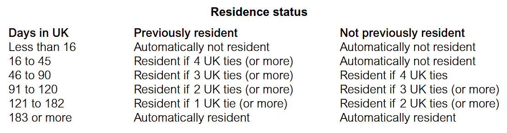

::: {.center data-latex=""}
```{mermaid}
%%| fig-width: 6
%%| fig-align: center
flowchart TD
    %% Main Node
    A([INCOME TAX<br>ADDITIONAL ASPECTS])

    %% First Level Sub-Nodes
    B([RESIDENCE])
    C([RELIEFS AND<br>ALLOWANCES])
    D([CHILD BENEFIT<br>TAX CHARGE])
    E([Individual Savings Accounts<br>ISAs])
    F([ACCRUED<br>INCOME SCHEME])

    %% Second Level Sub-Node
    G([SPOUSE/CIVIL<br>PARTNER<br>PLANNING])

    %% Connections
    A -.- B
    A -.- C
    A -.- D
    A -.- E
    A -.- F
    
    C -.- G

    %% Styling to mimic the rounded blue boxes
    style A fill:#fff,stroke:#1e3a8a,stroke-width:2px,color:#1e3a8a
    style B fill:#fff,stroke:#1e3a8a,stroke-width:2px,color:#1e3a8a
    style C fill:#fff,stroke:#1e3a8a,stroke-width:2px,color:#1e3a8a
    style D fill:#fff,stroke:#1e3a8a,stroke-width:2px,color:#1e3a8a
    style E fill:#fff,stroke:#1e3a8a,stroke-width:2px,color:#1e3a8a
    style F fill:#fff,stroke:#1e3a8a,stroke-width:2px,color:#1e3a8a
    style G fill:#fff,stroke:#1e3a8a,stroke-width:2px,color:#1e3a8a
```
::: 

# Tax status of an individual

The tax ***residency status*** of an individual determines how much income is assessed to UK tax. 

All persons resident in the UK for tax purposes are assessed to UK tax on their **worldwide income**.


## Definition of residence 

A person is UK resident in the tax year if the individual:

1. Does not meet one of the automatic non-UK residence tests, and
2. Meets one of the automatic UK residence tests, or
3. Meets one or more of the sufficient ties tests.  

These rules are complex in practice; however the examining team have confirmed that the following simplified rules are to be applied in the TX examination.


### Procedure to determine residence 

| Step   | Description                                                                 |
|--------|-----------------------------------------------------------------------------|
| Step 1 | **Check automatic non-UK residence tests** \newline - If satisfy one test = non-UK resident \newline - If not = go to Step 2 |
| Step 2 | **Check automatic UK residence tests** \newline - If satisfy one test = UK resident \newline - If not = go to Step 3 |
| Step 3 | **Determine how many sufficient ties with the UK exist**, and \newline **How many days are spent in the UK in the tax year**, then \newline **Use tax tables to decide status** |

The **order** of the procedure is important because it is possible for an individual to satisfy both one of the automatic non-UK residence tests and one of the automatic UK residence tests, If this is the case:

- the non-UK residence test takes priority and the decision is made at Step 1 
- there is no need to continue to Step 2.

### Automatic non-UK residency tests

An individual is automatically not UK resident if the individual is ‘in the UK’ in the tax year for less than:

- 16 days or 
- 46 days, and has not been UK resident in any of the previous three tax years or
- 91 days, and works full-time overseas. 

### Automatic UK residency tests 

An individual is automatically UK resident if:

- the individual is in the UK for at least 183 days in the tax year or
- the individual’s only home is in the UK or 
- the individual works full-time in the UK. 

Note that an individual is ‘in the UK’ if the individual is in the UK at *midnight*.

If the individual does not satisfy any of the automatic tests, the residency status is determined by: 

- how many of the five ‘sufficient ties tests’ are satisfied, and
- how many of the five ‘sufficient ties tests’ are satisfied, and

### Sufficient ties tests 

To determine whether or not the individual is sufficiently connected to the UK to be considered UK resident, HMRC look at the following five ties:

1. Family: Has close family (a spouse or civil partner or minor children) in the UK 
2. Accommodation: Has accommodation available in the UK which is made use of during the tax year 
3. Work: Does substantive work in the UK 
4. Days in UK: Has spent more than 90 days in the UK in either, or both, of the previous two tax years 
5. Country: Spends more time in the UK than in any other country in the tax year 

To determine the residency status of the individual, consideration is given to: 

| Days in the UK | Previously resident                                    | Not previously resident                                |
|----------------|--------------------------------------------------------|--------------------------------------------------------|
| Less than 16   | Automatically not resident                             | Automatically not resident                             |
| 16 to 45       | Resident if 4 UK ties (or more)                        | Automatically not resident                             |
| 46 to 90       | Resident if 3 UK ties (or more)                        | Resident if 4 UK ties                                  |
| 91 to 120      | Resident if 2 UK ties (or more)                        | Resident if 3 UK ties (or more)                        |
| 121 to 182     | Resident if 1 UK tie (or more)                         | Resident if 2 UK ties (or more)                        |
| 183 or more    | Automatically resident                                 | Automatically resident                                 |

> N: These rules make it more difficult for someone leaving the UK to lose UK residency status than it is for someone arriving in the UK to remain non-UK resident. 


```{mermaid}
%%| fig-width: 6
%%| padding: 2
flowchart TD
    %% Main Top Node
    A("RESIDENT IN UK?")

    %% Level 1 Categories
    B("Automatic<br><b>non-UK residency tests</b>")
    C("Automatic<br><b>UK residency tests</b>")
    D("<b>Sufficient ties tests</b>")

    %% Level 2 Detailed Boxes (Switched to standard rectangles [] for bulletproof text fitting)
    B_Detail["Individual in UK in <b>tax year</b> less<br>than<br>• <b>16 days</b> or<br>• <b>46 days</b> and not UK R for<br>  last 3 years or<br>• <b>91 days</b> and work FT abroad"]
    
    C_Detail["Individual automatically UK R if:<br>• In UK <b>183 days</b> in tax year or<br>• Only home in UK or<br>• Work FT in UK"]
    
    D_Detail["<b>1</b> Close family<br>   - Spouse/Civil partner/<br>     minor child<br><b>2</b> Accommodation in UK<br>   - used in tax year<br><b>3</b> Substantive work in UK<br><b>4</b> Days in UK in last two tax years<br>   - > 90 days in either year<br><b>5</b> Country tie<br>   - Most time spent in UK"]

    %% Level 3 Splits from Sufficient Ties
    subgraph  
    E["<b>Previously resident<br>in UK</b><br>= UK R in one of last 3 years<br><br>Consider <b>all five</b> ties"]
    F["<b>Not previously resident<br>in UK</b><br>= not UK R in any of last 3 years<br><br>Consider <b>first four</b> ties"]
    end
    
    %% Dotted Connections
    A -.- B
    A -.- C
    A -.- D

    B -.- B_Detail
    C -.- C_Detail
    D -.- D_Detail

    D_Detail -.- E
    D_Detail -.- F

    %% Styling to match the original blue theme
    style A fill:#fff,stroke:#1e3a8a,stroke-width:2px,color:#1e3a8a
    style B fill:#fff,stroke:#1e3a8a,stroke-width:2px,color:#1e3a8a
    style C fill:#fff,stroke:#1e3a8a,stroke-width:2px,color:#1e3a8a
    style D fill:#fff,stroke:#1e3a8a,stroke-width:2px,color:#1e3a8a
    style B_Detail fill:#fff,stroke:#1e3a8a,stroke-width:2px,color:#1e3a8a
    style C_Detail fill:#fff,stroke:#1e3a8a,stroke-width:2px,color:#1e3a8a
    style D_Detail fill:#fff,stroke:#1e3a8a,stroke-width:2px,color:#1e3a8a
    style E fill:#fff,stroke:#1e3a8a,stroke-width:2px,color:#1e3a8a
    style F fill:#fff,stroke:#1e3a8a,stroke-width:2px,color:#1e3a8a
```

> ***See Tax tables in exam***



```{python}
#| eval: false
#| include: false
def check_residency_status():
    print("--- UK Statutory Residence Test (SRT) Simulator ---")
    
    # ---------------------------------------------------------
    # 1. AUTOMATIC NON-UK RESIDENCY TESTS
    # ---------------------------------------------------------
    print("\n[Step 1] Checking Automatic Non-UK Residency Tests...")
    days_in_uk = int(input("How many days did the individual spend in the UK during the tax year? "))
    
    if days_in_uk < 16:
        return "Automatically Non-UK Resident (Less than 16 days in UK)"
        
    not_uk_r_last_3_years = input("Was the individual non-UK resident for ALL of the last 3 tax years? (yes/no): ").strip().lower() == 'yes'
    if days_in_uk < 46 and not_uk_r_last_3_years:
        return "Automatically Non-UK Resident (Less than 46 days and not resident in last 3 years)"
        
    work_ft_abroad = input("Did the individual work full-time abroad during the tax year? (yes/no): ").strip().lower() == 'yes'
    if days_in_uk < 91 and work_ft_abroad:
        return "Automatically Non-UK Resident (Less than 91 days and working full-time abroad)"

    # ---------------------------------------------------------
    # 2. AUTOMATIC UK RESIDENCY TESTS
    # ---------------------------------------------------------
    print("\n[Step 2] Checking Automatic UK Residency Tests...")
    if days_in_uk >= 183:
        return "Automatically UK Resident (183 or more days in the UK)"
        
    only_home_in_uk = input("Was the individual's only home in the UK? (yes/no): ").strip().lower() == 'yes'
    if only_home_in_uk:
        return "Automatically UK Resident (Only home in the UK)"
        
    work_ft_uk = input("Did the individual work full-time in the UK? (yes/no): ").strip().lower() == 'yes'
    if work_ft_uk:
        return "Automatically UK Resident (Working full-time in the UK)"

    # ---------------------------------------------------------
    # 3. SUFFICIENT TIES TESTS
    # ---------------------------------------------------------
    print("\n[Step 3] Checking Sufficient Ties Tests...")
    previously_resident = input("Was the individual resident in the UK in any of the last 3 tax years? (yes/no): ").strip().lower() == 'yes'
    
    # Counting the ties
    ties_count = 0
    
    # Tie 1: Family
    if input("1. Do they have close family (Spouse/Civil partner/minor child) in the UK? (yes/no): ").strip().lower() == 'yes':
        ties_count += 1
        
    # Tie 2: Accommodation
    if input("2. Did they have accommodation available in the UK used during the tax year? (yes/no): ").strip().lower() == 'yes':
        ties_count += 1
        
    # Tie 3: Substantive Work
    if input("3. Did they do substantive work in the UK? (yes/no): ").strip().lower() == 'yes':
        ties_count += 1
        
    # Tie 4: 90-Day Tie
    if input("4. Did they spend > 90 days in the UK in either of the last two tax years? (yes/no): ").strip().lower() == 'yes':
        ties_count += 1
        
    # Tie 5: Country Tie (Only evaluated if previously resident)
    if previously_resident:
        if input("5. Did they spend more time in the UK than in any other country? (yes/no): ").strip().lower() == 'yes':
            ties_count += 1
            
    print(f"\nResulting Ties Counted: {ties_count}")
    if previously_resident:
        print("Status: Previously Resident (Consider all 5 ties)")
    else:
        print("Status: Not Previously Resident (Consider first 4 ties)")
        
    return f"Sufficient Ties evaluated. Refer to the exam tax tables using {ties_count} ties for {days_in_uk} days."

# Run the simulator
if __name__ == "__main__":
    result = check_residency_status()
    print(f"\n>>> FINAL DETERMINATION: {result} <<<")
```


