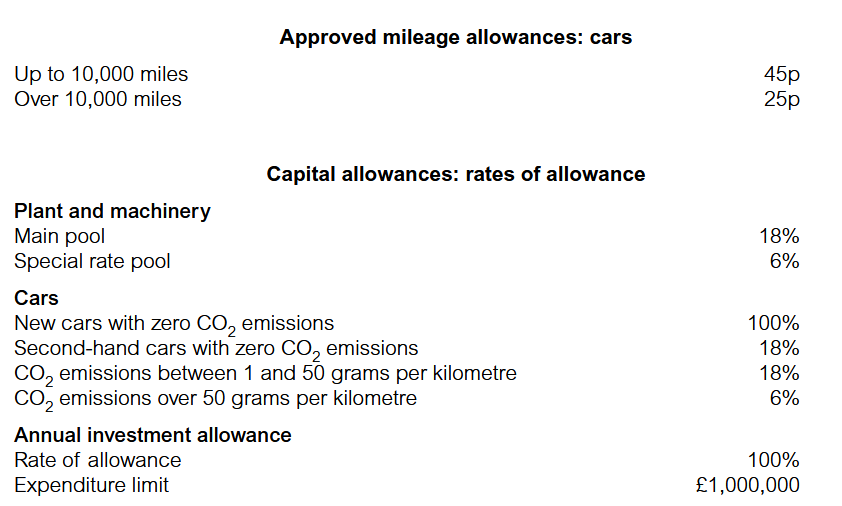
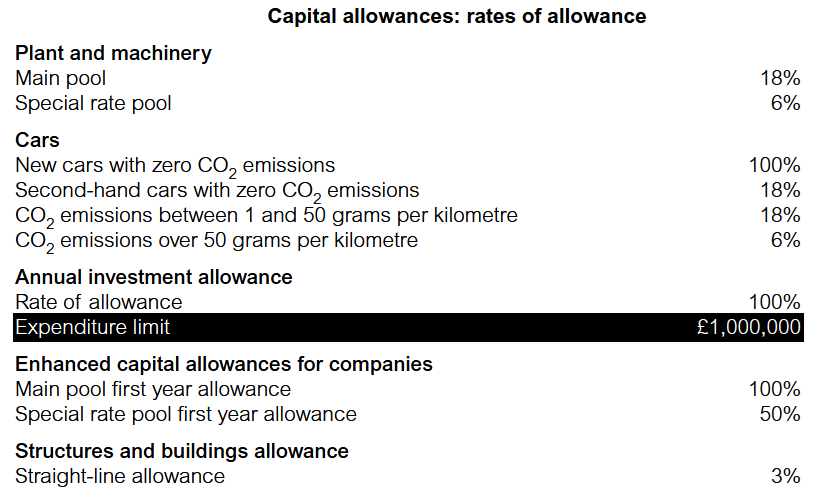
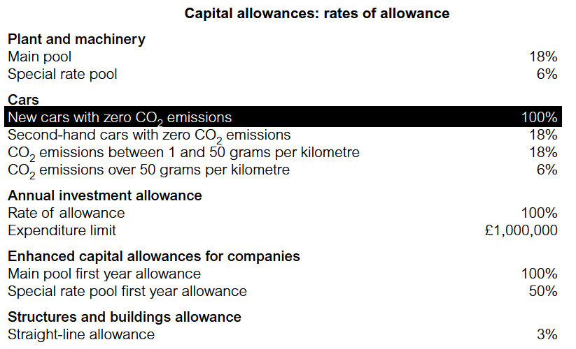
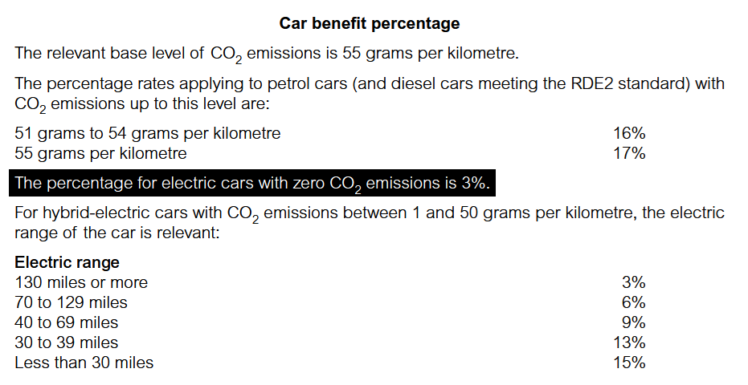
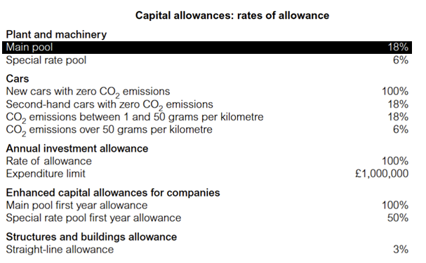
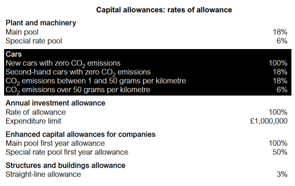

# Capital allowances – plant and machinery 

## Purpose, Qualifying assets, Qualifying expenditure  and Relief

### Purpose of capital allowances 

Capital allowances are provided ***to give a business tax relief*** for capital expenditure on qualifying assets. 

Remember that depreciation charged in the accounts is not allowable in computing tax adjusted trading profits; capital allowances are given instead. 

This chapter details the capital allowances available for expenditure on plant and machinery followed by expenditure on qualifying structures and buildings. 

### Qualifying assets (Who may claim capital allowances?)

Capital allowances are available **to persons who buy qualifying assets** (i.e. plant and machinery for use in a trade or profession) and elect to be taxed on the ***accruals basis***.

In the TX examination, unincorporated businesses using the cash basis generally cannot claim capital allowances (Chapter 7).            
However, an exception exists for cars; businesses using the cash basis can claim capital allowances on cars, if they *choose not* to use HMRC’s ***AMAP rates***.  All rules relating to cars covered in this chapter will apply in such cases. 

Capital allowances are ***available to both unincorporated businesses and companies***. However, there are some differences in the rules for calculating capital allowances for companies, which are covered in Chapter 13.  

### Qualifying expenditure 

Capital allowances are given on the original cost of a capital asset ***and all subsequent qualifying expenditure*** of a capital nature (e.g. improvements).  

### Relief for capital allowances 

**Capital allowances** are: 

- an allowable deduction in calculating the ***tax adjusted trading profit***. 
- calculated for a trader’s period of account (i.e. the period for which they prepare accounts).

## Plant and machinery Definition and Key principles 

### Definition of plant and machinery 
 
‘Machinery’ has a commonly understood meaning. It includes all machines, computers, office equipment, etc.                     
The term ‘plant’ however, is not clearly defined in the tax legislation.                           
HMRC has however codified some rules based on decided court cases and has specifically deemed certain types of expenditure to be plant and machinery. 

### Key principles 

The key principle to apply in deciding the appropriate treatment of a capital purchase is to consider ***the function that the asset performs*** for the business: 

| Does the asset perform: | This means that the asset is: | Plant and machinery? |
|-------------------------|-------------------------------|----------------------|
| An active function      | Apparatus with which the business is carried on | Yes    |
| A passive function      | The setting in which the business is carried on | No     |

#### Assets deemed to be plant 

There are certain types of expenditure that, although not plant using the above key principle, are treated as plant by specific legislation. 
These include: 

- the **cost of alterations** to buildings needed for the installation of plant 
- expenditure on acquiring **computer software**. 

#### Assets deemed not to be plant 

Statute also makes it clear that land, buildings and structures cannot be plant for capital allowance purposes. There is a separate allowance available for qualifying buildings and structures, detail is provided in section 13. 

#### Summary 

Determining what is and what is not plant can be difficult in practice. In the examination the most common examples of plant and machinery are: 

- computers and software 
- machinery 
- cars and lorries 
- office furniture 
- movable partitions 
- air conditioning 
- alterations of buildings needed to install plant and machinery.

#### Calculating the allowances 

The main pool (or general pool) 

Generally, expenditure on plant and machinery ***becomes part of a pool of expenditure*** upon which capital allowances are claimed. Normally capital allowances are not calculated on individual assets. 

- Most items of plant and machinery purchased are included within the main pool (also known as the ***general pool***). 
- Some cars are also included in the main pool at purchase, namely: 

    - All cars with CO2 emissions between 1g/km and 50g/km 
    - Second-hand cars with zero CO2 emissions  

- When an asset is acquired, the purchase price increases the value of the pool. 
- When an asset is disposed of, the pool value is reduced ***by the lower of sale proceeds and original cost***.

Certain items are not included in the main pool. For unincorporated businesses, they are: 

- **new** zero CO2 emission cars  
- new or second-hand cars with CO2 emissions in **excess of 50g/km** 
- assets that are used partly for private purposes by the owner of the business 
- expenditure incurred on short life assets where an **election to de-pool** is made 
- expenditure incurred on items that form part of the ***special rate pool***. 

These exceptions are dealt with later in this chapter. The next few sections go through the different elements, and detailed rules, for calculating the allowances on different types of plant and machinery. A step-by step approach is explained, building up to a full capital allowances pro forma for a sole trader.

It is very important that this standard layout is used for ***capital allowance computations in section C*** questions of the examination. 

### The annual investment allowance (AIA) 

The ***annual investment allowance (AIA) is a 100% allowance for the first £1,000,000*** of expenditure incurred by a business in a 12-month period on plant and machinery.

The key rules for the allowance are as follows: 

- available to all businesses. 
- available on acquisitions of plant and machinery in the main pool and acquisitions of special rate pool items.
- not available on cars. 
- limited to a maximum of £1,000,000 expenditure incurred in each 12 month period of account. 
- for long and short periods of account the maximum allowance is ***increased/reduced to reflect the length of the period***. 
- not available in the period of account in which trade ceases. 

Where a business spends more than £1,000,000 in a 12-month period of account on assets qualifying for the AIA: 

- the expenditure above the £1,000,000 limit qualifies for ***writing down allowances*** (WDA) (covered later).

Note also that: 

- taxpayers do not have to claim all/any of the AIA if they do not want to. 
- any unused AIA cannot be carried forward or carried back, the benefit of the allowance is just lost.  

The AIA maximum amount of £1,000,000 is included in the tax rates and allowances provided to you in the examination. 

#### Example 1: AIA

Matthew commenced trading on 1 January 2026 and ***elected to use the accruals basis***. In his first year of trading, he made the following purchases:

| Asset                                 | £         |
|---------------------------------------|-----------|
| Plant and machinery                   | 1,060,000 |
| Office furniture and equipment        | 170,000   |
| A new car with CO₂ emissions of 45g/km for the use of his manager | 11,000    |

(a) Calculate Matthew’s **AIA** for the year ended 31 December 2026 and the **balance on the main pool** after deducting the AIA.

(b) Prepare the same calculations but this time ***assuming Matthew did not purchase the plant and machinery***.

**Solution**

(A) Y/e 31 December 2026

|                                         | £            | Main pool (£) |
|-----------------------------------------|--------------|---------------|
| **Additions**                           |               |               |
| **Not qualifying for AIA:**             |               |               |
| Car (CO₂ between 1 – 50g/km)            |               | 11,000        |
| **Qualifying for AIA:**                 |               |               |
| Plant and machinery                     | 1,060,000     |               |
| Office furniture and equipment          | 170,000       |               |
| **Total AIA qualifying additions**      | **1,230,000** |               |
| AIA (Maximum)                           | (1,000,000)   |               |
|                                         | **230,000**   | 230,000       |
| **Balance after AIA (Note 1)**          |               | **241,000**   |

(B) If Matthew did not purchase the plant and machinery 

|                                         | £            | Main pool (£) |
|-----------------------------------------|--------------|---------------|
| **Additions**                           |               |               |
| **Not qualifying for AIA:**             |               |               |
| Car (CO₂ between 1 – 50g/km)            |               | 11,000        |
| **Qualifying for AIA:**                 |               |               |
| Office furniture and equipment          | 170,000       |               |
| **Total AIA qualifying additions**      | **170,000**   |               |
| AIA (Maximum: 1,000,000)                |  (170,000)    |               |
|                                         | **0**         |       0       |
| **Balance after AIA (Note 1)**          |               | **11,000**    |

> The balance after AIA on the main pool is eligible for a writing down allowance (WDA)

> The unused AIA of £830,000 (£1,000,000 – £170,000) is lost. 

#### First year allowances (FYA) – New zero-emission cars 

The AIA is not available on cars, however a ***100% first year allowance (FYA)*** is available on the purchase of new zero CO2 emission cars. 

The zero CO2 emission limit and 100% first year allowance are included in the tax rates and allowances provided to you in the examination. The 100% FYA is given as follows: 

- In the period of acquisition, a 100% FYA is given instead of the WDA,                          
(i.e. a business cannot have both the FYA and WDA in the first year). 
- Unlike the AIA and WDA, the ***FYA is never time apportioned*** for periods of account ***greater or less than 12 months***. 
- The taxpayer does not have to utilise all/any of the FYA. 
- If the FYA is **not used** at all, **the WDA is available**. 
- However, if the FYA is only **partially used**, the remaining cost **goes into the main pool** but is not entitled to any other allowance in that first year. 
- FYAs are not given in the final period of trading. 
- If the zero-emission car is not new (i.e. second-hand) it is treated in the same way as a car with CO2 emissions of between 1 – 50g/km, so the cost is added to the main pool and no FYA or AIA is available. 

Refer to section 6 for more detail on other types of car. Because new cars with zero CO2 emissions qualify for a 100% first year allowance the FYA is effectively a full tax-allowable deduction of the cost of the car in the year of its purchase.   

Providing zero-emission cars for employees’ private use is highly tax efficient for both employees and employers, especially for company directors who are 100% shareholders.                         

Employees face minimal income tax implications because only a 3% car benefit percentage applies. Similarly, employers pay low class 1A national insurance contributions. 

#### Writing down allowances (WDA) 

- An annual WDA of 18% is given on a reducing balance basis in the main pool. 

:::{.callout-important}

It is given on: 

- the unrelieved expenditure in the main pool brought forward at the beginning of the period of account (i.e. tax written down value (TWDV)), plus  
- any additions on which the AIA or FYA is not available, plus 
- any additions not covered by the AIA (i.e. exceeding the limit) after taking account of disposals. 

> The tax written down value brought forward includes all prior expenditure added to the main pool, less allowances already claimed. 

:::

The 18% WDA is included in the tax rates and allowances provided to you in the examination. 

#### Computations 

In the TX examination you will normally do computations for one period of account only. However, for tutorial purposes, the illustrations in this chapter may cover multiple accounting periods to enable you to practise the technique.          

In all questions you should assume that the tax year 2025/26 rules apply throughout. 

#### Example 2: Writing down allowances

Calculate the **total capital allowances** available to Matthew in Example 1: AIA part (a).

**Solution**

| y/e 31 December 2026                                  | AIA '1M'       |Main @ 18%         | Allowances (£)          |
|-------------------------------------------------------|----------------|-------------------|-------------------------|
| **Additions:**                                        |                |                   |                         |
| -   **Not qualifying for AIA or FYA:-**               |                |                   |                         |
| Car (CO₂ between 1 – 50g/km)                          |                | 11,000            |                         |
| - **Qualifying for AIA:-**                            |                |                   |                         |
| Plant and machinery                                   |  1,060,000     |                   |                         |
| Office furniture and equipment                        |  170,000       |                   |                         |
| **Total qualifying for AIA**                          |  **1,230,000** |                   |                         |
| AIA (Maximum)                                         |  (1,000,000)   |                   | 1,000,000               |
| **Balance after AIA**                                 |  230,000       | 230,000           |                         |
| WDA @ 18%                                             |                | (43,380)          | 43,380                  |
| **TWDV c/f**                                          |                | **197,620**       |                         |
| **Total allowances**                                  |                |                   | **1,043,380**           |

#### Example 3: Writing down allowances (WDA)

Grace commenced trading on 1 January 2026 and elected to use the **accruals basis**. Her trading profits, adjusted for tax purposes but before capital allowances, are as follows:

| Trading profits           |               |
|---------------------------|---------------|
|Year ended 31 December 2026| £1,520,770    |
|Year ended 31 December 2027| £1,525,000    |

On 9 May 2026, she bought **plant and machinery for £1,250,000**, a **second-hand car with CO2 emissions of 43g/km for £6,500** and a ***new zero-emission car for £13,600***. 

Calculate Grace's ***tax adjusted trading profit for both years***.                 
Assume the tax year 2025/26 rules apply throughout.

**Solution**

| Trading profits           | Calculation              |After Allowance |
|---------------------------|--------------------------|----------------|
|Year ended 31 December 2026| (1,520,770 - 1,059,770)  | **461,000**    |
|Year ended 31 December 2027| (1,525,000 - 37,859)     | **1,487,141**  |

| y/e 31 December 2026                                  | AIA '1M'       | Main @ 18%        | Allowances (£)     |
|-------------------------------------------------------|----------------|-------------------|--------------------|
| **Additions:**                                        |                |                   |                    |
| -   **Not qualifying for AIA or FYA:-**               |                |                   |                    |
| Car (CO₂ between 1 – 50g/km)                          |                | 6,500             |                    |
| - **Qualifying for AIA:-**                            |                |                   |                    |
| Plant and machinery                                   |  1,250,000     |                   |                    |
| **Total qualifying for AIA**                          |  **1,250,000** |                   |                    |
| AIA (Maximum)                                         |  (1,000,000)   |                   | 1,000,000          |
| **Balance after AIA**                                 |                | 250,000           |                    |
| **WDA @ 18%**  ((6,500 + 250,000) * 18%)              |                | (46,170)          | 46,170             |
| - **Qualifying for FYA:-**                            |                |                   |                    |
| New zero-emission car                                 |  13,600        |                   |                    |
| **FYA @ 100%**                                        | (13,600)       |                   | 13,600             |
| **TWDV c/f**                                          |                | **210,330**       |                    |
| **Total allowances**                                  |                |                   | **1,059,770**      |

| y/e 31 December 2027                                  | AIA '1M'       |Main @ 18%         | Allowances (£)       |
|-------------------------------------------------------|----------------|-------------------|--------------------|
| **TWDV b/f @ December 2026**                          |                | **210,330**       |                      |
| **WDA @ 18%**  (210,330 * 18%)                        |                | (37,859)          | 37,859               |
| **TWDV c/f @ December 2027**                          |                | **172,471**       |                      |
| **Total allowances**                                  |                |                   | **37,859**           |

#### Example 4: Writing down allowances (WDA)

Ginevra commenced trading on 6 April 2025 and elected to use the **accruals basis**. Her trading profits, adjusted for tax purposes but before capital allowances, are as follows:

| Trading profits           |               |
|---------------------------|---------------|
|Year ended 31 December 2026| £1,595,740    |
|Year ended 31 December 2027| £1,600,000    |

On 1 May 2025, Ginevra acquired plant and machinery for £1,203,000, a new car with CO2 emissions of 48g/km for £10,000 and a new zero emission car for £11,100. 

Calculate Ginevra’s tax adjusted trading profit for both years.         
Assume the tax year 2025/26 rules apply throughout. 

**Solution**

| Trading profits           | Calculation              |After Allowance |
|---------------------------|--------------------------|----------------|
|Year ended 31 December 2026| (1,595,740 - 1,049,440)  | **546,300**    |
|Year ended 31 December 2027| (1,600,000 - 31,439)     | **1,568,561**  |

| y/e 31 December 2026                                  | AIA '1M'       | Main @ 18%        | Allowances (£)     |
|-------------------------------------------------------|----------------|-------------------|--------------------|
| **Additions:**                                        |                |                   |                    |
| -   **Not qualifying for AIA or FYA:-**               |                |                   |                    |
| Car (CO₂ between 1 – 48g/km)                          |                | 10,000            |                    |
| - **Qualifying for AIA:-**                            |                |                   |                    |
| Plant and machinery                                   |  1,203,000     |                   |                    |
| **Total qualifying for AIA**                          |  **1,203,000** |                   |                    |
| AIA (Maximum)                                         |  (1,000,000)   |                   | 1,000,000          |
| AIA Excess --> Main pool                              |                | 203,000           |                    |
| **Balance after AIA**                                 |                | 213,000           |                    |
| **WDA @ 18%**  ((6,500 + 250,000) * 18%)              |                | (38,340)          | 38,340             |
| - **Qualifying for FYA:-**                            |                |                   |                    |
| New zero-emission car                                 |  11,100        |                   |                    |
| **FYA @ 100%**                                        | (11,100)       |                   | 11,100             |
| **TWDV c/f**                                          |                | **174,660**       |                    |
| **Total allowances**                                  |                |                   | **1,049,440**      |

| y/e 31 December 2027                                  | AIA '1M'       |Main @ 18%         | Allowances (£)     |
|-------------------------------------------------------|----------------|-------------------|--------------------|
| **TWDV b/f @ December 2026**                          |                | **174,660**       |                    |
| **WDA @ 18%**                                         |                | (31,439)          | 31,439             |
| **TWDV c/f @ December 2027**                          |                | **143,221**       |                    |
| **Total allowances**                                  |                |                   | **31,439**         |

#### Short or long periods of account

- The AIA and WDAs are given for periods of account (i.e. the period for which a trader prepares accounts). The £1,000,000 maximum AIA and the WDA percentage of 18% are based on a period of account of 12 months. 
- Shorter or longer periods of account result in the AIA and WDA being reduced/increased to reflect the length of the period of account. 
- If the period of account exceeds 18 months, then it must be split into two capital allowance computations – a 12-month period and a second period to deal with the remaining months. The total allowances are then deducted from the tax adjusted profits of the long period.  
- The most common occasion for a business not having a 12-month period of account is at the start of trading. 
- Remember that FYAs are never adjusted to reflect the length of the period of account.

#### Example 5: WDA: Long period of account

Yoltzin commenced trading on 1 April 2025 and elected to use the **accruals basis**. They prepared accounts for the *14-month period ended 31 May 2026* **and** *the year ended 31 May 2027*. 

On 1 June 2025, they bought plant and machinery for £1,100,000, a new car with CO2 emissions of 46g/km for £19,800 and a new zero emission car for £13,000. 

Calculate Yoltzin’s capital allowances for each of the periods of trading.                      
Assume the tax year 2025/26 rules apply throughout.

**Solution**

Because this accounting period is longer than 12 months, both the Annual Investment Allowance (AIA) limit and the Writing Down Allowance (WDA) rate must be proportionally **scaled up** by $\frac{14}{12}$.

| ***14-month period ended 31 May 2026***               | AIA '1M'       | Main @ 18%        | Allowances (£)     |
|-------------------------------------------------------|----------------|-------------------|--------------------|
| **Additions:**                                        |                |                   |                    |
| -   **Not qualifying for AIA or FYA:-**               |                |                   |                    |
| Car (CO₂ between 1 – 46g/km)                          |                | 19,800            |                    |
| - **Qualifying for AIA:-**                            |                |                   |                    |
| Plant and machinery                                   |  1,100,000     |                   |                    |
| **Total qualifying for AIA**                          |  **1,100,000** |                   |                    |
| AIA (Scaled up) W1 *'1M * 14/12'*                     |  (1,100,000)   |                   | 1,100,000          |
| **Balance after AIA**                                 |                | **19,800**        |                    |
| **WDA @ 21%** (Scaled up) W2 *'18% * 14/12'*          |                | (4,158)           | 4,158              |
| - **Qualifying for FYA:-**                            |                |                   |                    |
| New zero-emission car                                 |  13,000        |                   |                    |
| **FYA @ 100%**                                        | (13,000)       |                   | 13,000             |
| **TWDV c/f**                                          |                | **15,642**        |                    |
| **Total allowances**                                  |                |                   | **1,117,158**      |

| ***31 May 2027***               | AIA '1M'       | Main @ 18%        | Allowances (£)     |
|-------------------------------------------------------|----------------|-------------------|--------------------|
| **TWDV b/f**                                          |                | **15,642**        |                    |
| **WDA @ 18%** (Scaled up) W2 *'18% * 14/12'*          |                | (2,816)           | 2,816              |
| **Total allowances**                                  |                |                   | **2,816**      |

::: {.columns}

::: {.column width="45%"}
***W1: AIA Maximum Limit Scaled Up***                         
AIA Maximum Limit: $£1,000,000 \times \frac{14}{12} = £1,166,667$. The $£1,100,000$ plant purchase is fully covered.

:::

::: {.column width="5%"}

:::

::: {.column width="45%"}

***W2: Pro-rata WDA Rate*** 
$18\% \times \frac{14}{12} = \mathbf{21\%}$.

:::

:::

> FYAs are never adjusted to reflect the length of the period. 

#### Example 6: WDA: Long period of account

Graham commenced trading on 1 May 2025 and elected to use the *accruals basis*. He prepared accounts for the **4-month period** ended 31 August 2025 and then the year ended 31 August 2026. 

On 1 May 2025, he bought plant and machinery for £470,000, a *used car with zero CO2 emissions for £11,500* and a new zero-emission car for £16,500. 

Calculate the **capital allowances** for each period of trading.                 
Assume the tax year 2025/26 rules apply throughout. 

**Solution**

| ***4-month period 31 August 2025***                   | AIA '1M'       | Main @ 18%        | Allowances (£)     |
|-------------------------------------------------------|----------------|-------------------|--------------------|
| **Additions:**                                        |                |                   |                    |
| -   **Not qualifying for AIA or FYA:-**               |                |                   |                    |
| Car (CO₂ between 1 – 46g/km)                          |                | 11,500            |                    |
| - **Qualifying for AIA:-**                            |                |                   |                    |
| Plant and machinery                                   |  470,000       |                   |                    |
| **Total qualifying for AIA**                          |  **470,000**   |                   |                    |
| AIA (Pro-rate) W1 *'1M * 4/12'*                       |  (333,333)     |                   | 333,333            |
|                                                       |                | 136,667           |                    |
| **Balance after AIA**                                 |                | **148,167**       |                    |
| **WDA @ 6%** (Pro-rate) W2 *'6% * 4/12'*              |                | (8,890)           | 8,890              |
| - **Qualifying for FYA:-**                            |                |                   |                    |
| New zero-emission car                                 |  16,500        |                   |                    |
| **FYA @ 100%**                                        | (16,500)       |                   | 16,500             |
| **TWDV c/f**                                          |                | **139,277**       |                    |
| **Total allowances**                                  |                |                   | **358,723**        |

 

::: {.columns}

::: {.column width="45%"}

***W1: AIA Maximum Limit Scaled Down***                           
$£1,000,000 \times \frac{4}{12} = \mathbf{£333,333}$

:::

::: {.column width="5%"}

:::

::: {.column width="45%"}
***W2: Pro-rata WDA Rate***                                                      
$18\% \times \frac{4}{12} = \mathbf{6\%}$

:::

:::

 

| ***y/e 31 August 2025***                              | AIA '1M'       | Main @ 18%        | Allowances (£)     |
|-------------------------------------------------------|----------------|-------------------|--------------------|
| **TWDV b/f**                                          |                | **139,277**       |                    |
| **WDA @ 18%**                                         |                | (25,070)          | 25,070             |
| - **Qualifying for FYA:-**                            |                |                   |                    |
| New zero-emission car                                 |  16,500        |                   |                    |
| **FYA @ 100%**                                        | (16,500)       |                   |                    |
| **TWDV c/f**                                          |                | **139,277**       |                    |
| **Total allowances**                                  |                |                   | **25,070**         |

#### Length of ownership in the period of account 

It is important to distinguish between the length of the period of account and the length of ownership of the asset during the period: The WDA is applied proportionally according to the length of the period of account. 

- The WDA is never restricted by reference to the length of ownership of an asset in the period of account. 
- If a business prepares accounts for the year ended 31 March 2026, the same WDA is given whether an asset is purchased on 10 April 2025 or on 31 March 2026.       

> The WDA is available provided the asset is owned on the last day of the period of account. The actual length of ownership of the asset during theperiod of account is not relevant.

## Sale of plant and machinery 

When an asset is sold or scrapped the following steps are taken. 

- The **disposal value** (lower of sale proceeds and original cost) is deducted from the total of:

::: {.columns}

::: {.column width="45%"}

The tax written down value brought forward on the pool plus --->>

:::

::: {.column width="5%"}

:::

::: {.column width="45%"}

Additions to the pool 

- additions not qualifying for either the AIA or FYA, and 
- additions qualifying for but not covered by AIA. 

:::

:::

> The WDA for this period is then calculated on the **remaining figure**. 

If ***sale proceeds exceed the original cost*** of the asset: 

- the disposal value deducted from the pool is ***restricted to the original cost*** of the asset. 

> Note that any excess of sale proceeds over original cost may then be taxed as a **chargeable gain** (Chapter 17). 

Therefore, on a disposal, always deduct from the correct pool the lower of:  

- the sale proceeds, and – 
- the original cost. 

- If an asset is disposed of ***through part exchange***, the disposal needs to be recognised for capital allowances purposes. The part exchange allowance should be ***treated as the proceeds for the asset disposed of***, and also added to the cash acquisition cost of the new asset. 

#### Example 1: Sale of plant and machinery

Gustav prepares accounts to 31 May and elects to use the accruals basis. In the year to 31 May 2026, the following transactions took place: 

| Transactions       |                      |
|--------------------|----------------------|
| 5 June 2025        | Plant sold for £1,200 (purchased for £8,000) |
| 3 September 2025   | Plant purchased for £204,000 |

Compute the capital allowances for the year ended 31 May 2026, assuming that the TWDV on 1 June 2025 was **£10,000**.     
Assume the tax year 2025/26 rules apply throughout. 

**Solution**

| y/e 31 May 2026                                       | AIA '1M'       | Main @ 18%        | Allowances (£)     |
|-------------------------------------------------------|----------------|-------------------|--------------------|
| **TWDV b/f**                                          |                | 10,000            |                    |
| - **Qualifying for AIA:-**                            |                |                   |                    |
| Plant and machinery                                   |  204,000       |                   |                    |
| **Total qualifying for AIA**                          |  **204,000**   |                   |                    |
| AIA (Maximum = 1M)                                    |  (204,000)     |                   | 204,000            |
| **Balance after AIA**                                 |                |  **10,000**       |                    |
| Disposal (lower of cost and SP)                       |                | (1,200)           |                    |
| **WDA @ 18%**  ((10,000 - 1,200) * 18%)               |                |  (1,584)          | 1,584              |
| **TWDV c/f**                                          |                | **7,216**         |                    |
| **Total allowances**                                  |                |                   | **205,584**        |

#### Example 2: Sale of plant and machinery

Gloria has owned and run her own business for many years and uses the **accruals basis**. She prepares accounts to 30 June each year. During the year ended 30 June 2026, the following transactions took place: 

| Transactions       |                      |
|--------------------|----------------------|
| 21 June 2025       | Purchased a car with CO2 emissions of 42g/km for £24,000. |
| 14 August 2025     | Sold a piece of plant for £12,400. She had paid £15,000 for this when she acquired it.  |
| 31 October 2025    | Sold a van for £700. She had paid £600 for this when she acquired it.  |
| 19 November 2025   | Purchased plant for £184,500. |

The TWDV at 1 July 2025 was **£21,000**.                

Compute the capital allowances for the year ended 30 June 2026.              
Assume the tax year 2025/26 rules apply throughout. 

**Solution**

| y/e 30 June 2026                                      | AIA '1M'       | Main @ 18%        | Allowances (£)     |
|-------------------------------------------------------|----------------|-------------------|--------------------|
| **TWDV b/f**                                          |                | 21,000            |                    |
| - **Not Qualifying for AIA or FYA:-**                 |                |                   |                    |
| Car with CO2 emissions of 42g/km                      |                | 24,000            |                    |
| - **Qualifying for AIA:-**                            |                |                   |                    |
| Plant and machinery                                   |  184,500       |                   |                    |
| **Total qualifying for AIA**                          |  **184,500**   |                   |                    |
| AIA (Maximum = 1M)                                    |  (184,500)     |                   | 184,500            |
| Disposal Car (lower of cost and SP)                   |                | (12,400)          |                    |
| Disposal Van (lower of cost and SP)                   |                | (600)             |                    |
| **Balance after AIA and Disposal**                    |                |  **32,000**       |                    |
| **WDA @ 18%**  ((10,000 - 1,200) * 18%)               |                |  (5,760)          | 5,760              |
| **TWDV c/f**                                          |                | **9,020**         |                    |
| **Total allowances**                                  |                |                   | **190,260**        |

### Balancing charges 

The basic idea underlying capital allowances is that the business will over time obtain relief for the actual net cost of an asset to the business (i.e. cost less any sale proceeds). 

Initially the asset is put into the pool at its original cost. If, on disposal of an asset in the pool, sale proceeds exceed the balance brought forward: 

- the pool balance will become negative because allowances exceeding net cost have been claimed in the past 
- the negative amount = the excess allowances previously given 
- these will be recovered and charged to tax by means of a balancing charge (BC) 
- the BC reduces the capital allowances claim for the period 
- if there is an overall net BC, it is **added to** the tax adjusted trading profit.

#### Example 1: Balancing charges

Gun-woo has traded for many years as an ice cream manufacturer and uses the **accruals basis**. He prepares accounts to 30 June and during the year ended 30 June 2026 he made the following transactions:

| Transactions       |                      |
|--------------------|----------------------|
| 14 July 2025       | Sold some machinery for £12,100 which originally cost £26,000.  |
| 30 August 2025     | Purchased a new zero-emission car for £14,000.  |
| 16 March 2026      | Purchased some equipment for £23,500.  |

The TWDV at 1 July 2025 was **£11,000**. 

(a) Calculate Gun-woo’s capital allowances for the year ended 30 June 2026.                
(b) Explain what would have happened had Gun-woo made no additions in the year.                         
Assume the tax year 2025/26 rules apply throughout. 

**Solution**

***(A)***

| ***y/e 30 June 2026***                                | AIA '1M'       | Main @ 18%        | Allowances (£)     |
|-------------------------------------------------------|----------------|-------------------|--------------------|
| **TWDV b/f**                                          |                | **11,000**        |                    |
| - **Qualifying for AIA:-**                            |                |                   |                    |
| Plant and machinery                                   |  23,500        |                   |                    |
| **Total qualifying for AIA**                          |  **23,500**    |                   |                    |
| AIA                                                   |  (23,500)      |                   | 23,500             |
| **Less:** Disposal Sold machinery                     |                |  (12,100)         |                    |
| **Balance after AIA**                                 |                | **(1,100)**       | (1,100)            |
| **WDA @ 18%**                                         |                | (0)               |                    |
| - **Qualifying for FYA:-**                            |                |                   |                    |
| New zero-emission car                                 |  14,000        |                   |                    |
| **FYA @ 100%**                                        | (14,000)       |                   | 14,000             |
| **TWDV c/f**                                          |                | **0**             |                    |
| **Total allowances**                                  |                |                   | **36,400**         |

> Note: A balancing charge reduces the capital allowances claim in the period.

***(B)***

If Gun-woo had made no additions in the year No AIA or FYA would have been available and therefore only a balancing charge of £1,100 would arise. This would be ***added to Gun-woo’s tax adjusted trading profits for the year***. 

### Balancing allowances 

At cessation, if there is still a balance of unrelieved expenditure in the pool, a business can claim relief for the unrelieved balance by way of a balancing allowance (BA). 

- This is the only time a BA will arise in the main pool (or special rate pool). 
- The BA is the surplus of the pool balance at the end of the final period of account, after accounting for all disposal proceeds, including the ultimate disposal of plant and machinery.

### Cessation of trade

When the business is permanently discontinued, the AIA, WDA and FYA are ***not available in the final period*** of account. Therefore, in the period to cessation, a normal capital allowance computation is not prepared. Instead, these steps should be followed: 

1. Add in any additions made in the final period. 
2. Do not calculate any AIAs, WDAs or FYAs. 
3. Deduct any disposals made in the final period and any sale proceeds on the ultimate disposal of plant and machinery at cessation. 
4. Calculate a balancing charge (BC) or balancing allowance (BA) as appropriate. 
5. There should not be any balances carried forward at the end of trade.

### Example 1: Cessation of trade

Gene has previously prepared accounts to 31 March and uses the **accruals basis**. He decided to cease to trade on 31 December 2026, after a period of ill health. The following transactions have recently taken place:

| Transactions       |                      |
|--------------------|----------------------|
| 21.2.2026          | Plant sold for £320 (originally purchased for £2,000) |
| 10.9.2026          | Plant purchased for £4,000  |

On completion of the sale of his business, Gene received **£5,400** for his plant and machinery. *No item was sold for more than its original cost*.                  
The TWDV on 1 April 2025 was **£9,000**. 

Compute the **capital allowances** for the year ended 31 March 2026, and the period ended 31 December 2026.       
Assume the tax year 2025/26 rules apply throughout.

**Solution**

1. ***Year Ended 31 March 2026 (Normal Trading)***

The transactions on 21 February 2026 **fall within this period**. Gene can claim a standard 18% Writing Down Allowance (WDA) on the Main Pool.               
*'capital allowances y/e 31 March 2026 = 1,562 (WDA)'*

| Main Pool Calculation      | Amount (£) | Allowances (£) |
|----------------------------|------------|----------------|
| TWDV b/f (1 April 2025)    | 9,000      |                |
| Less: Disposal (21.2.2026) | (320)      |                |
|                            | 8,680      |                |
| Less: WDA @ 18%            | (1,562)    | 1,562 (WDA)    |
| TWDV c/f (31 March 2026)   | **7,118**  |                |
| **Total allowances**       |            | **1,562 (WDA)**|

2. ***Period Ended 31 December 2026 (Cessation Period)***

Because Gene permanently ceases trading on 31 December 2026, the regular capital allowance rules change:

* ***No Annual Investment Allowance (AIA)*** can be claimed on ***additions*** made during the final cessation period.
* ***No Writing Down Allowance (WDA) is calculated.***
* Instead, all pool balances and final sale proceeds ***are aggregated to trigger a Balancing Adjustment***.

*'capital/balancing allowances p/e 31 December 2026 = 5,718 (BA)'*

| Main Pool Calculation | Amount (£) | Allowances (£) |
|-----------------------|------------|----------------|
|TWDV b/f (1 April 2026)| **7,118**  |                |
| Add: Plant Purchase (10.9.2026) | 4,000 |           |
| Pre-cessation Balance | **11,118** |                |
| Less: Final Business Sale Proceeds | (5,400) |      |
| **Balancing Allowance**        | 0 | 5,718 (BA)     |

> There is no AIA, FYA or WDA available in the final period of account.

> A balancing allowance is treated as normal capital allowances, and is deducted from the tax adjusted trading profits. 

## Cars 

Remember that ***cars are the only type of asset eligible for capital allowances*** if the business uses the **cash basis**. Under the cash basis, the trader can either: 

- Claim capital allowances on the purchase cost of the car along with any **actual running costs** of the car, or 
- Claim the **AMAP rates** (Chapter 7).           

The treatment of cars depends on the CO2 emissions, as follows: 

| CO₂ emissions | Treatment in capital allowances computation: |
|---------------|------------------------------------------------|
| 0g/km         | If purchased new:   eligible for 100% FYA (section 3)   If purchased second-hand:   treat like a car with CO₂ emissions of 1 – 50g/km |
| 1 – 50g/km    | Included in the main pool as an addition not qualifying for AIA or FYA |
| > 50g/km      | Include in the ***special rate pool*** as an addition not qualifying for AIA or FYA  |

> The FYA and WDA percentages applicable to the different CO2 emissions are included in the rates and allowances provided to you in the examination.

:::{.callout-note}

Note however that: 

- Cars with an element of private use by the owner of the business, regardless of their level of emissions, are dealt with separately.                          
***Remember that the AIA is not available on any type of car.*** 

:::

### Example 1: Cars

Glenda prepares accounts to 31 March and uses the **accruals basis**. At 1 April 2025, the TWDV of the **main pool was £21,200**. The following transactions took place during the two years ended 31 March 2027: 

| Transactions  |                                                |
|---------------|------------------------------------------------|
| 25.4.25       | Purchased a car with CO2 emissions of 49g/km for £20,600  |
| 11.6.26       | Purchased plant and machinery for £11,000                 |
| 15.8.26       | Sold equipment for £9,400 (originally purchased for £15,000)|

Calculate the **capital allowances** for the *two years to 31 March 2027*.               
Assume the tax year 2025/26 rules apply throughout.  

**Solution** 

1. **Year Ended 31 March 2026**

The car purchased on 25 April 2025 has CO2 emissions of **49g/km**, which falls into the 1–50g/km range. Under 2025/26 rules, it does not qualify for the Annual Investment Allowance (AIA) but is placed *directly into the Main Pool to receive a standard 18% Writing Down Allowance (WDA)*.

| Main Pool Calculation | Amount (£) | Allowances (£) |
|-----------------------|------------|----------------|
|TWDV b/f (1 April 2025)| 21,200     |                | 
| Add: Car purchase (25.4.25) | 20,600 |              |
|                       | 41,800     |                |
| Less: WDA @ 18%       | (7,524)    | 7,524 (WDA)    |
| TWDV c/f (31 March 2026) | 34,276  |                |
| **Total allowances**  |            | **7,524 (WDA)**|

*'Total Allowances (WDA) for 2026 =  £7,524'*

2. **Year Ended 31 March 2027**

The plant and machinery addition qualifies for AIA up to the £1,000,000 limit.

| Main Pool & AIA Calculation | Amount (£) | Allowances (£) |
|-----------------------------|------------|----------------|
| TWDV b/f (1 April 2026)     | 34,276     |                |
| **Qualifying for AIA**      |            |                |
| **Add:** Plant & Machinery (11.6.26) | 11,000 |           |
| **Less:** AIA @ 100%        | (11,000)   | 11,000 (AIA)   |
| **Less:** Equipment Disposal (15.8.26) | (9,400) |        |
|                             | **24,876**     |            |
| Less: WDA @ 18%             | (4,478)    | 4,478 (WDA)    |
| TWDV c/f (31 March 2027)    | 20,398     |                |
| **Total allowances**        |      | **15,478 (AIA, WDA)**|

### Example 2: Cars

Glen prepares accounts to 31 December and uses the accruals basis. At 1 January 2026, the TWDV of the main pool was **£48,100**.                                       
Transactions during the year ended 31 December 2026 were: 

| Transactions  |                                                |
|---------------|------------------------------------------------|
| 10.5.26       | Purchased plant for £1,003,300                 |
| 25.6.26       | Purchased two new cars, one with CO2 emissions of 44g/km for £18,600 and one with zero CO2 emissions for £13,000 |
| 18.11.26      | Sold plant for £4,600 (originally purchased for £9,500) |

**Solution**

|                                       | AIA        | Main pool (£)| Allowances (£)|
|---------------------------------------|------------|--------------|---------------|
| **TWDV b/f**                          |            | 48,100       |               |
| **Additions: Not qualifying for AIA:**|            |              |               |
| Car (CO₂ between 1 – 44g/km)          |            | 18,600       |               |
| Private use car                       |            |              |               |
| **Additions: Qualifying for AIA:**    |            |              |               |
| Plant and machinery                   | 1,003,300  |              |               |
| AIA                                   | (1,000,000)|              | 1,000,000     |
| AIA Excess ---> Main pool             |            | 3,300        |               |
| **Disposal (lower of cost and SP)**   |            | (4,600)      |               |
| **Balance before WDA**                |            | **65,400**   |               |
| **WDA @ 18%**                         |            | (11,772)     | 11,772        |
| New zero CO2 emissions car            | 13,000     |              |               |
| **FYA @ 100%**                        | (13,000)   |              | 13,000        |
| **TWDV c/f**                          |            | **18,204**   |               |
| **Total allowances**                  |            |              | **1,024,772** |

## Assets with private use by the owner of the business 

Where an asset is used by the owner of the business, *partly* for business and *partly* for private purposes: 

1. Only the **business proportion** of capital allowances are available for tax relief. 
2. The cost of the **privately used asset** is not brought into the main pool, but **must be the subject of a separate calculation, in its own column**. 
3. The AIA, FYA or WDA on the asset is ***based on its full cost but only the business proportion of any allowance is deductible*** in computing the taxable trading profit.                   
    Note that if applicable, the business can always choose the expenditure against which the AIA is allocated.    
    *It will therefore be most beneficial for the AIA to be allocated against main pool expenditure, rather than any private use asset, as only the business proportion of any AIA allocated can actually be claimed.* 
    However, note that in the examination, the assets most commonly used for private purposes are *cars*, which are not eligible for the AIA. 
4. Cars with private use are always treated separately regardless of their CO2 emissions. 
5. On disposal of the private use asset, a balancing adjustment is computed by comparing sale proceeds (SP) with the tax written down value (TWDV). 
6. There is a balancing charge (BC) if SP exceeds the TWDV, and a 
7. balancing allowance (BA) if SP are less than the TWDV. 
8. Having computed the balancing adjustment, the amount included in the total allowances column is reduced to the business proportion. 

Note that these rules only apply if there is private use by the **owner** of the business.             
Private use of an asset by an employee has no effect on the business owner’s entitlement to full capital allowances.

### Example 1: Assets with private use by the owner of the business 

Gleb runs a business preparing accounts to 5 April and uses the **accruals basis**. At 6 April 2025, the TWDV in the main pool was **£11,700**. The following transactions took place in the year ended 5 April 2026: 

- Purchased plant for £18,500 
- Purchased a car with CO2 emissions of 45g/km for £19,000 
- Sold some machinery for £8,500 (originally purchased for £18,000) 
- Purchased a car with CO2 emissions of 43g/km for £9,400 (*used **45%** for private purposes by Gleb*). 

Calculate the ***capital allowances*** for the year ended 5 April 2026. 

**Solution** 

Capital allowances computation – y/e 5 April 2026 

|                                       | AIA     | Main pool (£)| Private use car (£)| Business use %  |Allowances (£)|
|---------------------------------------|---------|--------------|--------------------|-----------------|-----------|
| **TWDV b/f**                          |         | 11,700       |                    |                 |           |
| **Additions: Not qualifying for AIA:**|         |              |                    |                 |           |
| Car (CO₂ between 1 – 50g/km)          |         | 19,000       |                    |                 |           |
| Private use car                       |         |              | 9,400              |                 |           |
| **Additions: Qualifying for AIA:**    |         |              |                    |                 |           |
| Plant and machinery                   | 18,500  |              |                    |                 |           |
| AIA                                   | (18,500)|              |                    |                 | 18,500    |
| **Disposal (lower of cost and SP)**   |         | (8,500)      |                    |                 |           |
| **Balance before WDA**                |         | **22,200**   |                    |                 |           |
| WDA @ 18%                             |         | (3,996)      |                    |                 | 3,996     |
| WDA @ 18%                             |         |              | (1,692)            | ( × 55%)        | 931       |
| **TWDV c/f**                          |         | **18,204**   | **7,708**          |                 |           |
| **Total allowances**                  |         |              |                    |                 | **23,427**|

> Note: The TWDV of the private use car is reduced by the full amount of the WDA, but only the business use proportion of the allowance can be claimed (i.e. deducted from trading profits).

### Example 2: Assets with private use by the owner of the business 

Georgina runs a small business, prepares accounts to 31 March and uses the *accruals basis*. At 1 April 2025, the TWDV in the main pool was **£21,200**. The following transactions took place during the year ended 31 March 2026: 

| Transactions  |                                                |
|---------------|------------------------------------------------|
| 10.5.25       | Purchased plant for £6,600                     |
| 25.6.25       | Purchased a car with CO2 emissions of 43g/km for £17,000|
| 15.2.26       | Sold some machinery for £9,400 (originally purchased for £12,000) |
| 16.2.26       | Purchased a car with CO2 emissions of 47g/km for £10,600 (used 40% for private purposes by Georgina) |
| 14.3.26       | Purchased a new car with zero CO2 emissions for £11,750 |

Calculate the **capital allowances** for the year ended 31 March 2026.  

**Solution**

|                                       | AIA     | Main pool (£)| Private use car (£)| Business use %  |Allowances (£)|
|---------------------------------------|---------|--------------|--------------------|-----------------|--------------|
| **TWDV b/f**                          |         | 21,200       |                    |                 |              |
| **Additions: Not qualifying for AIA:**|         |              |                    |                 |              |
| Car (CO₂ between 1 – 50g/km)          |         | 17,000       |                    |                 |              |
| Private use car                       |         |              | 10,600             |                 |              |
| **Additions: Qualifying for AIA:**    |         |              |                    |                 |              |
| Plant and machinery                   | 6,600   |              |                    |                 |              |
| AIA                                   | (6,600) |              |                    |                 | 6,600        |
| **Disposal (lower of cost and SP)**   |         | (9,400)      |                    |                 |              |
| **Balance before WDA**                |         | **28,800**   |                    |                 |              |
| WDA @ 18%                             |         | (5,184)      |                    |                 | 5,184        |
| WDA @ 18% '*Private use car*'         |         |              | (1,908)            | ( × 60%)        | 1,145        |
| Car with zero CO2 emissions           |         |  11,750      |                    |                 |              |
| FYA @ 100%                            |         | (11,750)     |                    |                 | 11,750       |
| **TWDV c/f**                          |         | **18,204**   | **8,692**          |                 |              |
| **Total allowances**                  |         |              |                    |                 | **24,679**   |

## Special rate pool

The ***special rate pool*** is a pool of qualifying expenditure that operates in the same way as the main pool except that: 

- the ***WDA is 6% for*** a 12-month period (rather than 18%). 
- The *6% WDA applicable to the special rate pool* is included in the tax rates and allowances provided to you in the examination. 

### Qualifying expenditure 

The *special rate pool* groups together expenditure incurred on the following types of asset: 

1. long life assets 
2. ‘integral features’ of a building or structure 
3. thermal insulation of a building 
4. high emission cars (with CO2 emissions of > 50g/km).

Long life assets are defined as plant and machinery with both: 

- a total cost of at least **£100,000** (for a 12-month period), and 
- an expected working life of **25 years** or more 

The 25-year working life is from the time that the asset is first brought into use, to the time that it ceases to be capable of being used. It is not sufficient to just consider the expected life in the hands of the current owner. 

Examples of this might include aircraft used by an airline, and agricultural equipment used by a farm. Where the business spends less than **£100,000** per year on long life assets, they are treated as **normal additions** to either the main or special rate pool, depending on the type of expenditure.  

The following can never be classed as long life assets. 

- Cars (but ***added to the special rate pool if high emissions***) 
- Plant and machinery *situated* in a building that is used as a retail shop, showroom, hotel or office.    
Integral features of a building or structure and thermal insulation     
‘Integral features of a building or structure’ include expenditure incurred on:         

    - electrical (including lighting) systems 
    - cold water systems 
    - space or water heating systems 
    - external solar shading 
    - powered systems of ventilation, air cooling or air purification 
    - lifts, escalators and moving walkways. 
    - Thermal insulation in all business buildings *(except residential buildings in a property business) is also included in the special rate pool.* 
    - High emission cars 

> Note that where a high emission car is privately used by the owner of the business, the cost is added to a ***separate column*** like any private use asset, but it only receives a WDA of 6% (before adjusting for business use).

The AIA in the special rate pool 

- the AIA is available against all expenditure in this pool (except cars), and    
- the business *can choose the exact expenditure against which the AIA* is allocated.              
  
It is most beneficial for the AIA to be allocated against expenditure in the following order: 

1. the special rate pool (as assets in this pool are only eligible for 6% WDA, whereas main pool plant and machinery is eligible for 18% WDA). 
2. the main pool. 
3. short life assets.
4. private use assets.

#### Example 1: Long life assets 

Apple runs a manufacturing business, prepares her accounts to 31 December each year and uses the **accruals basis**. As at 1 January 2026, the *tax written down value* in the main pool was **£43,000**. 

In the year ended 31 December 2026 Apple incurred the following expenditure:                           

1. Spent £1,008,000 on a new air conditioning system for the factory which is expected to last **30 years**.              
2. Purchased a **new computer and related software** for **£25,000 and £5,000** respectively.             
3. Spent **£115,000 on a new packing machine**. Apple also incurred **£4,000 on alterations to the factory** in order to accommodate the new machine.              
4. Purchased a **new car** with CO2 emissions of **95g/km** for **£28,000**.              

In addition, she **sold machinery for £10,000** (original cost £60,000). 

Calculate the **capital allowances** available to Apple for the year ended 31 December 2026.             
Assume the tax year 2025/26 rules apply throughout. 

**Solution**

|                                       | AIA           | Main pool (£)| Special Rate Pool  |Allowances (£)|
|---------------------------------------|---------------|--------------|--------------------|--------------|
| **TWDV b/f**                          |               | 43,000       |                    |              |
| **Additions: Not qualifying for AIA:**|               |              |                    |              |
| Car emissions of **95g/km**           |               |              | 28,000             |              |
| Private use car                       |               |              |                    |              |
| **Additions: Qualifying for AIA:**    |               |              |                    |              |
| Air conditioning system               | 1,008,000     |              |                    |              |
|                                       | **1,008,000** |              |                    |              |
| AIA                                   | (1,000,000)   |              |                    | 1,000,000    |
| AIA Excess ---> SRP                   |               |              | 8,000              |              |
| New computer                          | 25,000        |              |                    |              |
| Related software                      | 5,000         |              |                    |              |
| New packing machine                   | 115,000       |              |                    |              |
| Alterations to the factory            | 4,000         |              |                    |              |
| AIA Excess ---> Main Pool             |               | 149,000      |                    |              |
| **Disposal (lower of cost and SP)**   |               | (10,000)     |                    |              |
| **Balance before WDA**                |               | **182,000**  | **36,000**         |              |
| WDA @ 18%                             |               | (32,760)     |                    | 32,760       |
| WDA @ 6% '*Special Rate Pool*'        |               |              | (2,160)            | 2,160        |
| **TWDV c/f**                          |               | **149,240**  | **33,840**         |              |
| **Total allowances**                  |               |              |                    |**1,034,920** |

> The air conditioning unit has an expected life of more than 25 years and is therefore a long life asset. As Apple has incurred more than £100,000 on such assets in the year, the air conditioning unit is included in the special rate pool and WDAs are restricted to 6%.

> The AIA is allocated to additions in the special rate pool in priority to the additions in the main pool. The maximum £1,000,000 is therefore all allocated to the special rate pool expenditure and there is no AIA available for the main pool expenditure. 

> Software and the cost of altering buildings to accommodate plant are specifically deemed by statute to be items of plant and machinery.

:::{.callout-important}
***The small pool WDA*** 

Where the balance immediately before the calculation of the WDA: 

1. on the main and/or special rate pool 
2. is £1,000 or less  

The ***whole balance can be claimed as a WDA*** and written off in that year. Note that the £1,000 limit is for a ***12-month period*** of account.     
It is therefore adjusted *proportionally* for long and short periods of account. 

The claim is optional. However, the taxpayer will normally want to claim the maximum allowances available and reduce the balance on the pool to **£Nil**. 

:::

#### Example 2: The small pool WDA

Angelina is in business as a sole trader, prepares accounts to 31 May each year and uses the **accruals basis**.      
During the year ending 31 May 2026 she purchased the following:

| Transactions  |                                                |
|---------------|------------------------------------------------|
| 15 June 2025  | Purchased new office furniture for **£898,800.**   |
| 2 July 2025   | Purchased a new car (with CO2 emissions of 114g/km) for **£12,600** which Angelina will use 20% of the time for private purposes.|
| 10 July 2025  | Installed a new water heating system in her business premises at a cost of **£40,000** and a new lighting system at a cost of **£70,000**.|

In addition, on 1 July 2025 she sold office equipment for **£18,700** (original cost £28,000). 

As at 1 June 2025 the TWDV on her main pool was **£10,800**, and on the **special rate pool was £16,600**. 

Calculate Angelina’s **capital allowances** for the year ended 31 May 2026.             
Assume the tax year 2025/26 rules apply throughout. 

**Solution**

|                                       |AIA     | Main pool | special rate pool| Private use Car| Business %|Allowances |
|---------------------------------------|--------|-----------|------------------|----------------|-----------|-----------|
| **TWDV b/f**                          |        | 10,800    | 16,600           |                |           |           |
| **Additions: Not qualifying for AIA:**|        |           |                  |                |           |           |
| Private use car                       |        |           |                  | 12,600         |           |           |
| **Additions: Qualifying for AIA:**    |        |           |                  |                |           |           |
| ***1. Integral features(SRP):***      |        |           |                  |                |           |           |
| New Water heating system              |40,000  |           |                  |                |           |           |
| New Lighting system                   |70,000  |           |                  |                |           |           |
|                                  |**110,000** |            |                  |                |           |           |
| ***2. Office furniture***            | 898,800 |           |                  |                |           |           |
|                                  |**1,008,800**|           |                  |                |           |           |
| AIA                              |(1,000,000)|                |                 |           |         | 1,000,000      |
| AIA Excess --> Main Pool              |        | 8,800     |                  |                |           |           |
| Disposal (lower of cost and SP)       |        | (18,700)  |                  |                |           |           |
| **Balance before WDA**                |        | **900**   | **16,600**       | **12,600**     |           |           |
| Small Pool WDA                        |        | (900)     |                  |                |           | 900     |
| SWDA @ 6%                             |        |           | (996)          |                |             | 996       |
| SWDA @ 6%                             |        |           |                  | 756            | ( × 80%)  | 605       |
| **TWDV c/f**                          |        |           | **15,604**       | **11,844**     |           |           |
| **Total allowances**                  |        |           |                  |             |           | **1,002,501**|

> AIA is first applied to assets in the special rate pool before being applied to the main pool.

> This is because Excess in the special rate pool would otherwise only get relief at 6% per year, which is much slower than main pool at 18%.

## Short life assets 

The short life asset election exists to enable businesses to ***accelerate capital allowances*** on certain qualifying expenditure. 

### Qualifying expenditure 

For the purposes of the examination, qualifying expenditure is: 

- all plant and machinery (with the exception of cars) which would normally go in the main pool. 
- where it is the intention to sell or scrap the item within **eight years** of the end of the period of acquisition. 

### Process for computation 

If the election is made, the following steps must be taken:              
Each short life asset is put in a **separate column** in the capital allowances computation. 

1. On disposal within eight years of the end of the period of account in which the asset was acquired a ***separate balancing allowance or balancing charge*** is calculated. 
2. An **election** (written application to HM Revenue & Customs (HMRC)) must be made to enable assets to be treated separately in the capital allowances computation as short life assets. This is known as ***de-pooling***. 
3. The election must be made by the ***first anniversary of 31 January*** following the end of the tax year in which the period of account in which the expenditure was incurred ends. 
4. If no disposal has taken place within eight years of the end of the period of account in which the acquisition took place: 
    - the unrelieved balance is transferred to the main pool. 
    - the transfer takes place in the first period of account following the eight-year anniversary. 

Note that the AIA is available against short life assets and the business can choose the expenditure against which the AIA is matched. However, if eligible for the AIA, there will be no expenditure left to *'de-pool'* and the 
short life asset election will not be made. 

If there is expenditure in excess of the maximum available AIA, ***it may be advantageous*** for the AIA to be allocated against the main pool expenditure rather than a short life asset and for the short life asset election to be made.       
Expenditure in excess of the AIA that is de-pooled is eligible for WDAs. 

It will be advantageous to make the election ***if it is anticipated that a balancing allowance will arise within eight years*** following the period of acquisition. 

#### Example 1: Short life assets 

Gina has traded for many years preparing accounts to 31 December each year and uses the **accruals basis**. The TWDV on the main pool was **£15,000** on 1 January 2025. 

In May 2025, she acquired a new machine costing **£10,000**. She anticipated that the machine would last **two years** and she eventually sold it on 30 June 2027, for £1,750.                      
In August 2025, she acquired plant and machinery for **£1,002,000**. 

**Calculate** the *allowances available for the three years to 31 December 2027*, **illustrating** whether or not an election to treat the new machine as a short life asset would be beneficial.                    
Assume the tax year 2025/26 rules apply throughout. 

**Solution**

::: {.callout} 
***Capital allowances computation – without making a short life asset election*** 
:::

|                                       | AIA         | Main pool    |  Allowances  |
|---------------------------------------|-------------|--------------|--------------|
| **TWDV b/f y/e 2024**                 |             | 15,000       |              |
| **Additions: Qualifying for AIA:**    |             |              |              |
| New machine                           | 10,000      |              |              |
| Plant and machinery                   | 1,002,000   |              |              |
|                                       |**1,012,000**|              |              |
| AIA                                   | (1,000,000) |              |  1,000,000   |
| AIA Excess --> Main Pool              |             | 12,000       |              |
| **Balance before WDA**                |             | **27,000**   |              |
| WDA @ 18%                             |             | (4,860)      |  4,860       |
| **TWDV c/f for y/e 2025**             |             | **22,140**   |              |
| **Total allowances y/e 2025**         |             |              | **1,004,860**|
| **TWDV b/f y/e 2025**                 |             | 22,140       |              |
| WDA @ 18%                             |             | (3,985)      | 3,985        |
| **TWDV c/f for y/e 2026**             |             | **18,155**   |              |
| **Total allowances y/e 2026**         |             |              | **3,985**    |
| **TWDV b/f y/e 2026**                 |             | 18,155       |              |
| Disposal (lower of cost and SP)       |             | (1,750)      |              |
| **Balance before WDA**                |             | **16,405**   |              |
| WDA @ 18%                             |             | (2,953)      | 2,953        |
| **TWDV c/f for y/e 2027**             |             | **13,452**   |              |
| **Total allowances y/e 2027**         |             |              | **2,953**    |

::: {.callout}
***Capital allowances computation – with a short life asset election***
:::

|                                       | AIA         | Main pool    | Short life asset |  Allowances  |
|---------------------------------------|-------------|--------------|------------------|--------------|
| **TWDV b/f y/e 2024**                 |             | 15,000       |                  |              |
| New machine                           |             |              | 10,000           |              |
| **Additions: Qualifying for AIA:**    |             |              |                  |              |
| Plant and machinery                   | 1,002,000   |              |                  |              |
|                                       |**1,002,000**|              |                  |              |
| AIA                                   | (1,000,000) |              |                  |  1,000,000   |
| AIA Excess --> Main Pool              |             |  2,000       |                  |              |
| **Balance before WDA**                |             | **17,000**   | **10,000**       |              |
| WDA @ 18%                             |             | (3,060)      |  (1,800)         |  4,860       |
| **TWDV c/f for y/e 2025**             |             | **13,940**   | **8,200**        |              |
| **Total allowances y/e 2025**         |             |              |                  | **1,004,860**|
| **TWDV b/f y/e 2025**                 |             | 13,940       | 8,200            |              |
| **Balance before WDA**                |             | **13,940**   | **8,200**        |              |
| WDA @ 18%                             |             | (2,510)      | (1,476)          | 3,986        |
| **TWDV c/f for y/e 2026**             |             | **11,430**   | **6,724**        |              |
| **Total allowances y/e 2026**         |             |              |                  | **3,985**    |
| **TWDV b/f y/e 2026**                 |             | 11,430       | 6,724            |              |
| Disposal (lower of cost and SP)       |             |              | (1,750)          |              |
| **Balance before WDA**                |             | **11,430**   | **4,974**        |              |
| Balancing Allowance                   |             |              |  (4,974)         | 4,974        |
| WDA @ 18%                             |             | (2,057)      |                  | 2,057        |
| **TWDV c/f for y/e 2027**             |             | **9,373**    | 0                |              |
| **Total allowances y/e 2027**         |             |              |                  | **7,031**    |

Total allowances claimed without making the election are:-  

|  Allowances  |
|--------------|
| £1,004,860   |
| £3,985       |
| £2,953       |
|**£1,011,798**|

If Gina makes the election, the allowances available are:-  

|  Allowances  |
|--------------|
| £1,004,860   |
| £3,985       |
| £7,032       |
|**£1,015,877**|

Note that the election just accelerates the allowances available and only changes the timing of the allowances. The total allowances available will eventually be the same, however, without the election, it will take considerably longer to get the relief.

Therefore, if not covered by the AIA, it is recommended that the short life treatment is taken but only if it is expected that a balancing allowance can be accelerated. It is not advantageous to accelerate a balancing 

- **When it happens**:  
  - On disposal of a short‑life asset (where the election was made).  
  - If the disposal value is less than the remaining TWDV.  
  - The difference is given as a balancing allowance, accelerating tax relief.

- **Why it matters**:  
  - Short‑life asset treatment allows you to isolate the asset from the main pool.  
  - If it’s scrapped or sold cheaply within the short‑life period, the unrelieved expenditure doesn’t linger in the pool—it’s relieved straight away.  
  - This is the main advantage of making the election: faster relief if a balancing allowance is expected.

## Value added tax (VAT) 

In some examination questions you may be given the figures for **additions and disposals** including value added tax (VAT). VAT is charged by businesses on most sales and hence when another business buys the item its cost will include VAT.

If a business is registered for VAT it can reclaim any VAT it has been charged on the purchase of tangible non-current assets. The only exception is cars, for which VAT can only be recovered if the car is used *100% for business* (such as a driving school car or a car purchased for re-sale).  

- If the business can reclaim the VAT then the cost of the asset in the capital allowances computation must be ***net of VAT***. 

- When the assets are sold, the business must charge VAT on the sale proceeds of any asset on which VAT was reclaimed on the purchase. Since the business must pay over any VAT it collects to HMRC, the actual proceeds kept by the business are the proceeds excluding VAT.  
- If the business has charged VAT on the sale, the proceeds figure in the capital allowances computation must be ***net of VAT***. 
- VAT is charged at 20%. You will find detailed coverage of VAT in Chapter 23.

#### Example 1: Capital allowances and VAT

Kiran has a business manufacturing computers and uses the **accruals basis**. She is *registered* for VAT. In the year ended 31 March 2026 she bought machinery costing **£27,000** and a ***car for herself*** costing **£12,780**. She will use the car 60% for business. She also sold an old piece of machinery for **£1,200**.                               
All these figures include VAT at 20%.  

Calculate the **additions and disposal proceeds** for capital allowance purposes.

**Solution**

In her capital allowances computation, the **additions** will be: 

|             |                                                |          |
|-------------|------------------------------------------------|----------|
| Machinery   | £27,000 × 100/120                              | 22,500   |
| Car         | VAT is not recoverable therefore capital allowances are claimed on the VAT-inclusive price | 12,780   |

The **disposal** proceeds will be:

|             |                                                |          |
|-------------|------------------------------------------------|----------|
| Machinery   | £1,200 × 100/120                               | 1,000    |

# Summary of computational technique 

- Capital allowances are an important element of the syllabus and are certain to appear in the examination, within at least one of the questions. 
- To be successful answering these questions, it is vital to use a methodical approach to work through the information in the question. 
- Always follow the approach to computational questions outlined below and always ensure that you answer the question using the pro forma that follows (amended to reflect the particular circumstances of the question). 

## Approach to computational questions 

1. Read the information in the question and decide how many ***columns/pools*** you will require. 
2. Draft the layout and insert the tax written down value b/f (does not apply in a new trade). 
3. Insert additions not eligible for the AIA or FYAs into the appropriate column taking particular care to allocate cars into the correct column according to CO2 emissions. 
4. Insert additions eligible for the AIA in the first column, then allocate the AIA to the additions    
    - remember to *time apportion* if the period of account is not 12 months 
    - allocate the AIA to special rate pool additions in priority to additions to main pool or single asset columns. 
5. Any special rate pool additions in excess of the allocated AIA are added to the special rate pool to increase the balance qualifying for 6% WDA.    
   Any main pool expenditure in excess of the allocated AIA is added to the main pool to increase the balance qualifying for 18% WDA.       
   The same approach is taken for additions to single asset columns.    
6. Deal with any disposals by deducting the ***lower of cost and sale proceeds***. 
7. Work out any ***balancing charge/balancing allowance*** for assets in individual pools. 
   Remember to *adjust for any private use proportion*. 
8. Consider if the small pools WDA applies to the main pool and/or the special rate pool.
9. Calculate the WDA on each of the pools at the appropriate rate (either 18% or 6%).                    
   Remember to: – 
   - *time apportion* if the period of account is not 12 months. 
   - *adjust* for any private use by the owner of an unincorporated business. 
10. Insert additions eligible for FYAs (i.e. any new cars with zero CO2 emissions) which get 100% FYA. 
    Remember the ***FYA is never time apportioned***, but you do need to adjust for any private use by the owner of the business. 
11. Calculate the tax written down value to carry forward to the next period of account in each column, and total the allowances column. 
12. Deduct the total allowances from the tax adjusted trading profits. 

::: {.callout-note}

***Notes to the pro forma capital allowances computation*** 

1. Cars are pooled according to their CO2 emissions into either the main or special rate pool. *New zero-emission cars receive 100% FYA*. 
2. Cars with private use are *de-pooled* regardless of their CO2 emissions, and *only the business proportion of allowances can be claimed*. However, the CO2 emissions are important in determining the rate of WDA available. 
3. Allocate the AIA to the special rate pool expenditure in priority to main pool plant and machinery assets as a WDA of only 6% is available on the special rate pool as opposed to 18% available on main pool items. 
4. Expenditure qualifying for AIA in the main pool which exceeds the level of AIA available, is eligible for a WDA of 18%. 
5. Small pools WDA: can claim up to a maximum WDA of £1,000 (for a  12-month period) to write the pool down to zero, but on the main pool and/or special rate pool only. 
6. The taxpayer does not have to claim all or any of the FYA, AIA or WDA available, but the maximum should be claimed in the examination, unless the question instructs otherwise.  

:::

#### Example 1: Comprehensive example

Ashley runs a manufacturing business, prepares accounts to 31 December each year and uses the **accruals basis**. During the year ending 31 December 2026 Ashley incurred the following expenditure:

| Transactions  |                                                |
|---------------|------------------------------------------------|
| 1 May 2026    | Spent £1,020,000 on a new air conditioning system for the factory which is expected to last **30 years**.  |
| 1 June 2026   | Purchased new machinery for £40,000.  |
| 3 June 2026   | Purchased a new zero-emission car for £17,000. |
| 15 July 2026  | Purchased a new car with CO2 emissions of 43g/km for £18,000  |

In addition, on 1 July 2026 Ashley **sold** an old machine for **£10,000** (original cost £15,000). 

As at 1 January 2026 the tax written down value on the **main pool was £64,000**. 

Calculate Ashley's capital allowances for the year ended 31 December 2026.                                     
Assume the tax year 2025/26 rules apply throughout.  

**Solution**
 
***Ashley's capital allowances for the Y/E 31 December 2026***

|                                       | AIA         | Main pool    | Special rate pool|  Allowances  |
|---------------------------------------|-------------|--------------|------------------|--------------|
| **TWDV b/f**                          |             |  64,000      |                  |              |
| **Additions: Not Qualifying for AIA:**|             |              |                  |              |
| Car with CO2 emissions of 43g/km      |             |  18,000      |                  |              |
| **Additions: Qualifying for AIA:**    |             |              |                  |              |
| Air conditioning sys.'Long life asset'| 1,020,000   |              |                  |              |
| AIA                                   | (1,000,000) |              |                  |  1,000,000   |
| AIA Excess --> Special rate pool      |             |              |  20,000          |              |
| Plant and machinery                   | 40,000      |              |                  |              |
| AIA Excess --> Main pool              |             |  40,000      |                  |              |
| Disposal of old machine               |             |  (10,000)    |                  |              |
| **Balance before WDA**                |             | **112,000**  | **20,000**       |              |
| WDA @ 18%                             |             | (20,160)     |                  | 20,160       |
| WDA @ 6%                              |             |              | (1,200)          | 1,200        |
| **TWDV c/f for y/e 2026**             |             | **100,040**  | **18,800**       |              |
| **Additions: Qualifying for FYA:**    |             |              |                  |              |
| New zero-emission car                 |  17,000     |              |                  |              |
| FYA @ 100%                            | (17,000)    |              |                  |  17,000      |
| **Total allowances y/e 2026**         |             |              |                  | **1,038,360**|

> Note: The AIA is allocated to the additions in the special rate pool (WDA 6%) in priority to the additions in the main pool (WDA 18%). 

#### Example 2: Comprehensive example

On 1 May 2025, Gordon commenced in self-employment running a music recording studio. He prepared his first set of accounts for the three months to 31 July 2025 and elects to use the **accruals basis**.                                             
The following information relates to the three months to 31 July 2025: 
1. The tax adjusted trading profit for the period is £349,340. This figure is before taking account of capital allowances. 
2. Gordon purchased the following assets: 

| Transactions  |                                                |                       |
|---------------|------------------------------------------------|-----------------------|
| 1 May 2025    | Recording equipment  | 277,875  |
| 15 May 2025   | Car with CO2 emissions of 79g/km  (used by Gordon – 60% business use) | 15,800 | 
| 20 June 2025  | Car with CO2 emissions of 48g/km  (used by employee – 20% private use)  | 10,400 |
| 4 July 2025   | Recording equipment  (expected to be scrapped in 2 years) | 3,250 |

Calculate Gordon’s **tax adjusted trading profit** for the period ended 31 July 2025.

**Solution**

| ***Period ended 31 July 2025***       |                        |
|---------------------------------------|------------------------|
| Adjusted profit                       | 349,340                |
| **Less:** Capital allowances (W1)     | Recording equipment    |
| Tax adjusted trading profit           | Recording equipment    |

 

[***W1: Capital allowances***]{style="font-size: 18px; text-decoration: underline;"}

|                                       |AIA        |Main pool  |  SLA    |Private use car|Bus. %| Allowances  |
|---------------------------------------|-----------|-----------|---------|---------------|------|-------------|
| **Additions: Not Qualifying for AIA:**|           |           |         |               |      |             |
| Car with CO2 emissions of 48g/km      |           | 10,400    |         |               |      |             |
| Private Car emissions of 79g/km > 50g |           |           |         | 15,800        |      |             |
| **Additions: Qualifying for AIA:**    |           |           |         |               |      |             |
| Recording equipment                   | 277,875   |           | 3,250   |               |      |             |
| AIA Max 250K (W2)                     | (250,000) |           |         |               |      | 250,000     |
| AIA Excess --> Main pool              |           | 27,875    |         |               |      |             |
| **Balance before WDA**                |           |**38,275** |**3,250**|**15,800**     |      |             |
| WDA @ 18%                             |           | (6,890)   |         |               | ×80% | 5,512       |
| Balancing Allowance                   |           |           | (3,250) |               |      | 3,250       |
| WDA @ 6%                              |           |           |         |(948)          |      | 948         |
| **TWDV c/f for y/e 2025**             |           |**31,385** | 0       |**14,852**     |      |             |
| **Total allowances y/e 2026**         |           |           |         |               |      | **259,710** |

## Structures and buildings allowances (SBAs) 

Businesses can claim SBAs on qualifying costs for ***new non-residential*** structures and buildings, or for renovations/extensions to existing buildings.         

Where buildings are purchased second-hand, or are already owned by the business, the examination question will make clear whether SBAs are available.                                         
Where buildings are newly constructed or renovated in the period, the examination question will not mention SBAs and you will need to identify if SBAs are available.                                     

SBAs are not available to traders who use the *cash basis* for calculating taxable trading profits. However, SBAs are *available to property letting businesses using the accruals basis*.

Relief is given as an ***annual straight line allowance of 3%.*** The allowance can be claimed from the date the asset is brought into use in the trade. It will therefore be time apportioned in the first period.  

Expenditure qualifying for SBAs: 

- Buildings including offices, retail and wholesale premises, factories and warehouses and the cost of subsequent improvements. 
- Structures including roads, walls, bridges and tunnels. 

Qualifying costs do not include land, legal fees or repairs and maintenance. 

When an unused building is purchased from a builder or developer the qualifying cost ***is the price paid less the value of the land.***

There is no pooling system for assets eligible for SBA – they are kept separate from other assets that qualify for capital allowances. ***Any asset eligible for SBA will not be eligible for the AIA***. 

When an asset is sold any SBA claimed are added to the sale proceeds of the asset for ***chargeable gains purposes*** (Chapter 17). There is no balancing adjustment made on sale. The buyer will take over the remaining allowances and, if necessary, allowances will be apportioned in the period of disposal.

#### Example 1: Structures and buildings allowance

During the year ended 31 March 2026, Alejandro incurred the following expenditure on a new factory constructed to use in his business:

|                   |              |
|-------------------|--------------|
| Land              | 220,000      |
| Levelling of land | 9,000        |
| Factory building  | 350,000      |
|Planning permission| 2,000        |

***The factory was brought into use on 1 September 2025.***

(a) Calculate Alejandro’s SBA for the year ended 31 March 2026 assuming he uses the accruals basis.                        
(b) Explain SBA implications for *Alejandro and the buyer* if the building is sold for £750,000 *on 1 December 2034*. The buyer has a year end of *30 November* and uses the accruals basis. 

**Solution**

***(A) Qualifying expenditure***

The cost of the land itself and the planning permission fees are **strictly excluded** from SBA. *Site preparation* (such as levelling) is fully eligible and added to the structural building costs.

|***Qualifying expenditure***|              |
|----------------------------|--------------|
| Levelling of land          | 9,000        |
| Factory building           | 350,000      |
|                            | **359,000**  |

The standard SBA rate is 3% per annum on a straight-line basis. The factory was brought into qualifying use on 1 September 2025.

Month-Based Pro-Rata: **7 months** (September to March):

$$\text{SBA} = (£359,000 \times 3\%) \times \frac{7}{12} = \mathbf{£6,283}$$ 

> Relief is given as an ***annual straight line allowance of 3%.*** The allowance can be claimed from the date the asset is brought into use in the trade. 

***(B) Sale of the building*** 

::: {.columns}

::: {.column width="45%"}

**Alejandro (seller)**           
Allowances are available to the date of disposal for Alejandro.         
Allowances can be claimed for the eight months the factory was used in the business.          
The allowance for the year ended 31 March 2035 (period of sale) would be **£7,180** (£359,000 @ 3% × 8/12).  

*Because Alejandro owns the building for exactly 8 full months (from 1 April 2034 to 30 November 2034) during his final tax year, he claims the final £7,180 SBA for that period.*

:::

::: {.column width="5%"}

:::

::: {.column width="45%"}

**Buyer**                 
The buyer of the building takes over the right to claim SBA on the balance of Alejandro’s qualifying expenditure. The ***purchase price*** of £750,000 is ***irrelevant***. The 3% SBA per 12 months continues to be applied straight line by the buyer.  

*The buyer can claim SBA of **£10,770** (£359,000 @ 3%) for the year ended 30 November 2035, assuming the building is in use for the full period of account.* 

:::

:::

#### Example 2: Structures and buildings allowance

Alysha had a new factory constructed during the year ended 31 March 2026. Alysha started to use the factory in her business on 1 May 2025.      
She uses the *accruals basis*. The costs incurred in relation to the factory are:

|                                                              | £        |
|--------------------------------------------------------------|----------|
| Land                                                         | 165,000  |
| Factory building                                             | 244,000  |
| Planning permission                                          | 1,700    |

Calculate the SBAs for the year ended 31 March 2026. 

**Solution**

# Practices on Additional aspects

## Objective Test (OT) questions

### Q1: Capital allowances For Cars (Owner's private use)

::: {.callout}

Kelly runs a small business which she **started on 1 May 2025**. She prepared her first set of accounts for the ***nine months to 31 January 2026***. On 1 June 2025, she purchased a car for £12,500 which she uses 30% for business purposes. The car has CO2 emissions of 49g/km. 

What are the capital allowances available to her for the nine-month period ended 31 January 2026? 

A. £12,500                  
B. £1,688                  
C. £675                  
**D. £506**                  

12,500 * 0.18 * 0.3 * 9/12

:::

### Q2: Balancing/Allowance charge for high emission car

:::{.callout}

Gideon prepares accounts to 30 June each year. On 5 August 2026 he ***sold a car for £17,560*** which had originally been purchased on 1 September 2025 for £18,000. This car has CO2 emissions of 70g/km.                   
On 1 July 2025 there was no balance on either the main or special rate 
pool.           
For the year ended 30 June 2027, the sale of the car results in capital 
allowances of:

**A. £640 balancing charge**                 
B. £640 balancing allowance                 
C. £2,800 balancing charge                 
D. £2,800 balancing allowance                

|                                                   |  SRP      |
|---------------------------------------------------|-----------|
| **Y/e 30 June 2026**                              |           |
| TWDV b/f                                          | 0         |
| Addition (high emission car)                      | 18,000    |
| WDA @ 6%                                          | (1,080)   |
| **TWDV c/f**                                      | **16,920**|
|                                                   |           |
| **Y/e 30 June 2027**                              |           |
| Disposal proceeds                                 | (17,560)  |
| **Balancing charge (negative capital allowance)** | **(640)** |

> Purchase dates are irrelevant we only **apportion** for **Tax year**

:::

### Q3: Qualifiable Assets

:::{.callout}

Which one of the following would not qualify for capital allowances? 

A. Movable partitions in an office 
B. Swimming pools at a caravan park 
**C. False ceilings in a restaurant installed to cover pipes** 
D. Costs of altering factory to install new machinery 

:::

### Q4: High emission car & Apportioned Tax Year 'Purchase dates are irrelevant' 

:::{.callout}

Paul runs a small business as a hairdresser and elects to use the accruals basis. He commenced trading on 1 July 2025 and prepared his first set of accounts for the ***nine months*** to 31 March 2026.

During this first period of account he purchased the following items: 

| Asset                 | £        |
|-----------------------|----------|
| Car (100% business use, CO₂ emissions 57g/km) | 8,000    |
| Plant and machinery   | 15,000   |

What is Paul’s maximum capital allowance claim for the nine months ended 31 March 2026?

**A. £15,480** 
B. £15,360 
C. £16,080 
D. £23,000 

|                                     | Main pool | Special rate pool | Allowances (£) |
|-------------------------------------|-----------|-------------------|----------------|
| Non-AIA assets – Car (CO₂ > 50g/km) |           | 8,000             |                |
| Assets qualifying for AIA           | 15,000    |                   |                |
| AIA                                 | (15,000)  |                   | 15,000         |
| Balance before WDA                  | 0         | 8,000             |                |
| WDA @ 6% × 9/12                     |           | (360)             | 360            |
| **TWDV c/f**                        | **0**     | **7,640**         |                |
| **Total allowances**                |           |                   | **15,360**     |

:::

## Constructed response questions

### Q1: 

:::{.callout}

:::