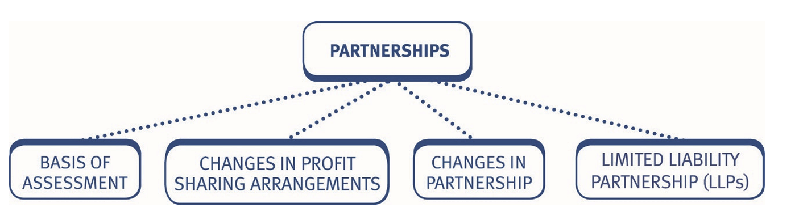
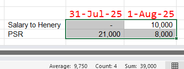
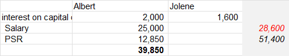
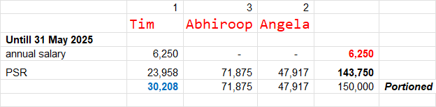

# Basis of Assessment

## Introduction

A partnership is a body of persons carrying on business together with a view to profit. 

- Each partner is taxed **individually**, despite the partnership being a single trading entity, with its own accounts.
- Each partner is taxed based on their *allocated share* of the partnership profits as if the partner were a sole trader making that amount of profit.
- To determine a partner’s taxable profits: 
    
    - Firstly, the trading profits of the partnership are calculated for tax purposes as for a sole trader, on the ***cash basis by default or the accruals basis by election*** (Chapter 7).
    - Secondly, deduct the capital allowances of the partnership if using the accruals basis or claiming capital allowances on cars under the cash basis (Chapter 8). 
    - Thirdly, the taxable trading profits of the partnership are allocated to the individual partners 
    - Finally, each of the partners are taxed on their allocation of the taxable profits on a tax year basis. Therefore, if the partnership accounts are not prepared to a 31 March/5 April year end the partners’ allocated profits will need to be ***time apportioned*** to calculate the taxable trading income for the tax year. 

## The allocation of profits and losses

### The computation of partnership profits and losses

The principles of computation of a partnership’s trading profits for tax purposes are the same as those for a sole trader. 

Partners’ salaries and interest on capital ***are not deductible expenses for tax purposes***, since these are merely an allocation of profit.                    
As for sole traders, the cash basis will be used for partnerships by default, but the accruals basis is available by election. ***Flat rate expenses*** are also available, as for a sole trader.  

### The allocation of the profit or loss

The taxable trading profit or loss is allocated (divided) between the partners according to their *profit sharing arrangements* for that period of account. 

Partners may be entitled by the partnership agreement to ‘salaries’ (a fixed allocation of profit) and ‘interest on capital’. 

The balance of profits remaining after the allocation of any ‘salaries’ or interest is allocated in the ***profit sharing ratio (PSR)***. 

Whether it is described as salary, interest on capital, or profit share, the total allocated to a partner is assessable to income tax as trading income. 

As for ***sole traders***, any money taken out of the business by a partner is classed as ***drawings*** and therefore not an allowable deduction. 

#### Example 1: The allocation of profits and losses

Phil and Dan have been in partnership for a number of years. **The partnership agreement provides that each should take a salary of £25,000, 5% interest on capital balances at the start of the accounting period and then split the profit remaining 60:40 in Phil’s favour**. 

Their respective capital balances at 1 April 2025, were :

| ***Capital***                         |                        |
|---------------------------------------|------------------------|
| Phil                                  | 75,000                 |
| Dan                                   | 60,000                 |

Calculate the **trading income assessable** for each partner for the tax year 2025/26, if the taxable trading profits for the year ended 31 March 2026, were **£74,000**.

**Solution**

|                                        | Total     | Phil      |  Dan      |
|----------------------------------------|-----------|-----------|-----------|
| Salary                                 | 50,000    | 25,000    | 25,000    |
| Int. on Capital (75 * 0.05),(60 * 0.05)| 6,750     | 3,750     | 3,000     |
|                                        | **56,750**| **28,750**| **28,000**|
| **Balance = 17,250 = 74,000 - 56,750** | 17,250    | 10,350    | 6,900     |
|**Total profit alloc. of partnership**  | **74,000**| **39,100**| **34,900**|

> The allocated profit represents each partner’s share of the profits for this period of account. 

> Each partner's allocated share of the profit is then assessed to tax on the individual partners as trading profit using the tax year basis. 

#### Example 2: The allocation of profits and losses

Paul and Art have been in partnership for many years preparing accounts to 31 March each year.        
The partnership agreement provides Paul with a salary of £3,000 and Art is entitled to 15% interest on his capital balance at the start of the period. 

His capital balance was £27,000 on 1 April 2025. Paul and Art agreed to split any remaining profits **equally**. 

Calculate the trading income assessments for each partner for the tax year 2025/26, if in the year ended 31 March 2026, the taxable trading profits were £30,000.

**Solution**

### Partnership capital allowances 

Capital allowances are calculated in the same way as for a sole trader. They are available to a partnership that elects to use the ***accruals basis***. If the partnership is using the cash basis, they are only available on cars (Chapter 7). 

::: {.callout-important}

***Capital allowances are deducted as an expense*** in calculating the trading profit or loss of the partnership. The profit allocated between the partners is therefore after deducting capital allowances. 

- Individual partners cannot claim capital allowances on their own behalf. 
- If assets are owned privately (such as cars): 

    - The total cost of such assets are ***included*** in the partnership’s capital allowances computation.
    - The maximum capital allowances available is calculated in the normal way. 
    - The amount actually claimed is the business use ***proportion***. 
    - The capital allowances claimed are deducted as an expense prior to allocating the profit to each partner. 
    
***Tax year basis.*** 

- If a partnership prepares accounts to a year end that does not coincide with the tax year, then having allocated the partnership profits between the partners, each partner will then need to **time apportion** their share of the profits to determine the taxable profits for each tax year. 

:::

#### Example 1: Tax year basis

Kieran and Brahim have been in partnership for a number of years. The partnership agreement states that all profits are split 65:35 in Kieran’s favour. 

Kieran has **transition profits** of £6,500 and Brahim has **transition profits** of £3,500 to be taxed in the tax year 2025/26.

Calculate the trading income assessable for each partner for the tax year 2025/26, if the taxable trading profits were as follows: 

|                                       |                        |
|---------------------------------------|------------------------|
| Y/e 31 December 2025                  | 48,000                 |
| Y/e 31 December 2026                  | 54,000                 |

**Solution**

# Changes in the profit sharing ratio 

The profit sharing ratio may change for a number of reasons:

1. The existing partners may decide to allocate profits in a different way. This may be as a result of a change in duties, seniority or simply by agreement of the parties concerned. 
2. The membership of a partnership may change as a result of the admission, death or retirement of a partner. 
Provided that there is at least one partner common to the business before and after the change, the partnership will automatically continue for tax purposes. 
3. Where there is a change in membership, the commencement or cessation basis of assessment rules apply to the individual partner who is joining or leaving the partnership only.

## The effect of a change in the profit sharing ratio 

If a partnership changes its basis of profit sharing *during a period of account*, then the period is ***split***, with a different allocation of profits in the different parts.

#### Example 1: The effect of a change in the profit sharing ratio

Rosalie and Logan are in partnership. Their taxable trading profit for the year ended 31 March 2026, was **£16,500**. 

Up to 31 December 2025, profits were shared between Rosalie and Logan 3:2, after paying annual salaries of £3,000 and £2,000 respectively. 

From 1 January 2026, profits are shared between Rosalie and Logan 2:1, after paying annual salaries of £6,000 and £4,000 respectively. 

Show the trading income assessments for Rosalie and Logan for the tax year 2025/26. 

**Solution**

|***Up to 31 December 2025 1.4.2025 – 31.12.2025 (9 Months)***|Total|Rosalie|Logan|
|----------------------------------------|-----------|-----------|-----------|
| Salary (W1: Pro-rata Salaries)         | 3,750     | 2,250     | 1,500     |
| **Balance** (W2: Pro-rata profit) (3:2)| 8,625     | 5,175     | 3,450     |
|                                        | **12,375**| **7,425** | **4,950**|

|***From 1 January 2026 2025 1.1.2026 – 31.3.2026 (3 Months)***|Total|Rosalie|Logan|
|----------------------------------------|-----------|-----------|-----------|
| Salary (W3: Pro-rata Salaries)         | 2,500     | 1,500     | 1,000     |
| **Balance** (W4: Pro-rata profit) (2:1)| 1,625     | 1,083     | 542       |
|                                        | **4,125** | **2,583** | **1,542** |
| **Total profit alloc. of partnership** | **16,500**| **10,008**| **6,492** |

::: {.columns}

***1 April 2025 to 31 December 2025 (9 Months)***              

::: {.column width="45%"}

***W1: Pro-rata Salaries***                  
Rosalie: £3,000 × 9/12 = **£2,250**                           
Logan: £2,000 × 9/12 = **£1,500**                    

:::

::: {.column width="5%"}

:::

::: {.column width="45%"}

***W2: Pro-rata profit***                         
The total profit of £16,500 must be time-apportioned into two distinct periods based on when the profit-sharing arrangements changed.                       
Total Period Profit = £16,500 × 9/12 = **£12,375**                 
Balance = 12,375 - 3,750 = **8,625**

:::

:::

::: {.columns}

***1 January 2026 to 31 March 2026 (3 Months)***              

::: {.column width="45%"}

***W3: Pro-rata Salaries***                  
Rosalie: £6,000 × 3/12 = £1,500                    
Logan: £4,000 × 3/12 = £1,000                  

:::

::: {.column width="5%"}

:::

::: {.column width="45%"}

***W4: Pro-rata profit***                    
Total Period Profit: £16,500 × 3/12 = **£4,125**
Balance = 4,125 - 2,500 = **1,625**

:::

:::

#### Example 2: The effect of a change in the profit sharing ratio

John and Major have been in partnership for many years preparing 
accounts to 31 March. 
Their original profit sharing arrangement provides for salaries of £4,500 
and £3,000 p.a. for John and Major respectively and the balance in the 
ratio of 3:2 in John's favour. 
From 1 October 2025, John received a salary of £9,000 p.a. and Major a 
salary of £6,000 p.a., with the balance of profit shared in the ratio 2:1 in 
John’s favour. 
The recent taxable trading profits for the accounting year ended 
31 March 2026, are £24,800. 
Show the division of profits for the year ended 31 March 2026 and 
the trading income assessments for each partner for the tax year 
2025/26.

# Change in partnership

## Commencement and cessation 

### Commencement – New partner 

The steps taken are: 

- Identify the start date of the new partner. 
- Allocate the profits between the old and new partner(s).

    - If the new start date is part way through the period of account, the allocation of profits is split between the two periods concerned. 
    - If the new partner joins at the start of a new period of account, profits in the period are allocated throughout using the new PSR. 

- Determine the assessable trading income for the tax year.

#### Example 1: Commencement and cessation

Alex, Arsene and Jose have been in partnership for a number of years. Their recent results have been as follows: 

|                           |               |
|---------------------------|---------------|
| Year ended 31 March 2024  | £103,500      |
| Year ended 31 March 2025  | £128,000      |

The relationship is often fractious and there have been a number of disputes over the years. In an attempt to improve the dynamics, on 1 July 2024, *Rafa was admitted to the partnership*. 

Profits had been shared equally, after allocating salaries and interest on capital, prior to the admission of Rafa, as follows: 

| Partner  | Salary   | Capital     | % Capital |
|----------|----------|-------------|-----------|
| Alex     | 15,000   | 100,000     | 5%        |
| Arsene   | 12,000   | 80,000      | 5%        |
| Jose     | 10,000   | 40,000      | 5%        |

Rafa’s admission changed the profit sharing arrangements as follows: 

| Partner  | Salary   | Capital     | % Capital | Profit Share |
|----------|----------|-------------|-----------|--------------|
| Alex     | 20,000   | 100,000     | 5%        | 35%          |
| Arsene   | 18,000   | 80,000      | 5%        | 30%          |
| Jose     | 15,000   | 40,000      | 5%        | 25%          |
| Rafa     | 10,000   |  0          | NA        | 10%          |

The **projected** result for the year ended 31 March 2026, is a taxable trading profit of **£140,000**.

Calculate the assessable trading income for each of the partners for the tax years **2023/24 to 2025/26**.

**Solution**

The assessable trading income for each partner across the three tax years is as follows:

***y/e 31 March 2024 income***

| Partner  | Income   |
|----------|----------|
| Alex     | 38,500   |
| Arsene   | 34,500   |
| Jose     | 30,500   |

 

| ***y/e 31 March 2024***  | Total     | Alex      | Arsene    | Jose      |
|--------------------------|-----------|-----------|-----------|-----------|
| Salary                   | 37,000    | 15,000    | 12,000    | 10,000    |
| Intrest on Capital       | 11,000    | 5,000     | 4,000     | 2,000     |
| PSR                      | 55,500    | 18,500    | 18,500    | 18,500    |
| Balance                  |**103,500**| **38,500**| **34,500**| **30,500**|

 

***y/e 31 March 2025***

| Partner  | Income   |
|----------|----------|
| Alex     | 44,591   |
| Arsene   | 39,316   |
| Jose     | 32,541   |
| Rafa     | 11,550   |

 

|***3m, ended 1 July 2024***| Total     | Alex      | Arsene    | Jose      |
|---------------------------|-----------|-----------|-----------|-----------|
| Salary *(Pro Rated 3/12)* | 9,250     | 3,750     | 3,000     | 2,500     |
| Intrest on Capital        | 2,750     | 1,250     | 1,000     | 500       |
| PSR                       | 20,000    | 6,666     | 6,666     | 6,666     |
| Balance                   |**32,000** | **11,666**| **10,666**| **9,666**|

 

|***9m, ended 31 March 2025***| Total     | Alex      | Arsene    | Jose      | Rafa      |
|-----------------------------|-----------|-----------|-----------|-----------|-----------|
| Salary *(Pro Rated 9/12)*   | 47,250    | 15,000    | 13,500    | 11,250    | 7,500     |
| Intrest on Capital          | 8,250     | 3,750     | 3,000     | 1,500     | 0         |
| PSR                         | 40,500    | 14,175    | 12,150    | 10,125    | 4,050     |
| Balance                     |**96,000** | **32,925**| **28,650**| **22,875**| **11,550**|

 

***y/e 31 March 2026***

| Partner  | Income   |
|----------|----------|
| Alex     | 48,100   |
| Arsene   | 41,800   |
| Jose     | 33,500   |
| Rafa     | 16,600   |

 

|***9m, ended 31 March 2026***| Total     | Alex      | Arsene    | Jose      | Rafa      |
|-----------------------------|-----------|-----------|-----------|-----------|-----------|
| Salary                      | 63,000    | 20,000    | 18,000    | 15,000    | 10,000    |
| Intrest on Capital          | 11,000    | 5,000     | 4,000     | 2,000     | 0         |
| PSR                         | 66,000    | 23,100    | 19,800    | 16,500    | 6,600     |
| Balance                     |**140,000**| **48,100**| **41,800**| **33,500**| **16,600**|

#### Example 2: Commencement and cessation

Able and Bertie have been in partnership since 1 April 2023 preparing accounts to 31 March each year. On 1 April 2025, Carol joined the partnership. Profits are shared equally. The partnership’s taxable trading profits are as follows: 

|                           |               |
|---------------------------|---------------|
| Year ended 31 March 2024  | £10,000       |
| Year ended 31 March 2025  | £13,500       |
| Year ended 31 March 2026  | £18,000       |

Calculate the assessable trading income of the individual partners for the tax years 2023/24 to 2025/26. 

**Solution**

### Cessation – Partner leaving 

The steps taken are: 

- Identify the partner ceasing to be a member. 
- Allocate the profits, remembering that if this is part way through the period of account it will affect the profit sharing ratio for that period of account and this will need to be calculated in two parts. 

#### Example 4: Cessation – Partner leaving

Ball, Sphere, Globe and Bauble have been in partnership for a number of years, preparing accounts to 31 March each year. The profit sharing arrangements have been as follows: 

| Partner  | Salary   | Capital     | % Capital | Profit Share |
|----------|----------|-------------|-----------|--------------|
| Ball     | 20,000   | 100,000     | 5%        | 35%          |
| Sphere   | 18,000   | 80,000      | 5%        | 30%          |
| Globe    | 15,000   | 40,000      | 5%        | 25%          |
| Bauble   | 10,000   |  0          | NA        | 10%          |

Ball has decided to **resign** as a partner at the end of September 2026.                  
The existing salary and interest arrangements will remain in place, but the balance of the **profit** will then be split equally between the three remaining partners.                      
Taxable trading profits for the year end 31 March 2026 and 2027 are expected to be **£180,000 and £210,000** respectively. 

Calculate the assessable trading income of each partner for the tax years 2025/26 and 2026/27.  

**Solution**

#### Example 5: Cessation – Partner leaving

Continuing the Example 4 above with Able, Bertie and Carol.                            
After suffering a period of ill health, Bertie plans to retire on 30 September 2026.                 
Profits for year ended 31 March 2027, are expected to be £24,000. The profit sharing ratio will remain unchanged until Bertie retires. Thereafter it will be split 65:35 in Able’s favour. 

Calculate the trading income assessments for the tax year 2026/27 as a result of Bertie’s retirement. 

**Solution**

# Limited liability partnerships (LLP) 

An LLP is a special type of partnership where the amount that each partner contributes towards the partnership losses, debts and liabilities is *limited by agreement*. 

The taxation implications of an LLP are as follows: 

- It is generally taxed in the same way as all other partnerships. 
- At TX, normal loss reliefs are available (Chapter 10). 

Note that the rules which may restrict the use of trading losses by LLPs are not examinable.

# Practices on Additional aspects

## Objective Test (OT) questions

### Q1: Adjusted trading profits

:::{.callout}

Elizabeth and Henry have been in partnership for many years, preparing accounts to 31 December each year.     
Until 31 July 2025 profits were shared in the ratio 70:30 to Elizabeth and Henry respectively, with no salary allocated to either partner. From 1 August 2025 the profit sharing ratio was adjusted to 80:20 to Elizabeth and Henry respectively, after allocating a salary of £24,000 per annum to Henry.       
The adjusted trading profits for the accounting year ended 31 December 2025 are £120,000. 

How much of the profit for the year ended 31 December 2025 is allocated to Henry? 

A. £41,000      
B. £31,000      
C. £43,200      
**D. £39,000**     

:::

### Q2: Partnership agreement

:::{.callout}

Albert and Jolene have been in partnership for many years, preparing accounts to 30 September each year. Albert and Jolene have balances on their capital accounts of £50,000 and £40,000 respectively.      
The partnership agreement provides for Albert to receive an annual salary of £25,000 and both partners to receive interest on capital of 4% per year. 

The agreed profit sharing ratio is 1:3 to Albert and Jolene respectively.        
The adjusted trading profits for the accounting year ended 30 September 2025 are £80,000. 

How much is Albert’s taxable share of the trading profit in respect of the year ended 30 September 2025? 

**39,850** 

:::

### Q3: Partnership agreement

:::{.callout}

Tim, Abhiroop and Angela have been in partnership for many years, preparing accounts to 31 December each year. 

The partnership agreement provides for Tim to receive an annual salary of £15,000.      
The agreed profit sharing ratio is 1:3:2 to Tim, Abhiroop and Angela respectively.        

Tim left the partnership on 31 May 2025.       
The adjusted trading profits for the accounting year ended 31 December 2025 are £360,000. 

How much of the profit for the year ended 31 December 2025 is allocated to Tim? 

A. £25,000     
**B. £30,208**     
C. £72,500     
D. £23,958     

:::

## Constructed response questions

### Q1: 

