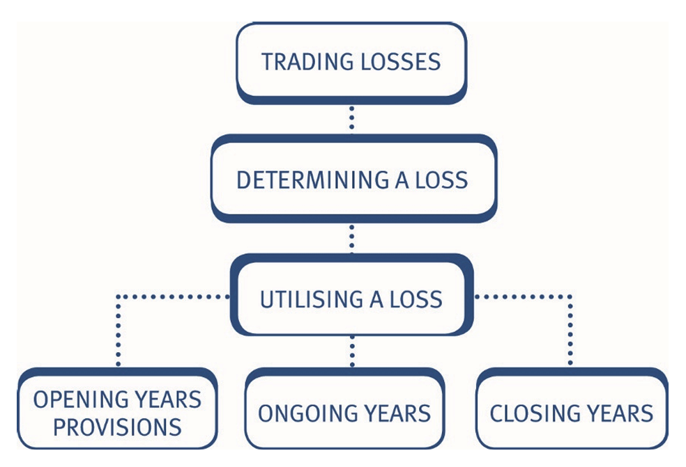
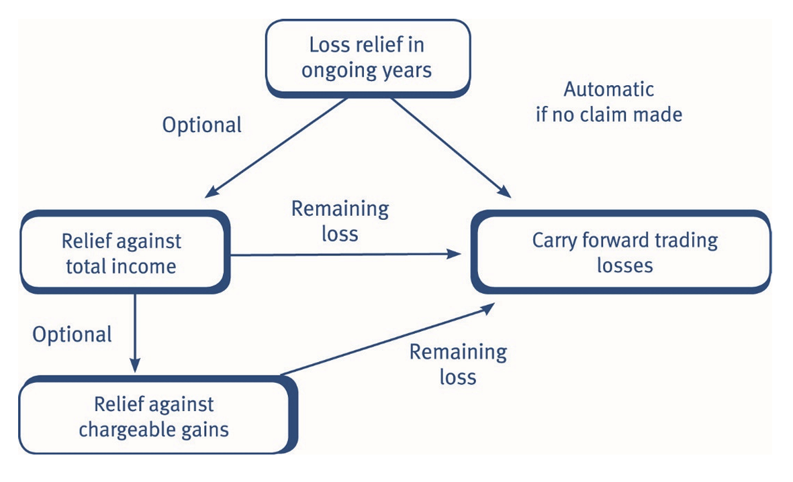
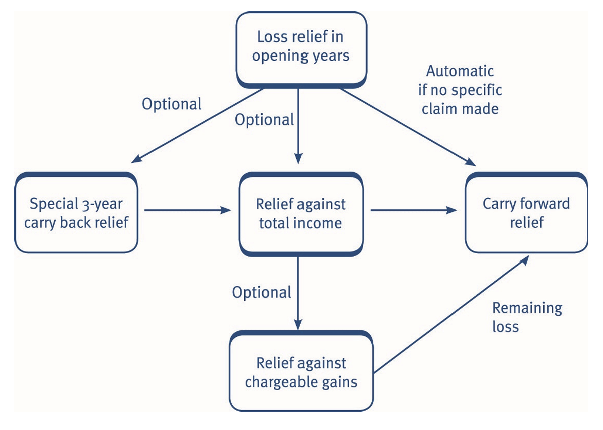
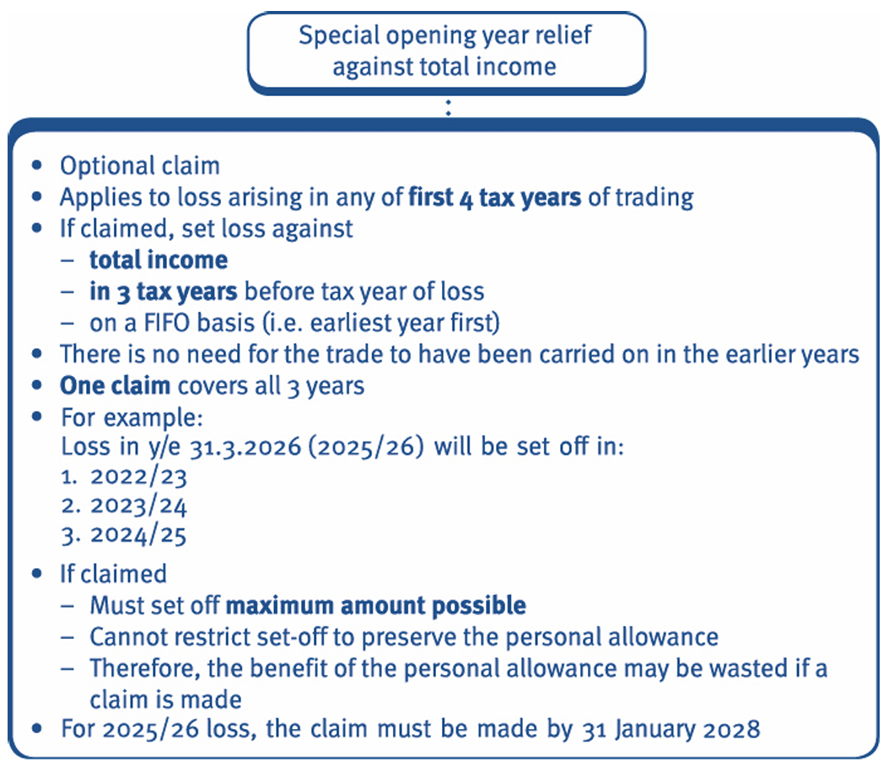
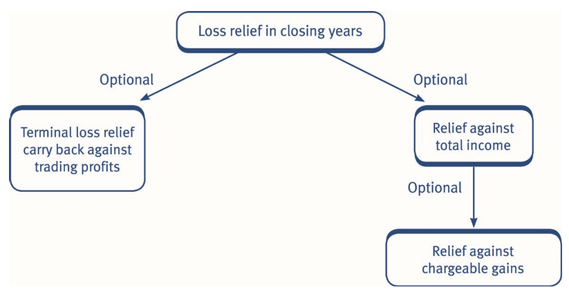
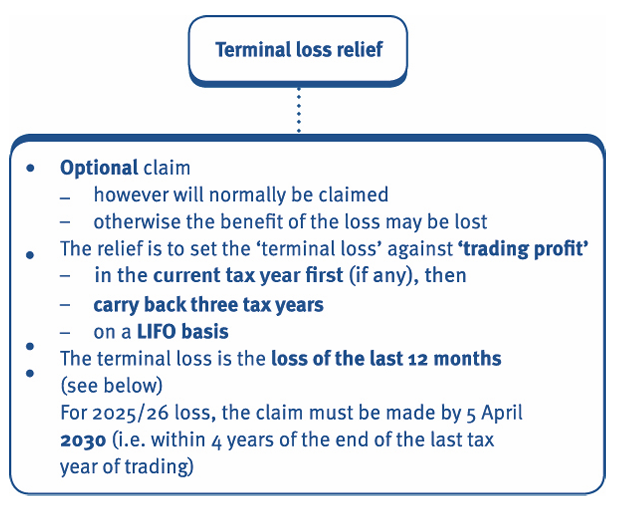
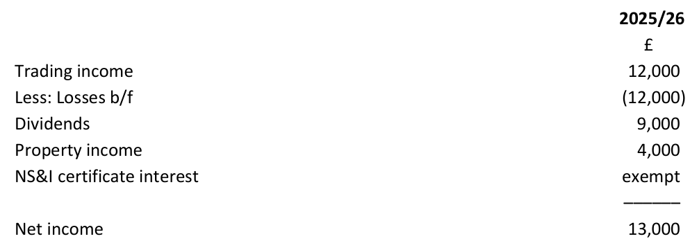

# Trading losses

## Identifying a trading loss

A trading loss arises when the normal tax adjusted trading profit computation gives a negative result. 

A trading loss can occur in two situations, as follows: 

|                                                                 | £        |
|-----------------------------------------------------------------|----------|
| Tax adjusted trading profit/(loss) before capital allowances    | X        |
| Less: Capital allowances (if relevant)                          | (X)      |
| **Trading loss**                                                | **(X)**  |

|                                                                 | £        |
|-----------------------------------------------------------------|----------|
| Tax adjusted trading profit/(loss) before capital allowances    | (X)      |
| Less: Capital allowances (if relevant)                          | (X)      |
| **Trading loss**                                                | **(X)**  |

Note that capital allowances: 

- are taken into account in calculating the amount of the trading loss available for relief, and 
- can increase a tax adjusted trading loss, and 
- can turn a tax adjusted trading profit into a trading loss. 

Where a trading loss occurs: 

- the trading loss is allocated to the relevant tax year  
- if the overall position for the tax year is a trading loss the individual's taxable trading income for the tax year is £Nil 
- a number of loss relief options are available to obtain relief for the loss. 

If the accounting period coincides with the tax year, the allocation to the relevant tax year is straightforward.              
For example, a loss made in the year ended 31 March 2026, is allocated directly to the tax year 2025/26.                     
If the accounting period does not coincide with the tax year, a **time apportionment** is required as for trading profits. This may mean some of the loss will automatically be offset against profits of an earlier or a later period.                            

> Note that the interaction between trading losses and transition profits is not examinable. 

#### Example 1: Trading losses and tax year basis

Sahar made a trading **loss** of **£36,000** for the year ended 31 December 2025. Her forecast trading **profit** for the year ended 31 December 2026 is **£44,000**. 

Calculate Sahar’s trading income (if any) for the tax year 2025/26 and show the trading loss that is available for relief. 

**Solution** 

|                                         |                      | £        |
|-----------------------------------------|----------------------|----------|
|6 April 2025 – 31 December 2025 **LOSS** | (36,000) × 9/12      | (27,000) |
|1 January 2026 – 5 April 2026 **Profit** | 44,000 × 3/12        | 11,000   |
| **Trading income**                      |                      | ***Nil***|

> There is an available trading loss of £16,000 (£27,000 – £11,000) and there are various options available to obtain relief for the loss.

## Utilising a loss

***Loss relief options*** 

The main reliefs available for a trading loss are as follows: 

- Terminal loss relief against previous trading profits. 
- Carry forward against future trading profits. 
- Relief against total income. 
- Opening year loss relief against total income. 

### Loss relief options in ongoing years

If an individual makes a trading loss in the ***ongoing years*** of a business, the trader initially has to decide whether to claim relief against total income or carry forward all of the loss. The choices can be summarised as follows: 

> Note that a claim against gains can only be made after a claim against total income, in the same tax year, has been made.

### Carry forward of trading losses

When dealing with loss questions it is useful to adopt a *columnar layout*, presenting *each tax year in a separate column*. In addition, keep a separate working to show when, and how much of, the loss has been used.                     
In the examination, it is possible that you will be provided with a pre formatted response area for loss questions. 

#### Example 1: Carry forward of trading losses 

Edward has had the following recent *tax adjusted trading* results: 

|                                         | £        |
|-----------------------------------------|----------|
| Year to 31 March 2024 **(Loss)**        | (5,000)  |
| Year to 31 March 2025 **Profit**        | 3,000    |
| Year to 31 March 2026 **Profit**        | 10,000   |

Assuming that Edward does not have any other income and wishes *to carry the loss forward*, calculate his total income for the tax years 2023/24 to 2025/26 inclusive.

**Solution**

|                            | 2023/24   | 2024/25   | 2025/26   |
|----------------------------|-----------|-----------|-----------|
| Trading income (Note)      | 0         | 3,000     | 10,000    |
| Less: Loss relief b/f (W)  | 0         | (3,000)   | (2,000)   |
| **Total income**           | **0**     | **0**     | **8,000** |

**Working – Loss memorandum**

|                                           | £        |
|-------------------------------------------|----------|
| Trading loss – 2023/24                    | 5,000    |
| Less: Used in 2024/25                     | (3,000)  |
| Less: Used in 2025/26                     | (2,000)  |
| **Loss carried forward to 2026/27**       | **0**    |

> The taxable trading income in the tax year of the loss (2023/24) is £Nil.

> In the examination never put the loss in the income tax computation, always show taxable trading income as ***£Nil***. 

> In addition, always show the amount of the loss in a *separate* loss working.

#### Example 2: Carry forward of trading losses 

Kamila has been trading for many years as a retailer. Her recent tax adjusted trading results are as follows: 

|                                         | £        |
|-----------------------------------------|----------|
| Year to 31 March 2024 **(Loss)**        | (9,000)  |
| Year to 31 March 2025 **Profit**        | 6,000    |
| Year to 31 March 2026 **Profit**        | 19,000   |

Kamila has had no other sources of income. 

Calculate Kamila’s total income for the tax years 2023/24 to 2025/26, assuming she carries the loss forward. 

**Solution**

Carry forward loss relief is useful as: 

- the taxpayer gets the potential of an unrestricted period over which to utilise the available loss 
    
    – providing that the taxpayer’s trade continues, and 
    – the taxpayer makes subsequent future profits from the same trade. 

However, there are a number of disadvantages to carrying losses forward: 

- In a prolonged difficult trading period for a business, relief may take a long time to materialise. 
- Obtaining relief in a later period is less advantageous from a cashflow and time value of money perspective. 
- There is no certainty about the levels of future trading profits and whether it will be possible to utilise the loss. 

Due to the number of disadvantages of carry forward relief, taxpayers are likely to consider the alternative loss reliefs available. 

### Loss relief against total income 

A taxpayer making a loss in the tax year 2025/26 has the option to make a ***claim against total income***.               
Relief against total income is optional but if claimed it permits the taxpayer to relieve trading losses against the total income of: 

- the tax year of the loss, and/or 
- the previous tax year. 

A claim may be made in: 
- either year in isolation, or 
- both years, in any order. 

For example: A loss for the year ended 31 March 2026 arises in the tax year 2025/26.                         
Therefore, the tax year of the loss is 2025/26 and the loss can be set against total income in: 

- 2025/26, and/or 
- 2024/25. 

#### Example 1: Loss relief against total income 

Abbas's recent tax adjusted trading results are as follows: 

|                                         | £        |
|-----------------------------------------|----------|
| Year to 31 March 2025 **Profit**        | 10,000   |
| Year to 31 March 2026 **(Loss)**        | (6,000)  |
| Year to 31 March 2027 **Profit**        | 12,000   |

Explain how Abbas can utilise the loss arising in the y/e 31 March 2026 assuming ***he claims to offset it against his total income***. 

**Solution** 

The loss of £6,000 arises in the tax year 2025/26. 

Loss relief is available against total income in 2025/26 and/or 2024/25.

#### Obtaining relief for the loss 

Due to the wording 'and/or', and the fact that a claim can be made in any order, the taxpayer has five key options to consider: 

1. set against total income of the tax year of the loss, then set against total income of the previous tax year, or 
2. set against total income of the previous tax year, then set against total income of the current tax year, or 
3. set against total income of the tax year of the loss only 
4. set against total income of the previous tax year only
5. make no claim and carry all of the loss forward

In the case of the first four options, any unrelieved loss is carried forward automatically. However, a key point to note is that if relief against total income is claimed, the taxpayer must set off the *maximum amount possible* for a given year; a partial claim is not allowed. Other points to note: 

::: {.columns}

::: {.column width="45%"} 

- The personal allowance is deducted from net income (i.e. total income after deducting reliefs). Therefore, a claim for loss relief against total income may result in the personal allowance being wasted. 

:::

::: {.column width="5%"}

:::

::: {.column width="45%"}

- The savings income nil rate band and dividend nil rate band could also be wasted if a claim is made to use the loss against total income. 

:::

::: {.column width="45%"} 

- A claim must be made within one year of *31 January* following the end of the tax year of loss. 
  For a 2025/26 loss the claim must be made by 31 January 2028. 

:::

::: {.column width="5%"}

:::

::: {.column width="45%"}

- A taxpayer may have losses for two consecutive tax years and wish to relieve both against total income. 
  In these circumstances the total income of a tax year is relieved by the loss of that year, in priority to the loss carried back from the following tax year. 

:::
:::

#### Example 2: Loss against total income

Rose's recent tax adjusted trading results are as follows: 

|                                         | £        |
|-----------------------------------------|----------|
| Year ended 31 March 2024 **Profit**     | 18,000   |
| Year ended 31 March 2025  **Loss**      | (43,200) |
| Year ended 31 March 2026 **Profit**     | 13,000   |
| Year ended 31 March 2027 **Profit**     | 15,000   |

**Rose’s other income each year is £12,000.** 

Show Rose’s net income for all tax years affected assuming: 

(a) No claim is made against total income for the trading loss.                      
(b) Claims against total income are made to obtain relief for the loss as early as possible.

**Solution**

***(A)***          
No relief against total income – *If no claim is made against total income, the trading loss of the tax year 2024/25 is carried forward against future ***trading*** profits.* 

|                         | 2023/24 (£) | 2024/25 (£) | 2025/26 (£) | 2026/27 (£) |
|-------------------------|-------------|-------------|-------------|-------------|
| Trading income          | 18,000      | 0           | 13,000      | 15,000      |
| Less: Loss relief b/f   | -           | -           | (13,000)    | (15,000)    |
| Other income            | 30,000      | 12,000      | 12,000      | 12,000      |
| **Total income**        | **48,000**  | **12,000**  | **12,000**  | **12,000**  |

**Working – Loss memorandum**

|                                           | £        |
|-------------------------------------------|----------|
| Loss in 2024/25                           | 43,200   |
| Less: Used in 2025/26                     | (13,000) |
| Less: Used in 2026/27                     | (15,000) |
| **Loss relief carry forward to 2027/28**  | **15,200** |

***(B)***          
Claims against total income – The loss of the tax year 2024/25 can be claimed against **total income** for 2023/24 and/or 2024/25.              
Any balance is carried forward. As relief is to be claimed for the loss as early as possible a claim will be made against total income for both 2023/24 and 2024/25.

|                         | 2023/24 (£) | 2024/25 (£) | 2025/26 (£) | 2026/27 (£) |
|-------------------------|-------------|-------------|-------------|-------------|
| Trading income          | 18,000      | 0           | 13,000      | 15,000      |
| Less: Loss relief b/f   | —           | —           | (1,200)     | —           |
| Other income            | 30,000      | 12,000      | 11,800      | 15,000      |
| **Total income**        | **48,000**  | **12,000**  | **23,800**  | **27,000**  |
| Less: Loss relief       | (30,000)    | (12,000)    | —           | —           |
| **Net income**          | **0**       | **0**       | **23,800**  | **27,000**  |

|                                           | £        |
|-------------------------------------------|----------|
| Loss in 2024/25                           | 43,200   |
| Less: Used in 2023/24                     | (30,000) |
| Less: Used in 2024/25                     | (12,000) |
| **Loss to carry forward**                 | 1,200    |
| Less: Used in 2025/26                     | (1,200)  |
| **Loss to carry forward**                 | **0**    |

#### Example 3: Loss against total income

Adrian's recent trading results have been: 

|                                         | £        |
|-----------------------------------------|----------|
| Year ended 31 March 2025 **Profit**     | 34,000   |
| Year ended 31 March 2026 **Loss**       | (48,000) |
| Year ended 31 March 2027 **Profit**     | 6,800    |

Adrian had other income as follows: 

|                         | £        |
|-------------------------|----------|
| 2024/25                 | 5,000    |
| 2025/26                 | 6,000    |
| 2026/27                 | 13,000   |

Calculate the taxable income for the tax years 2024/25 to 2026/27 inclusive, assuming that Adrian makes claims against ***total income to the extent that they are beneficial***. State the amount of the **remaining loss**, if any.      
Assume the tax rates and allowances for the tax year 2025/26 continue in the future.

**Solution**

### Relief of trading losses against chargeable gains 

If any loss remains after a claim against total income, a taxpayer can make a ***claim against chargeable gains***. 
This relief is optional but if claimed it permits the taxpayer to relieve trading losses against the chargeable gains in the same tax years as a claim against total income, i.e. in the: 

- tax year of the loss, and/or 
- previous tax year. 

A claim may be made in: 

- either year in isolation, or 
- both years, in any order. 

The relief operates as follows: 

- A trader is permitted to set unrelieved trading losses against chargeable gains, provided the maximum possible amount is offset against total income of the same tax year first, i.e. total income is reduced to £Nil if no restrictions apply. 
- If claimed, the unrelieved trading loss is treated as a current year capital loss (Chapter 17).

The loss is deducted before both the CGT ***annual exempt amount (AEA)*** and any capital losses brought forward as follows: 

|                                                                     | £         |
|---------------------------------------------------------------------|-----------|
| Chargeable gains in year                                            |  X        |
| **Less:** Capital losses in year                                    | (X)       |
| **Net chargeable gains**                                            |  X        |
| **Less:** Trading loss relief   (*subject to the maximum amount) | (X)       |
| **Less:** AEA                                                       | (3,000)   |
| **Net chargeable gains before brought forward losses**              | **X**     |

::: {.columns}

The maximum amount of loss relief under these rules is the **lower of**: 

::: {.column width="45%"}

The remaining trading loss, or

:::

::: {.column width="5%"}

:::

::: {.column width="45%"}

Chargeable gains in the tax year after the deduction of current year capital losses and brought forward capital losses. 

:::

:::

A key point to note is that if a claim is made against chargeable gains, the taxpayer must set off the maximum amount possible for a given year; ***a partial claim is not allowed***.              
 
It is crucial that if a claim is made against chargeable gains this is shown in a *separate computation* to any claim against total income. 

Other points to note: 

- The annual exempt amount is deducted after this relief, therefore a claim may result in **wasting** the annual exempt amount. 
- A claim is required in the same time period as for a claim against total income (i.e. within one year of 31 January following the end of the tax year of loss).                   
  For a 2025/26 loss the claim must be made by ***31 January 2028***. 
- Relief against chargeable gains normally saves tax at 18% or 24% (Chapter 17).

#### Example 1: Losses against chargeable gains

Charlie made a trading profit of £3,000 in the year ended 31 March 2026 and a trading loss of £14,000 the following year. 

They have other income of £4,500 in the 2025/26 tax year and also realised chargeable gains of £26,000 and capital losses of £5,000 in that tax year. 

Calculate the amounts that remain in charge to tax for the tax year 2025/26, assuming that Charlie claims loss relief against both total income and chargeable gains for that tax year, but makes no claims in respect of any other tax year. 

**Solution**

#### The procedure for dealing with questions involving losses 

As covered in the previous examples and test your understandings, the following procedure should be adopted when answering questions: 

1. Determine the tax adjusted profits and losses *after capital allowances* for each accounting period. 
2. Determine when losses arise and therefore when loss relief is available (i.e. in which tax years). 
3. Set up a pro forma income tax computation for each tax year side by side and leave spaces for the loss set off to be inserted later (you may be provided with a pre-formatted response area for loss relief questions in the examination). 
4. Set up a **loss memo** working for each loss to show how it is utilised. 
5. If more than one loss – consider the losses in *chronological order*. 
6. Consider each option – be prepared to explain the options, the consequences of making a claim and the advantages and disadvantages. 
7. Set off losses according to the requirements of the question, or in the *most beneficial way* if it is a tax planning question.

### Relief for trading losses in the opening years

The options available in the opening tax years of trade are exactly the same as those available to an ongoing business, with one extra option to ***carry back losses three years against total income***. The choices can be summarised as follows: 

If a trading loss occurs in the opening years, the trader has to decide whether to claim *normal loss relief against total income, special opening year loss relief or to carry forward the loss*. 

#### Special opening year loss relief 

As an alternative to, or in addition to, a claim against total income the taxpayer can make a special opening year loss relief claim. The relief operates as follows:

#### Example 1: Relief for trading losses in opening years

Caroline started her business on 1 April 2025. Her trading results, as adjusted for tax purposes, for the first two years are as follows: 

|                                                   | £        |
|---------------------------------------------------|----------|
| Year ended 31 March 2026 (2025/26) **Loss**       | (12,000) |
| Year ended 31 March 2027 (2026/27) **Profit**     | 5,465    |

Before becoming self-employed, Caroline had been employed as a dressmaker. Her remuneration from this employment, which ceased on 30 September 2024, was: 

|         | £        |
|---------|----------|
| 2024/25 | 7,300    |
| 2023/24 | 13,490   |
| 2022/23 | 16,200   |

Caroline has **other income of £4,850** p.a.

Calculate the taxable income for all tax years after **claiming special opening year loss relief**.                     
Assume the tax rates and allowances for the tax year 2025/26 apply throughout.

**Solution** 

***Taxable income computations***
 
 

|                         | 2022/23 (£) | 2023/24 (£) | 2024/25 (£) |
|-------------------------|-------------|-------------|-------------|
| Employment income       | 16,200      | 13,490      | 7,300       |
| Other income            | 4,850       | 4,850       | 4,850       |
| **Total income**        | 21,050      | 18,340      | 12,150      |
| **Less:** Loss relief   | [(12,000)]{style="color: red;"}| — | —  |
| **Net income**          | 9,050       | 18,340      | 12,150      |
| Less: PA                | (12,570)    | (12,570)    | (12,570)    |
| **Taxable income**      | **0**       | **5,770**   | **0**       |

|                         | 2025/26 (£) | 2026/27 (£) |
|-------------------------|-------------|-------------|
| Trading income (W)      | 0           | 5,465       |
| Other income            | 4,850       | 4,850       |
| **Total income**        | **4,850**   | **10,315**  |
| Less: PA                | (12,570)    | (12,570)    |
| **Taxable income**      | **0**       | **0**       |

1. Under the special opening year loss relief rules, the loss from the tax year 2025/26 of £12,000 is set firstly against total income for the tax year 2022/23. Any loss remaining would then have been set automatically against total income of 2023/24 and then against total income of 2024/25.

2. When opening year losses are carried back to tax years before the start of trade, they are able to relieve previous other income, often employment income. As this is an opening year relief, there is no requirement in the legislation that the trade be carried on in all tax years covered by the three-year carry back.

#### Example 2: Relief for trading losses in opening years

Lance started a business on 1 May 2025. His taxable trade profits are:

|                                                   | £        |
|---------------------------------------------------|----------|
| 11 months to 31 March 2026 (2025/26) **Loss**     | (28,480) |
| Year ended 31 March 2027 (2026/27) **Profit**     | 35,000   |

Prior to starting his business Lance had been employed. ***His employment income for the tax years 2022/23, 2023/24 and 2024/25 was £23,660, £5,564 and £6,120 respectively.*** 

In addition he has **savings income amounting to £1,700** each year. 

Show how Lance will obtain relief for the loss if he makes a claim for special opening year loss relief. 

**Solution**

### Terminal loss relief

The options available in the ***closing years of trade*** are exactly the same as those available to an ongoing business, except that: 

- the option to carry forward losses is not available as there will be no further trading profits once the trade ceases 
- an extra option of terminal loss relief is available. 

If a trading loss occurs in the closing years, the trader has to decide whether to claim relief against total income (and then possibly offset against gains) or claim terminal loss relief against trading profits.

The relief operates as follows: 

#### The calculation of the terminal loss 

The terminal loss is the loss of the final 12 months of trading and is calculated as follows: 

| Period                                                                    | Amount |
|---------------------------------------------------------------------------|--------|
| 6 April before cessation to the date of cessation                         |        |
| Actual trading loss in this period (ignore if a profit)                   | X      |
| 12 months before cessation to 5 April before cessation                    |        |
| Actual trading loss in this period (ignore if a profit)                   | X      |
| **Terminal loss**                                                         | **X**  |

#### Example 1: Terminal loss

Sergei ceased trading on 30 June 2026. His trading results for the final two accounting periods were:

|                                                                           | Amount |
|---------------------------------------------------------------------------|--------|
| Year ended 31 December 2025 **Profit**                                    | 10,000 |
| Period ended 30 June 2026 loss **Loss**                                   |(25,000)|

Calculate Sergei’s terminal loss

**Solution**

> It is not compulsory to make a claim against total income before claiming terminal loss relief. However, it is important to note that relief can only be obtained for a loss once. 

> Therefore, where losses included in the terminal loss calculation have already been relieved under another claim (i.e. against total income or chargeable gains), the amount of the terminal loss must be reduced. 

> Additionally, if an element of the loss has already been relieved by offsetting it against profits when calculating taxable trading income for the tax year (due to tax year basis rules), relief is not available for that part of the loss.  

#### Example 2: Terminal loss relief

Yves prepared accounts annually to 31 March each year and he ceased trading on 31 March 2026. Yves had no other sources of income other than his trading profits. 

His tax adjusted trading results are as follows:

|                                                                           | Amount |
|---------------------------------------------------------------------------|--------|
| Year to 31.3.2026 **Loss**                                                | 7,200  |
| Year to 31.3.2025 **Profit**                                              | 100    |
| Year to 31.3.2024 **Profit**                                              | 7,000  |
| Year to 31.3.2023  **Profit**                                             | 7,500  |

Calculate the **terminal loss** available to Yves and show how relief may be obtained for it.

**Solution**

### Maximum deduction from total income 

There is a limit on the amount of relief that can be deducted when a claim is **made against total income**. The maximum deduction is the greater of:

- £50,000, or
- 25% of adjusted total income.

**Adjusted total income (ATI)** for the TX examination is calculated as follows:

|                                                       | £        |
|-------------------------------------------------------|----------|
| Total income                                          |  X       |
| Less: Gross personal pension contributions            | (X)      |
| **Adjusted total income**                             | **X**    |

Note that the restriction will be £50,000 unless the individual's ATI exceeds £200,000 (£200,000 × 25% = £50,000).

The limit applies to trading losses set against: 

- current year total income, and 
- the prior year if set against income other than profits of the same trade. 

It does not apply where the trading loss is set against profits from the same trade of an earlier year. Note that in this instance, trading losses are set against 
trading income from the same trade before income from other sources.                   
Any trade loss that cannot be set off against total income is carried forward against future trade profits from the same trade. 

As the reliefs against total income are 'all or nothing', it is possible that this restriction of the amount of the loss allowed to be deducted could be beneficial and prevent the ***wastage*** of the personal allowance. 

#### Example 2: Aganist Total Income

Sheetal is a sole trader and has adjusted trading results as follows: 

|                                                       | £        |
|-------------------------------------------------------|----------|
| Year ended 31 March 2025                              | £64,000  |
| Year ended 31 March 2026                              |(£127,800)|

She has **savings income** of £63,000 each year but no other income.         

She makes **gross personal pension scheme** contributions of £5,725 each year.

Sheetal wishes to **offset the trading loss against her total income** for the tax years 2025/26 and then 2024/25. 

Calculate Sheetal's taxable income for the tax years 2024/25 and 2025/26.                      
Assume that the rates and allowances for the tax year 2025/26 apply throughout.

**Solution**

### Choice of loss reliefs 

***Utilising loss relief*** 

When *planning relief* for trading losses, careful consideration needs to be given to the personal circumstances of the individual. ***Tax advice*** should aim to satisfy the following goals of a taxpayer: 

- Obtain tax relief at the highest marginal rate of tax. 
- Obtain relief as soon as possible. This can mean that tax from earlier years is repaid, or it may reduce tax payable soon.  
- Ensure the taxpayer's PA, savings income nil rate band and dividend nil rate band are not wasted, if possible. 

It may not be possible to satisfy all of these aims, for example: 

- to get a higher rate of relief, the taxpayer may have to waste the PA 
- carrying losses forward may give a higher rate of relief, but the cash flow implications of claiming relief now rather than waiting for relief may be more important to the taxpayer. 

The specific circumstances faced by the taxpayer will help to determine which of these is most important.

### Factors to consider

In understanding the position of the taxpayer, it is important to understand the comparative features of the various reliefs.

| Income relieved                                              | Timing of relief                                           | Flexibility                                                                                                  |
|--------------------------------------------------------------|------------------------------------------------------------|--------------------------------------------------------------------------------------------------------------|
| Total income – normal claim   (possibly also chargeable gains relief) | Current and/or previous tax year | Either, neither or both tax years (either order).   All or nothing. Maximum restriction may apply. |
| Total income – special opening years claim                   | Preceding three tax years on a FIFO basis | Only in the first four years of a trade.   All or nothing.   Can be used with a normal claim against total income.   Maximum restriction may apply. |
| Future trading profit                                        | As soon as possible in future (same trade)                 | None.                                                                                                        |
| Trading profit – terminal loss claim                         | Preceding three tax years on a LIFO basis                  | Only on cessation.   All or nothing.  Can be used with a normal claim against total income.                      |

::: {.callout-note}

***Choice of loss relief*** 

Although the reliefs against total income (normal relief and special opening year relief) obtain relief more quickly than relief by carry forward, they frequently involve ***loss of the personal allowance***, savings income nil rate band and dividend nil rate band. 

However, for a large loss that will eliminate several years’ modest trading profits, there is no point in choosing to carry forward a loss if there is no non-trading income in those future years to obtain relief for personal allowances. All that will have happened is that future personal allowances rather than current ones will be wasted. 

The taxpayer can choose when to claim relief against total income, that is, in the tax year of the loss; or the preceding year, as the legislation does not dictate that either takes priority. 

If neither a current nor a previous year claim against total income appears appropriate, consider the chargeable gains position. Where the taxpayer has made a large chargeable gain, a claim against it may be appropriate. 

Since the claim can only be made once, total income for the year is reduced as far as possible, and this will generally involve wasting at least one year's personal allowance. 

However, at all times be mindful of the maximum restriction rules and the rate of tax relief available as the taxpayer's primary aim is usually to save as much tax as possible. 

:::

    

## The allocation of trading losses for Partnership 

Trading losses are allocated between partners in exactly the same way as trading profits.

Loss relief claims available 

Claims available to partners are the same as those for sole traders. 

- A partner joining a partnership may be entitled to claim opening year loss relief, where a loss was incurred in the first four tax years of membership of the partnership. This relief would not be available to the existing partners. 
- A partner leaving the partnership may be entitled to claim for terminal loss relief. 

Again, this relief would not be available to the partners remaining in the partnership.

#### Eample 1: Partnership Loss

Diane, Lynne and John are in partnership preparing their accounts to 5 April. During the tax year 2025/26, John left the partnership and 
Helen joined in his place. 

For the year ended 5 April 2026, the partnership made a tax adjusted trading loss of £40,000.

State the loss relief claims that are available to the partners. 

**Solution**

#### Eample 2: Partnership Loss

Jake and Milo have been in partnership together since 2007, but ceased trading on 31 March 2026. Profits and losses have always 
been shared 40% to Jake and 60% to Milo. 

The tax adjusted trading profits and losses for the final *four years* before allocation between the partners are as follows: 

|            |                                         | Amount    |
|------------|-----------------------------------------|-----------|
| 2022/23    | Profit – y/e 31.3.2023                  | £11,000   |
| 2023/24    | Profit – y/e 31.3.2024                  | £32,500   |
| 2024/25    | Profit – y/e 31.3.2025                  | £19,000   |
| 2025/26    | Loss – y/e 31.3.2026                    | £(65,000) |

Jake is single and has no other income or outgoings.                          
Milo is single and also has no other income or outgoings apart from **bank interest of £4,350** received on 1 December 2025 from investing a recent inheritance. He has a **chargeable gain of £35,300** for the tax year 2025/26 in respect of the disposal of an asset on 18 July 2025.             

Assume that the rates and allowances for the tax year 2025/26 apply to all years and that capital gains tax is payable at 18%. 

(a) Advise the partners of the possible ways of relieving the partnership loss for the tax year 2025/26. 
(b) Advise the partners as to which loss relief claims would be the most beneficial. 
(c) After considering the advice in (b), calculate the partners’ taxable income for the tax years 2022/23 to 2025/26. Show Milo's tax saving under each of the options considered in part (b).

**Solution**

***(A)***                 
There are ***two possible ways to relieve the partnership loss***: 

::: {.columns}

::: {.column width="45%"}

1. A claim can be made against **total income** for the tax years 2025/26 and/or 2024/25.
   Subject to this claim being made, it would then be possible to claim against chargeable gains of the same tax year. 

:::

::: {.column width="5%"}

:::

::: {.column width="45%"}

2. Terminal loss relief can be claimed. 

:::

:::

The tax adjusted trading profits and loss are split between the partners: 

|         | Jake (40%) | Milo (60%) |
|---------|------------|------------|
| 2022/23 | 4,400      | 6,600      |
| 2023/24 | 13,000     | 19,500     |
| 2024/25 | 7,600      | 11,400     |
| 2025/26 | (26,000)   | (39,000)   |

***(B)***              
**Most beneficial relief**         
The most beneficial loss relief claim available to **Jake** is a **terminal loss claim**, as he has no other income or gains. However, this does waste his **personal allowances**.                               

**Milo** could also make a terminal loss claim, but this would *waste most of his personal allowances* for several years.                
It is more beneficial for Milo to make a claim against his total income of £4,350 for the tax year 2025/26, which wastes his personal allowance in that year, but then allows a *claim against 
his chargeable gain of £35,300* for the tax year 2025/26.

***(C)***              
Jake – Taxable income

|                         | 2022/23 (£) | 2023/24 (£) | 2024/25 (£) | 2025/26 (£) |
|-------------------------|-------------|-------------|-------------|-------------|
| Trading income          | 4,400       | 13,000      | 7,600       | 0           |
| Less: Terminal loss     | (4,400)     | (13,000)    | (7,600)     | 0           |
| **Net income**          | **0**       | **0**       | **0**       | **0**       |
| Less: PA (restricted)   | —           | —           | —           | —           |
| **Taxable income**      | **0**       | **0**       | **0**       | **0**       |

> The remaining loss of £1,000 (£26,000 – £7,600 – £13,000 – £4,400) is wasted as there are no future profits from the same trade to carry forward against and Jake has no other income or gains in the tax years 2025/26 or 2024/25.

Milo – Taxable income             

|                         | 2022/23 (£) | 2023/24 (£) | 2024/25 (£) | 2025/26 (£) |
|-------------------------|-------------|-------------|-------------|-------------|
| Trading income          | 6,600       | 19,500      | 11,400      | 0           |
| Bank interest           | —           | —           | —           | 4,350       |
| **Total income**        | 6,600       | 19,500      | 11,400      | 4,350       |
| Less: Loss relief       | —           | —           | —           | (4,350)     |
| **Net income**          | 6,600       | 19,500      | 11,400      | 0           |
| Less: PA                | (12,570)    | (12,570)    | (12,570)    | —           |
| **Taxable income**      | **0**       | **6,930**   | **0**       | **0**       |

> Assuming that tax year 2025/26 rates apply throughout, claiming terminal loss relief would save income tax of:

£6,930 × 20% = £1,386

Claiming relief against total income and then chargeable gains in the tax year 2025/26 would save:

|                                                              | £        |
|--------------------------------------------------------------|----------|
| Income tax – income would be covered by PA                   | 0        |
| Capital gains tax (£32,300 (W) × 18%)                        | 5,814    |
| **Total tax saving**                                          | **5,814**|

**Working: Taxable gain without loss relief**

|                                                              | £        |
|--------------------------------------------------------------|----------|
| Chargeable gain                                              | 35,300   |
| Less: Annual exempt amount                                   | (3,000)  |
| **Taxable gain**                                              | **32,300**|

> Loss relief available is £34,650 (£39,000 – £4,350 used against total income). 

The loss is offset before the deduction of the annual exempt amount (AEA). Thus the remaining loss of £34,650 is fully utilised, most of the AEA is wasted, and tax is saved on taxable gains of £32,300.

# Practices on Additional aspects

## Objective Test (OT) questions

### Q1: The use of the loss

:::{.callout}

Beverley has been trading for many years and incurred a tax adjusted trading loss for the year ended 31 March 2026.  

Which of the following statements is correct with regard to the use of the loss? 

A. The loss may be carried forward and set against trading income for the tax year 2025/26 arising from the same trade.              
B. The loss can be set against total income for the tax year 2025/26, but only after the loss is set against total income for the tax year 2024/25.             
C. **The loss can be set against total income for the tax year 2024/25, irrespective of whether the loss has been set against total income for the tax year 2025/26.**           
D. The loss can be set against taxable income for the tax year 2024/25 and/or the tax year 2025/26.       

**Why Wrong?!**     
A. Wrong: Carried forward and set against future trading profits, but the loss is incurred in the tax year 2025/26 and will therefore be available to **carry forward to the tax year 2026/27**.    
B. Wrong: There is no need for the claim for the tax year 2024/25 to be made before that of the tax year 2025/26.
D. Wrong: The loss can be set against total income ***(not taxable income)*** of the tax years 2025/26 and/or 2024/25. 

:::

### Q2: Loss Available to Carry Forward

:::{.callout}

Lena has been trading as a picture framer for many years. Her recent results have been as follows:

|                           |               |
|---------------------------|---------------|
| Year ended 31 March 2024  | £30,000       |
| Year ended 31 March 2025  | £25,000       |
| Year ended 31 March 2026  | (£45,000)     |

Lena’s only other income is **bank interest of £5,000 each year**. Assuming that Lena claims relief for her loss in the most efficient way, ***how much loss***, if any, is available to carry forward to the tax year 2026/27? 

A. £0              
B. **£15,000**           
C. £20,000             
D. £10,000           

Lena should make a claim to offset the loss in the tax year 2024/25, but not in the tax year 2025/26 when ***her income is covered by the personal allowance***.

|                         | 2024/25 (£) | 2025/26 (£) |
|-------------------------|-------------|-------------|
| Trading income          | 25,000      | 0           |
| Bank interest           | 5,000       | 5,000       |
| **Total income**        | 30,000      | 5,000       |
| Less: Loss claim        | (30,000)    | —           |
| **Net income**          | 0           | 5,000       |
| Less: PA                | —           | (5,000)     |
| **Taxable income**      | **0**       | **0**       |

 

| Loss available to carry forward to 2027 | £        |
|-----------------------------------------|----------|
| Income before relief                    | 45,000   |
| Less: Loss claim                        | (30,000) |
| **Net income**                          | **15,000** |

1. Identify the Tax Years & Total Income

Lena's trading loss occurs in the year ended 31 March 2026, which maps to the tax year 2025/26. To determine the most efficient way to use the loss, we look at her total income across the available years:

* Tax Year 2024/25 (Preceding Year): £25,000 (Trading Profit) + £5,000 (Bank Interest) = £30,000 Total Income
* Tax Year 2025/26 (Loss Year): £0 (Trading Loss) + £5,000 (Bank Interest) = £5,000 Total Income

2. Evaluate the Most Efficient Claim 

Lena can offset her £45,000 loss against the **total income** of the current year (2025/26) and/or the preceding year (2024/25).

::: {.columns}

::: {.column width="45%"}

Claiming against 2025/26 (Current Year): is **inefficient**. Her total income is only £5,000, which is already *fully covered by her tax-free Personal Allowance* (£12,570). Claiming here *would save £0 tax and waste £5,000* of her loss.

:::

::: {.column width="5%"}

:::

::: {.column width="45%"}

Claiming against 2024/25 (Preceding Year): This is highly efficient. Her income is well above the Personal Allowance, so offsetting here will fully eliminate her taxable income for that year to nil.

:::

:::

3. Calculate the Loss Available to Carry Forward
The remaining unused balance of the loss is automatically carried forward under Section 83 to the next tax year (2026/27) to be offset against future trading profits from the same business.
$$\text{Loss Carry Forward} = £45,000 - £30,000 = \mathbf{£15,000}$$

> A claim against total income can be made for the tax year of loss and/or the previous tax year in any order. 

:::

### Q3: Trading losses

:::{.callout}

Which of the following statements about trading losses is true? 

A. A trade loss can only be carried forward for a maximum of two years.         
B. **A trade loss carried forward must be deducted from future profits of the same trade.**            
C. A claim against total income must be made for the tax year of loss first before carrying it back to the previous tax year.              
D. When a loss is deducted from total income it can be restricted to allow the personal allowance to be relieved in full.             

***Why Wrong?!***            
A. is false because there is no limit on the time that a loss can be carried forward.        
C. is false because a claim against total income can be made for the tax year of loss and/or the previous tax year in any order.           
D. is false because a loss claimed against total income is deducted before the personal allowance and the offset cannot be restricted to preserve the personal allowance. 

:::

### Q4: Maximum loss relief 

:::{.callout}

Naomi is self-employed. For the year ended 5 April 2026 she made a trading loss of £110,000, having made a trading profit of £24,000 for the year ended 5 April 2025. Naomi also had employment income of £92,000 for the tax year 2024/25. 

What is the maximum loss relief claim which Naomi can make against her total income for the tax year 2024/25? 

**A. £74,000**     
B. £50,000     
C. £110,000     
D. £29,000     

Under UK tax rules, when an individual claims to offset a trading loss against their total income of a current or prior tax year:

* **Offset against trading profits from the same trade is unrestricted:** No cap or limit applies when setting off the loss against trading profits.
* **Offset against non-trading (other) income is restricted:** The offset of trading losses against other types of income (such as employment income or investment income) is restricted to a maximum cap.
* **The Cap:** The limit is the **greater of £50,000 or 25% of adjusted total income**. Since Naomi's total income is £116,000, 25% of this is £29,000. Therefore, her restriction limit is **£50,000**.

$$
£24,000 + £50,000 = \mathbf{£74,000}\
$$

:::

### Q5: Carring the trading loss forward

:::{.callout}

Brooke had been trading profitably as a sole trader for many years. However, in the year ended 31 March 2025 she made a trading loss of £65,000.

Brooke has the following income in the tax year 2025/26:

| Income Item                        | Amount (£) |
|------------------------------------|------------|
| Trading profit for year ended 31 March 2026 | 12,000     |
| Dividend income                    | 9,000      |
| Property income                    | 4,000      |
| NS&I savings certificate interest  | 1,000      |

What is Brookes’ net income for the tax year 2025/26 assuming she carries the trading loss forward?

**13,000**

:::

### Q6: Trading loss available to carry forward

:::{.callout}

Damayanti has been trading as a sole trader for many years. Her recent tax adjusted trading profits/(losses) have been:

| Period                       | Amount (£) |
|------------------------------|------------|
| Year ended 5 April 2025      | 55,000     |
| Year ended 5 April 2026      | (90,000)   |

Damayanti also receives bank interest of £14,000 each tax year.

What is the amount of trading loss carried forward to the tax year 2026/27 assuming that Damayanti makes a claim to use the loss in the current and prior tax years?

A. £35,000     
B. £26,000     
C. £21,000     
**D. £7,000**

> 90-14-55-14

:::

### Q7: Earliest tax year and Loss relieved

:::{.callout}

Sabine **started to trade as a sole trader on 1 April 2024**. Her tax adjusted trading profits/(losses) for the first two years are:

Year ended 31 March 2025: **£5,000**

Year ended 31 March 2026: **(£25,000)**

Sabine was employed until 31 March 2024 earning £45,000 per annum. She also receives £3,000 of savings income every year.

Sabine would like to relieve her loss as early as possible.

**Indicate, by selecting the relevant boxes in the table below, the earliest tax year in which her loss can be offset and how much loss can be relieved in that year?**

| Earliest tax year | Loss relieved |
|---|---|
| 2020/21    | £14,000    |
| 2021/22    | £20,000    |
| **2022/23**| £22,000    |
| 2023/24    | **£25,000**|
| 2024/25    |            |

:::

### Q8: Chargeable gain - Trading loss

:::{.callout}

Sally has been trading as a sole trader for many years. In the year ended 31 March 2026 she made a trading loss of **£45,000**.      
Sally’s only other source of income is property income of **£8,000** each tax year.      
In the tax year 2025/26 Sally realised a chargeable gain of **£32,000** on the sale of a necklace and a capital loss of **£4,000** on the sale of a painting. She has capital losses brought forward of **£18,000**. 

What is the amount of trading loss that Sally can offset against her chargeable gain in the tax year 2025/26?  

A. £45,000       
B. £37,000       
C. £28,000       
**D. £10,000**      

:::

### Q9: Terminal loss relief 'LIFO'

:::{.callout}

Carol ceased trading on 31 March 2026.

Her recent tax adjusted trading profits/(losses) have been:

- Year ended 31 March 2023: £12,000
- Year ended 31 March 2024: £28,000
- Year ended 31 March 2025: £19,000
- Year ended 31 March 2026: (£44,000)

Carol also receives dividend income of £5,000 each tax year. She wishes to claim terminal loss relief to utilise her loss in the period to cessation.

What is the amount of terminal loss that will be offset against her income in the tax year 2023/24?

**25,000**

> 44,000 - 19,000

> Terminal loss relief is set against trading profits only and carried back three years on a LIFO basis. It is therefore relieved against the trading profits of the tax year 2024/25, then the tax year 2023/24.

:::

### Q10: Claim for Loss Relief

:::{.callout}

Humphrey is a sole trader who has been trading for a number of years. Humphrey incurred a trading loss in the tax year 2025/26. He wishes to make a claim to offset this loss against his total income of the tax year 2024/25. 

What is the deadline for Humphrey to claim this relief? 

A. 31 January 2027       
**B. 31 January 2028**       
C. 5 April 2029       
D. 5 April 2030      

> Loss Relief claim must be made within one year of 31 January following the end of the tax year in which the loss arose

:::

## Constructed response questions

### Q1: 

:::{.callout}

:::