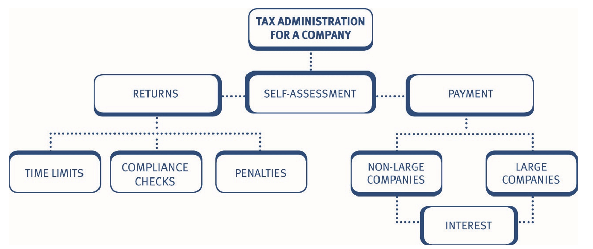
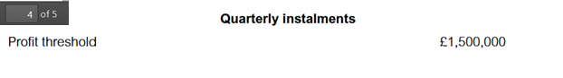
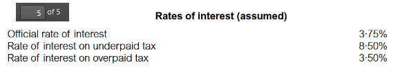
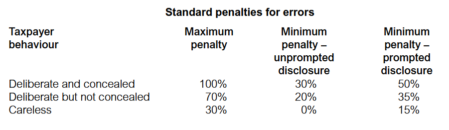

# The self-assessment system for companies 

As for individuals, self-assessment applies for corporate taxpayers. Responsibility rests with the company to: 

- calculate its own corporation tax liability for each accounting period 
- submit a self-assessment corporation tax return within 12 months after the end of the period of account 
- pay any corporation tax due within nine months and one day after the end of the accounting period. 

Given the timing of the due date for payment of tax, in practice, many companies will aim to complete the self-assessment tax return prior to the nine month deadline for paying the corporation tax. 

***The self-assessment tax return***    
The self-assessment tax return must be submitted by the later of: 

- 12 months after the end of the period of account, and 
- three months after the issue of the notice to file a return.  

***The return must:***      

- contain all information required to calculate the company’s taxable total profits 
- include a self-assessment of the amount of corporation tax payable for that accounting period 
- be submitted online. 

A company has to submit a copy of its financial accounts together with the self-assessment tax return.

All companies must file self-assessment returns and copies of accounts electronically using **'Inline eXtensible Business Reporting Language' (iXBRL).** 

iXBRL is the global standard for exchanging business information in an electronic format and tags the accounts so they can be read by a computer. 

HMRC provide free online filing software applications for companies with straightforward tax affairs that automatically produces and submits a self-assessment return with accounts and computations in the required iXBRL format, as well as calculating the tax liability. 

For other companies, commercial software applications and services enable the submission of the tax return in one of three ways: 

::: {.columns}

::: {.column width="45%"}

:::

::: {.column width="5%"}

:::

::: {.column width="45%"}

:::

::: {.column width="5%"}

:::

::: {.column width="45%"}

:::

::: {.column width="5%"}

:::

::: {.column width="45%"}

1. Integrated software applications – automatically inserts iXBRL tags to data and produces iXBRL accounts and/or computations. 

:::

::: {.column width="5%"}

:::

::: {.column width="45%"}

2. Managed tagging services – provided by agents whereby the company outsources the process of iXBRL tagging to convert non-iXBRL accounts and computations into the required format.

:::

::: {.column width="55%"}

:::

::: {.column width="50%"}

3. Conversion software applications – allows the company to apply appropriate iXBRL tags to each item of data itself to convert the accounts and computation into the required format. 

:::

:::

***iXBRL***      
The items to be tagged are those which appear in 'taxonomies'. HMRC has published minimum tagging lists for UK GAAP, UK IFRS® and corporation tax computation taxonomies. 

***Making claims***    
Any claims must be included in the self-assessment tax return. A claim for a relief, allowance or repayment must be quantified at the time that the claim is made. For example, if loss relief is claimed, then the amount of the loss must be stated. 

:::{.callout}
***Notification of chargeability***         
A company coming within the scope of corporation tax for the first time must notify HMRC when its first accounting period begins, *within three months* of the start of its first accounting period. 

Companies that do not receive a notice to file a tax return are required to notify HMRC if they have income or chargeable gains on which tax is due. 

The time limit for notifying HMRC of chargeability is **12 months** from the end of the accounting period in which the liability arises. 

A standard penalty may be imposed for failure to notify HMRC of chargeability (section 6). 

:::

***Penalties for failure to submit a return***    
HMRC can impose fixed penalties and tax-geared penalties for the failure to submit a return, depending on the length of the delay in submitting the return. 

:::{.callout-note}
***Determination assessments***       
To prevent companies deliberately delaying the submission of the return HMRC may determine the amount of corporation tax due by issuing a determination assessment. 

- The determination assessment is treated as a self-assessment by the company, and is replaced by the actual self-assessment when it is submitted by the company. 
- There is no appeal against a determination assessment. Instead, the company must displace it with the actual self-assessment return. 
- A determination assessment can be raised at any time within three years of the filing date (i.e. four years from the end of the period of account). 

:::

***Records***    
Companies are required to keep and preserve records necessary to make a 
correct and complete return. 

The records that must be kept include records of: 
- all receipts and expenses 
- all goods purchased and sold 
- all supporting documents relating to the transactions of the business, such as accounts, books, contracts, vouchers and receipts. 

The records must be retained until the later of: 
- six years after the end of the accounting period 
- the date on which a compliance check into the return is completed 
- the date on which it becomes impossible for a compliance check to be started. 

A penalty may be charged for failure to keep or retain adequate records. The maximum penalty is only likely to be imposed in the most serious cases, such as where a company deliberately destroys its records in order to obstruct an HMRC compliance check. 

## Tax returns – amendments and errors 

Either the company or HMRC may make amendments to a return: 

- HMRC may correct any obvious errors or mistakes within ***nine months*** of the date that the return is filed with them. For example, they will correct arithmetical errors or errors of principle. This type of correction does not mean that HMRC has accepted the return as accurate. 
- A company can amend the return within 12 months of the filing date. For an AP ending on 31 March 2025, the filing date is 31 March 2026, and the company has until 31 March 2027 to make any amendments. 
- If an error is discovered at a later date, then the company can make a claim for overpayment relief to recover any corporation tax overpaid. 

***Claims for overpayment relief***      
Where an assessment is excessive due to an error or mistake in a return, the company can claim relief. A claim can be made in respect of errors made, and mistakes arising from not understanding the law. 

The claim must be made within ***four years*** of the end of the accounting period to which it relates. 

## Due dates for payment 

The payment date for corporation tax depends on the size of the company: 

- For companies which are not ‘large’ – the due date is ***nine months and one day*** after the end of the accounting period. 
- For ‘large’ companies – the liability is settled by ***quarterly instalment payments***. 

All companies must pay their corporation tax electronically. Very large companies (i.e. those with augmented profits above £20 million) have different quarterly instalment payment dates from large companies. These payment dates are not examinable.

## Quarterly instalment payments for large companies 

Large companies do not have the benefit of paying corporation tax nine months after the end of the accounting period. Instead, large companies must pay their tax by instalments, starting during the accounting period. 

***Definition of a large company***    
The key points here are: 

- For TX a large company is one with augmented profits for the accounting period in question of more than ***£1.5 million***. 
- The £1.5 million threshold is time apportioned for short accounting periods, and is divided by the total number of associated companies.  

The threshold of £1.5 million is included within the tax rates and allowances provided to you in the examination. 

Companies that become large during an accounting period do not have to make instalment payments provided: 

- their augmented profits for the accounting period do not exceed £10 million, and 
- they were not a large company for the previous accounting period. However, instalments are never due if a company’s corporation tax liability is below £10,000 (time apportioned for a short period). 

#### Example 1: Large Company

Zachary Ltd has taxable total profits of £1.4 million in the year ended 31 March 2026. The company also received a dividend of £103,000 from another UK company in which it holds 5% of the shares. Zachary Ltd was a large company in the year ended 31 March 2025. 

Calculate Zachary Ltd’s **augmented profits** for the year ended 31 March 2026 and **explain** if the company will be required to pay corporation tax by instalments. 

**Solution**

### Associated companies 

The £1.5 million and £10 million thresholds are divided by the number of associated companies. 

For the purposes of the profits threshold used to determine the due date(s) of corporation tax, it is the number of associated companies at the end of the previous accounting period that is relevant. The number of associated companies for this purpose will be provided in questions in the TX exam.

#### Example 2: Associated companies 

Stationery plc had *four associated companies* at the end the year ended 31 March 2025. 

Calculate the augmented profit threshold that will apply for the purposes of determining whether Stationery plc is required to pay corporation tax *by instalments* for the year ended 31 March 2026. 

**Solution** 

The augmented profit threshold used to decide if Stationery plc is large is *divided by five* (i.e. Stationery plc plus its four associated companies at the end of the previous accounting period).  

Therefore, if Stationery plc's augmented profits exceed £300,000 (£1,500,000/5) it will be a large company for the purposes of paying its corporation tax liability for the year ended 31 March 2026. 

#### Example 3: Associated companies 

Flower Ltd had five associated companies at the end of the year ended 31 March 2025. 

Calculate the augmented profit threshold for corporation tax payment purposes for the companies in Flower Ltd’s group for the year ended 31 March 2026. 

**Solution**

### Instalment dates 

***Four quarterly instalments are due. The first payment is due on the 14th day of the 7th month after the start of the accounting period and the final payment is due on the 14th day of the 4th month after the accounting period end.*** 

The other payments are due on the 14th day, every three months in between.           
Therefore, for a 12-month accounting period, the instalments are in months 7, 10, 13 and 16 from the start of the period. 

#### Basis of payment 

Instalments are based on the ***expected*** corporation tax liability for the current accounting period. It is, therefore, necessary for companies to produce an accurate forecast of their current period tax liability. 

Interest will be charged or paid based on the actual corporation tax due per the final tax return. 

Companies will normally be able to obtain a refund, if they subsequently find that instalments have been overpaid. 

#### Example 4: Quarterly instalment payments for large companies 

Twister plc estimates that its corporation tax liability for the year ended 31 December 2025 will be **£800,000**. Twister plc has been a large company for corporation tax payment purposes for a number of years. 

State when Twister plc’s corporation tax liability will be due.  

Solution 

Twister plc’s corporation tax liability is due by instalments:  

£200,000 on 14 July 2025 
£200,000 on 14 October 2025 
£200,000 on 14 January 2026 
£200,000 on 14 April 2026 

#### Example 5: Quarterly instalment payments for large companies 

Typhoon Ltd has an expected corporation tax liability of £2,000,000 for the year ended 31 March 2026. Typhoon Ltd has been a large company for corporation tax purposes for a number of years. 

State when Typhoon Ltd’s corporation tax liability for the year ended 31 March 2026 will be due. 

**Solution**

***Special rules apply where the accounting period is less than 12 months.***

#### Short accounting periods

Where the accounting period is *less than 12 months*: 

- First instalment due by: 4th day of 7th month after the start of the AP (as normal) 
- Subsequent instalments are due at 3 monthly intervals thereafter, until the date of the final instalment is reached. 
- Final instalment due by:  14th day of 4th month after the end of the accounting period. 

:::{.callout}
For an accounting period of 3 months or less, applying the above instalment rules would result in the date of the first instalment being later than the final instalment. Therefore, in this situation the full tax due for the accounting period is due on the date of the final instalment, i.e. 14th day of 4th month after the end of the accounting period. 

:::

Using formula:

$\text{Instalment Amount} = \text{Estimated CT Liability} \times \left(\frac{n}{\text{Length of AP}}\right)$ 

Where n = 3 months for a full quarterly instalment But n = 2 or 1 for the final instalment if the period since the previous instalment is less than 3 months.

#### Example 6: Quarterly instalment payments - Short accounting periods 

Delta Ltd is a large company with a short accounting period (AP) of 7 months running from 1 January to 31 July. The company's estimated Corporation Tax (CT) liability for this period is £420,000. Delta Ltd is required to pay its corporation tax by quarterly instalments.

Calculate the amount of the first instalment and the final instalment payable by Delta Ltd.

**Solution**

Using your formula:

$\text{Instalment Amount} = \text{Estimated CT Liability} \times \left(\frac{n}{\text{Length of AP}}\right)$ 

::: {.columns}

::: {.column width="45%"}

1. Total Number of Instalments

* A standard 12-month period has 4 instalments.
* For a short period, we find how many 3-month blocks (n=3) fit into the total length.
* For a 7-month period, it divides into:
* Instalment 1: 3 months
   * Instalment 2: 3 months
   * Instalment 3 (Final): 1 remaining month (since 3 + 3 + 1 = 7)

:::

::: {.column width="5%"}

:::

::: {.column width="45%"}

2. Calculating Instalment 1 (n = 3)

* Formula: $\text{£420,000} \times \left(\frac{3}{7}\right)$
* Calculation: £420,000 ÷ 7 = £60,000 × 3
* Answer: £180,000

:::

::: {.column width="5%"}

:::

::: {.column width="45%"}

3. Calculating Instalment 2 (n = 3)

* Formula: $\text{£420,000} \times \left(\frac{3}{7}\right)$
* Answer: £180,000

:::

::: {.column width="5%"}

:::

::: {.column width="45%"}

4. Calculating the Final Instalment (n = 1)

* Formula: $\text{£420,000} \times \left(\frac{1}{7}\right)$
* Calculation: £420,000 ÷ 7 = £60,000 × 1
* Answer: £60,000

:::

:::

#### Example 7: Quarterly instalment payments - Short accounting periods 

Assume Twister plc in "Example 4 Quarterly instalment payments for large companies" prepared accounts for the *8 months* ended 31 December 2025 and that its corporation tax liability is £800,000.

**Show when Twister plc’s corporation tax liability will be due.**

**Solution**

Twister plc’s corporation tax liability will be due by instalments as follows:

| Due date    | Paying                                     | Amount                    |
|-------------|--------------------------------------------|---------------------------|
| 14.11.2025  | (14th day of 7th month after start of AP)  | 3/8 × £800,000 = £300,000 |
| 14.2.2026   | (three months later)                       | 3/8 × £800,000 = £300,000 |
| 14.4.2026   | (14th day of 4th month after end of AP)    | 2/8 × £800,000 = £200,000 |

## Interest 

There are two key types of interest: 

::: {.columns}

::: {.column width="45%"}

***Late payment interest***      
calculated at 8.5% p.a. 

:::

::: {.column width="5%"}

:::

::: {.column width="45%"}

***Repayment interest***      
calculated at 3.5% p.a.

:::

:::
 
The interest rates will be provided in the tax rates and allowances within the examination. 

***Late payment interest***      
Interest is automatically charged if corporation tax is paid late.  

Interest runs: 

- from: the normal due date 
- to: the date of payment. 

Interest paid to HMRC on corporation tax paid late is a deductible expense from NTLR income. 

#### Eaxample 1: Interest

Able Ltd prepares accounts to 31 March.     
The company has a corporation tax liability of £75,000, for the year ended 31 March 2026. 
Able Ltd paid £25,000 of its corporation tax liability on 1 January 2027, *but did not pay the balance of £50,000 until 15 March 2027*. 

Explain the period that interest will run on the late payment of corporation tax. Assume Able Ltd is not a large company. 

**Solution**

### Repayment interest 

Interest is paid by HMRC on any overpayment of corporation tax. Where interest is due, the interest runs: 

- from: the later of:  

    - the due date  
    - the date of actual payment 

- to: the date of repayment.

Interest paid by HMRC on overpayments of corporation tax is taxable NTLR income. 

# Penalties 

In addition to interest on the late payment of tax, HMRC can impose penalties: 

1. Standard penalty 

HMRC has **standardised penalties** across taxes for the submission of incorrect returns and failure to notify liability to tax. 

The penalty is calculated as a percentage of *‘potential lost revenue’* which is generally the tax unpaid. The percentage charged can be reduced where the taxpayer makes a disclosure and co-operates with HMRC to establish the amount of tax unpaid. 

Penalties for late filing of returns :

| Date return is filed                                                 | Penalty                                            |
|----------------------------------------------------------------------|----------------------------------------------------|
| within 3 months of filing date                                       | £100 fixed penalty                                 |
| more than 3 months after filing                                      | Fixed penalty increased to £200 (N)                |
| Additional penalties:                                                |                                                    |
| 6 – 12 months after filing date                                      | Additional 10% of tax outstanding 6 months after filing date |
| More than 12 months after filing date                                | Additional penalty increased to 20%                |
| Failure to keep and retain records                                   | Up to £3,000 per accounting period                 |

> N: Fixed penalties rise to £500 and £1,000 if persistently filed late (i.e. returns for the two preceding periods were also late) 

#### Example 1: Self-assessment for companies - Penalities 

Late Ltd submitted its self-assessment return for the year ended 31 March 2026, on 30 November 2027. The corporation tax due of £50,000 was paid on the same day. Late Ltd has submitted its previous tax returns on time. 

State the penalties that are due as a result of the late submission of the tax return. 

**Solution** 

The tax return should have been submitted by 31 March 2027, and so it is eight months late. 

The fixed penalty is therefore £200, and the tax-geared penalty is £5,000 (£50,000 at 10%). 

#### Example 2: Self-assessment for companies - Penalities 

Everlate Ltd submitted its corporation tax return for the year ended 28 February 2026, on 30 September 2027. This is the *fifth consecutive occasion* the company has submitted its return late. 

The corporation tax liability for the year was £100,000 which was paid when the return was submitted. 

State the penalties that are due as a result of the late submission of the tax return.

**Solution**

# Compliance checks into returns 

HMRC have the right to enquire into the completeness and accuracy of any self-assessment tax return and issue discovery assessments under their compliance check powers. The procedures and rules are similar tothose for individuals. 

The compliance check (enquiry) may be made as a result of any of the following: 

- suspicion that income is undeclared 
- suspicion that deductions are being incorrectly claimed 
- other information in HMRC’s possession 
- being part of a random review process. 

Additional points: 

- HMRC do not have to state a reason for the compliance check and are unlikely to do so. 
- HMRC must give written notice before commencing a compliance check by the following dates: 

| If return filed: | Notice must be issued within 12 months of: |
|------------------|---------------------------------------------|
| On time          | the actual delivery of the tax return to HMRC |
| Late             | the 31 January, 30 April, 31 July or 31 October next following the actual date of delivery of the tax return to HMRC |

## Compliance check procedure 

HMRC can demand that the company produce any or all of the following: 

- documents 
- accounts  
- other written particulars 
- full answers to specific questions. 

The information requested should be limited to that connected with the return.

• The company has 30 days to comply with the request. An appeal can be made against the request. 
• The compliance check ends when HMRC give written notice that it has been completed. 
• The notice will state the outcome of the compliance check and HMRC's amendments to the self-assessment. 
• The company then has 30 days to appeal, in writing, against HMRC’s amendment. 

***Discovery assessments***    
HMRC has the capacity to raise additional assessments, referred to as discovery assessments. The key points are: 

- The use of a discovery assessment is restricted where a self-assessment return has already been made. However, although compliance checks must normally begin within 12 months of the actual submission date, a discovery assessment can be raised at a later date to prevent the loss of corporation tax. 
- Unless the loss of corporation tax was brought about carelessly or deliberately by the company, a discovery assessment cannot be raised where full disclosure was made in the return, even if this is found to be incorrect. 
- HMRC will only accept that full disclosure has been made if any contentious items have been clearly brought to their attention – perhaps in a covering letter. 
- Only a company that makes full disclosure in the self-assessment tax return, therefore, has absolute finality 12 months after the actual submission date. 

The time limit for making a discovery assessment is:

| Type of error        | Time from the end of the AP |
|----------------------|-----------------------------|
| Basic time limit     | four years                  |
| Careless error       | six years                   |
| Deliberate error     | twenty years                |

A discovery assessment may be appealed against.

:::{.callout-note}
***Determination assessments***       
To prevent companies deliberately delaying the submission of the return HMRC may determine the amount of corporation tax due by issuing a determination assessment. 

- The determination assessment is treated as a self-assessment by the company, and is replaced by the actual self-assessment when it is submitted by the company. 
- There is no appeal against a determination assessment. Instead, the company must displace it with the actual self-assessment return. 
- A determination assessment can be raised at any time within three years of the filing date (i.e. four years from the end of the period of account). 

:::

# Practices on Additional aspects

## Objective Test (OT) questions

### Q1: CT payable date 

:::{.callout}
Roberts plc prepares accounts to 31 March each year and its *taxable total profits for the year ended 31 March 2026 are £1,800,000*. Roberts plc has no subsidiaries, receives no dividend income and *its taxable total profits for the year ended 31 March 2025 were £920,000*. 

Which of the following statements is correct with respect to Roberts plc's corporation tax liability for the year ended 31 March 2026? 

**A. The liability is payable on 1 January 2027**                 
B. The liability is payable on 31 March 2027                 
C. The liability is payable in 4 equal instalments beginning on 14 October 2025                 
D. The liability is payable in 4 equal instalments beginning on 14 October 2026                 

> Roberts plc is a large company for the year ended 31 March 2026. Therefore, instalments payments would normally be expected. However, Roberts plc was not large in the previous accounting period and therefore (given its profits do not exceed £10m) it will not have to pay instalments for the year ended 31 March 2026. 

> Roberts plc's corporation tax liability will be payable by 9 months and 1 day after the end of the accounting period (i.e. by 1 January 2027). 

:::

### Q2: Final payment of CT

:::{.callout}

Grape plc has been a large UK company for corporation tax payment purposes for a number of years. 

During its *year ended 31 December 2025* Grape plc had taxable total profits of £1,600,000. 

By which date must Grape plc make its **final payment** of corporation tax? 

A. 1 October 2026      
B. 31 December 2026             
**C. 14 April 2026**             
D. 14 July 2026            

:::

### Q3: Return date vs. Tax payable date 'Not Large'

:::{.callout}
Potassium Ltd has taxable total profits of *£800,000* and *prepares accounts to 31 December every year*. Potassium Ltd has no associated companies.

By which dates must Potassium Ltd file its tax return and pay its corporation tax for the accounting period ended 31 December 2025?

| Option | Return date          | Tax payable date     |
|--------|----------------------|----------------------|
| A      | 31 January 2027      | 31 January 2027      |
| **B**  | **31 December 2026** | **1 October 2026**   |
| C      | 31 January 2027      | 30 September 2026    |
| D      | 31 December 2026     | 31 January 2027      |

The return must be submitted within **12 months** of the end of the period of account and the tax paid **nine months** and one day after the end of the accounting period. 

:::

### Q4: iXBRL

:::{.callout}
Which of the following statements is/are true?

1. Only companies with revenue of £100,000 or more are required to file returns and pay corporation tax electronically.            
2. All companies must file their accounts using iXBRL.            
3. iXBRL stands for inline eXtended Blank Reports Limits.            

A. (1) and (2)       
B. (1) only       
**C. (2) only**       
D. None of them       

:::

### Q5: Classification of Tax

:::{.callout}

Taxes can be either capital taxes or revenue taxes, although some taxes are neither type of tax.

**Tick the appropriate boxes to show the correct classification for the following three taxes.**

| Tax                               | Capital tax | Revenue tax | Neither type |
|-----------------------------------|-------------|-------------|--------------|
| Value added tax (VAT)             | □           | □           | O            |
| Inheritance tax (IHT)             | O           | □           | □            |
| National insurance contributions (NICs) | □     | O           | □            |

:::

--- 

Indicate, by ticking the relevant boxes in the table below, whether each tax listed is a direct or indirect tax and whether it is progressive or not progressive.

| Tax                           | Direct | Indirect | Progressive | Not progressive |
|-------------------------------|--------|----------|-------------|-----------------|
| Income tax                    | O      | □        | O           | □               |
| Value added tax (VAT)         | □      | O        | □           | O               |

:::

### Q7: Tax avoidance & tax evasion 

:::{.callout}

Which of the following statements correctly explains the difference between tax evasion 
and tax avoidance? 

A. Both tax evasion and tax avoidance are illegal, but tax evasion involves providing HM Revenue & Customs with deliberately false information.  
**B. Tax evasion is illegal, whereas tax avoidance involves the minimisation of tax liabilities by the use of any lawful means.**  
C. Both tax evasion and tax avoidance are illegal, but tax avoidance involves providing HM Revenue & Customs with deliberately false information.  
D. Tax avoidance is illegal, whereas tax evasion involves the minimisation of tax liabilities by the use of any lawful means. 

---

Which TWO of the following are true of tax evasion? 

A. Tax evasion means using the taxation regime to ones’ own advantage by arranging your affairs to minimise your tax liability  
**B. Tax evasion includes not providing all relevant information to HMRC**  
C. Tax evasion is legal and does not involve misleading HMRC  
D. Tax evasion utilises loopholes in tax legislation  
**E. Tax evasion encompasses any attempt to avoid or reduce tax by illegal means**  
F. Tax evasion includes utilising tax-free investments, such as ISAs  

---

Which of the following is true of a tax adviser? 

A. A tax adviser can only disclose information about the client to third parties with the clients’ consent 
**B. A tax adviser must not assist a client to plan or commit any tax offences** 
C. If a tax adviser becomes aware that a client has committed a tax irregularity they must disclose it to HMRC 
D. A tax adviser acting for a client has no duties and responsibilities towards HMRC 

:::

### Q8: Statutory 

:::{.callout}

You are a trainee Chartered Certified Accountant and your firm has a client who has refused to disclose a chargeable gain to HM Revenue & Customs (HMRC).

Tick the appropriate boxes to show which of the following actions could be expected of your firm and which would be unacceptable.

| Action                                                                 | Could be expected | Unacceptable |
|------------------------------------------------------------------------|-------------------|--------------|
| Reporting under the money laundering regulations                       | O                 | □            |
| Advising the client to make disclosure                                 | O                 | □            |
| Ceasing to act for the client                                          | O                 | □            |
| Informing HMRC of the non-disclosure                                  | □                 | O            |
| Warning the client that your firm will be reporting the non-disclosure | □                 | O            |
| Notifying HMRC that your firm has ceased to act for the client        | O                 | □            |

---

Which of the following is the correct definition of an extra-statutory concession? 

**A. A provision for the relaxation of the strict application of the law where it would lead to anomalies or cause hardship**  
B. Supplementary information providing additional detail in relation to the general principles set out in legislation 
C. HM Revenue & Customs’ interpretation of tax legislation 
D. Guidance provided to HM Revenue & Customs’ staff in interpreting and applying tax legislation  

> The legality of extra-statutory concessions was successfully challenged in 2005, so they are gradually being withdrawn or made law. 

:::

## Constructed response questions

### Q1: 

