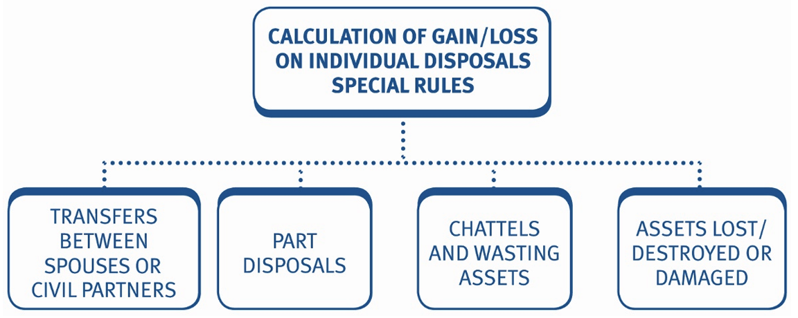
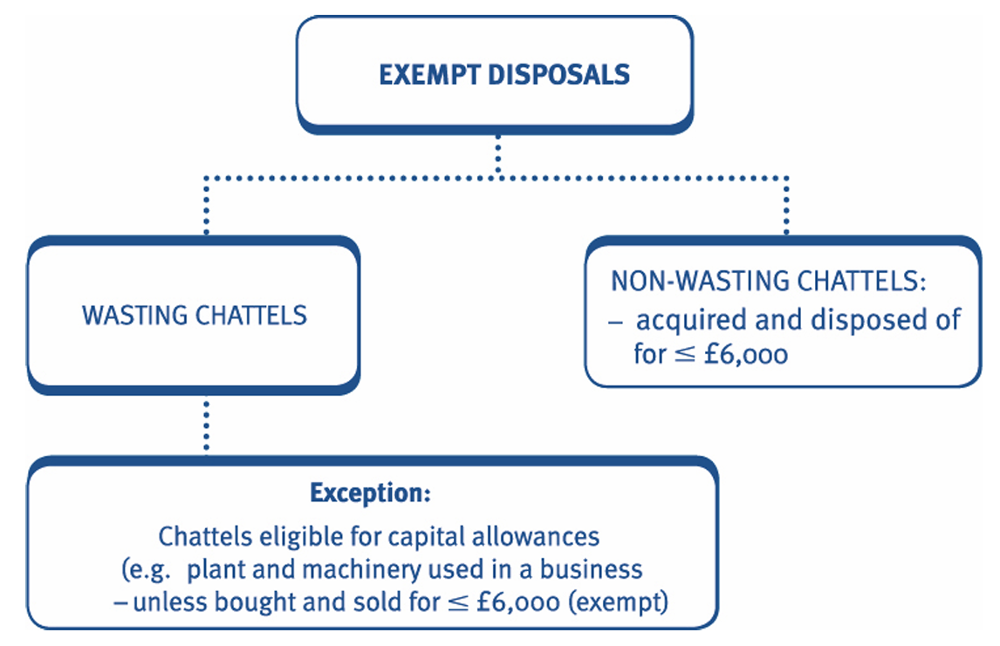
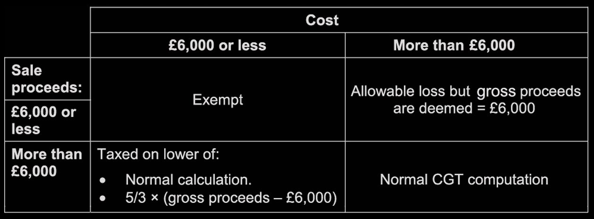
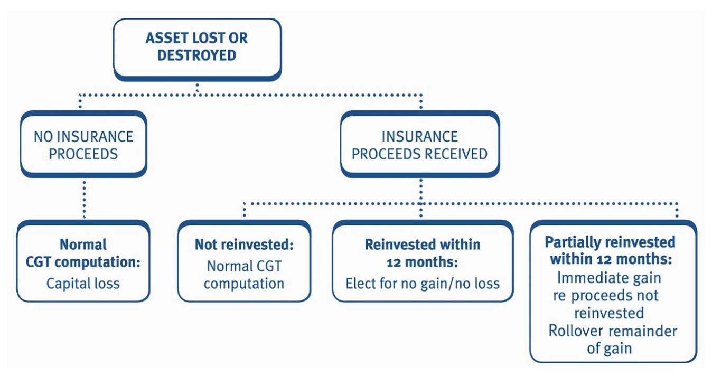

***Introduction***     
The basic pro forma for calculating gains on the disposal of assets is adapted by special rules in the following circumstances: 

1. transfers between spouses or civil partners 
2. part disposals 
3. chattels and wasting assets 
4. assets lost or destroyed 
5. damaged assets. 

Transfers between spouses or civil partners Where an asset is transferred between spouses or civil partners: 

• no gain or loss arises on the transfer 
• any actual proceeds are ignored 
• the transferor is deemed to dispose of the asset at its acquisition cost 
• the deemed proceeds of the transferor are treated as the deemed 

acquisition cost of the transferee (i.e. the recipient spouse acquires the asset at its original acquisition cost).

# Transfers between spouses or civil partners 

Where an asset is transferred between spouses or civil partners: 

- no gain or loss arises on the transfer 
- any actual proceeds are ignored 
- the transferor is deemed to dispose of the asset at its acquisition cost 
- the deemed proceeds of the transferor are treated as the deemed 

acquisition cost of the transferee (i.e. the recipient spouse acquires the asset at its original acquisition cost).

#### Example 1: Transfers between spouses and civil partners

David purchased some jewellery in August 2005 for £50,000. In July 2025 he gave it to his wife Victoria when it was worth £200,000. 

Calculate the deemed sale proceeds of David’s disposal and state Victoria’s deemed acquisition cost. 

**Solution**

David is **deemed** to have transferred the asset at its acquisition cost so that no gain or loss arises on the transfer. 

The deemed proceeds are therefore £50,000 and Victoria’s deemed acquisition cost is the same as David’s deemed proceeds (i.e. £50,000).

***Subsequent disposal by transferee*** 
On a subsequent disposal of the transferred asset by the transferee, the deemed acquisition cost (often referred to as the base cost of the asset) is the original acquisition cost to the first spouse. 

#### Example 2: Subsequent disposal CG

Fernanda acquired a **holiday cottage for £29,175** on 1 September 1997 and transferred it to her husband, Luiz, on 31 August 2018. Luiz sold the cottage to a third party on 31 January 2026 for **£42,000**. 

Compute the **chargeable gain** on Luiz’s disposal in January 2025.  

**Solution** 

|                                     | £          |
|-------------------------------------|------------|
| Chargeable gain (before deduction)  | 42,000     |
| Less: Deduction                     | (29,175)   |
| **Chargeable gain**                 | **12,825** |

#### Example 3: Subsequent disposal CG

John acquired a warehouse as an investment for **£100,000** on 1 September 2004. On 1 May 2018 he gave the warehouse to his wife, 

Tania, when it was worth £300,000. Tania sold the warehouse for **£341,000** on 1 July 2025. Tania had no other capital disposals in the tax year 2025/26, but has capital losses brought forward of **£11,800**. Her taxable income for the tax year 2025/26 is £45,000. 

Calculate Tania’s capital gains tax payable in the tax year 2025/26. 

**Solution**

***Planning opportunities***    
Married couples and civil partners can transfer assets between them at no tax cost (i.e. the assets are transferred at no gain/no loss). This provides opportunities to minimise their total capital gains tax liability. 

They can transfer assets between them to maximise the use of: 

- each individual’s annual exempt amount 
- each individual's basic rate band, and 
- capital losses.

#### Example 4: CGT payable Advise

Tereza, who is married to Kerry, made three chargeable disposals in the tax year 2025/26, as follows:

| Asset    | Chargeable gain | £        |
|----------|-----------------|----------|
| Asset 1  | Chargeable gain | 10,900   |
| Asset 2  | Chargeable gain | 19,600   |
| Asset 3  | Chargeable gain | 39,700   |

Tereza's only income for the year is a **trading profit of £45,270**, whilst Kerry has no taxable income.

(a) Calculate Tereza’s CGT payable for the tax year 2025/26.

(b) Advise how tax savings could have been made by the couple, and calculate the revised CGT payable by the couple assuming they had taken your advice.

---

**Solution**

(a) **Tereza’s CGT payable – 2025/26**

|                                     | £          |
|-------------------------------------|------------|
| Asset 1                             | 10,900     |
| Asset 2                             | 19,600     |
| Asset 3                             | 39,700     |
| **Total chargeable gains**          | **70,200** |
| Less: AEA                           | (3,000)    |
| **Taxable gains**                   | **67,200** |

|                                         | £        |
|-----------------------------------------|----------|
| Basic rate (W) – £5,000 × 18%           | 900      |
| Higher rate – £62,200 × 24%             | 14,928   |
| **Capital gains tax payable**            | **15,828** |

**Working:**  
Taxable income = (£45,270 – £12,570) = £32,700  
Remaining BR band = (£37,700 – £32,700) = £5,000  

**Note:**  
The question stated Tereza's trading income/profit rather than her taxable income and therefore her taxable income must be calculated to determine the remaining basic rate band.  

---

(b) ***Advice***

As a married couple, Kerry and Tereza can transfer assets between themselves at no gain/no loss (i.e. at no tax cost).  

Accordingly, they should transfer assets between themselves to ensure that they both use their AEAs and basic rate bands.  

If Tereza had transferred Asset 3 to Kerry, then the gain on the asset would be reduced by her AEA of £3,000 and taxed at 18%.  

**Tereza’s revised CGT payable for the year is as follows:**

|                                     | £          |
|-------------------------------------|------------|
| Asset 1                             | 10,900     |
| Asset 2                             | 19,600     |
| **Total**                           | **30,500** |
| Less: AEA                           | (3,000)    |
| **Taxable gain**                    | **27,500** |

|                                         | £        |
|-----------------------------------------|----------|
| Basic rate (as before) – £5,000 × 18%   | 900      |
| Higher rate – £22,500 × 24%             | 5,400    |
| **Capital gains tax payable**           | **6,300** |

---

**Kerry’s CGT payable would be:**

|                                     | £          |
|-------------------------------------|------------|
| Asset 3                             | 39,700     |
| Less: AEA                           | (3,000)    |
| **Taxable gain**                    | **36,700** |
| Basic rate – £36,700 × 18%          | 6,606      |
| **Capital gains tax payable**       | **6,606**  |

|                                          | £        |
|------------------------------------------|----------|
| Total CGT payable (£6,300 + £6,606)      | 12,906   |
| **Tax saving** (£15,828 – £12,906)       | 2,922    |

**Alternative tax saving calculation:**

| Use of Kerry's AEA (£3,000 × 24%)                      | 720      |
| Use of Kerry's basic rate band (£36,700 × (24% – 18%)) | 2,202    |
| **Total tax saving**                                   | **2,922** |

# Part disposals 

When there is a part disposal of an asset, we need to identify how much of the original cost of the asset relates to the part of the asset disposed of. 

The allowable cost of the part of the asset disposed of is calculated using the following formula: 

Cost × A/(A + B)     
***Where:***    

A = Value of the part disposed of 
B = Market value of the remainder at the time of the part disposal. 

The allowable cost, calculated using the formula, is then used in the basic capital gains tax computation as normal. Incidental costs of acquisition or enhancement expenditure, relating to: 

- solely the part of the asset being disposed of = deducted in full in the chargeable gain calculation 
- the whole asset (rather than just the part being disposed of) = apportioned in the same way as cost (i.e. A/A+B). 

#### Example 5: Part disposals 

Yayha acquired 20 hectares of land in March 2008 for **£6,000**. On 1 June 2025, he disposed of 8 hectares for **£8,000**. The value of the remaining 12 hectares at this date was **£15,000**.        
On 1 July 2025, Yayha sold the remainder of the land for £18,000. 

Calculate the **chargeable gains** arising on the disposals of land in the tax year 2025/26. 

**Solution**

***1 June 2025 disposal***

|                                                   | £         |
|---------------------------------------------------|-----------|
| Sale proceeds                                     | 8,000     |
| Less: Deemed cost of part disposed of             |           |
| £6,000 × £8,000 / (£8,000 + £15,000)              | (2,087)   |
| **Chargeable gain**                               | **5,913** |

> **Note** that the number of hectares owned and sold is irrelevant in calculating the cost of the land disposed of. **Always** use the (A/A + B) formula, which uses the **value** of the asset disposed of and retained.

***1 July 2025 disposal***

|                                                   | £          |
|---------------------------------------------------|------------|
| Sale proceeds                                     | 18,000     |
| Less: Deemed cost of the remainder                |            |
| (£6,000 – £2,087 (above))                         | (3,913)    |
| **Chargeable gain**                               | **14,087** |

#### Example 6: Part disposals 

Jacob bought 10 hectares of land for £8,000 in August 2012. He sold 3 hectares of the land for £20,000 in January 2026. At that time the remaining land was worth £60,000. 

In May 2014, Jacob spent £3,000 levelling the 3 hectares of land that were sold in January 2026. 

In March 2026 Jacob sold the remaining hectares for £66,300. Jacob's employment income for the tax year 2025/26 is £30,710. He has no other income. 

Calculate the chargeable gains arising on the two disposals of land and the capital gains tax payable for the tax year 2025/26. State the due date of payment. 

**Solution**

#### Example 7: Part disposals 

Gemma a bought a commercial investment property in May 2010 for **£50,000**. On 1 July 2016 she disposed of part of the land attached to the property for **£40,000**. The value of the property and the remaining land at this date was **£100,000**. 

Gemma paid legal fees of **£4,500** in relation to the purchase of the investment property and the land. 

On 1 August 2025 Gemma sold the property and remaining land for **£191,300**. 

Gemma's taxable income for the tax year 2025/26 is **£52,000**. 

Calculate the capital gains tax payable for the tax year 2025/26. 

**Solution**

# Chattels and wasting assets 

It is important to be able to identify a chattel and a wasting asset as there are special rules for calculating the gain or loss arising on them. 

## Chattels 

Chattels are defined as **tangible** movable property (e.g. a picture or table). 

Note that the asset must be: 

- movable – therefore a building is not a chattel 
- tangible – therefore shares are not chattels. 

***Wasting assets***     
A wasting asset is an asset with a **predictable life** not exceeding 50 years.            
Chattels may be wasting or non-wasting as follows.

|                   | Wasting chattels       | Non-wasting chattels |
|-------------------|------------------------|----------------------|
| **Expected life** | Not exceeding 50 years | More than 50 years   |
| **Examples**      | Greyhound              | Antiques             |
|                   | Boat                   | Jewellery            |
|                   | Plant and machinery    | Paintings            |
|                   | Racehorse              |                      |

> Plant and machinery are deemed to have a useful life of less than 50 years and are therefore always wasting chattels (however an exception applies to plant and machinery that is eligible for capital allowances). 

### Exempt disposals 

Certain disposals of chattels are exempt from capital gains tax as follows. 

#### Example 1: Chattels (wasting or non-wasting)

Hana has made the following disposals in the tax year 2025/26. 

1. A painting was sold in July 2025 for £5,600. She originally bought it in February 2000 for £3,500. 
2. A piece of land, which she bought in April 2015 for £2,000 (as an investment), was sold in September 2025 for £5,000. 
3. She sold a vintage car for £25,000 in November 2025 that had originally cost £5,500 in June 2009. 
4. She bought a movable crane for £20,000 in August 2002, which she used in her haulage business. She sold the crane for £10,000 in January 2026. 
5. An antique vase was sold in August 2025 for £10,000. It originally cost £8,000 in April 2010. 
6. In October 2025 she sold her half share in a racehorse for £5,000, which she had acquired in June 2011 for £4,000. 

For each of the above transactions, state whether they are chattels (wasting or non-wasting) and whether they will be subject to capital gains tax. 

**Solution**

1. The painting is a non-wasting chattel which was bought and sold **for less than £6,000**. This is therefore an **exempt** disposal. 
2. Land is not movable property and is therefore **not a chattel**. The disposal is therefore *chargeable to capital gains tax*. 
3. Cars are always exempt assets for capital gains tax purposes. 
4. The crane is a **wasting chattel**, which is **eligible for capital allowances** as it is used in a business. The disposal is therefore not an exempt disposal. The loss on disposal however, is not allowable as it is relieved via capital allowances. 

> Because the crane is used in a trade, it qualifies for capital allowances. That means tax relief has already been given through the capital allowances system .

> Even though wasting chattels are often exempt from CGT, the exemption does not apply when the asset is used in a business and capital allowances have been claimed. So the disposal must be considered within the capital allowances framework, not CGT exemption rules.

> If the crane is sold at a loss compared to its cost, that loss is not allowable as a capital loss Because the tax system already provides relief for the decline in value through capital allowances. Allowing a capital loss as well would be double relief, which the rules prevent.

5. The antique vase is a non-wasting chattel. As it was bought and sold for more than £6,000 it is chargeable to capital gains tax. 
6. A racehorse is a wasting chattel and is therefore exempt from capital gains tax. 

#### Example 2: Chattels (wasting or non-wasting)

Which of the following disposals are exempt from, and which are chargeable to, capital gains tax? 

1. Gift of a necklace which was bought for £4,000. Its market value at the date of the gift was £7,000. 
2. Sale of shares in a quoted trading company for £2,000 which were bought for £1,000. 
3. Sale of a car, for £5,000, which was used for business purposes. It was acquired for £6,000. 
4. Sale of a boat for £20,000, which was acquired for £15,000. 
5. Sale of a painting for £5,000, which was acquired for £1,000. 
6. Sale of a greyhound for £10,000, which was acquired for £5,000.

**Solution**

### ***Non-wasting chattels***    

When a non-wasting chattel is disposed of the following rules apply: 

1. asset bought and sold for £6,000 or less = exempt 
2. asset bought and sold for more than £6,000 = the chargeable gain is computed in the normal way 
3. asset either bought or sold for £6,000 or less = special rules apply: 
    
    - Sold at a gain 
    Calculate the chargeable gain as normal but the gain is restricted to a maximum of: 
    5/3 × (gross disposal consideration – £6,000)

These rules are referred to as the £6,000 rule and can be summarised in the table below:

#### Example 3: Non-wasting chattels CGT 

Andrew sold a picture on 1 February 2026 for £6,600. He had acquired it on 1 March 2014 for £3,200.

**Calculate the chargeable gain arising on the disposal.**

**Solution**

As the picture is a non-wasting chattel that was sold for more than £6,000, the disposal is not an exempt disposal.

|                                                   | £        |
|---------------------------------------------------|----------|
| Sale proceeds                                     | 6,600    |
| Less: Cost                                        | (3,200)  |
| **Unrestricted gain**                             | **3,400** |

***Gain is restricted to:***              
$5/3 \times (£6,600 - £6,000) = £1,000$         
so the chargeable gain is **£1,000**.

#### Example 4: Non-wasting chattels CGT 

Hasan bought an antique table for **£6,500** in September 2011 and sold it for **£5,600** in December 2025. He incurred **£250** to advertise it for sale.

**Calculate the allowable loss arising, if any.**

**Solution**

This is a disposal of a non-wasting chattel that cost more than £6,000 but which was sold for less than £6,000. The disposal is not an exempt disposal but the allowable loss is restricted as follows:

|                              | £         |
|------------------------------|-----------|
| Deemed gross sale proceeds   | 6,000     |
| Less: Expenses of sale       | (250)     |
| **Net sale proceeds**        | **5,750** |
| Less: Cost                   | (6,500)   |
| **Allowable loss**           | **(750)** |

#### Example 5: Non-wasting chattels CGT 

Marjory bought two antique tables in March 1995 for £1,000 each. She sold them both in October 2025 for £6,400 and £13,600 respectively. 

Calculate the chargeable gains arising on the disposal of the two antique tables. 

**Solution**

#### Example 6: Non-wasting chattels CGT 

Brian bought a picture in April 1993 for £10,400 plus purchase costs of £100. The market for the artist’s work slumped and Brian sold the picture on 27 June 2025 for £500, less disposal costs of £50. 

Calculate the allowable loss on disposal of the picture.

**Solution**

#### Example 7: Non-wasting chattels CGT 

During January 2026, Leyla sold four paintings, which she had acquired in May 2010. Details were as follows.

| Painting | Cost (£) | Proceeds (£) |
|----------|----------|--------------|
| 1        | 2,000    | 7,000        |
| 2        | 8,000    | 4,500        |
| 3        | 3,000    | 5,500        |
| 4        | 7,000    | 9,500        |

Calculate Leyla’s net chargeable gains for the tax year 2025/26.

**Solution**

### ***Wasting assets*** 

Wasting assets (i.e. predictable life of 50 years or less) can be split into the following categories: 

1. Chattels not eligible for capital allowances = exempt from CGT. 
2. Chattels eligible for capital allowances. 
3. Other wasting assets.

:::{.callout}
***1. Chattels not eligible for capital allowances*** 

This type of wasting asset is exempt from CGT. 

This category of asset could include plant and machinery, even where it is used in a trade.  

For example, if a sole trader is using the cash basis to calculate tax adjusted trading profits (Chapter 7), plant and machinery is not eligible for capital allowances. Instead, the original cost of plant and machinery is deductible against trading profits, and the sale proceeds included as income. Therefore, any profit on disposal would be included in trading profits, and there will be no CGT implications on disposal.
:::

:::{.callout}
***2. Chattels eligible for capital allowances*** 

For example, plant and machinery used for the purposes of a trade. Where capital allowances have been claimed on an asset, in the gain/loss computation we must consider the *tax relief* already given for the net cost of the asset in the capital allowances computation. 

Accordingly the following rules apply: 

- Sold at a gain Calculate the gain as normal, applying the £6,000 rule if applicable. Any capital allowances given over the life of the asset will have been clawed back with a balancing charge on disposal. 
- Sold at a loss The capital loss is restricted as relief for the loss has already been given through the capital allowances system. 

In the capital loss computation, the net capital allowances (i.e. net of balancing charges on disposal) are deducted from the allowable expenditure. 

> Accordingly, plant and machinery which is eligible for capital allowances and sold at a loss, results in a no gain/no loss situation for CGT purposes.

:::

#### Example 7: Wasting chattels CGT 

Sarah elects to use the accruals basis for tax purposes. She bought a machine for use in her trade for **£35,000** in May 2016. In October 2025 she decided to replace it and sold the old machine for **£40,000**.

**Calculate the chargeable gain arising on the disposal in October 2025.**

**Solution**

The asset was sold at a gain. The capital gain is therefore calculated as normal.

|                                         | £         |
|-----------------------------------------|-----------|
| Sale proceeds                           | £         |
| Less: Cost                              | (35,000)  |
| **Chargeable gain**                     | **5,000** |

#### Example 8: Wasting chattels CGT 

Murad elects to use the accruals basis for tax purposes. He bought a machine for use in his trade for **£35,000** in April 2012. In October 2025 he decided to replace it and sold the old machine for **£26,500**.

**Calculate the chargeable gain or allowable loss arising.**

**Solution**

Murad has sold the machine for a real loss of £8,500 (£35,000 – £26,500). ***He is compensated for this loss through the capital allowances system*** (i.e. he receives net capital allowances of £8,500 in respect of the machine).

The capital loss computation is therefore adjusted to reflect the relief for the loss already given through capital allowances as follows:

|                                         | £        |
|-----------------------------------------|----------|
| Sale proceeds                           | 26,500   |
| Less: Cost                              | (35,000) |
| Add: Net capital allowances             | 8,500    |
| **Adjusted loss**                       | **0**    |

:::{.callout}
***3. Other wasting assets*** 

This category covers wasting assets that are not chattels as they are not tangible and/or not movable (e.g. a copyright). The allowable expenditure on these assets is deemed to waste away over the life of the asset on a **straight line basis**.

Consequently, when a disposal is made:

- the allowable expenditure is restricted to take account of the asset’s ***natural fall in value***.
- the asset’s fall in value is deemed to occur on a **straight line basis** over its predictable useful life
- the allowable cost is calculated as:

$$
\text{Cost} \times \frac{\text{Remaining life at disposal}}{\text{Estimated useful life}}
$$

:::

#### Example 9: Other wasting assets

On 1 February 2015 Ian bought a wasting asset (that is not a chattel) at a cost of £24,000. It had an estimated useful life of 30 years. He sold the asset for £38,000 on 1 February 2026.

**Calculate the chargeable gain or allowable loss arising.**

**Solution**

|                                                   | £          |
|---------------------------------------------------|------------|
| Sale proceeds                                     | 38,000     |
| Less: Allowable element of acquisition cost (W)   | (16,000)   |
| **Chargeable gain**                               | **22,000** |

---

**Working: Allowable element of acquisition cost**

|                                  |             |
|----------------------------------|-------------|
| Estimated useful life            | 30 years    |
| Remaining life at disposal       | 20 years    |
| Allowable cost = £24,000 × 20/30 | **£16,000** |

#### Example 10: Other wasting assets

On 1 March 2020 Jan bought a wasting asset (which is not a chattel) at a cost of £19,000. It had an estimated useful life of 40 years. She sold the asset for £30,000 on 1 March 2026. 

Calculate the chargeable gain or allowable loss arising.

**Solution**

# Assets lost or destroyed or damaged 

A capital transaction usually has two parties, a buyer and a seller. However, when an asset is damaged, destroyed or lost and the asset’s owner receives compensation (either from the person who caused the 
loss, damage or destruction, or an insurance company) the position is different. 

The owner has received a capital sum without disposing of the asset and the compensation payer has received nothing in return. 

Consequently, a special set of rules is required. The rules vary according to whether: 

1. the asset has been completely lost/destroyed or merely damaged 
2. the owner has replaced or restored the asset.

## Assets lost or destroyed 

There is a deemed disposal for capital gains tax purposes as follows: 

***(a) No insurance proceeds***     
Compute a *capital loss* using the normal CGT computation:

- Disposal proceeds are £Nil. 
- Deduction of the allowable expenditure will create a loss. 

***(b) Insurance proceeds received***    
no replacement of asset Chargeable gain/loss is computed using the normal CGT computation pro forma. The insurance proceeds received are the proceeds in the CGT pro forma. 

***(c) Insurance proceeds received – asset replaced within 12 months***    
The taxpayer can claim that the destruction/loss of the asset is treated as a no gain/no loss disposal (as for transfers between spouses/civil partners).              
If the insurance proceeds are greater than the deemed disposal proceeds under the no gain/no loss computation, the **excess is deducted from the replacement asset’s allowable cost**. 

***(d) Insurance proceeds received – partially used to replace asset within 12 months***    
There is an immediate chargeable gain in respect of the excess proceeds that are not reinvested in the replacement asset.                           
The remainder of the gain can be deferred by electing for the no gain/no loss treatment in (c) above. 

> The date of disposal is the date that the insurance proceeds are received, not the date the destruction or loss of the asset occurred. 

Where insurance proceeds have been reinvested, a claim must be made **within 4 years** of the end of the tax year, if the taxpayer wishes to claim no gain/no loss treatment.  

#### Example 1: Assets lost or destroyed

Nadir purchased a capital asset for **£15,000** on 1 April 2000, which was destroyed by fire on 31 July 2025. *The asset was not insured*.

**Calculate the allowable loss arising in the tax year 2025/26.**

**Solution**

|                           | £        |
|---------------------------|----------|
| Proceeds                  | 0        |
| Less: Cost                | (15,000) |
| **Allowable loss**         | **(15,000)** |

#### Example 2: Assets lost or destroyed

Padma purchased an antique table for **£35,000** on 1 May 2002, which was destroyed by fire on 30 June 2025. She received *insurance proceeds* of **£50,000** on 1 September 2025. *She did not replace the table*.

**Calculate the chargeable gain arising in the tax year 2025/26.**

**Solution**

|                                             | £          |
|---------------------------------------------|------------|
| Insurance proceeds                          | 50,000     |
| Less: Cost                                  | (35,000)   |
| **Chargeable gain**                         | **15,000** |

#### Example 3: Assets lost or destroyed

Silvio purchased a painting for **£57,000** on 1 June 2004 which was destroyed in a fire on 31 July 2025. He received *insurance proceeds* of **£50,000** on 1 September 2025. *He did not replace the painting*.

**Calculate the allowable loss arising in the tax year 2025/26.**

**Solution**

|                                             | £           |
|---------------------------------------------|-------------|
| Insurance proceeds                          | 50,000      |
| Less: Cost                                  | (57,000)    |
| **Allowable loss**                          | **(7,000)** |

#### Example 4: Assets lost or destroyed

Bill purchased an asset for **£25,000** on 1 October 2000, which was destroyed by fire on 30 September 2025. He received compensation of **£35,000** from his insurance company on 1 January 2026. He purchased a replacement asset for **£40,000** on 1 February 2026. 

Assuming that Bill claims the loss by fire to be a no gain/no loss disposal, calculate the **allowable expenditure (base cost)** of the replacement asset.

**Solution**

|                                                 | £          | £          |
|-------------------------------------------------|------------|------------|
| Cost of replacement asset                       |            | 40,000     |
| Compensation                                    |  35,000    |            |
| Less: Deemed disposal proceeds of old asset (N) | (25,000)   |            |
|                                                 |            | (10,000)   |
| **Replacement asset base cost**                 |            | **30,000** |

> ***n:*** Since the disposal of the old asset is assumed to be on a no gain/no loss basis. The disposal proceeds are the allowable cost of the asset.

|                                                | £        |
|------------------------------------------------|----------|
| Allowable cost = Deemed disposal proceeds      | **25,000** |

#### Example 5: Assets lost or destroyed

Belinda purchased an antique necklace for **£21,140** on 1 October 2006, which she lost on 30 June 2018. She received compensation of **£45,000** from her insurance company on 1 October 2018 and purchased a replacement necklace for **£50,000** on 1 November 2018. 

She sold the replacement necklace for **£65,000** on 1 March 2026. 

Assuming that Belinda claims the loss of the necklace to be a no gain/no loss disposal, calculate the ***chargeable gain arising on the sale of the replacement necklace*** on 1 March 2026. 

**Solution** 

|                                               | £          |
|-----------------------------------------------|------------|
| Sale proceeds                                 | 65,000     |
| Less: Cost (W)                                | (26,140)   |
| **Chargeable gain**                           | **38,860** |

---

**W – Replacement asset base cost**

|                                               | £          | £          |
|-----------------------------------------------|------------|------------|
| Cost of replacement necklace                  |            | 50,000     |
| Insurance proceeds                            |  45,000    |            |
| Less: Deemed disposal proceeds 'Base cost'    | (21,140)   |            |
|                                               |            |  (23,680)  |
| **Replacement asset base cost**               |            | **26,320** |

#### Example 6: Assets lost or destroyed

Morgan purchased a holiday cottage for **£83,040** on 4 May 2011, which was destroyed in a hurricane on 27 October 2024. They received insurance proceeds of **£113,000** on 5 June 2025 and purchased a replacement holiday apartment for **£103,440**.

**Assuming that Morgan claims to defer the gain arising from the insurance proceeds, calculate any gain arising in the tax year 2025/26 and state the base cost of the replacement apartment.**

**Solution**

|                                              | £          |
|----------------------------------------------|------------|
| Insurance proceeds                           | 113,000    |
| Less: Cost                                   | (83,040)   |
| **Total gain**                               | **29,960** |
| Less: Gain deferred (balancing figure)       | [(20,400)]{style="font-size: 18px; text-decoration: underline;"}   |
| **Chargeable gain (£113,000 – £103,440)**    | **9,560**  |

| Base cost of holiday apartment:               | £        |
|-----------------------------------------------|----------|
| Purchase price                                | 103,440  |
| Less: Deferred gain                           | (20,400) |
| **Base cost**                                 | **83,040** |

## Asset damaged

There are no implications for capital gains tax purposes unless compensation (e.g. insurance proceeds) is received. 

Where an asset is damaged and compensation is received there is a **part disposal** for capital gains tax purposes. The allowable cost is calculated using the normal part disposal formula:

***Cost × A/A + B*** 

Where:  

- A = Compensation received 
- B = Market value of the remainder at the time of the part disposal (i.e. value in its damaged condition). 

The computation is varied depending on how the insurance proceeds are applied. 

(a) Proceeds not used in restoration work Normal part disposal capital gains computation is used. The value of the part retained is the value of the asset in its damaged condition. 

(b) Proceeds fully used in restoration work Where all of the insurance proceeds are used in restoring the asset the taxpayer may claim to *deduct the proceeds from the cost of the asset* rather than be treated as having made a part disposal of the asset. 

#### Example 7: Asset damaged – Sasha

Sasha purchased a painting on 1 April 2010 for **£10,000**. The painting was damaged on 1 May 2025 when it was worth £50,000. After the damage the painting was worth **£25,000**. On 1 July 2025 insurance proceeds of **£30,000** were received, which were not used to restore the painting. 

Calculate the chargeable gain arising in respect of the painting. 

**Solution**

|                                                         | £          |
|---------------------------------------------------------|------------|
| Insurance proceeds                                      | 30,000     |
| Less: Deemed cost £10,000 × £30,000/(£30,000 + £25,000) | (5,455)    |
| **Chargeable gain**                                     | **24,545** |

#### Example 8: Asset damaged

Amy purchased a painting on 1 April 2010 for **£10,000**. The painting was damaged on 1 May 2025 when it was worth £50,000. After the damage the painting was worth **£40,000**. On 1 July 2025 insurance proceeds of **£8,000** were received. All of the proceeds were *used immediately to restore the painting*. 

Assuming Amy elects for the insurance proceeds to be *rolled over* against the cost of the painting,calculate the **revised base cost for CGT purposes** of the painting after it has been restored. 

**Solution**

There is ***no part disposal*** and the revised base cost of the painting is: 

|                                  | £          |
|----------------------------------|------------|
| Original cost                    | 10,000     |
| Plus: Restoration expenditure    | 8,000      |
| Less: Insurance proceeds         | (8,000)    |
| **Revised base cost**            | **10,000** |

Note that when the amount spent on restoring the asset is the same as the insurance proceeds then the ***revised base cost is the same as the original cost.***

#### Example 9: Asset damaged

Sari purchased a commercial investment property on 1 May 2012 for **£200,000**. In June 2023 it was damaged by fire. On 1 August 2025 insurance proceeds of **£100,000** were received. On 1 September 2025 **£110,000** was spent on restoring the property. After the restoration the property was worth £500,000. 

Assuming Sari elects for the insurance proceeds to be rolled over against the cost of the property calculate **the revised base cost for CGT purposes** of the property after it has been restored. 

**Solution**

As the proceeds are fully used in restoration and the ‘rollover’ election is made, there is no part disposal and the revised base cost is: 

|                                        | £           |
|----------------------------------------|-------------|
| Original cost                          | 200,000     |
| Plus: Restoration expenditure          | 110,000     |
| Less: Insurance proceeds               | (100,000)   |
| **Revised base cost**                  | **210,000** |

# Practices on Additional aspects

## Objective Test (OT) questions

### Q1: CG - Part Disposal

:::{.callout}
Denis bought 20 hectares of land on 13 September 2023 for **£30,000**. 

On 22 November 2025, Denis sold 10 hectares for **£60,000** and the market value of the remaining land at that time was **£15,000**. 

What is Denis’s chargeable gain arising on the disposal of the land in November 2025? 

A. £30,000      
B. £24,000      
C. £45,000      
**D. £36,000**      

:::

### Q2: Wasting Chattel

:::{.callout}

Laticia makes the following **capital disposals** in the tax year 2025/26: 

1. A machine, which she used for business purposes, that was purchased for £8,000 and sold for £10,000. 
2. A greyhound which was purchased for £7,000 and sold for £15,000. 
3. A painting that was purchased for £4,000 and sold for £7,500. 
4. Land that was purchased for £1,000 and sold for £5,200. 

Which of these capital disposals are chargeable to capital gains tax? 

A. 1, 2 and 3          
B. 1 and 4 only          
C. 3 and 4 only          
**D. 1, 3 and 4** 

> The greyhound is a **wasting chattel** and therefore exempt. 

:::

### Q3: Insurance Compensation

:::{.callout}
Nikhil purchased a valuable painting which was destroyed in a fire. He received compensation from his insurance company but did not purchase a replacement. 

The transaction is treated as follows: 

A. No gain arises as there is no disposal       
B. The transaction is treated as a disposal at no gain/no loss       
C. The value of the insurance proceeds received are treated as a chargeable gain       
**D. A gain/loss is computed using the normal chargeable gains rules** 

:::

### Q4: Non-wasting chattel

:::{.callout}
Gaynor sold an antique vase for £7,800 in July 2025, incurring an auctioneer’s fee of 1% of the gross sales value. She bought the vase in December 2014 for £2,300. 

What is Gaynor’s chargeable gain? 

A. Nothing, the transaction is exempt from capital gains tax         
B. £5,422        
C. £5,500        
**D. £3,000**        

|                                                       | £        |
|-------------------------------------------------------|----------|
| Gross sale proceeds                                   | 7,800    |
| Less: Auctioneer's fee (7.8K × 1%)                    | (78)     |
| Less: Allowable costs                                 | (2,300)  |
| **Capital gain**                                      | **5,422**|

***Restricted to:***  
$$
5/3 \times (£7,800 - £6,000) = £3,000
$$

> The asset qualifies as a **chattel**, but is **not a wasting chattel**, and therefore is not exempt. 

> As the chattel has been sold for more than £6,000 but ***purchased for equal to or less than £6,000***, the eventual gain should be restricted to 5/3 × (gross sale proceeds – £6,000).

:::

## Constructed response questions

### Q1: 
