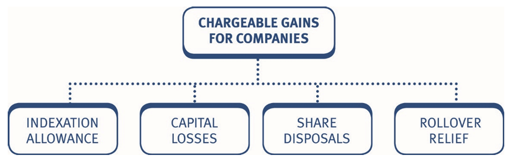
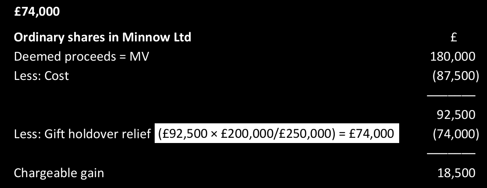
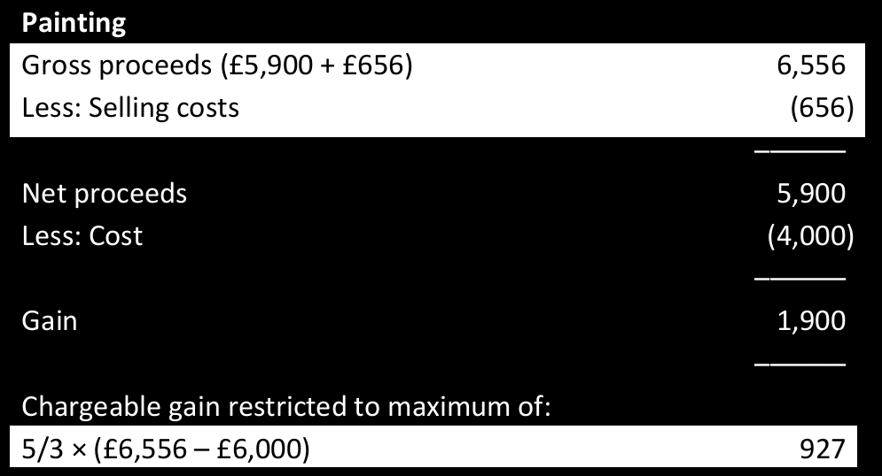

# Chargeable gains for a company

The total net chargeable gains that a company makes during an accounting period (AP) are included in the taxable total profits computation.

It is important to remember that companies pay **corporation tax** on **chargeable gains**, not capital gains tax. 

## Calculation of total net chargeable gains for a company  

The following steps should be completed: 

1. Calculate the chargeable gain/allowable loss arising on the disposal of each chargeable asset separately. 
2. Calculate the net chargeable gains arising in the AP = (chargeable gains less allowable losses) 
3. Deduct capital losses brought forward = total net chargeable gains 
4. Include in taxable total profits computation. 

> Note that there is ***no annual exempt*** amount available to companies. The total net chargeable gains are therefore simply included in the company’s taxable total profits computation.

***Pro forma – companies***

| Description                                      | £         |
|--------------------------------------------------|-----------|
| Disposal proceeds                                | X         |
| Less: Incidental disposal costs                  | (X)       |
| **Net proceeds**                                 | **X**     |
| Less: Allowable expenditure (as for individuals) | (X)       |
| **Unindexed gain**                               | **X**     |
| Less: Indexation allowance (section 2)           | (X)       |
| **Chargeable gain/(allowable loss)**             | **X/(X)** |

***Note that:*** 

- The calculation of chargeable gains is the same as for individuals except that companies are entitled to an **indexation allowance** for assets acquired **prior to December 2017**. 
- There are a few other key differences when dealing with the disposal of assets by companies. These include the treatment of capital losses the treatment of shares and securities, and the availability of reliefs. 

## Indexation allowance 

The indexation allowance (IA) gives a company some allowance for the effect of **inflation** in calculating a gain. 

The rules for the IA are as follows: 

- the IA applies to assets purchased prior to **December 2017**.  
- the IA is calculated as: cost of the asset × indexation factor  
- the indexation factor is the movement in the **retail price index (RPI)** from the month of purchase  to the month of disposal (or December 2017 if earlier). 
- the IA is calculated **separately** for each item of expenditure (e.g. calculate a different IA for the *original acquisition cost* and any *subsequent enhancement expenditure* because they have ***different purchase dates***). 
- the IA cannot create or increase a capital loss. 

#### Example 1: Indexation Allowances

Pye Ltd bought a factory for **£250,000**, on *1 April 1998*. On *15 August 2001*, the company spent **£70,000** on an extension to the factory. The factory was sold on *30 September 2025*, for **£950,000**.

Assume the relevant indexation factors are as follows:

| Period                           | Indexation factor |
|----------------------------------|-------------------|
| April 1998 to December 2017      | 0.710             |
| August 2001 to December 2017     | 0.598             |

---

**Calculate Pye Ltd’s chargeable gain.**

**Solution**

|                                                   | £           |
|---------------------------------------------------|-------------|
| Sale proceeds                                     | 950,000     |
| Less: Cost                                        | (250,000)   |
| Less: Enhancement expenditure                     | (70,000)    |
| **Unindexed gain**                                | **630,000** |
| **Less: Indexation allowance**                    |             |
| Cost (£250,000 × 0.710)                           | (177,500)   |
| Enhancement expenditure (£70,000 × 0.598)         | (41,860)    |
| **Chargeable gain**                               | **410,640** |

#### Example 2: Indexation Allowances

Hobbit Ltd bought a factory for £175,000 on 1 June 2000. On 15 January 2019, the company spent £62,000 on an extension to the factory. The factory was sold on 31 August 2025, for £680,000.           
Assume the indexation factor is as follows: 

June 2000 to December 2017: **0.625** 

Calculate Hobbit Ltd’s chargeable gain. 

**Solution**

# Capital losses 

A capital loss arises if the proceeds received for an asset are lower than the allowable expenditure. 

> Remember that the indexation allowance cannot create or increase a capital loss. 

#### Example 1: Capital loss

JNN Ltd is considering selling a field at auction in July 2025. It acquired the field in August 1992, for £10,000 and the sale proceeds are likely to be one of three figures: 

(a) £25,000     
(b) £12,000     
(c) £8,000     

Calculate the chargeable gain or loss under each alternative.            
Assume the indexation factor from August 1992 to December 2017 is **1.002**. 

**Solution**

## Utilisation of a capital loss 

- Where allowable losses arise, they are set off against chargeable gains arising in the same accounting period. 
- Any loss remaining, is carried forward against chargeable gains of future accounting periods, **as soon as they arise**. 
- Capital losses **cannot be**: 

    - set off against any other income of a company, nor  
    - carried back against gains in previous accounting periods. 

#### Example 2: Capital losses

For the year ended 31 March 2026, Jump Ltd has a tax adjusted trading profit of **£65,000**, and a chargeable gain of **£3,600**.

At 1 April 2025, it had *unused* capital losses brought forward of **£6,000**.

**Calculate Jump Ltd’s **corporation tax liability** for the year ended 31 March 2026.**

**Solution**

**Corporation tax liability – y/e 31 March 2026**

|                                          | £          |
|------------------------------------------|------------|
| Tax adjusted trading profit              | 65,000     |
| Net chargeable gain (Working)            | 0          |
| **Taxable total profits**                | **65,000** |

|                                             | £          |
|---------------------------------------------|------------|
| Corporation tax (£65,000 × 25%)             | 16,250     |
| Less: Marginal relief (250K – 65K) × 3/200  | (2,775)    |
| **Corporation tax liability**               | **13,475** |

---

**Working: Net chargeable gain**

|                                             | £           |
|---------------------------------------------|-------------|
| Chargeable gain                             | 3,600       |
| Less: Capital loss brought forward          | (6,000)     |
| **Excess capital loss**                     | **(2,400)** |

Net chargeable gain in the accounting period is therefore **£Nil**.

The remaining capital losses cannot be set against the tax adjusted trading profit of the company in the year, they can only be carried forward and set against future chargeable gains.

#### Example 3: Capital losses

For the year ended 31 March 2026, High Ltd has a tax adjusted trading profit of £300,000, and a chargeable gain of £17,000. At 1 April 2025, it had unused capital losses brought forward of £23,000. 

Calculate High Ltd’s corporation tax liability for the year ended 31 March 2026. 

**Solution**

# Shares and securities 

The issues regarding the disposal of shares by a company are similar to those set out in Chapter 19 for disposals by individuals. 

:::{.callout-tip}
Remember that: 

Shares and securities present a particular problem for capital gains computations, because any two shares in a company (of a particular class) are *indistinguishable*.            
**Matching rules** are therefore needed, to solve the problem of identifying acquisitions with disposals. 

They apply when there has been more than one purchase of shares or securities of the same class, in the same company.

:::

***Matching rules***       
The matching rules for shares disposed of by companies are different from those for an individual.       
For a company, disposals are matched against acquisitions as follows: 

1. shares acquired on the same day (as the sale) 
2. shares acquired during the nine days before the sale (FIFO basis) 
3. shares in the share pool.

#### Example 1: Disposal of shares and securities

Minnie Ltd sold *3,000 shares* in Mickey plc for **£15,000**, on 15 February 2026. The shares in Mickey plc were purchased as follows:

| Date                | Number of shares | Cost   |
|---------------------|------------------|--------|
| 1 July 2007         | 1,000            | 2,000  |
| 1 September 2011    | 1,000            | 2,500  |
| 8 February 2026     | 500              | 1,200  |
| 15 February 2026    | 1,500            | 6,000  |

**Explain which shares Minnie Ltd is deemed to have sold.**

**Solution**

Using the matching rules, the 3,000 shares sold are as follows:

| Step | Matching rule                               | Number of shares |
|------|---------------------------------------------|------------------|
| 1    | Same day purchases: 15 February 2026        | 1,500            |
| 2    | Previous 9 days purchases: 8 February 2026  | 500              |
|      | **Subtotal**                                | **2,000**        |
| 3    | **Share pool:**                             |                  |
|      | 1 July 2007                                 | 1,000            |
|      | 1 September 2011                            | 1,000            |
|      | **Total shares in pool**                    | **2,000**        |
|      | Disposal from pool (remaining needed)       | (1,000)          |
|      | **Shares left in pool**                     | **1,000**        |
|      | **Total shares disposed of**                | **3,000**        |

#### Example 2: Disposal of shares and securities 

From the previous illustration (Minnie Ltd), calculate the gains on the shares purchased:

(a) on the same day      
(b) in the previous 9 days.     

**Solution**

Calculate sale proceeds per share:  
3,000 shares are sold for £15,000, therefore 1 share is sold for **£5.00** (£15,000 / 3,000).

---

**(a) Gain on same day purchases (1,500 shares):**

|                                          | £        |
|------------------------------------------|----------|
| Sale proceeds (£5 × 1,500)               | 7,500    |
| Less: Allowable cost                     | (6,000)  |
| **Chargeable gain**                      | **1,500** |

**(b) Gain on previous 9 days purchases (500 shares):**

|                                         | £         |
|-----------------------------------------|-----------|
| Sale proceeds (£5 × 500)                | 2,500     |
| Less: Allowable cost                    | (1,200)   |
| **Chargeable gain**                     | **1,300** |

> There is no **Indexation Allowance IA** on either of these calculations. 

The share pool for companies is different from the share pool for individuals: 

- It contains shares in the same company, of the same class, purchased more than 9 days before the date of disposal. 
- The pool keeps a record of the:  

    - number of shares acquired and sold  
    - cost of the shares, and 
    - indexed cost of the shares (i.e. cost plus IA).

- Each purchase and sale is **recorded** in the pool, but the indexed cost must be updated before recording an 'operative event' (i.e. a sale or purchase). 
- When shares are disposed of out of the share pool, the appropriate proportion of the cost and indexed cost which relates to the shares disposed of is calculated on an average cost basis (as for individuals).

#### Example 3: Disposal of shares and securities

Continuing the previous illustration of Minnie Ltd, calculate the chargeable gain on the ***disposal from the share pool.***

Assume the indexation factors are as follows:

- **July 2007 to September 2011**: 0.154  
- **September 2011 to December 2017**: 0.169  

**Solution**

|                                          | £        |
|------------------------------------------|----------|
| Sale proceeds (£5 × 1,000)               | 7,500    |
| Less: Allowable cost (Working)           | (2,250)  |
| **Unindexed gain**                       | **2,750** |
| Less: Indexation allowance (Working)     | (561)    |
| **Chargeable gain**                      | **2,189** |

---

***Working: Share pool***

| Date / Event                              | Number of shares | Cost   | Indexed cost |
|-------------------------------------------|------------------|--------|--------------|
| **July 2007 purchase**                    | 1,000            | 2,000  | 2,000        |
| IA to next operative event (July 2007 to Sept 2011) |                  |        |              |
| 0.154 × £2,000                            |                  |        | 308          |
| **September 2011 purchase**               | 1,000            | 2,500  | 2,500        |
| **Total before next IA**                   | **2,000**        | **4,500** | **4,808**    |
| IA to next operative event (Sept 2011 to Dec 2017) |                  |        |              |
| 0.169 × £4,808                            |                  |        | 813          |
| **Total before disposal**                  | **2,000**        | **4,500** | **5,621**    |
| **February 2026 sale (Note)**             | (1,000)          | (2,250)| (2,811)      |
| **Pool carried forward**                   | **1,000**        | **2,250** | **2,810**    |

**Note:** Half of the shares sold, therefore take out half of the cost and indexed cost.

#### Example 4: Disposal of shares and securities

Braganza Ltd sold 10,000 ordinary shares in the FRP Co plc, a quoted company, on 20 December 2025, for £70,000.

The company had bought the ordinary shares on the following dates:

| Date                | Number of shares | Cost   |
|---------------------|------------------|--------|
| 1 April 2003        | 8,000            | 25,250 |
| 22 December 2005    | 4,000            | 7,500  |

**Calculate the chargeable gain arising on the disposal.**

Assume indexation factors of:

- April 2003 to December 2005: 0.071
- December 2005 to December 2017: 0.433

**Solution**

## Bonus and rights issues 

The key points to remember are as follows: 

• A **bonus issue** is the distribution of **free shares** to shareholders, based on existing shareholdings. 
• A **rights issue** involves shareholders paying for new shares, usually at a rate below market price and in proportion to their existing shareholdings. 
• In both cases, the shareholder is making a new acquisition of shares. 
• However, for matching purposes, such acquisitions arise out of the original holdings. They are not treated as a separate holding of shares. 
• Bonus and rights issues are therefore added to the shares already held within the pool. 

### Bonus issues 

- As a bonus issue is free shares (i.e. no cost is involved), there is **no indexation** to be calculated. 
- A bonus issue is **not an operative event** in the share pool. 
- Simply, add the bonus issue shares to the share pool at **£Nil** cost. 

When the next operative event occurs (e.g. next sale or purchase), index from the operative event before the date of the bonus issue.

### Rights issues 

- A rights issue is simply a purchase of shares (usually at a price below the market rate). 
- Therefore, it should be treated as an operative event, in the same way as a normal purchase in the share pool: 

1. Index up to the date of the rights issue (or December 2017, if earlier), then 
2. Add in the number of shares and their cost.

#### Example 5: Bonus issue

Alpha Ltd acquired shares in S plc, a quoted company, as follows:    
2,000 shares acquired *in June 2003*, for £11,500.

In October 2016, there was ***a 1 for 2 bonus issue***.

**Set up the share pool and deal with the events up to and including the bonus issue.**

**Solution**

| Share pool                            | Number of shares | Cost       | Indexed cost |
|---------------------------------------|------------------|------------|--------------|
| Purchase (June 2003)                  | 2,000            | 11,500     | 11,500       |
| Bonus issue (October 2016) (1 for 2)  |                  |            |              |
| 1/2 × 2,000                           | 1,000            | 0          | 0            |
| **Total after bonus issue**           | **3,000**        | **11,500** | **11,500** |

**Note:** Do not index up to the date of the bonus issue as no cost is involved. The next time there is an operative event, IA will be calculated from June 2003 (the last operative event).

#### Example 6: Bonus issue

Spencer Ltd sold 2,000 ordinary shares out of a holding of 5,000 shares in Plumb Ltd, on 30 September 2025, for £15,400.

Spencer Ltd prepares accounts every year to 31 March. The holding of shares in Plumb Ltd had been built up as follows:

| Date acquired        | Number of shares | Cost   |
|----------------------|------------------|--------|
| May 2000             | 4,000            | 7,000  |
| March 2011 – Bonus issue 1 for 4 | 1,000 | 0      |

Compute the chargeable gain arising on the sale of shares, in the year ended 31 March 2026.

Assume the indexation factors are:

- May 2000 to March 2011: 0.362
- May 2000 to December 2017: 0.629
- March 2011 to December 2017: 0.196

**Solution**

#### Example 7: Rights issue

Amber Ltd sold 2,600 shares in Pearl Ltd in December 2025 for **£30,000**.

Amber Ltd originally acquired 3,000 shares in Pearl Ltd in June 2002 for **£11,500**. In December 2009 Amber Ltd took up its entitlement ***to a 1 for 4 rights issue*** at ***£3 per share***.

**Calculate the chargeable gain arising on disposal of the shares, in December 2025.**

Assume the following indexation factors apply:

- June 2002 to December 2009: 0.237
- June 2002 to December 2017: 0.578
- December 2009 to December 2017: 0.276

**Solution**

***Chargeable gain***

|                                                         | £          |
|---------------------------------------------------------|------------|
| Sale proceeds                                           | 30,000     |
| Less: Cost (Working)                                    | (9,533)    |
| **Unindexed gain**                                      | **20,467** |
| Less: Indexation allowance (£14,576 – £9,533) (Working) | (5,043)    |
| **Chargeable gain**                                     | **15,424** |

---

***Working: Share pool***

| Date / Event                          | Number of shares | Cost       | Indexed cost |
|---------------------------------------|------------------|------------|--------------|
| **Purchase – June 2002**              | 3,000            | 11,500     | 11,500       |
| IA to December 2009 (0.237 × £11,500) |                  |            | 2,726        |
| **Total before rights issue**         | **3,000**        | **11,500** | **14,226**   |
| **Rights issue (1 for 4) at £3**      | 750              | 2,250      | 2,250        |
| **Total before next IA**              | **3,750**        | **13,750** | **16,476**   |
| IA to December 2017 (0.276 × £16,476) |                  |            | 4,547        |
| **Total before disposal**             | **3,750**        | **13,750** | **21,023**   |
| **Disposal – December 2025**          |                  |            |              |
| (2,600/3,750) × £13,750;  £21,023     | (2,600)          | (9,533)    | (14,576)     |
| **Balance carried forward**           | **1,150**        | **4,217**  | **6,447**    |

---

**Note:** The indexed cost is updated prior to the rights issue, because it is a purchase which involves additional cost (i.e. it is an operative event).

Following the disposal, there are 1,150 shares in the pool, with a cost of £4,217 and an indexed cost of £6,447.

This will be used as the starting point, when dealing with the next operative event.

# Takeovers/reorganisations 

We have already considered takeovers and reorganisations in relation to an individual taxpayer (Chapter 19). The same principles apply to disposals by companies as summarised below. 

__Consideration: shares for shares__ 

Where the consideration for the reorganisation or takeover only involves the issue of shares in the acquiring company, the tax consequences are: 

- No chargeable gain arises at the time of the reorganisation or takeover. 
- The cost of the original shares becomes the cost of the new shares. 
- Where the shareholder receives more than one type of share, in exchange 

***for the original shares:***    
the cost of the original shares is allocated to the new shares by reference to the market values of the various new shares on the first day of dealing in them after the reorganisation/takeover. 

:::{.callout}
***Mixed consideration***     
When both cash and shares are received on a takeover: 

- There is a **part disposal** of the original shares. 
- A **chargeable gain** arises on the **cash element** of the consideration. 
- The calculation of the chargeable gain is the same as for individuals (Chapter 19) except that indexation allowance must be taken into account.

:::

#### Example 1: Takeovers/reorganisations 

In June 2002, Major Ltd purchased **2,000** ordinary shares in Blue plc, for **£5,000**.

In July 2017, Blue plc was taken over by Red plc, and Major Ltd ***received 2 ordinary shares and 1 preference share in Red plc***, for each ordinary share in Blue plc.

Immediately after the takeover, the ordinary shares in Red plc, were *quoted at £2* and the preference shares in Red plc, *were quoted at £1*.

In December 2025, Major Ltd sold all of its holding of ordinary shares in Red plc, for **£8,000**.

**Calculate the chargeable gain arising in December 2025.**

| Indexation factors         | Value    |
|----------------------------|----------|
| June 2002 to July 2017     | 0.549    |
| July 2017 to December 2017 | 0.019    |
| June 2002 to December 2017 | 0.578    |

**Solution**

|                                                     | £         |
|-----------------------------------------------------|-----------|
| Sale proceeds                                       | 8,000     |
| Less: Cost (W3)                                     | (4,000)   |
| **Unindexed gain**                                  | **4,000** |
| Less: Indexation allowance (£6,314 – £4,000) (Note) | (2,314)   |
| **Chargeable gain**                                 | **1,686** |

---

**Workings:**

**(W1) Share pool – Blue plc**

| Date / Event                                | Number of shares | Cost      | Indexed cost |
|---------------------------------------------|------------------|-----------|--------------|
| June 2002 – purchase                        | 2,000            | 5,000     | 5,000        |
| IA to takeover – July 2017 (0.549 × £5,000) |                  |           | 2,745        |
| **Balance at takeover**                     | **2,000**        | **5,000** | **7,745**    |

---

**(W2) Allocation of cost of shares in Blue plc**

**Major Ltd received:**

| Share type                             | Market value | Cost allocation | Indexed cost allocation |
|----------------------------------------|--------------|-----------------|-------------------------|
| 4,000 ordinary shares (valued at £2)   | 8,000        | 4,000           | 6,196                   |
| 2,000 preference shares (valued at £1) | 2,000        | 1,000           | 1,549                   |
| **Total**                              | **10,000**   | **5,000**       | **7,745**               |

The *cost and indexed cost attributable to the ordinary shares* is calculated as:

$$
\frac{8,000}{10,000} \times £5,000 = £4,000
$$

$$
\frac{8,000}{10,000} \times £7,745 = £6,196
$$

New share pools are then established for the new ordinary and preference shares received in Red plc.

***(W3) Share pool in Red plc – ordinary shares***

| Date / Event                         | Number of shares | Cost      | Indexed cost |
|--------------------------------------|------------------|-----------|--------------|
| July 2017                            | 4,000            | 4,000     | 6,196        |
| IA to December 2017 (£6,196 × 0.019) |                  |           | 118          |
| **Total before disposal**            | **4,000**        | **4,000** | **6,314**    |
| December 2025 – Disposal             | (4,000)          | (4,000)   | (6,314)      |
| **Balance carried forward**          | **0**            | **0**     | **0**        |

---

***Tutorial note:***   
Technically IA should be calculated up to the date of the takeover (i.e. from June 2002 to July 2017) on the original shares in the share pool. The new shares then inherit the indexed cost at the date of the takeover. On the disposal of the new shares, this indexed cost is indexed from July 2017 to December 2017 as shown above.

However, performing just one IA calculation from June 2002 to December 2017 will not give a materially different answer. This approach is therefore an acceptable short cut in the examination.

|                                                           | £         |
|-----------------------------------------------------------|-----------|
| Sale proceeds                                             | 8,000     |
| Less: Cost                                                | (4,000)   |
| **Unindexed gain**                                        | **4,000** |
| Less: IA from June 2002 to December 2017 (£4,000 × 0.578) | (2,312)   |
| **Chargeable gain**                                       | **1,688** |

#### Example 2: Takeovers/reorganisations 

In July 2025, during its year ended 31 December 2025, Concert Ltd sold its entire holding of ordinary shares in Corus plc, for £75,000.        
Concert Ltd had originally purchased 20,000 £1 ordinary shares in BNB plc, at a cost of £20,000, in April 2007. 

In July 2013, BNB plc was taken over by Corus plc. Concert Ltd received one ordinary 50p share and one 50p 6% preference share in Corus plc, for each ordinary share it held in BNB plc. 

Immediately after the takeover, the value of these new shares was: 

50p ordinary share £1.80 each            
50p preference share £0.80 each            

(a) Compute the chargeable gain arising in the year ended 31 December 2025. The relevant indexation factor to be used is 0.354.                     
(b) Explain the consequences had Concert Ltd received cash of £16,000 rather than preference shares in July 2013. 

**Solution**

# Reliefs available to companies 

The only capital gains relief available to companies is **rollover relief**. The other reliefs covered in Chapter 20 are not applicable to companies. 

***Rollover relief for companies***    
Rollover relief (ROR) for companies operates, in general, in the same way as for individuals. The rules are summarised below.

:::{.callout-important}
***Rollover relief***      

- ROR allows a company to replace assets used in its trade, without incurring a corporation tax liability on the related chargeable gains. 
- The gain arising on the disposal of the business asset, is deducted from (rolled over against), the acquisition cost of the new asset. 
- Provided the proceeds are fully reinvested, no tax is payable at the time of the disposal. 
- Common assets which qualify for ROR in the examination are: 
    
    - Land and buildings that are both occupied and used for trading purposes. 
    - Fixed plant and machinery ('fixed' means immovable). 

- The acquisition of the ***replacement asset must occur during a period that begins one year before the sale of the old asset and ends three years after the sale.*** 
- The new asset must be brought into use in the trade when it is acquired. 
- Where disposal proceeds of the old asset are not fully reinvested, the ***surplus retained***, reduces the amount of chargeable gain that can be rolled over. 

- When an asset has not been used entirely for business purposes throughout the company’s period of ownership, ROR is **scaled down** in proportion to the non-business use. 
- If reinvestment is in a **depreciating asset**, the chargeable gain is deferred until the earliest of:   

    - disposal of the depreciating asset 
    - depreciating asset ceases to be used for trading purposes.
    - 10 years after the depreciating asset was acquired. 

- Any asset with a predictable life of not more than 60 years, is a depreciating asset. 
- If a new non-depreciating asset is acquired before the deferred gain becomes chargeable, ROR can be claimed and the deferred gain is deducted from the base cost of the new non-depreciating asset. 

:::

The key differences in the rules for companies are as follows: 

- goodwill is ***not a qualifying asset*** for companies 
- the gain deferred is the **'indexed gain'** (i.e. the gain after IA) 
- claim must be made within **four years** of the later of the end of the accounting period in which the asset is 
    - sold, and 
    - replaced.

#### Example 1: Reliefs available to companies

Medway Ltd has been offered 160,000 for a freehold factory that it owns, and is considering disposing of the factory in January 2026. The company acquired the factory on 15 March 2009, for 45,000.                 
The factory has always been used by Medway Ltd for business purposes.

Explain the chargeable gains implications of each of the following alternative courses of action that Medway Ltd is considering:

(a) Acquire a larger freehold factory in April 2026, for 170,000.               
(b) Acquire a smaller freehold factory in April 2026, for 155,000.
(c) Using the proceeds to pay a premium of El 80,000 in April 2026, for a 40-year lease of a new factory (it is possible that a freehold warehouse will be bought in the next two or three years for an estimated cost of E200,000).

Assume the following indexation factor applies:       
***March 2009 to December 2017: 0.316***

**Solution**

::::: {.columns}

::: {.column width="45%"}
## 👤 Individuals

**Taxation:**

- Capital gains tax (CGT) – tax separately from income

**Annual exempt amount (AEA):** ✅

**Indexation allowance to Dec 2017:** ❌

**Matching rules – Shares purchased:**

1. On the same day
2. In the following 30 days (FIFO)
3. In the share pool

**Treatment of capital losses:**

- Offset against current year gains without restriction
- Carry forward against future net AEA

**Reliefs available:**

- Business asset disposal relief ✅
- Gift relief ✅
- Principal private residence (PRR) ✅
- Investors' relief ✅
- Rollover relief ✅
:::

::: {.column width="5%"}

:::

::: {.column width="50%"}
## 🏢 Companies

**Taxation:**

- Corporation tax – include in TTP
- Tax with income

**Annual exempt amount (AEA):** ❌

**Indexation allowance to Dec 2017:** ✅

**Matching rules – Shares purchased:**

1. On the same day
2. In the previous 9 days (FIFO)
3. In the share pool

**Treatment of capital losses:**

- Offset against current year gains without restriction
- Carry forward against future net gains without restriction

**Reliefs available:**

- Business asset disposal relief ❌
- Gift relief ❌
- Principal private residence (PRR) ❌
- Investors' relief ❌
- Rollover relief ✅ *(but not on goodwill)*
:::

:::::

# Practices on Additional aspects

## Objective Test (OT) questions

:::{.callout}
### Q1: Chargeable gain - Indexation
X Ltd sold a building for proceeds of **£330,000**. The building cost **£250,000**. Surveyor and agents fees totalling **£2,500** were also paid by X Ltd when the building was purchased. 

What is the chargeable gain or allowable loss arising on this disposal?              
Use an indexation factor of **0.316**. 

A. £1,000 gain              
B. (£2,290) loss              
**C. £0**              
D. (£1,500) loss              

:::

:::{.callout}
### Q2: Chargeable gain - Part Disposal
Walton Ltd bought 20 hectares of land on 13 January 2021 for **£30,000**. On 22 November 2025, the company sold 10 hectares for **£60,000** and the market value of the remaining land at that time was **£15,000**. 

On 17 March 2022 Walton Ltd had levelled the 10 hectares that were not sold at a cost of £7,400. 

What is the chargeable gain arising on the disposal of the land in November 2025? 

A. £41,300        
B. £45,000        
C. £30,080        
**D. £36,000**        

> The enhancement to the 10 hectares which were not sold will not affect this gain.  It will be deducted when the remaining hectares are sold.

:::

:::{.callout}
### Q3: Chargeable gain - Indexation
In August 2025, Greengrass plc sold a property for **£750,000** which it purchased in April 1999 for **£125,000**. In November 2010 the property was redecorated at a cost of **£5,000**.

What is the chargeable gain arising on the disposal? The indexation factors are:

| Period                         | Indexation factor |
|--------------------------------|-------------------|
| April 1999 – December 2017     | 0.683             |
| November 2010 – December 2017  | 0.226             |

A. £531,210         
B. £596,750         
**C. £539,625**         
D. £533,495         

>  Redecoration is revenue expenditure and does not qualify as a capital improvement.  

:::

:::{.callout}
### Q4: Chargeable gain - Indexation
XYZ Ltd sold an unwanted factory for **£634,000** on 15 March 2026. The company had paid **£120,000** for the factory on 2 January 2012. XYZ Ltd had incurred expenses of **£8,000** in buying the factory. 

The relevant indexation factor is **0.168**.         
What is XYZ Ltd’s chargeable gain arising on the above disposal?          

A. £493,840        
**B. £484,496**        
C. £485,840        
D. £506,000        

> Indexation allowance is calculated on the total acquisition costs of £128,000

:::
### Q5: Indexation
:::{.callout}

Forrest Ltd bought a warehouse for £250,000 in December 2009, incurring £20,000 legal fees in connection with the acquisition. The warehouse was sold for £830,000 in May 2025, incurring legal fees of £30,000. 

Assume the relevant indexation factors are as follows: 

December 2009 to December 2017 **0.276** 

What is the chargeable gain arising on the sale of the warehouse? 

A. £461,000      
**B. £455,480**      
C. £447,200      
D. £530,000      

---

Harrop Ltd sold two assets during the accounting period: 
1. Two hectares of land which it had acquired for £20,000 and sold for £45,000. The relevant indexation factor is **1.418**. 
2. A warehouse which it had acquired for £80,000 and sold for £75,000. The relevant indexation factor is **0.702**. 

What is the company’s allowable loss for the period, assuming it sold no other assets? 

A. £64,520        
B. £8,360        
**C. £5,000**        
D. £61,160        

> The indexation allowance cannot increase or create a loss. 

:::

:::{.callout}
### Q6: Capital loss c/f
In the year ended 30 June 2025 Lompy Ltd had a tax adjusted trading profit of £800,200 and property income of £45,000. It also realised a chargeable gain of £25,000 and a capital loss of £80,000 on assets that were used for the purposes of the property business. In the year ended 30 June 2024 it had a tax adjusted trading profit of £520,000 and chargeable gains of £9,000. 

How much, if any, of the capital loss arising in the year ended 30 June 2025 is carried forward to the year ended 30 June 2026? 

**55k**

:::

:::{.callout}
### Q7: Indexation - Shares
Rimbo Ltd had the following transactions in the shares of Profitable Ltd, an investment company:

| Date        | Transaction | Number of shares | £        |
|-------------|-------------|------------------|----------|
| April 1995  | Purchase    | 25,000           | 33,000   |
| June 2025   | Sale        | 8,000            | 26,000   |

Assume the relevant indexation factors are as follows:

April 1995 to December 2017: 0.866

What is the amount of the indexed cost available on the sale of the shares in June 2025?

A. £61,578        
B. £28,578        
**C. £19,705**        
D. £10,560      

:::

:::{.callout}

On 1 October 2025 Smooth Ltd sold a factory for £850,000, realising a gain of £250,000.       
On 1 November 2024 the company had purchased an immovable machine for £900,000. The machine is expected to be used by the company for at least 25 years. 

The company prepares accounts to 31 December. 

The company wishes to defer the gain arising on the sale of the factory by making a rollover relief election in respect of the acquisition of the machine. 

For each of the following statements select whether it is true or false: 

The £250,000 gain which could be deferred as a result of the acquisition of the machine will become chargeable on 1 October 2035

The company must make a rollover relief election by 31 December 2029

:::

## Objective Test Cases (OTC)

### Q1: MICHAEL CHIN

Michael Chin made the following disposals of assets during the tax year 2025/26:

1. On 30 June 2025 Michael sold a business that he had run as a sole trader since 1 January 2021. He realised the following gains and losses on the chargeable assets of the business:

   | Asset              | Amount (£) |
   |--------------------|------------|
   | Goodwill           | 60,000     |
   | Freehold property  | 64,000     |
   | Storage unit       | (13,000)   |

   The goodwill has been built up since 1 January 2021. The freehold property had been acquired 6 months prior to the date of disposal and the storage unit had been acquired on 1 June 2022.

2. On 8 December 2025 Michael gave Mika, his daughter, his entire holding of 50,000 50p ordinary shares (a 60% holding) in Minnow Ltd, an unquoted trading company. The market value of the shares on that date was £180,000.

   Michael had originally purchased the shares on 5 January 2025 for £87,500. On 8 December 2025 the market value of Minnow Ltd’s chargeable assets was £250,000, of which £200,000 was in respect of chargeable business assets. Michael has never been employed by Minnow Ltd.

3. On 28 February 2026 Michael sold a painting for £5,900 after auctioneer’s fees of £656. He had originally acquired the painting on 1 June 2024 for £4,000.

4. On 15 March 2026 Michael gave Mika, his daughter, the following assets:
   - Necklace valued at £4,000. Acquired by Michael for £5,000.
   - Boat valued at £80,000. Acquired by Michael for £70,000.
   - Machine used for trading activities valued at £7,000. Acquired by Michael for £8,000.

Michael incurred a capital loss of £16,800 during the tax year 2023/24, and made a chargeable gain of £7,800 and a capital loss of £7,000 during the tax year 2024/25.

Assume that the tax rates and allowances for the tax year 2025/26 apply throughout.

:::{.callout}

#### Q1.1: Sole trader business CG

What is the net chargeable gain on the disposal of the sole trader business on 30 June 2025 that qualifies for business asset disposal relief? 

A. £124,000       
**B. £111,000**       
C. £60,000       
D. £51,000      

:::

:::{.callout}
#### Q1.2: Gift holdover relief - personal trading company
What amount of gift holdover relief, if any, is available on the gift of shares in Minnow Ltd on 8 December 2025? 

> Gift holdover relief is available as ordinary shares in an unquoted trading company are qualifying assets for gift holdover relief purposes. However full relief is not available as the shares are in Michael’s personal trading company and the company holds investments.

:::

:::{.callout}
#### Q1.3: Non wasting chattels
What is the chargeable gain, if any, arising on the sale of the painting on 28 February 2026? 

A. £1,244      
B. £0      
C. £1,900      
**D. £927**   

:::

### Q2: BO

You are a trainee accountant and your manager has asked for your help regarding a client who disposed of assets during the tax year 2025/26. 

**Bo Neptune**            
On 31 July 2025 Bo made a gift to his son, Chi, of his entire holding of 50,000 £1 ordinary shares (a 100% holding) in Botune Ltd, an unquoted trading company. The market value of the shares on that date was £210,000. The shares had been purchased by Bo on 22 January 2018 for £94,000. Bo and Chi have elected to hold over the gain as a gift of a business asset. 

Bo has taxable income in the tax year 2025/26 of £30,700 and had made a chargeable gain on the sale of a painting of £11,400. Bo has never made any other chargeable disposals. 

**Saffie Jupiter**     
On 30 September 2025 Saffie sold a house for £282,000, resulting in a chargeable gain of £172,000. The house had been purchased on 1 October 2013. 

She occupied the house as her main residence from the date of purchase until 30 September 2015. Saffie then moved in with her girlfriend and the house was unoccupied between 1 October 2015 and 30 September 2025. Throughout the period 1 October 2013 to 30 September 2025 Saffie did not have any other main residence.

:::{.callout}
#### Q2.1: Base cost for gifted shares
What is Chi’s base cost in the 50,000 £1 ordinary shares in Botune Ltd? 

**A. £94,000**      
B. £97,000      
C. £116,000      
D. £210,000     

> Since no consideration has been paid for the shares, all of Bo’s chargeable gain can be held over (i.e. deferred) with a gift holdover relief claim.

:::

:::{.callout}
#### Q2.2: Sold shares instead of gifting
If Bo had instead sold the shares in Botune Ltd to Chi for £160,000, for each of the following statements select whether it is true or false:

Bo’s chargeable gain would have been £66,000    T         
Bo and Chi would not have been able to claim gift holdover relief     F  
The base cost of the shares for Chi would be £210,000   F

:::

:::{.callout}
#### Q2.3: CG and Claim dates
When is the capital gains tax due date(s) for the tax year 2025/26 and by what date must Bo and Chi make the election to hold over the gain on the Botune Ltd shares? 

> Capital gains tax is due under self-assessment, with the balancing payment for income tax, on 31 January following the tax year i.e. 31 January 2027 for the tax year 2025/26. 

> A gift holdover relief claim must be made within four years of the end of tax year of the gift i.e. 5 April 2030 for a disposal in the tax year 2025/26.  

:::

:::{.callout}
#### Q2.4: CG Bands
Assuming that no other chargeable gains arise in the tax year, how much capital gains tax would Bo pay on the disposal of the painting in the tax year 2025/26?  

**1,400**

> 1400 × 0.24 + 7000 × 0.18

:::

:::{.callout}
#### Q2.5: private residence relief PRR
How much private residence relief is Saffie entitled to on the sale of her main residence? 

A. £172,000      
B. £82,417      
**C. £39,417**      
D. £38,729      

> 172 × ((2+9/12)/12)

:::

### Q3: ALPHABET LTD

On 15 October 2025 Alphabet Ltd, an unquoted trading company, was taken over by XYZ plc. Prior to the takeover Alphabet Ltd’s share capital consisted of 100,000 £1 ordinary shares and under the terms of the takeover the shareholders received either cash of £6 per share or one £1 ordinary share in XYZ plc for each £1 ordinary share in Alphabet Ltd.  

The following information is available regarding three shareholders of Alphabet Ltd: 

**Aloi**      
Aloi has been the managing director of Alphabet Ltd since the company’s incorporation on 1 January 2015, and she accepted XYZ plc’s cash alternative of £6 per share in respect of her shareholding of 60,000 £1 ordinary shares in Alphabet Ltd. Aloi had originally subscribed for 50,000 shares in Alphabet Ltd on 1 January 2015 at their par value, and purchased a further 10,000 shares on 20 May 2016 for £18,600. 

**Bon**      
Bon has been the sales director of Alphabet Ltd since 1 February 2024, having not previously been an employee of the company. She accepted XYZ plc’s share alternative of one £1 ordinary share for each of her 25,000 £1 ordinary shares in Alphabet Ltd. Bon had purchased her shareholding on 1 February 2024 for £92,200. 

On 4 March 2026 Bon gave 10,000 of her £1 ordinary shares in XYZ plc to her brother for £50,000. On that date the shares were quoted on the Stock Exchange Daily Official List at £7.10 – £7.18. Gift holdover relief is not available in respect of this disposal. 

**Cherry**     
Cherry has been an employee of Alphabet Ltd since 1 May 2016. She accepted XYZ plc’s share alternative of one £1 ordinary share for each of her 3,000 £1 ordinary shares in Alphabet Ltd. 

Cherry had purchased her shareholding on 20 June 2017 for £4,800. On 13 November 2025 Cherry sold 1,000 of her £1 ordinary shares in XYZ plc for £6,600. 

Cherry died on 5 April 2026, and her remaining 2,000 £1 ordinary shares in XYZ plc were inherited by her daughter. On that date these shares were valued at £15,600.

:::{.callout}
#### Q3.1: Share as part disposal, cuz takeover bruh..

What is the chargeable gain, if any, arising on Aloi on the takeover of Alphabet Ltd? 

**291,400**

> 360,000 - 68,600

:::

:::{.callout}
### Q3.2: CG

What is the chargeable gain or allowable loss on the disposal of shares in XYZ plc by Bon to her brother? 

A. £13,120 gain        
B. £34,120 gain        
**C. £34,520 gain**        
D. (£20,800) loss        

> ((7.1+7.18)/2*10000)-(92200*10/25)

:::

:::{.callout}
### Q3.3: capital gains tax due date
By what date(s) must Bon pay any capital gains tax due as a result of the disposal of shares in XYZ plc? 

**A. 31 January 2027**        
B. 30 September 2026       
C. 4 March 2027        
D. 5 December 2026        

:::

:::{.callout}
### Q3.4: Cost of Shares on Death                
What is the allowable cost that will be used by Cherry’s daughter in the capital gains computation on a subsequent disposal of her inherited shares in XYZ plc? 

**A. £15,600**      
B. £4,800      
C. £2,000      
D. £3,200      

> Transfers on death are exempt disposals for CGT purposes. The daughter’s cost of acquisition on a subsequent disposal is the probate value i.e. the market value of the shares at the date of death. 

:::

### Q4: LILY

Lily disposed of various assets during the tax year 2025/26, resulting in chargeable gains. Lily’s disposals included the following:

**A copyright sold on 30 June 2025**

The copyright had been purchased on 1 July 2022 for £22,000 when it had an unexpired life of 15 years.

---

**Four hectares of land sold on 12 August 2025**

Lily had originally purchased six hectares of land on 30 May 2013 for £84,000. The four hectares of land were sold for £140,000, and the market value of the unsold two hectares of land at the time of sale was £60,000. Prior to the disposal, Lily spent £14,400 clearing and levelling the four hectares of land that were sold.

---

**A house sold on 31 December 2025**

The house had been purchased on 1 January 2012, and throughout the 168 months of ownership had been occupied by Lily as follows (periods shown chronologically):

| Period                           | Months |
|----------------------------------|--------|
| Occupied                         | 32     |
| Unoccupied – travelling overseas | 36     |
| Unoccupied – required to work elsewhere in the United Kingdom | 60     |
| Occupied                         | 20     |
| Unoccupied – travelling overseas | 20     |
| **Total**                        | **168** |

Throughout the period 1 January 2012 to 31 December 2025, Lily did not have any other main residence.  

**Cash received following the takeover of Moon plc by Sun plc on 22 February 2026** 

Lily had originally purchased her £1 ordinary shares in Moon plc on 18 July 2016 for £27,280.               
Under the terms of the takeover, Lily received total cash of £19,800 and 22,000 £1 ordinary shares in Sun plc. Immediately after the takeover, Sun plc’s £1 ordinary shares were quoted at £2.20.  

**Lily's sister**      
Lily's sister has chargeable gains for the year 2025/26 of £44,200 which qualify for business asset disposal relief and £107,400 of chargeable gains relating to the disposal of a residential property which is not her main residence.  

Lily's sister does not have any taxable income for the tax year 2025/26. 

:::{.callout}
### Q4.1: Base Cost copyright - Remaining Life Paet Disposal
What cost figure will have been used in calculating the chargeable gain on the disposal of Lily's copyright? 

A. £22,000          
**B. £17,600**          
C. £4,400          
D. £19,067          

:::

:::{.callout}
#### Q4.2: Part the disposal of land - Total deductions 
What are the total deductions which will have been allowed in calculating the chargeable gain on the disposal of Lily's four hectares of land? 

A. £68,880        
**B. £73,200**        
C. £70,400        
D. £58,800        

> 84000*140/200+14400

:::

:::{.callout}
#### Q4.3: Period of occupation
What is the total period of occupation (both actual and deemed) for the purposes of calculating the private residence relief on the disposal of Lily's house? 

**A. 145 months**        
B. 157 months        
C. 168 months        
D. 136 months  

> The deemed occupation must be preceded and succeeded by periods of occupation so the first period of 36 months is covered as absence for any reason (up to three years) and 

> the second period of working elsewhere in the UK is covered for 48 months, and 

> the “three years for any reason” period has already been utilised. The final period of travelling is not covered as deemed occupation since there was no actual occupation afterwards (and the “three years for any reason” period has already been utilised). 

> However, nine months of the final period of ownership are covered as deemed occupation, even if not actually occupied.   

:::

:::{.callout}
#### Q4.4: CG on Cash for Takeover 
What is Lily's chargeable gain in respect of the cash received following the takeover of Moon plc by Sun plc? 

**A. £11,880**      
B. £6,878      
C. £19,800      
D. £8,640      

:::

:::{.callout}
#### Q4.5: BADR & Other
What is Lily's sister's capital gains tax liability for the tax year 2025/26? 

A. £31,964          
B. £28,982          
C. £31,544          
**D. £31,244**         

:::

### Q5: ALBERT AND CHARLES

**Albert and Victoria**

On 12 February 2026, Albert sold a house for £840,000, which he had owned individually. The house had been purchased on 12 February 2010 for £222,900.

Throughout the period of ownership the house was occupied by Albert and his wife, Victoria, as their main residence. One-quarter of the house was always used exclusively for business purposes by the couple.

For the tax year 2025/26 Albert is a higher rate taxpayer and did not make any other disposals of assets.

For the tax year 2025/26 Victoria had taxable income of £21,440 and made chargeable gains on other disposals of £3,000.

---

**Charles and Daphne**

On 23 October 2025 Charles sold 4,000 £1 ordinary shares in Restoration plc, a quoted trading company, to his daughter, Daphne, for £20,000 when they were valued at £31,600. Gift holdover relief is not available in respect of this gift.

The company has 4 million £1 ordinary shares in issue. Charles has never worked for the company, but Daphne has worked for the company for the previous five years.

Charles acquired his shares in the company as follows:

- **1 March 2017**  
  Purchased 20,000 shares for £19,800  

- **20 July 2021**  
  Purchased 8,000 shares for £27,800  

On 4 April 2026 Daphne sold a painting for gross proceeds of £5,300. The painting had been purchased for £13,000 in September 2009. Daphne incurred auctioneer’s fees of £300 in relation to the disposal.

:::{.callout}
#### Q5.1: PRR
What is the amount of private residence relief available on the disposal of the house by Albert? 

A. £154,275         
**B. £462,825**         
C. £469,253         
D. £460,575         

> (£840,000 – £222,900) × 3/4

:::

:::{.callout}
#### Q5.2: Spouses Planning
Albert’s brother Ernest has told Albert it would have been better to have transferred 50% ownership of the house to Victoria prior to its disposal. Which TWO of the following statements are correct? 

**A. The transfer to Victoria would have been at nil gain/nil loss**        
B. Private residence relief available would not have been available in relation to Victoria’s gain on the disposal of the house        
C. The amount of capital gains tax that would have been saved is £3,902        
**D. The amount of capital gains tax that would have been saved is £976**        

> lower rate of CGT applied (£16,260 × (24% – 18%))

:::

:::{.callout}
#### Q5.3: Base cost of Gifted Shares Using Averagea
What is the allowable base cost used in the capital gains tax computation on Charles’ sale of shares to Daphne? 

**6,800** 

| Date                | Description                              | Number of shares | Cost   |
|---------------------|------------------------------------------|------------------|--------|
| 1 March 2017        | Purchase                                 | 20,000           | 19,800 |
| 20 July 2021        | Purchase                                 | 8,000            | 27,800 |
| **Total before disposal** |                                    | **28,000**       | **47,600** |
| 23 October 2025     | Disposal (£47,600 × 4,000/28,000)        | (4,000)          | (6,800) |
| **Balance c/f**      |                                          | **24,000**       | **40,800** |

:::

:::{.callout}
#### Q5.4: Non Wasting Chattel
What is Daphne’s allowable loss, if any, in respect of the sale of the painting on 4 April 2026? 

**A. (£7,300) loss**       
B. (£7,000) loss       
C. £0       
D. (£8,000) loss       

:::

### Q6: ZOYLA

Zoyla’s capital gains tax (CGT) liability for the tax year 2025/26 is calculated as follows:

|                                    | £        |
|------------------------------------|----------|
| Ordinary shares in Minor Ltd       | 92,400   |
| Ordinary shares in Major plc       | 44,400   |
| Annual exempt amount               | (3,000)  |
| **Taxable gains**                  | **130,800** |

---

**CGT:**

|                                   | £        |
|-----------------------------------|----------|
| £10,600 × 18%                     | 1,908    |
| £120,200 × 24%                    | 28,848   |
| **Total CGT**                      | **30,756** |

---

Minor Ltd is an unquoted trading company with an issued share capital of 200,000 £1 ordinary shares. Zoyla has been a director of this company since 1 April 2019. On 20 June 2025, Zoyla sold 20,000 of her holding of 45,000 ordinary shares in Minor Ltd. She had originally purchased 22,500 shares on 15 August 2023 for £117,000. On 12 December 2023, Minor Ltd made a 1 for 1 rights issue. Zoyla took up her allocation under the rights issue in full, paying £7.40 for each new share issued.

Major plc is a quoted trading company with an issued share capital of 2,000,000 £1 ordinary shares. Zoyla has been an employee of Major plc since 1 November 2023 when she acquired 16,000 ordinary shares in the company. On 6 March 2026, Zoyla sold her entire holding of ordinary shares in Major plc to her son for £152,000. On that date, shares in Major plc were quoted on the stock exchange at £9.62 – £9.74.

Zoyla will not make any other disposals in the foreseeable future, and her taxable income will remain unchanged.

:::{.callout}
#### Q6.1: Base Cost
What cost figure will have been used in calculating the chargeable gain on Zoyla’s disposal of 20,000 ordinary shares in Minor Ltd? 

**A. £126,000**       
B. £104,000       
C. £148,000       
D. £252,000      

:::

:::{.callout}
#### Q6.2: Share Proceeds 
What proceeds figure will have been used in calculating the chargeable gain on Zoyla’s disposal of 16,000 ordinary shares in Major plc? 

**154,880** 

Mid-price per share (£9.62 + £9.74)/2 9.68 

:::

:::{.callout}
### Q6.3:
If Zoyla had delayed the sale of her 16,000 ordinary shares in Major plc until 6 April 2026, by how long would the related CGT liability have been deferred? 

A. 11 months      
**B. 12 months**      
C. 1 month      
D. 6 months     

:::

## Constructed response questions

### Q1: 

