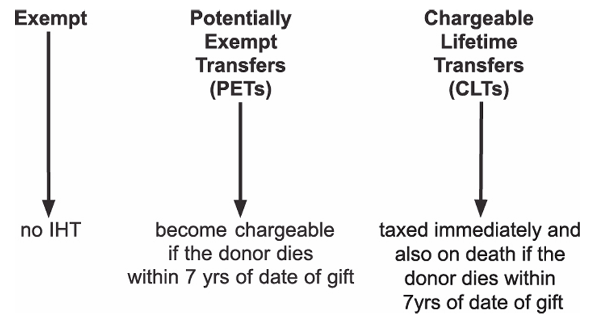
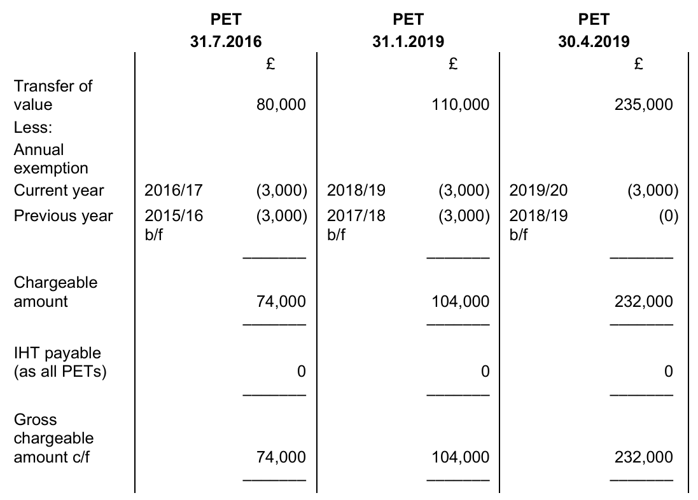
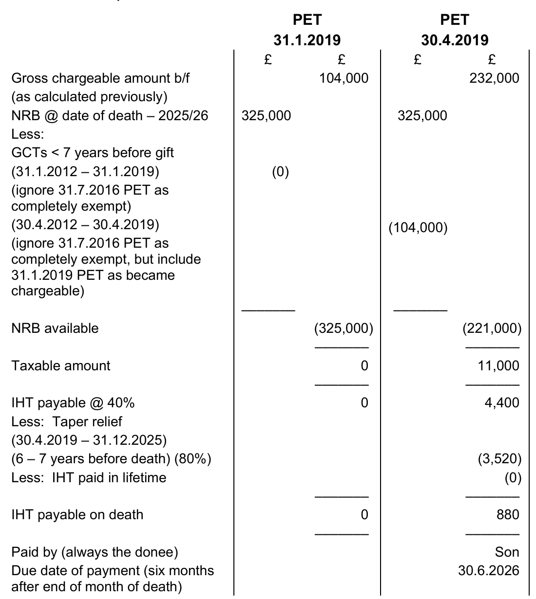
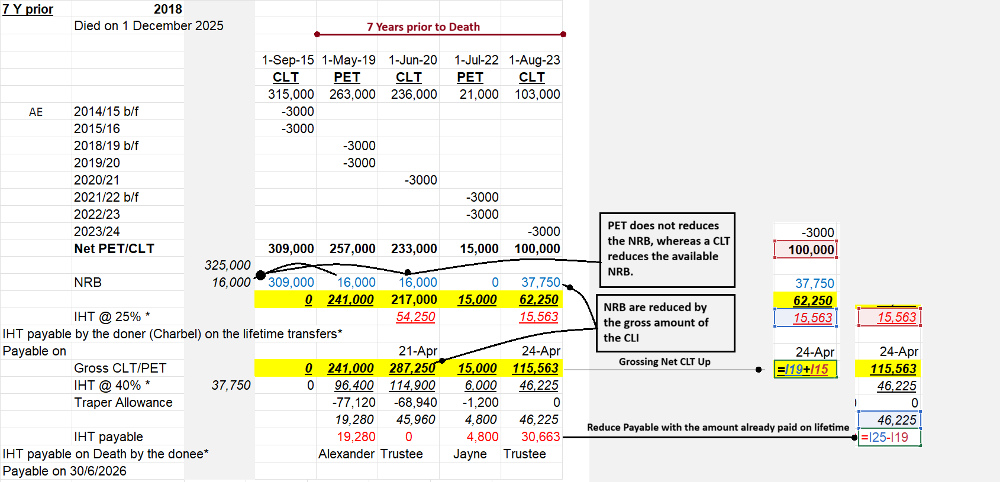
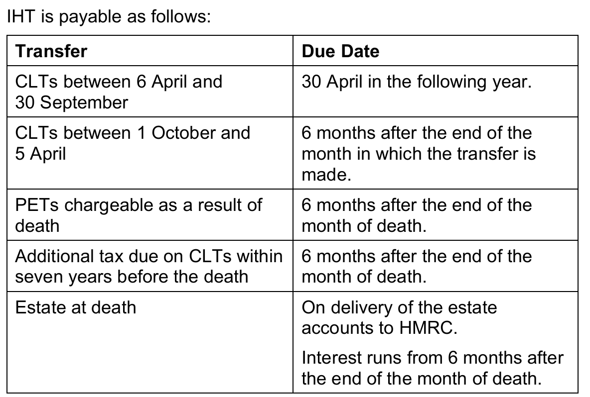

> Most inheritance tax (IHT) is collected on the death of an individual based on the value of the individual’s death estate. However, if IHT only applied on death, it would be an easy tax to avoid by giving away assets immediately before death. Therefore, there are IHT implications arising on some lifetime gifts as well as on death.

# The charge to inheritance tax (IHT) 

Inheritance tax is charged on: 

- a transfer of value 
- of chargeable property 
- by a chargeable person. 

A charge to inheritance tax (IHT) arises: 

- on the death of an individual 
- on lifetime gifts to individuals when the donor dies within seven years of the date of a gift 
- on lifetime gifts into trusts which are taxed at the date of the gift.

The donor is the person who makes the transfer of the asset, and the recipient is known as the donee. 

***Transfer of value***     
A transfer of value is a gift of any asset which results in a reduction in the value of the donor’s estate. 

To be treated as a transfer of value the transfer must be a ***‘gratuitous disposition’***. This basically means a gift. 

A bad business deal will therefore **not be liable** to inheritance tax, even though there is a fall in value of the estate, as it was not the donor’s intention to give anything away. 

To calculate the transfer of value for IHT purposes, the loss to donor principle is used (also referred to as the diminution in value concept). 

The loss to the donor is the difference between the value of the donor’s estate before and after the gift, and is the starting point for lifetime IHT calculations:

|                                              | £        |
|----------------------------------------------|----------|
| Value of estate before gift                  |  X       |
| Less: Value of estate after gift             | (X)      |
| **Diminution in value or transfer of value** | **X**    |

The loss to the donor is usually the open market value of the asset gifted. 

However, in some circumstances the transfer of value, from the donor’s **point of view** is not the same as the value of the asset received, from the donee’s point of view. 

This is most common with unquoted shares, where a controlling shareholding (from which a partial gift can be made, reducing the donor’s level of control) has a higher value per share than the minority shareholding which the donee acquires by the gift. 

#### Example 1: IHT 

Linda owns 6,000 shares, which represents a **60%** holding, in Loot Ltd.     
On 31 December 2025 she gave a 20% holding in the company to her friend, Bob.  

The values of shareholdings in Loot Ltd on 31 December 2025 have been agreed for IHT purposes as follows:  

| Holding      | Value per share |
|--------------|-----------------|
| Up to 25%    | £9              |
| 26% to 50%   | £15             |
| 51% to 74%   | £26             |
| 75% or more  | £45             |

**Calculate Linda’s transfer of value relating to the gift of unquoted shares for IHT purposes.**

**Solution**

## Property

### Chargeable property 

All property to which a person is beneficially entitled is deemed to form part of an individual’s estate. Therefore, a gift of any asset is a transfer of value. 

For the purposes of the TX examination there is no such thing as an exempt asset for IHT purposes, but there are exempt transfers. 

### Chargeable persons 

A chargeable person for the purposes of the TX examination will always be an individual. 

All individuals are potentially liable to IHT. 

An individual who is long-term resident in the UK is liable to inheritance tax on worldwide assets. 

If not long-term UK resident, an individual is generally liable on UK assets only. 

However, for the purposes of the TX examination, all individuals will be long-term UK resident. 

Note that spouses, or partners in a registered civil partnership, are treated as separate chargeable persons.  
 
### Occasions of charge 

The main charge to IHT arises on the death of an individual as liability arises on the following: 

- the value of all the net assets in the individual’s estate at the date of death. 
- any lifetime gifts made in the **seven years** before death, provided they are not exempt transfers. However, an IHT charge also arises on certain lifetime gifts at the date of the gift. 

### Lifetime gifts

There are three categories of lifetime gifts that can be made by an individual and they are treated for IHT purposes as follows: 

#### Types of lifetime gifts 

| **Exempt transfers**  | **Potentially Exempt Transfers (PETs)** | **Chargeable lifetime transfers (CLTs)** |
|--------------------------------------|--------------------------|------------------------------------------|
| **Definition**       |                                          |                                          |
| A gift or transfer that is specifically deemed to be exempt from IHT (covered later) | A gift by an individual to another individual | No definition = residual category (i.e. a gift which is not exempt nor a PET). For the TX examination, a CLT will be a gift into a trust. |
| **During lifetime**  |                                          |                                          |
| No IHT payable       | No IHT payable                           | IHT calculated using the lifetime rates of tax |
| **If Donor lives seven years** | | |
| No IHT payable       | No IHT payable                           | No further IHT payable                   |
|                      | Gift becomes exempt                      |                                          |
| **If Donor dies within seven years** | | |
| No IHT payable       | The PET becomes chargeable on death for the first time | Possibly extra IHT, calculated using the death rates of tax |

It is important to note that in practice, the majority of lifetime transfers made by individuals are either: 

- exempt transfers, or 
- transfers from one individual to another (i.e. a PET). 

Making gifts into trusts is a complicated area in practice, but for the TX examination, all gifts into trusts will be treated as CLTs. 

## Chargeable lifetime transfers (CLTs) 
 
A CLT is a gift that is not exempt and not a PET. They are not common in practice, but appear in examination questions because they are ***chargeable to IHT at the time of the gift***. 

In the TX examination, CLTs will always be a lifetime transfer by an individual into a trust. 

### Trusts 

A trust is an arrangement where property (known as the trust assets or settled property) is transferred by a person (known as the settlor) to the trustees, to be held for the benefit of one or more specified persons (known as the beneficiaries) on terms specified in the trust deed. 

The most common example of a trust is where parents wish to give assets to their children, but not until they are adults. The parents therefore put the assets into a trust with the children as beneficiaries, and the assets are controlled by the trustees until the children reach a specified age. 

It is not necessary to understand the workings of trusts for the TX examination, only to learn that gifts into trusts are CLTs.  

## Potentially exempt transfers (PETs) 

PETs have derived their name from the fact that ***if the donor lives for seven years after making the gift, then the transfer is exempt*** (i.e. free from IHT). Therefore, at the time of transfer, it has the potential to be exempt. 

However, if the donor dies within seven years of making the gift, then IHT may become chargeable on the gift. 

Note that transfers on death can never be PETs.

### Exempt transfers and reliefs for IHT 

The following table summarises the exempt transfers and reliefs available for 
IHT that are examinable in TX.

::::: {.columns}

::: {.column width="45%"}
## 🎁 Lifetime gifts only

| Relief | Summary |
|--------|---------|
| **Small gifts exemption** | Gifts of up to £250 per donee per tax year are exempt |
| **Marriage exemption** | Gifts on marriage: £5,000 (parent), £2,500 (grandparent), £1,000 (others) |
| **Normal expenditure out of income** | Gifts from regular income, provided they do not affect standard of living |
| **Annual exemption** | £3,000 per tax year; can be carried forward one year |
:::

::: {.column width="5%"}

:::

::: {.column width="45%"}
## ⚖️ Lifetime gifts and death estate

| Relief | Summary |
|--------|---------|
| **Inter‑spouse exemption** | Transfers between spouses/civil partners are completely exempt (UK domiciled) |
| | • If non‑UK domiciled, exemption limited to £325,000 |
:::

:::::

## Exemptions available for lifetime gifts only 

The following exemptions are available to reduce lifetime transfers only. They do not apply to the death estate. 

Note that the rules and limits for these exemptions are not included in the tax rates and allowances provided to you in the examination. 

### Small gifts exemption 

Lifetime gifts are exempt if they are: 

- an outright gift to an individual of no more than £250 
- per recipient 
- per tax year. 

The small gift exemption does not apply if the gift is more than £250. 

Therefore, a gift of £300 does not qualify. Similarly, if an individual makes a gift of £240 to a person followed by another gift of £100 to the same person in the same tax year, *neither gift is exempt*. 

However, the donor can make gifts of up to £250 to any number of different recipients and they will all be exempt. 

### Marriage exemption 

A lifetime transfer made 'in consideration of a marriage' (or the registration of a civil partnership) is exempt up to the following maximum limits: 

- £5,000 by a parent 
- £2,500 by a grandparent or remoter ancestor 
- £2,500 by a party to the marriage or civil partnership (e.g. from the groom to the bride) 
- £1,000 by anyone else.  

The exemption is conditional on the marriage taking place.

### Normal expenditure out of income 

IHT is levied on transfers of capital wealth.        
Therefore, a lifetime transfer is exempt if it can be shown that the gift: 

- is made as part of a person’s normal expenditure out of their income, and 
- does not affect the donor’s standard of living. 

To be treated as 'normal', gifts must be habitual (i.e. there is a regular pattern of giving). For example, payment of school fees for a grandchild or annual payments into a life insurance policy for the benefit of a child are usually exempted under this rule. 

### The annual exemption 

The annual exemption (AE) is an exemption available against lifetime transfers and operates as follows: 

The AE: exempts the first £3,000 of lifetime transfers in any one tax year is applied chronologically to the first gift in the tax year, then (if there is any left) the second gift and so on ***must be applied to the first gift each year***, even if the first gift is a PET and never becomes chargeable. 

Any unused AE: may be carried forward to the next year however, it can be carried forward for one year only, and can only be used after the current year’s AE. 

- The maximum AE in any one year is therefore £6,000 (£3,000 × 2). 
- If other exemptions are available, they are given before the AE.

#### Example 2: Lifetime gifts

Meron made the following lifetime gifts: 
(a) 31 August 2023, £600, to her son                        
(b) 31 October 2023, £800, to a trust         
(c) 31 May 2024, £2,100, to a trust     
(d) 30 November 2024, £1,100, to a trust     
(e) 30 April 2025, £5,000, to her daughter.        

Calculate the **chargeable amount** after AEs for each of the gifts.

**Solution**

## Exemptions available for lifetime transfers and the death estate 

### Inter-spouse exemption  

Transfers between spouses, or between partners in a registered civil partnership, are exempt: 

- regardless of the value of the transfer, and 
- whether made during the donor’s lifetime or upon the donor’s death.

#### Example 3: Lifetime gifts

Felipe made the following lifetime transfers: 

(a) Unquoted shares worth £525,000 in the family company to his husband on 1 June 2025.      
(b) £15,000 to his son on 6 July 2025 as a wedding present.       
(c) £20,000 to his nephew on 27 September 2025.       
(d) £235 to a friend for her 40th birthday on 4 November 2025.       
(e) £270,000 into a trust on 24 December 2025.      

Calculate the chargeable amount for each of Felipe’s lifetime gifts.

**Solution**

### IHT payable during an individual’s lifetime on CLTs 

Lifetime IHT is payable when an individual makes a gift into ***a trust***. 

The procedure to calculate the lifetime IHT on a CLT The chargeable amount for each lifetime gift (PETs and CLTs) is calculated on each gift separately, in chronological order.  

Even though there is no lifetime tax on a PET, it is necessary to calculate its chargeable value as a *PET uses the annual exemptions*, even if it never becomes chargeable. ***A PET may therefore reduce the amount of the annual exemptions available to a CLT***.  

***1. Calculate the chargeable amount of each CLT and PET:*** 

|                                                           | £        |
|-----------------------------------------------------------|----------|
| Value of estate before transfer                           |  X       |
| Less: Value of estate after transfer                      | (X)      |
| **Transfer of value**                                     | **X**    |
| **Less:**                                                 |          |
| 1. Wholly exempt transfers (i.e. to spouse/civil partner) | (X)      |
| 2. Specific lifetime exemptions:                          |          |
|    – e.g. Marriage exemption                              | (X)      |
|    – Annual exemptions (applied last)                     | (X)      |
| **Chargeable amount**                                     | **X**    |

> For a CLT (i.e. a transfer into a trust), the only exemption that is likely to be applicable is the annual exemption. 

> For a CLT, calculate the amount of ***nil rate band*** available after allowing for any gross chargeable transfers in the ***previous seven years*** (covered below). 

> Calculate the tax on the excess at either **20% or 25%** depending on *who has agreed to pay* the tax; the donor or the donee (covered below). 

> Calculate the **gross chargeable amount** of the gift to carry forward for future computations. 

> If required by the examination question, state the due date of payment of the IHT (covered later).

### The nil rate band

All individuals are entitled to a nil rate band (NRB) and are taxed on the chargeable value of CLTs in excess of the NRB at different rates, depending on who has agreed to pay the lifetime tax. 

The NRB had steadily increased each tax year in the past, although it has remained the same since the tax year 2009/10. 

For lifetime tax calculations, the NRB applicable at the time of the gift is used. The current NRB of **£325,000** is included in the tax rates and allowances provided to you in the examination. 

In the TX examination, you should assume that the NRB for previous years is £325,000, unless the question states otherwise. 

### The appropriate rate of tax 

The appropriate rate of tax to apply to lifetime gifts (after the deduction of the available NRB) depends on who has agreed to pay the tax due. 

***Donee pays the tax***    
If the trustees of the trust (which is the donee of the gift) agree to pay the tax: 

- the gift is referred to as a gross gift, and 
- the appropriate rate of tax is 20%.  

***Donor pays the tax***    
If the donor agrees to pay the tax: 

- The gift is referred to as a *net gift*. 
- As a result of the gift, the donor's estate is reduced by: 

    1. the value of the gift, and 
    2. the associated tax payable on the gift. 

- Therefore, the amount of the gift **needs to be ‘grossed up’** to include the tax that the donor has to pay. 
- The appropriate rate of tax is therefore ***25%*** (i.e. 20/80ths of the net gift). 
- The gross chargeable transfer (GCT) value to carry forward is the net chargeable amount (the net gift) plus any lifetime IHT paid by the donor. 

This GCT amount remains the same, even if the NRB available at death differs from the NRB that was available on this gift in the donor's lifetime. 

In summary, the rate of tax on the value of CLTs in excess of the NRB is:

| Payer                     |                   | Appropriate rate |
|---------------------------|-------------------|------------------|
| Trustees of the trust     | Gross gift        | 20%              |
| Donor                     | Net gift          | 25% (or 20/80)   |

> Note that the tax due on a CLT is primarily the responsibility of the donor. 

Therefore, where an examination question does not specify who has agreed to pay the tax always assume that the donor will pay and that the gift is therefore a net gift, and IHT is calculated at 25%. 

Note that the 25% tax rate is not included in the tax rates and allowances provided in the examination and therefore must be learnt. 

The normal due date of payment of lifetime IHT The date of payment of lifetime IHT depends on the date of the gift:

| Date of CLT             | Due date of payment                              |
|-------------------------|--------------------------------------------------|
| 6 April to 30 September | 30 April in the following year                   |
| 1 October to 5 April    | Six months after the end of the month of the CLT |

#### Example 4: Due date of CLTs 

Kendall makes a gift into a **trust** on 13 June 2025 of £366,000. They have made no previous lifetime gifts. 

Calculate the amount of lifetime IHT due on the gift into the trust and state the gross chargeable amount of the gift to carry forward for future computations, assuming: 

(a) the trustees of the trust have agreed to pay any IHT due.          
(b) Kendall has agreed to pay any IHT due.      

State the due date for payment of tax in both cases. 

**Solution**

### The seven year cumulation period 

In Example 4, the individual had made no previous lifetime gifts and therefore all of 
the NRB was available to calculate the tax. However, the NRB is available for a 'seven year cumulation period'. 

Each time a CLT is made, in order to calculate the IHT liability, it is necessary to **look back** seven years and calculate how much NRB is available to set against that particular gift. 

For lifetime calculations, to calculate the NRB available at any point in time, it is necessary to take account of the total of the gross amounts of all other CLTs made within the previous seven years. 

- These CLTs in the seven year cumulation period are deemed to have utilised the NRB first. 
- There will therefore only be NRB available to match against this latest gift, if the total of the CLTs in the previous seven years is less than the current NRB at the time of the gift. 
- Note that although PETs may use the AE during the donor's lifetime, they do not affect the NRB available to a CLT, as they are not yet chargeable.

#### Example 5: CLTs IHT arising and due date

During his lifetime Alex had made the following gifts: 

- 30 June 2015, £170,000 to a trust 
- 13 June 2019, £150,000 to his daughter 
- 30 June 2020, £191,000 to a trust 
- 15 December 2025, £256,000 to a trust 

The trustees of the first two trusts paid the IHT liabilities. Alex paid the tax on the last gift. 

Calculate the IHT arising as a result of Alex’s lifetime transfers.            
State who will pay the tax, the due date for payment and the gross chargeable amount of each gift to carry forward to future computations.

**Solution**

#### Example 6: Lifetime transfers

During his lifetime Yuuma had made the following cash gifts: 

- 21 April 2013, £98,000 to a trust (trustees to pay tax) 
- 15 April 2019, £140,000 to his son 
- 19 March 2020, £234,000 to a trust (Yuuma to pay tax) 
- 9 May 2025, £395,000 to a trust (trustees to pay tax) 

Calculate the IHT arising as a result of Yuuma’s lifetime transfers. 

**Solution**

***Summary of lifetime calculations***      
Remember to: 

- only calculate IHT on CLTs. 
- consider the IHT position for each CLT separately and in chronological order. 
- use the NRB applicable for the tax year of the gift. 
- tax is due at 20% if the trustees pay, and 25% if the donor pays. 

Also, remember that PETs are not chargeable at this stage, but you need to calculate the chargeable amount of the PETs as they may use the annual exemptions. 

IHT payable on lifetime gifts ***as a result of death***.          
On the death of an individual, an IHT charge could arise in relation to lifetime gifts within seven years of death as follows: 

- PETs become chargeable for the first time. 
- Additional tax may be due on a CLT. 

The IHT payable on lifetime gifts as a result of death is always ***paid by the recipient of the gift***: 

| Type of gift | Paid by               |
|--------------|-----------------------|
| CLT          | Trustees of the trust |
| PET          | Donee                 |

Calculating the death IHT on lifetime gifts  

The death tax is calculated on each gift separately, in chronological order, as follows: 

1. Identify all gifts within seven years of death. 
2. Calculate the gross chargeable amount of each gift, and also any lifetime tax paid (for CLTs only). 
3. Calculate the amount of NRB available for each lifetime gift that is taxed on death, after deducting all gross chargeable transfers in the seven years before that lifetime gift:

    - use the NRB for the tax year of death (rather than the NRB for the tax year of the gift)
    - include PETs that have become chargeable due to the donor’s death, but not PETs that are now exempt (gifted more than seven years pre-death).

4. Calculate the ***death tax at 40% on each GCT less the available NRB***.
5. Calculate and deduct any **taper relief** on each GCT (covered later).
6. For CLTs, deduct any lifetime IHT paid.
7. If required by the question, state who will pay the tax and the due date of payment (covered later).
   
 
### Further points regarding death tax calculations on lifetime gifts 

**Chargeable amount** 

- The gross chargeable amount of each gift is taxed on death. 
- The gross amount of CLTs will have already been calculated in the lifetime IHT calculations. 

Remember to use the **grossed up value** of any CLT where the tax was **paid by the donor**.

- The chargeable amount of a PET is calculated using the value at the time of the gift and PETs may use up AEs, even though a PET only becomes chargeable on death if the donor dies within seven 
years. 

***The nil rate band*** 

- The NRB for the tax year of the gift is used when doing the lifetime tax calculations on a CLT, as covered in the earlier illustrations. 
- The NRB for the tax year of death is used to calculate the death tax but it is matched against all chargeable gifts in the seven years prior to the date of the gift (i.e. CLTs and also PETs that have become chargeable) in chronological order. 
 
### The seven year cumulation period 

The seven year cumulation period for the NRB on death applies in a similar way as for the lifetime gifts NRB calculations. 

However, note that: 

- it is necessary to take into account the total of the **gross amounts** of all chargeable gifts made within the previous seven years (not just CLTs) 
- therefore, to calculate the death IHT on each gift, it is necessary to look back seven years from the date of each gift and include the gross amount of: 

    - all CLTs, and  
    - any PETs that have now become chargeable due to the death of the individual. 

This means that when calculating death tax, a CLT made more than seven years before death may still affect the NRB available for a subsequent lifetime gift that falls within seven years of death.  

However, ignore any PETs made more than seven years before death, as they are not taxable and do not use any NRB. 

The death rate of tax The death rate of IHT is **40% on the excess over the available NRB**.

 
### Taper relief

Where IHT is chargeable on any lifetime transfer due to death within seven years, the amount of IHT payable on death is reduced by **taper relief**: 

- where more than 3 years have elapsed since the date of the gift 
- by a **percentage reduction** according to the length of time between  

    - the date of the gift, and 
    - the date of the donor’s death. 

Note that this relief applies to both **CLTs and PETs**.  

The rates of taper relief are included in the tax rates and allowances provided to you in the examination, and are as follows:

So, for a chargeable transfer made more than 5 years but less than 6 years before death, the IHT due on death is calculated as normal and then 60% taper relief is applied such that only 40% of the death tax is payable. 

For gifts made seven or more years before death there is no IHT payable on death, so taper relief is not relevant.

**Deduction of lifetime IHT paid**     
For CLTs, any lifetime IHT already paid is deducted from the liability calculated on death. 

However, no refund is made if the lifetime tax already paid is higher than the amount now due on death. 

At best, the deduction of lifetime tax paid will bring the liability on death down to £Nil.

***The normal due date of payment of IHT on death***  
IHT as a result of death is due ***six months after the end of the month of death***. 

#### Example 7: Death tax payable on lifetime gifts

Fred had made the following lifetime transfers: 

- 31 July 2016, £80,000, to his son 
- 31 January 2019, £110,000, to his daughter 
- 30 April 2019, £235,000, to his son. 

He died on 31 December 2025. 

Calculate the IHT arising as a result of Fred’s death on 31 December 2025. State who will pay the tax and the due date of payment.

**Solution**

***PET – 31 July 2016*** 

- The PET made on 31 July 2016 to his son is **more than seven years** before 31 December 2025. 
- It is therefore **completely exempt**. No IHT is payable during his lifetime and no IHT is due as a result of his death. 
- The gift is ignored and is not accumulated for future calculations. 

***PETs – 31 January 2019 and 30 April 2019***    

The two gifts on 31 January 2019 and 30 April 2019 are PETs. Therefore **no lifetime IHT** is payable. However, both gifts will become **chargeable** as a result of Fred’s death **within seven years**. 

***IHT payable during lifetime*** 

> All gifts are PETs, therefore there is no lifetime tax to pay. However the gross chargeable amount of the PETs must be established at the time of the gift. 

***IHT payable on death*** 

Date of death: 31 December 2025            
Seven years before: 31 December 2018

> inheritance tax nil-rate band (NRB) can be used against a potentially exempt transfer (PET), but only if the gift becomes a "failed PET" because the donor dies within seven years of making it.

#### Example 8: Death tax payable on lifetime gifts

On **15 July 2018** Saanvi made a **transfer** of **£365,000** into a trust. She had made no other lifetime transfers. The IHT due in respect of this gift was paid by Saanvi.        
Saanvi died on **30 May 2025**. ---> *7 Y prior May 2018*

Calculate the IHT arising on Saanvi’s lifetime gift, and the additional IHT arising as a result of her death.                 
State who will pay the tax and the due date of payment. 

**Solution**

***Lifetime IHT***      
***15 July 2018 – CLT (2018/19)*** 

|                                                     | £             |
|-----------------------------------------------------|---------------|
| Transfer of value                                   | 365,000       |
| Less: AE – 2018/19                                  | (3,000)       |
| Less: AE – 2017/18 b/f                              | (3,000)       |
| **Net chargeable amount**                           | **359,000**   |
| **NRB** at date of gift *(2018/19) -> 2024.25*      | 325,000       |
| Less: GCTs in 7 years pre-gift (15.7.11 to 15.7.18) | 0             |
| **NRB available**                                   | **(325,000)** |
| **Taxable amount**                                  | **34,000**    |
| Lifetime IHT due (£34,000 × 25%)                    | 8,500         |
| (= net gift as Saanvi paying the tax)               |               |
| **Payable by**                                      | Saanvi        |
| **Due date** (gift in first half of tax year)       | 30.4.19       |
| **Gross chargeable transfer** (£359k + £8.5k)       | **367,500**   |

***IHT payable on death***         
**30 May 2025**

| Gross chargeable amount b/f                       | £             |
|---------------------------------------------------|---------------|
| NRB at death                                      | 325,000       |
| Less: GCTs in 7 years pre-gift (7.11 to 7.18)     | 0             |
| **NRB available**                                 | **(325,000)** |
| **Taxable amount**                                | **42,500**    |
| IHT due on death (£42,500 × 40%)                  | 17,000        |
| Less: Taper relief (7.18 to 5.25) (6–7 Y) (80%)   | (13,600)      |
| **Death tax liability**                           | **3,400**     |
| Less: IHT paid in lifetime (CLT)                  | (8,500)       |
| **IHT payable on death**                          | **0**         |

> There is no repayment of lifetime IHT paid.   

#### Example 9: IHT payable on lifetime gifts as a result of death 

Charbel made the following lifetime gifts: 

- 1 September 2015, £315,000, to a trust 
- 1 May 2019, £263,000, to his son Alexander 
- 1 June 2020, £236,000, to a trust 
- 1 July 2022, £21,000, to his daughter Jayne 
- 1 August 2023, £103,000, to a trust 

Charbel had agreed to pay any IHT due on CLTs. Charbel died on 1 December 2025. 

Calculate the IHT payable on the lifetime transfers during Charbel’s lifetime, and then the IHT payable on his death.                    
State who will pay the tax and the due date of payment. 

**Solution**

#### Example 10: IHT payable on lifetime gifts as a result of death

Ximena made the following lifetime gifts:

| Date          | Gift                                | Amount (£) | IHT paid by |
|---------------|-------------------------------------|------------|-------------|
| 1 May 2016    | To a trust                         | 182,000    | Ximena      |
| 30 June 2018  | To her niece on her 21st birthday  | 60,000     | Donee       |
| 11 June 2019  | To her nephew on his wedding day   | 169,000    | Donee       |
| 11 November 2021 | To a trust                      | 159,000    | Trustees    |

(a) Calculate the IHT liabilities arising as a result of the lifetime gifts and state who pays the tax and the due date.

(b) Assuming Ximena dies on 14 February 2026, calculate the additional IHT on the lifetime gifts as a result of Ximena’s death and state who pays the tax and the due date.

(c) Calculate the nil rate band left to set against the death estate.

**Solution**

### IHT payable on the death estate 

On the death of an individual, an inheritance tax charge arises on the value of the estate at the date of death. 

The death estate includes all assets held by the individual at the date of death.               
The value of assets brought into an individual’s estate computation is normally the open market value (OMV) of the asset at the date of death (known as the probate value).                

The values to use will always be provided in the examination.

The gross chargeable value of an individual’s estate is calculated using the following pro forma: 

***Pro forma death estate computation*** 

|                                                                  | £        | £        |
|------------------------------------------------------------------|----------|----------|
| Land and buildings                                               |          |  X       |
| Less: Mortgage (Note)                                            |          | (X)      |
| Business owned by sole trader/partnership                        |          |  X       |
| Stocks and shares (including ISAs)                               |          |  X       |
| Government securities                                            |          |  X       |
| Insurance policy proceeds (Note)                                 |          |  X       |
| Cars                                                             |          |  X       |
| Personal chattels                                                |          |  X       |
| Debts due to the deceased                                        |          |  X       |
| Cash at bank and on deposit (including ISAs)                     |          |  X       |
| **Total assets**                                                 |          | **X**    |
| Less: Debts due by the deceased                                  | (X)      | (X)      |
| Less: Outstanding taxes (e.g. IT, CGT due)                       | (X)      | (X)      |
| Less: Funeral expenses                                           | (X)      | (X)      |
| **Estate value**                                                 |          | **X**    |
| Less: Exempt legacies to spouse or civil partner                 |          | (X)      |
| **Gross chargeable estate**                                      |          | **X**    |

> The amounts still repayable at the date of death on repayment and interest-only mortgages are deductible from the property’s value.

> When there is a life insurance policy on the deceased individual’s own life, the proceeds of that policy are included in the death estate, rather than the market value of the policy at the date of death. 

> Funds held in a pension scheme are outside the estate for IHT purposes. 

> The expenses of administering the estate incurred by the executors (personal representatives) are not deductible.  

#### Allowable deductions in the death estate computation 

***Funeral expenses***    
The costs of the individual's funeral are allowable providing they are **reasonable**, even though the cost is incurred after the date of death. 

Reasonable costs of mourning clothes for the family and the cost of a tombstone are also allowable. 

***Other allowable deductions***    
Debts are deductible if they: 

- were outstanding at the date of death, and 
- had been incurred for valuable consideration, or were imposed by law (i.e. legally enforceable debts). 

This includes all outstanding taxes of the deceased person, such as income tax, NICs and CGT, although not the IHT (if any) due on the death estate itself.      
Note that a 'promise' to pay a friend, for example, is not legally enforceable and therefore not deductible. 

Gambling debts incurred in a lawful gambling business (such as a casino) are legally enforceable and can therefore be deducted. But informal private gambling debts are not legally enforceable, so cannot be deducted.  

If a debt is secured against specific property it is deducted from the value of that property. This is the case with a repayment or interest-only mortgage secured against land and buildings. 

***Exempt legacies***    
The *only* exempt legacies that are allowable in the death estate and examinable at TX are gifts to the spouse or civil partner. 
 
**The procedure to calculate the IHT on the death estate**     

1. Deal with the IHT on all lifetime gifts made within **seven years** of the date of death first before dealing with the death estate computation. 
2. Calculate the gross chargeable estate value. 
3. Calculate the available residence nil rate band (covered later). 
4. Calculate the amount of NRB available after deducting GCTs in the previous seven years (i.e. CLTs and PETs). 
5. Calculate the tax on the excess at 40%. 
6. If required by the question, state who will pay the tax and the due date of payment (covered later).

#### The nil rate band (NRB) 

The NRB available to an individual on death of £325,000 is first used to calculate the death tax on lifetime gifts, then any unused balance is available against the total death estate. 

***The residence nil rate band (RNRB)***     
The RNRB applies (in addition to the NRB) on a death estate where a dwelling house, which has been the deceased person’s residence, is inherited by one or more direct descendants. 

The seven year accumulation period applies when calculating the NRB available against the death estate, in a similar way to the NRB calculation for death tax calculations on lifetime gifts, as follows: 

- it is necessary to take into account the total of the gross amounts of all chargeable gifts made within the previous seven years 
- therefore, look back seven years from the date of death and accumulate the gross amounts of all CLTs, and all PETs (because all PETs within seven years before death will have become chargeable transfers on death). 

***The death rate of tax***    
The death rate of IHT is 40% on the excess over the RNRB plus the NRB.              
The normal due date of payment of IHT on death estate is due on the earlier of: 

- six months after the end of the month of death, or 
- on delivery of the account of the estate assets to HM Revenue & Customs 
(HMRC).

#### Example 11: IHT payable on the death estate

Sara died on 15 June 2025 leaving a gross chargeable estate valued at £427,000 which was bequeathed to her brother. 

(a) Calculate the IHT liability arising on Sara’s estate assuming she made no lifetime transfers.      
(b) What if Sara had gross chargeable transfers of £147,000 in the seven years prior to her death?      

**Solution**

(a) **No lifetime transfers**

|                                                  | £           |
|--------------------------------------------------|-------------|
| Gross chargeable estate value                    | **427,000** |
| NRB at death                                     | (325,000)   |
| Less: GCTs in 7 years pre-death                  | (0)         |
| **NRB available**                                |**(325,000)**|
| **Taxable amount**                               | **102,000** |
| IHT due on death (£102,000 × 40%)                | **40,800**  |

(b) **Lifetime transfers**

|                                                  | £           |
|--------------------------------------------------|-------------|
| Gross chargeable estate value                    | **427,000** |
| NRB at death                                     | 325,000     |
| Less: GCTs in 7 years pre-death                  | (147,000)   |
| **NRB available**                                |**(178,000)**|
| **Taxable amount**                               | **249,000** |
| IHT due on death (£249,000 × 40%)                | **99,600**  |

#### Example 12: IHT payable on the death estate

Timothy died on 23 April 2025 leaving a gross chargeable estate valued at £627,560 which was bequeathed to his girlfriend. 

Timothy had made the following lifetime gifts: 

- 1 June 2011, £180,000, to a trust  
- 16 May 2018, £228,000, to his cousin  

Calculate the IHT liability arising on Timothy’s estate and state the due date of payment and who it is paid by.

**Solution**

#### Example 13: IHT payable on the death estate

Bintou died on 30 June 2025 leaving the following assets:

| Asset            | Amount (£)  |
|------------------|-------------|
| House            | 200,000     |
| Boat             | 250,000     |
| Bank account     | 75,000      |
| Quoted shares    | 100,000     |
| Car              | 15,000      |
| **Total assets** | **640,000** |

At the date of Bintou’s death she owed £2,000 on her credit card, and £3,000 of income tax and CGT.

In Bintou’s will she left

- the house and shares to her wife
- the boat to her son
- the residue to her daughter.

Bintou made a lifetime gift of £115,000 in cash to her son in August 2018.

**Compute the IHT payable on Bintou’s death.**

**Solution**

#### Additional residence nil rate band (RNRB) 

An additional nil rate band, up to a maximum of **£175,000** in 2025/26, is available when calculating the IHT on the death estate where a residential house, which has been the deceased’s residence, is inherited on death by the deceased’s direct descendants. This is known as the residence nil rate band (RNRB). 

The RNRB applies when: 

- calculating the tax on the death estate, and 
- the date of death is on or after 6 April 2017, and 
- the chargeable death estate includes a residential property (that the deceased has lived in at some time) that is inherited by the deceased’s direct descendants. 

For the purpose of the TX examination, the deceased’s direct descendants are either the children or grandchildren. 

Unlike the normal NRB, the RNRB is not available when calculating the additional tax due on lifetime gifts as a result of death. So, if a house is given to a child during lifetime, the RNRB is not available when calculating any death tax due as a result of the PET becoming chargeable. 

Note that the deceased must only have lived in the residential property at some time. It does not have to have been the deceased’s main residence or be lived in by the deceased at the date of death. Also there are no minimum occupancy requirements.

In the TX examination a property that qualifies for the RNRB will always be referred to as the deceased’s main residence. Therefore, you should assume that the RNRB is not available if there is no mention of a main residence. 

The available RNRB is the lower of: 

- £175,000, and 
- The value of the main residence within the death estate. 

The RNRB of £175,000 is included in the tax rates and allowances provided to you in the examination. 

The value of the main residence is after deducting any repayment or interest only mortgage secured on the property. 

If the value of the main residence in the death estate is less than £175,000 the balance of RNRB (i.e. the unused amount) can be transferred to the deceased’s surviving spouse (covered later). 

In calculating the tax on a death estate the RNRB is applied before the normal NRB. 

#### Example 14: Additional residence nil rate band (RNRB) 

On 10 April 2025 the following individuals died, leaving their entire estates to their children. Set out below, for each individual, is the gross chargeable value of their estate together with the value of their main residence, which is included in their estate.

|          | Gross chargeable value of estate (£) | Value of main residence (£) |
|----------|--------------------------------------|-----------------------------|
| Albert   | 850,000                              | 300,000                     |
| Aroha    | 450,000                              | 80,000                      |

Calculate the available RNRB and the IHT liability on the death estate, for each individual, assuming that neither of them had made any lifetime gifts.

**Solution**

Each of the deceased is entitled to the RNRB as they died after 6 April 2017 and have left a main residence to a direct descendant (i.e. their children).

**Albert**

The available RNRB is the lower of £175,000 (the maximum) and the value of the main residence (£300,000) i.e. £175,000.

|                                                     | £           |
|-----------------------------------------------------|-------------|
| Gross chargeable estate value                       | 850,000     |
| Less: RNRB                                          | (175,000)   |
| Less: NRB at death (no lifetime gifts)              | (325,000)   |
| **Taxable amount**                                  | **350,000** |
| IHT liability of death estate (£350,000 × 40%)      | **140,000** |

---

**Aroha**

The available RNRB is the lower of £175,000 (maximum) and the value of the main residence (£80,000) i.e. £80,000.

|                                                     | £          |
|-----------------------------------------------------|------------|
| Gross chargeable estate value                       | 450,000    |
| Less: RNRB                                          | (80,000)   |
| Less: NRB at death (no lifetime gifts)              | (325,000)  |
| **Taxable amount**                                  | **45,000** |
| IHT liability of death estate (£45,000 × 40%)       | **18,000** |

#### Example 15: Additional residence nil rate band (RNRB)

On 1 December 2025 Ibha died, leaving the following assets and liabilities:

| Asset                        | Amount (£) |
|------------------------------|------------|
| Main residence               | 200,000    |
| Bank account                 | 100,000    |
| Quoted shares                | 450,000    |
| **Value of estate**          | **750,000** |

Ibha left the shares to her husband and the rest of the assets to her son.

On 1 May 2024 Ibha had made a lifetime gift to her daughter of £225,000 (after annual exemptions).

**Calculate the IHT due as a result of Ibha’s death.**

**Solution**

***Payment of inheritance tax on the death estate***

IHT on the death estate is initially paid by the executors (personal representatives).

The tax is paid from the estate, and so it is effectively borne by the person who inherits the residue of the assets (known as the residuary legatee) after the specific legacies have been paid.

A summary of the payment of tax is shown below:

| Recipient/asset         | Paid by    | Suffered by          |
|-------------------------|------------|----------------------|
| Spouse                  | N/A – exempt | N/A – exempt       |
| Specific UK assets      | Executors  | Residuary legatee    |
| Residue of estate       | Executors  | Residuary legatee    |

#### Example 16: Comprehensive example – death estate

Wilma died on 4 October 2025. Under the terms of her will, the estate was left as follows: 

- £170,000 to her husband 
- the residue of the estate (including her main residence) to her son Joe. 

At the date of her death, Wilma owned the following assets. 

- Her main residence valued at £268,000. 
- A flat in London valued at £175,000.  
- Four shops valued at a total of £231,250. 
- A holiday cottage situated in Cornwall worth £120,000.  
- 20,000 shares in ZAM plc. The shares were valued at 200p each. 
- 8,000 units in the CBA unit trust, valued at 130p each. 
- Bank balances of £57,850. 
- Wilma has a life insurance policy which was valued at £100,000 on her death. The insurance proceeds paid to the executors of her estate were £260,000. 

Wilma’s outstanding income tax liability was £7,500, and her funeral expenses amounted to £2,000. She had made no lifetime gifts. 

(a) Calculate the IHT that will be payable as a result of Wilma’s death.     
(b) Show who will pay and who will suffer the IHT liability and how the estate is distributed between the beneficiaries. 

**Solution**

***Married couples/civil partners***     
***Transfer of unused nil rate band (NRB)***     
Any amount of NRB that has not been utilised at the time of a person's death can be transferred to the deceased’s spouse or civil partner. 

As a result, each spouse or civil partner can leave their entire estate to the surviving spouse or civil partner with no adverse IHT consequences. 

- The surviving spouse or civil partner will have the benefit of  
    
    - that person’s own NRB, and 
    - any unused proportion of the spouse's or civil partner's NRB.

- When the second (surviving) spouse or civil partner dies, the increased NRB can be used against any death tax on lifetime gifts, as well as the death estate. 

- The amount of transferred NRB that can be claimed is based on the ***proportion*** that was unused by the first spouse or civil partner to die. 
- The unused proportion is applied to the full NRB available for the tax year of the second spouse or civil partner's death. 
- The executors (personal representatives) of the surviving spouse or civil partner must claim the transferred NRB on the IHT return submitted for the second death. The claim on this return must be submitted by the later of: 
    - 2 years after the second death, or 
    - 3 months after the executors starting to act

#### Example 17: Transfer of unused nil rate band

Winston *died on 15 August 2006*. Under the terms of his will **£105,450** was left to his children, and the remainder of his estate to his wife, Florence.          
Florence died on 24 February 2026.            
The nil rate band in 2006/07 was **£285,000**.

Calculate the amount of nil rate band available against Florence’s death estate. 

**Solution** 

On Winston’s death the NRB available was **£285,000** of which **£105,450 was utilised**. The remainder of the estate which was left to his wife was exempt. 

The unused amount of **£179,550** represents ***63%*** (£179,550/£285,000) of his NRB on death.  

The NRB available on Florence’s death is therefore:

|                                                  | £           |
|--------------------------------------------------|-------------|
| Florence's NRB on her death (2025/26)            | 325,000     |
| Winston's unused band transferred                |             |
| (£325,000 × 63%)                                 | 204,750     |
| **Total NRB available**                          | **529,750** |

#### Example 18: Transfer of unused nil rate band

Marija is 67 years old and was widowed on the death of her husband Zoran on 21 June 2007 (Nil rate band £300,000).           
Zoran had a chargeable estate valued at £800,000, and this was left entirely to Marija.       
Marija died on 23 May 2025 leaving an estate valued at £1 million, to her two children.           
Marija has made no lifetime transfers. 

Calculate the IHT liability due as a result of Marija's death assuming: 

(a) Zoran made no lifetime transfers         
(b) Zoran gave £186,000 to his son on 16 March 2007. 

**Solution**

#### Transfer of unused residence nil rate band (RNRB) 

An amount of RNRB that was not utilised at the time of a person’s death can also be transferred to the deceased’s surviving spouse or civil partner.               
There will be ***unused RNRB*** on the death of the first spouse/civil partner where: 

- The maximum RNRB (£175,000 for 2025/26) exceeded the value of the main residence. In this case the balance can be transferred to the spouse/civil partner. 
- On the death of the first spouse/civil partner: 

    - there was no main residence in the estate, or 
    - there was a main residence but it was **not inherited** by the deceased’s direct descendants. 

In both these cases 100% of the RNRB is **unused** and can be transferred to the surviving spouse. 

The transfer of the RNRB operates in a very similar way to the transfer of the NRB: 

- The amount of the RNRB that can be claimed by the surviving spouse/civil partner is based on the proportion that was unused by the first spouse. 
- The **unused proportion** is applied to the RNRB amount available on the second spouse/civil partner’s death. 
- The executors must claim the transferred RNRB within the same time limits as for the transferred NRB. 

The transfer is available even when the first spouse/civil partner died before 6 April 2017 (i.e. the date that the RNRB was introduced) provided the surviving spouse died on or after 6 April 2017. In this case, the unused proportion of the RNRB will always be 100% as the first spouse could not have used the RNRB on death (as this was before the RNRB was introduced). 

#### Example 19: Transfer of unsused RNRB - Death estates

Ezra died on 25 May 2025. He left an estate valued at **£800,000**, which included a main residence valued at **£140,000**. He left the main residence to his son and the rest of his estate to his wife, Elsa.    

Frank died on 1 June 2025. His estate was valued at **£1,000,000**, which included a main residence, worth **£175,000**. He left the whole of his estate to his wife, Fleur. 

Both Elsa and Fleur died on 1 February 2026.           
For both Elsa and Fleur calculate the amount of unused RNRB which may be transferred from their husbands to increase the RNRB available to them when calculating the IHT on their death estates. 

**Solution**     

***Ezra and Elsa***     
Ezra died after 6 April 2017 and left a residential home to a direct descendant (i.e. his son). The maximum RNRB available to Ezra was £175,000 of which he used £140,000. £35,000 (i.e. 20%) of Ezra’s RNRB is unused and can be transferred to Elsa. The unused % is applied to the RNRB available on Elsa’s death and therefore £35,000 (20% × £175,000) will be added to Elsa’s own RNRB. 

***Frank and Fleur***     
Frank died after 6 April 2017 and had a maximum RNRB of £175,000. He did not leave a main residence to a direct descendant therefore 100% of his RNRB was unused. 100% of Frank’s RNRB can be transferred to Fleur. The unused % is applied to the RNRB available on Fleur’s death and therefore £175,000 (100% × £175,000) will be added to Fleur’s own RNRB.

# IHT Planning 

It is important for an individual to plan lifetime gifts to be tax efficient and to make a will so that the individual’s estate is distributed in a tax efficient way. 

There are a number of tax planning measures that can reduce an individual’s liability to IHT. 

The overall objectives of all IHT tax planning measures are: 

- to minimise the amount of tax payable 
- to maximise the inheritance of the next generation. 

***Lifetime tax planning***     
IHT planning during an individual’s lifetime involves making gifts of wealth ***as early as possible***, as there are many advantages to making lifetime gifts. 

***Advantages of lifetime giving***     
Lifetime giving reduces the IHT payable on death as the assets gifted will not be included in the donor’s chargeable estate on death. Therefore, an individual should maximise the use of: 

- **exemptions available** (e.g. marriage, small gifts, annual exemption and normal expenditure out of income) 
- nil rate band every seven years.

Even if a lifetime gift becomes taxable, IHT on lifetime gifts is likely to be less than the IHT payable on the death estate because:

- If the gift is a PET, no IHT will be payable if the donor survives seven years. 
- If the gift is a CLT, the tax is calculated at 20% and no additional IHT will be payable on death if the donor survives seven years. 
- If the donor does not survive seven years, taper relief will be available after three years. 
- A lifetime gift is valued at the time of the gift and the value is 'frozen'. This locks in the value of an appreciating asset, so any increase in value up to the date of death will not be taxed. 
- Exemptions such as normal gifts out of income, small gifts, marriage and AEs may reduce or eliminate the value of a lifetime gift. 

However, it is not necessarily advantageous to gift all assets pre-death, as: 

1. The donor will want to continue to enjoy a comfortable life in old age, and 
2. IHT is not the only tax that needs to be considered in respect of lifetime gifts. 

***Disadvantages of lifetime giving***

- The donor loses the use of the asset and any income that can be derived from the asset once given away. 
- The **residence nil rate band** is ***not available*** for a ***lifetime gift*** of the main residence. 
- Capital gains tax may be payable on lifetime gifts of chargeable assets (either immediately or later if deferred with a gift holdover relief claim) but is not payable on assets held at the date of death. 
- Therefore, individuals should be advised not to gift assets during their lifetime that give rise to **large CGT liabilities**. 

***Death estate planning***     
Main residences should be left to **direct descendants** in priority to other assets. A main residence left to anyone other than direct descendants is not eligible for the **RNRB**, resulting in more IHT being paid on the death estate. 

Leaving a main residence to direct descendants could potentially save IHT of £70,000 (40% tax on £175,000 of RNRB), or as much as £140,000 (2 × £70,000) where an unused RNRB from a deceased spouse/civil partner is also available. 

If possible, avoid loans against residential property that reduce the value below the maximum available amount of the RNRB, in order to maximise this relief.

***Skipping generations***      
When making lifetime gifts or leaving legacies on death, it may be beneficial for inheritance tax purposes if gifts and/or legacies are made to grandchildren rather than children. This avoids a further IHT charge when the children die, thus skipping a generation. 

Gifts will then only be subject to IHT once before being inherited by the grandchildren (on the death of the grandparent), rather than twice (on the death of the parent and grandparent). 

Such planning depends on the children being independently wealthy, so that they have no need for the inheritance.

# Practices on Additional aspects

## Objective Test (OT) questions

### Q1: IHT Payable

:::{.callout}

Nicholas, a bachelor, died on 20 February 2026. During his lifetime he made the following cash gifts:

| Gift | Date            | Gift to:                  | £        |
|------|-----------------|---------------------------|----------|
| 1    | 1 January 2019  | A trust for his nephew    | 336,000  |
| 2    | 1 March 2020    | His uncle                 | 30,000   |
| 3    | 1 February 2022 | His niece                 | 25,000   |
| 4    | 1 March 2023    | A trust for his aunt      | 28,000   |

Nicholas paid any tax due on the transfers.

On which gifts will inheritance tax be payable as a result of Nicholas’ **death**?

A.  1 and 4 only          
**B.  2, 3 and 4 only**          
C.  All of them          
D.  None of them        

> Gift 1 is more than seven years before death and therefore no death tax is due. 

> To calculate the death tax, for each gift, the nil rate band on death is compared to gross chargeable transfers in the previous seven years. In all cases, this includes the CLT on 1 January 2019 which exceeds £325,000. 

:::

### Q2: Gross chargeable transfer GCT & NRB

:::{.callout}

Lucas made a **gross chargeable transfer** of **£157,000** on *5 November 2023*. 

On 19 November 2025 he gave **£200,000 to a trust**, paying the tax himself. 

How much lifetime IHT is payable on the gift in the tax year 2025/26? 

A. £0             
B. £5,200             
C. £8,000             
**D. £6,500**            

> The question gives the **GCT** for 5 November 2023 which, by definition, means after the deduction of annual exemptions. 

| Category                                                      | £           | £           |
|---------------------------------------------------------------|-------------|-------------|
| Transfer of value                                             | 200,000     |             |
| Less: Annual exemption 2025/26                                | (3,000)     |             |
| Less: Annual exemption 2024/25 b/f                            | (3,000)     |             |
| **Chargeable transfer before NRB**                            |             | **194,000** |
| Nil rate band – 2025/26                                       | 325,000     |             |
| Less: GCTs in previous seven years (19.11.2018 to 19.11.2025) | (168,000)   |             |
| **NRB available**                                             |             | **(157,000)** |
| **Taxable amount**                                            |             | **26,000**  |
| IHT @ 25% (Lucas to pay tax)                                  |             | **6,500**   |

:::

### Q3: Small gifts exemption

:::{.callout}

Chloe transferred **£200 into a trust** for her son Mathis in August 2025 and in the next month gave her daughter Clara **£250 cash**. Which of the gifts will be covered by the small gifts exemption? 

A. Neither    
B. Son’s trust only    
**C. Clara’s only**    
D. Both gifts    

> The gift into the trust does not qualify

:::

### Q4: Death tax - due dates

:::{.callout}

Eve made a chargeable lifetime transfer on 15 August 2022 on which **£4,500** lifetime IHT was payable.

Eve died on 24 March 2026 and **death tax** is due on the chargeable lifetime transfer.

On what date is the related IHT payable?

| Option | Lifetime IHT         | Death IHT            |
|--------|----------------------|----------------------|
| A      | 28 February 2023     | 24 September 2026    |
| **B**  | **30 April 2023**    | **30 September 2026**|
| C      | 28 February 2023     | 30 September 2026    |
| D      | 30 April 2023        | 24 September 2026    |

:::

## Constructed response questions

### Q1: 

