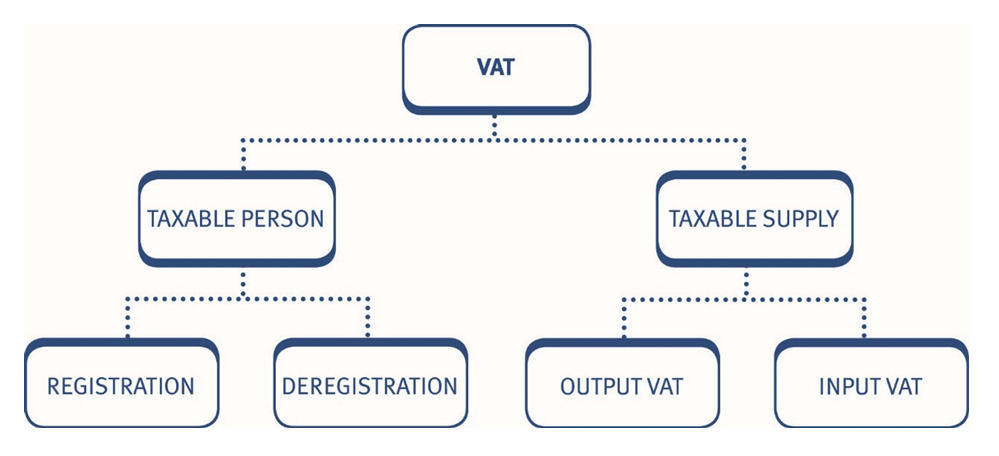
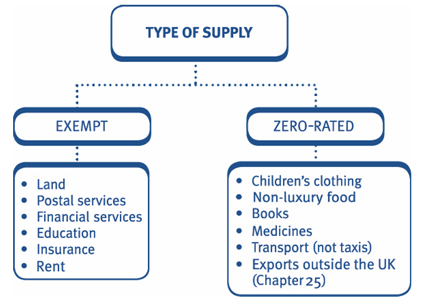
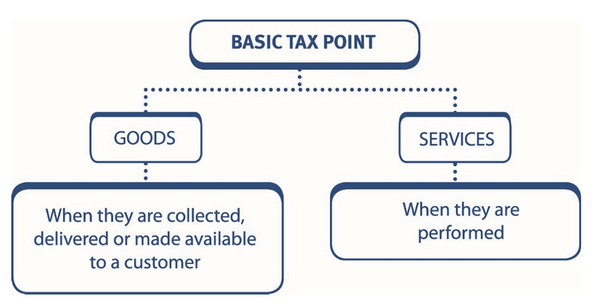
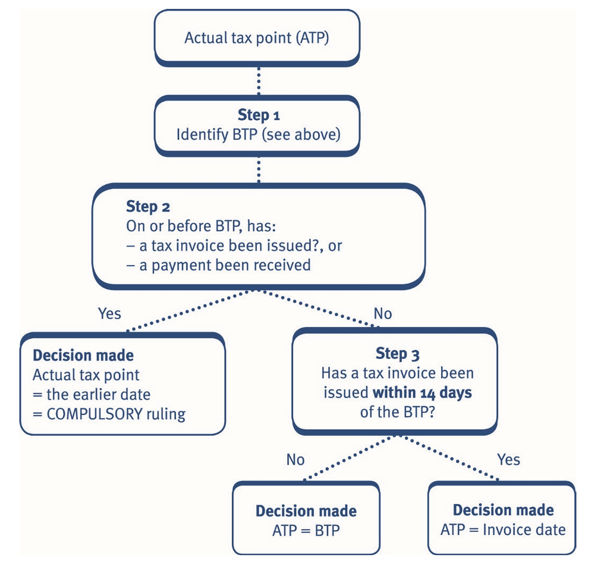

VAT is: 

- an indirect tax on consumer spending 
- charged on most goods and services supplied within the UK 
- suffered by the final consumer, and 
- collected by businesses on behalf of HMRC.

A taxable person is one who is or should be registered for VAT, because they make taxable supplies 

A taxable supply is everything which is not exempt or outside the scope of VAT. It includes sales and purchases of most goods or services. 

***Input and output VAT***            
It is important to distinguish between input and output VAT: 

- Businesses pay input VAT on their purchases of goods and services. 
- Input VAT is reclaimable from HMRC. 
- Registered businesses charge output VAT on their sales of taxable goods and services. 
- Output VAT is payable to HMRC. 
- Every month or quarter the input and output VAT is **netted off** and paid to or recovered from HMRC. 

The business therefore accounts to HMRC for VAT on the 'value added' to the product. 

# Types of supply 

Supplies can be taxable, exempt or outside the scope of VAT. 

## Taxable supplies  

VAT is charged on taxable supplies but not on exempt supplies or supplies which are outside the scope of VAT. 

It is therefore important to be able to correctly classify supplies in order to determine whether VAT should be charged. 

- It is also important to correctly classify supplies because: 
    
    - only taxable supplies are taken into account in determining whether a trader needs to register for VAT 
    - input VAT related to exempt supplies is not recoverable. 

- Taxable supplies are charged to VAT at one of three rates:  

    - **zero rate:** This is a tax rate of nil. 
      No VAT is charged but it is classed as a taxable supply. It is therefore taken into account in determining whether a trader should register for VAT and whether input VAT is recoverable. 
    - **reduced rate:** Some supplies, mainly for domestic or charitable use are charged at the reduced rate. 
    - standard rate: Any taxable supply which is not charged at the zero or reduced rates is charged at the standard rate of **20%**.

You do not need to remember the rates of VAT which apply to different goods and services. However, it is useful to know the treatment of some of the more common types of supply. 

For example, items such as wages and dividends are outside the scope of VAT. 

Remember that taxable supplies, which are not zero-rated or chargeable at the reduced rate, are standard-rated.

Remember that taxable supplies, which are not zero-rated or chargeable at the reduced rate, are standard-rated.

## Zero-rated and exempt supplies  

:::{.columns}

:::{.column width="45%"}
The most important ***zero-rated items*** are briefly described below. 

- Food: Food used for human consumption unless it is either a supply in the course of catering (e.g. in a restaurant) or is classed as a luxury item, such as alcohol or confectionery. 
- Books and other printed matter (e.g. newspapers, books, maps and sheet music). 
- Construction of dwellings, etc.: This includes new buildings for residential or charitable use, but not the reconstruction of an existing building. 
- Transport: Transporting passengers by road, rail, sea or air, but excluding smaller vehicles (e.g. not taxis). 
- Drugs, medicines and appliances: Drugs supplied on prescription and certain supplies to the disabled. 
- Charities: Gifts to charities are zero-rated. 
- Clothing and footwear: Young children’s clothing and footwear.  

:::

:::{.column width="5%"}

:::

:::{.column width="45%"}
The most important **exempt supplies** are briefly described below. 

- Land: Transfers of land and rights over land, but not buildings. 
- Insurance: premiums. 
- Financial services, including making loans, hire purchase, share dealing and banking services. 
- Education: If provided by schools and universities (VAT is now payable on private school fees but thisis not examinable by ACCA) 
- Health: The services of registered doctors, dentists, opticians, chemists and hospitals (but not health farms). 
- Sports: Entry fees to sports competitions used to provide prizes or 
charged by non-profit-making sporting bodies. 

:::

:::

# VAT registration 

## Compulsory VAT registration   

***Registration threshold***     
If a person’s taxable supplies (excluding sales of capital assets) exceed the **registration threshold**, then registration is compulsory. 

There are two separate tests for compulsory registration: 

- **Historic** turnover test 
- **Future** turnover test.

### Historic Turnover test

At the *end of each month*, the trader must look at the **cumulative** total of taxable **supplies** for the **last 12 months**, or since commencing trade, whichever is the shorter. 

If the total exceeds the registration threshold, currently **£90,000**, then the trader must register as follows: 

- Notify HMRC within 30 days of the end of the month in which the registration threshold is exceeded, by completing form VAT1, or via HMRC's online services. 
- Registration is effective from the **first day of the second month** after the taxable supplies exceed the threshold. 
- A trader need not register if taxable supplies for the next 12 months are expected to be less than the **deregistration threshold**, currently **£88,000**. 
- A trader can apply for an *exemption* from registration if supplies are **wholly zero-rated**. However this is not usually advantageous as the trader will be in a net repayment position if they have suffered any input VAT on purchases so it is beneficial to be registered to reclaim this. 

The registration and deregistration thresholds are provided in the tax rates and allowances in the examination. 

#### Example 1: Compulsory VAT registration – Historic turnover test

Hill Ltd commenced trading on 1 January 2024. Its monthly taxable supplies are as follows:

| Month     | 2024 (£) | 2025 (£) |
|-----------|----------|----------|
| January   | 3,500    | 5,090    |
| February  | 3,600    | 5,160    |
| March     | 3,700    | 5,780    |
| April     | 3,800    | 5,850    |
| May       | 3,840    | 5,970    |
| June      | 3,910    | 6,440    |
| July      | 3,980    | 8,260    |
| August    | 4,050    | 9,730    |
| September | 4,120    | 10,900   |
| October   | 4,490    | 10,750   |
| November  | 4,550    | 11,500   |
| December  | 4,630    | 11,050   |

In addition, in May 2025 the company sold surplus plant for £3,450.

**State from what date Hill Ltd is liable to register for VAT.**

**Solution**

The disposal of capital assets is strictly excluded when calculating a business's rolling taxable turnover for registration tests.

By checking the **cumulative trailing 12-month** totals at the **end of each month**, Hill Ltd first breaches the statutory threshold in November 2025.

$$
\text{Rolling Turnover} = £4,630 \text{ (Dec 24)} + \text{All of 2025 up to Nov } (£85,430) = \mathbf{£90,060}
$$ 

Hill Ltd is therefore liable to register on 30 November 2025, and must **notify HMRC by 30 December 2025**. 

The company will be registered from **1 January 2026**, or such earlier date as may jointly be agreed.

#### Example 2: Compulsory VAT registration – Historic turnover test

Jana owns a shop selling newspapers (zero-rated) and stationery (standard-rated). In her first year of trading to 31 July 2025, her sales of newspapers were £3,050 per month and of stationery £2,250 per month. 

In her second year of trading, these figures increased to £5,400 and £4,280, respectively. 

State from what date Jana is liable to register for VAT. 

**Solution**

### Future turnover test 

This test is considered at any time, when taxable supplies in the **next 30 days in isolation are expected to exceed £90,000**. 

- HMRC must be notified before the end of the 30 days, by completing form VAT1, or using HMRC's online services. 
- Registration will be effective from the beginning of the 30 day period.

#### Example 3: Compulsory VAT registration – Future turnover test

Cat Ltd signs a lease for new business premises on *1 May 2025* and opens for business on *20 July 2025*. The company estimates, from the outset, that taxable supplies will be in the region of £90,500 per month. 

State when, if at all, Cat Ltd is liable to register for VAT.  

**Solution** 

Cat Ltd is liable to ***register on 20 July 2025*** because supplies for the 30 days to 18 August 2025, are expected to exceed £90,000. 

The company must *notify HMRC of its liability to registration by 18 August 2025* and is registered with *effect from 20 July 2025*. 

Note: Cat Ltd does not make any taxable supplies during the period 1 May 2025 to 19 July 2025, so the liability to register under the future turnover test cannot arise during that period. 

#### Example 4: Compulsory VAT registration 

State which of the following unregistered traders are liable to register for VAT and the effective date of registration.

| Name      | Supplies                               | Details |
|-----------|-------------------|---------------------------------|
| Majid     | Accountancy services (standard-rated)  | Started in business 1 November 2025. Estimated fees £17,100 per month. |
| Jane      | Baby wear (zero-rated)                 | Established the business 1 March 2026 when Jane signed a contract to supply a national retail store. Sales for March 2026 are expected to be £91,000. |
| Sayso Ltd | Insurance (exempt)                     | Commenced trading 2 January 2026. Sales are £100,000 per month. |

**Soltion**

## Consequences of registration 

Once registered, a certificate of registration is issued and the taxable person must start accounting for VAT: 

- Output tax must be charged on taxable supplies. 
- Each registered trader is allocated a VAT registration number, which must be quoted on all invoices. 
- Each registered trader is allocated a tax period for filing returns, which is normally every three months. 
- Input tax (subject to some restrictions) is **recoverable** on business purchases and expenses. 
- Appropriate VAT records must be maintained. 

There are penalties for late registration. In addition, the trader must pay over the VAT they should have collected in the period that they should have been registered.

## Voluntary registration  

***Actual or intending traders***     
Even if not required to register, a trader may register voluntarily provided they are making, or intending to make, taxable supplies. 

HMRC will register the trader from the date of the request for voluntary registration, or a mutually agreed earlier date. 

## **Advantages and disadvantages of voluntary registration**

::::: {.columns}

::: {.column width="45%"}
### ✅ Advantages

- Avoids penalties for late registration
- Can recover input VAT on purchases
- Can disguise the small size of the business
:::

::: {.column width="5%"}

:::

::: {.column width="45%"}
### ❌ Disadvantages

- Business will suffer the burden of compliance with all VAT administration rules
- Business must charge VAT. This makes their goods comparatively more expensive than an unregistered business, for customers who cannot recover the VAT (i.e. final consumers)
:::

:::::

Voluntary registration is therefore **beneficial** where the business is making: 

- *zero-rated supplies* and has input VAT that it can recover, or 
- supplies to VAT registered customers but is probably not beneficial where the business is making supplies to non-VAT registered customers (e.g. the general public). 

#### Example 5:  Voluntary registration

Alfred sells goods, which would be ***standard-rated*** if he were registered for VAT. All of his sales are to members of the **public**. His current annual turnover is £40,000. He incurs input VAT of £5,000 on purchases each year. 

Assuming that, due to the competitive nature of his business, Alfred is unable to increase his prices to the public. Advise him whether it would be beneficial to register voluntarily for VAT. 

**Solution** 

If Alfred registered for VAT he would be required to charge his customers output VAT. As he is unable to increase his prices his VAT inclusive turnover would be £40,000 and he would have to account for output VAT to HMRC of £6,667 (£40,000 × 20/120). His profits would 
therefore decrease by £6,667.

He would however be able to reclaim input VAT of £5,000 p.a. The net cost to Alfred of registering for VAT would be £1,667 (£6,667 – £5,000) and it is therefore not beneficial for him to register voluntarily. 

If Alfred’s sales were to other VAT registered businesses, he would be able to charge VAT in addition to his normal selling price, as his 
customers would be able to recover the VAT charged.

In this situation it would be beneficial for Alfred to register for VAT voluntarily. He would be able to recover the input tax, on his purchases and, as a result his profits would increase by £5,000.

### Accepting additional new business 

Accepting additional new work may increase the taxable supplies of the business above the compulsory registration threshold. 

The VAT status of the customers of the business is therefore very important in deciding whether or not taking on the new business is beneficial. 

- If customers are VAT registered: 

    - they can recover the output VAT charged, and 
    - it will be advantageous to accept the new work. 

- If customers are not VAT registered:  
    
    - they cannot recover the output VAT charged, and 
    - if the selling price cannot be increased, the output VAT will become an additional cost to the business. 

This may make the additional new work unattractive it may be beneficial to decide to not accept the work, and maintain taxable supplies below the VAT registration threshold.

# VAT Groups 

Companies that are under common control can elect for a group VAT registration, provided that all the companies are established in, or have a fixed establishment, in the UK. 

A VAT group is treated as if it is a single company for the purposes of VAT. Group registration is optional; not all members of the group have to join the VAT group. 

The effect of a group VAT registration is as follows: 

- Goods and services supplied by one group company to another within the group registration are disregarded for the purposes of VAT. Therefore there is no need to account for VAT on **intra-group supplies**. 
- The VAT group appoints a **representative** member which is responsible for accounting for all input and output VAT for the group. 
- The **representative** member submits a single VAT return covering all group members, but all companies are jointly and severally liable for the VAT payable. 
- The normal time limits apply for submission of VAT returns. 

## ***Advantages and disadvantages of group VAT registration***  

::::: {.columns}

::: {.column width="45%"}
### ✅ Advantages

- VAT on intra‑group supplies eliminated
- Only one VAT return required, which should save administration costs
:::

::: {.column width="5%"}

:::

::: {.column width="45%"}
### ❌ Disadvantages

- All members remain jointly and severally liable
- A single return may cause administrative difficulties collecting and collating information
:::

:::::

# Pre-registration and Deregistration

## Recovery of pre-registration input VAT 

Normally, VAT incurred before registration cannot be accounted for as input VAT. If the conditions below are satisfied, however, then it can be treated as input tax and reclaimed accordingly. 

::::: {.columns}

::: {.column width="50%" style="border-right: 2px solid #2c3e50; padding-right: 20px;"}
### 📦 Goods

| | |
|---|---|
| 🎯 | Business purposes |
| 🚫 | Not sold/consumed before registration |
| ⏰ | ≤ 4 years prior to registration |
:::

::: {.column width="50%" style="padding-left: 20px;"}
### 💼 Services

| | |
|---|---|
| 🎯 | Business purposes |
| ⏰ | ≤ 6 months prior to registration |
:::

:::::

> Note that the term goods includes both current (e.g. inventory) and non-current (e.g. machinery) assets for VAT purposes. 

#### Example 1: Recovery of pre-registration input VAT

X Ltd registered for VAT with effect from 1 January 2026. The company incurred the following expenditure prior to registration:

| Item | Date    | Description                                                                  | £    |
|---|------------|---------------------------------------------------------------------------------|-----------|
| 1 | 12.2.2025  | Paid accountancy fees of £500 plus VAT for preparing cash flow forecasts.       |500 + VAT     |
| 2 | 14.8.2025  | Paid rent of £1,500 to a landlord. This was an exempt supply hence no VAT paid. |1,500 (exempt)|
| 3 | 15.10.2025 | Bought headed stationery, paying £1,150 including VAT.                          |1,150 inc. VAT|
| 4 | 1.11.2025  | Bought inventory intended for resale, costing £5,000 plus VAT.                  |5,000 + VAT   |
| 5 | 14.11.2025 | Bought machine, costing £6,500 plus VAT.                                        |6,500 + VAT   |

At the date of registration, **60%** of the inventory intended for resale had already been **sold**. The stationery was unused and the company still owned the machine.

**State the amounts of pre-registration input VAT that can be claimed.**

**Solution**

## Deregistration  

### Compulsory deregistration 

A person must deregister when they ***cease*** to make taxable supplies. 

- HMRC should be notified within 30 days of ceasing to make taxable supplies. 
- VAT registration is cancelled from the date of cessation. 

### Voluntary deregistration 

A person may voluntarily deregister, even if the business continues, if there is evidence that taxable supplies in the next 12 months, will not exceed £88,000. 

- The 12 month period is measured starting at any time. 
- The onus* is on the trader to satisfy HMRC that they qualify. 
    * onus: responsibility.
- VAT registration is cancelled from the date of request or an agreed later date. 

***Effect of deregistration***     
On deregistration, VAT output tax must be accounted for on the value of noncurrent assets and inventory held at the date of deregistration, on which a deduction for input tax has been claimed. 

However, this final tax liability is waived if it is £1,000 or less. 

#### Example 2: Deregistration

1. Jig Ltd closes down its business on 10 January 2026. 
2. At 1 January 2026, Elk Ltd forecasts taxable turnover for the year to 31 December 2026, will be £40,000. It immediately decides to apply for deregistration. 

State when Jig Ltd should notify HMRC of the business cessation and from when the company will be deregistered. 

State when Elk Ltd will be deregistered. 

**Solution**

# VAT on sale of a business 

## Alternative treatments 

Compulsory deregistration applies where a business is sold or otherwise transferred as a going concern to new owners. 

The sale may be treated in one of two ways: 

1. ***Transfer of business as a going concern***        
If certain conditions are satisfied, then the sale/transfer: 

- is not treated as a taxable supply 
- no output tax is therefore charged on the assets transferred by the seller, and 
- no input tax is recoverable by the purchaser. 

Conditions: 

- The business is transferred as a going concern. 
- There is no significant break in the trading. 
- The same type of trade is carried on after the transfer. 
- The new owner is or is liable to be registered for VAT, immediately after the transfer. 

Note that all these conditions must be met. 

2. ***Transfer of registration***             
On the sale of a business it is normally compulsory to deregister. However, instead of doing so, both the transferor and the transferee may make a **joint election**, for the transferor’s registration to be transferred to the transferee.              
Where this is done, the transferee assumes all rights and obligations in respect of the registration, including the liability to pay any outstanding VAT. Therefore, this may not be a good commercial decision. 

# The time of supply (the tax point)  

### Importance of tax point  

VAT is normally accounted for to HMRC on a quarterly basis, so it is important to know the time of a supply, to identify the quarter in which it falls. 

Also, if the standard rate of VAT were to change or if the classification of a supply altered (e.g. a zero-rated supply became standard-rated), it would be necessary to know whether a supply had been made before or after the date of change. 

## Basic tax point 

The rules are different for goods and services.

#### Example 1: The time of supply (the tax point)

Queue Ltd received an order for goods from a customer on 14 August 2025. The goods were despatched on 18 August 2025 and the customer paid on 15 September 2025 when they received their invoice, which was dated 14 September 2025. 

What is the basic tax point date?  

**Solution** 

The basic tax point date is 18 August 2025 (i.e. the date of despatch). 

## Actual tax point 

The basic tax point (BTP) may be overridden by the actual tax point as follows:

> Note that traders can agree an extension to the 14 day invoicing rule with HMRC, to fit in with their invoicing routines.

#### Example 2: The time of supply (the tax point)

Explain the effect if Queue Ltd, in Example 1 above, were to issue an invoice for the goods dated 30 August 2025. 

**Solution** 

The tax point would become 30 August 2025 as an invoice is issued within 14 days after the basic tax point date.

## Tax point – special rules 

Certain supplies of goods do not fit naturally into the above scheme: 

1. Goods on sale or return: The time of supply is the earlier of: 

    - the date when the goods are adopted by the customer, or 
    - 12 months after the despatch of the goods. 

2. Continuous supplies: Supplies such as electricity and tax advice do not have a basic tax point. The time of supply is the earlier of:  

    - a tax invoice being issued, and 
    - a payment received. 

3. The supplier may issue a tax invoice once a year in advance, showing the periodical payments and their due dates.       
    
    In this case, there is a separate tax point for every amount due, being the earlier of 
    
        - the due date and 
        - the date on which payment is received. 

4. Sales under hire purchase. The goods are taxed as normal at the standard or zero rate. The interest charge is an exempt supply, provided it is disclosed as a separate amount. 

The time of supply for the full value of the goods follows the normal rules (i.e. the time that the goods are collected, delivered or made available). 

#### Example 3: The time of supply (the tax point)

On 30 April 2025, Oak Ltd ordered a new felling machine, and on 16 May 2025, paid a deposit of £25,000. The machine was despatched to Oak Ltd, on 31 May 2025. On 12 June 2025, an invoice was issued to Oak Ltd for the balance due of £75,000. This was paid on 20 June 2025. 

State the tax point for: 

(a) the £25,000 deposit         
(b) the balance of £75,000.        

**Solution**

# The value of a supply  

### Basic rule 

The value of a taxable supply is the amount on which the VAT charge is based. This is normally the price (before VAT) charged by the supplier. 

### VAT fraction for standard-rated goods  

The price of goods before VAT is the VAT-exclusive amount. If the price includes VAT, then this is the **VAT-inclusive amount**. 

VAT is 20% of the VAT-exclusive amount.                     
If a standard-rated supply is made at a price of (£2,000 + VAT), then the value of the supply is £2,000 and the total consideration given for the supply is £2,400.          
If the VAT-inclusive amount is given, then the VAT element is ***(20/120)*** of the gross amount. The fraction of (1/6) gives the same result and is more commonly used. 

### Discounts 

If a discount is offered, then VAT must be calculated on the amount that the customer actually pays. 

Customers may be offered: 

- trade discounts – a reduced price for being a loyal customer or for buying large quantities of goods 
- prompt payment discounts – a reduced price for paying within an agreed timescale. 

In both cases VAT is charged on the price paid by the customer.           
For prompt payment discounts, the supplier may not know when the invoice is raised whether the customer will qualify for the discount. The supplier must therefore charge VAT on the invoice on the full price and either: 

- issue a credit note if the discount is taken, or 
- show full details of the terms of the prompt payment discount and include a statement that the customer can only recover input tax based on the amount paid to the supplier. If the discount is taken, the supplier must then 
adjust their records to account for output tax on the amount received. 

#### Example 1: The value of a supply

Gurminder sells standard-rated goods for **£4,000**, excluding VAT on 1 December 2025 and issues an invoice on the same day. He includes the following statement on the invoice: 

'A discount of 5% of the full price applies if payment is made within 14 days of the invoice date. No credit note will be issued. Following payment you must ensure that you have only recovered the VAT actually paid.' 

State the amount of VAT that Gurminder should show on the VAT invoice and explain what Gurminder should do if the customer pays within 10 days of the invoice date. 

**Solution** 

VAT shown on the invoice must be based on the full price i.e. £800 (£4,000 × 20%).           
If the customer pays within 10 days of the invoice date, Gurminder must adjust his VAT records to ensure that output tax of £760 (£4,000 × 20% × 95%) is paid to HMRC. 

Gurminder is not required to issue a credit note to the customer but must retain evidence that the invoice was paid within the terms of the discount arrangement (e.g. a bank statement).

### Goods for own use 

The treatment of goods taken for the trader's own use depends on the purpose for which the goods were purchased. 

1. Where the trader withdraws goods which were purchased for business purposes, input VAT can be recovered andoutput VAT must be accounted for on the replacement cost of the supplies. 
2. Where the trader initially purchased the goods for private purposes, no input VAT can be reclaimed and there is no output VAT charge. 

### Gifts 

Gifts of inventory or non-current assets are treated as taxable supplies at replacement cost, except gifts of: 

- goods to the same person which cost the trader £50 (excluding VAT) or less in a 12 month period. 
- business samples, regardless of the number of same samples given to the recipient. 

Gifts of services, whether to employees or customers, are not taxable supplies.

#### Example 2: VAT on Gifts, Replacement and Discount 

State the amount of VAT due in each of the following cases:

| Description                                                                 |
|-----------------------------------------------------------------------------|
| Sale of standard-rated goods for £500, excluding VAT. A trade discount of 3% is then applied. |
| Sales of standard-rated goods for £5,500, including VAT.                    |
| Gifts of 10 calendars costing £5 each, including VAT.                       |
| Removal of standard-rated goods by the owner. The goods cost £200 and would cost £220 to replace, both figures exclude VAT. |

**Assume that all transactions are in the quarter to 30 June 2024.**

**Solution**

# Recovery of input VAT

## Conditions for recovery of input VAT  

Input VAT is recoverable by taxable persons on goods and services that are supplied to them for business purposes. 

A ***VAT invoice*** (Chapter 24) is needed to support the claim. Capital and revenue expenditure 

Unlike other taxes, there is **no distinction** between capital and revenue expenditure for VAT. 

Provided the assets are used for the purposes of the trade, the related input VAT is recoverable on both capital assets (i.e. purchase of plant and machinery, delivery vans, equipment, etc.) and revenue expenditure. 

If capital assets are subsequently sold, output VAT must be charged as a taxable supply of goods. 

However, the exception to this rule is the purchase of cars (covered latter). 

## Irrecoverable input VAT 

Input VAT on Business entertaining (e.g. *entertaining suppliers and U.K. customers*) goods and services cannot be recovered.

Although VAT incurred on staff entertaining and entertaining *overseas customers is recoverable*. 

Cars, unless they are: 

    - used 100% for business purposes (e.g. driving school cars or new cars for resale), in which case 100% recovery available, or 
    - leased, in which case 50% of input VAT is recoverable where the car has some private use. 

> Note that where input VAT cannot be recovered on the purchase of a car, no output VAT will be due on its disposal. 

#### Example 1: Recovery of input VAT  

Riker plc makes *standard-rated supplies* and is registered for VAT. It incurs the following costs during 2025. 

1. £5,400 on business entertaining (*UK customers*) and £2,400 on *staff entertaining*. 
2. £30,000 on a new *car for the managing director* and £72,000 on new delivery lorries. 

The managing director's car is used partly for *private purposes*.           
All figures are **VAT-exclusive**. 

State the amount of input tax the business can claim and the figures that should be included in the financial statements in respect of these items. Explain how they will be treated for corporation tax purposes. 

**Solution** 

1. Entertaining UK customers 

No VAT recoverable on business entertaining of UK customers. The VAT-inclusive figure of (£5,400 × 120%) = £6,480, charged against profit will be a **disallowed expense** for the purpose of the tax adjusted trading profit computation. 

VAT of £480 (20% × £2,400), will be **recoverable on staff entertaining**. The VAT-exclusive amount of £2,400 will be charged against profits and is an allowable expense for tax purposes. 

2. Car and lorries 

No VAT recoverable on cars with private use. The VAT-inclusive figure of (£30,000 × 120%) = £36,000, will be capitalised in the accounts and will be eligible for capital allowances. 

VAT of £14,400 (20% × £72,000) is recoverable on the lorries. The VAT-exclusive figure of £72,000 will be capitalised in the accounts and will be eligible for capital allowances.

### Private use 

Input VAT cannot be claimed for goods or services that are not used for business purposes.

Where goods or services are used partly for private and partly for business purposes (e.g. use of telephone/mobile phone), an appropriate apportionment is made to calculate the recoverable input VAT. 

The exception to this rule is the recoverability of input VAT on car expenses. 

### Car expenses  

A business can recover all input VAT incurred on the **running costs** of a car, such as fuel and repairs, even when there is some private use. Note that VAT is not charged on the insurance and road fund licence. 

When a business pays for fuel costs for an employee, sole trader or partner and there is some private use of the vehicle, a VAT charge will be payable: 

- where the full cost of the private fuel is reimbursed by the employee/owner, output VAT is payable on the cost of fuel reimbursed. 
- if the employee does not reimburse the employer, output VAT is due based on a prescribed scale charge. 

The scale charge depends on the CO2 emissions of the car and the period for which VAT is being accounted for (usually quarterly). The scale charges will be provided in the examination if necessary. 

#### Example 2: Recovery of input VAT

Forge Ltd provides a company car with CO2 emissions of 205 g/km for the managing director for business and private use. The company pays for all running costs including petrol, with no reimbursement by the employee. The relevant quarterly VAT fuel **scale charge is £512**. 

State the value of the output tax in respect of the running costs for this car for the quarter to 31 December 2025. 

**Solution** 

The scale charge for a petrol car with CO2 emissions of 205 g/km is £512. This is the VAT-inclusive output amount. The output VAT charge is £85 (£512 × 1/6). 

Note that the scale charge will be given in the question in the examination. 

#### Example 3: Recovery of input VAT

For each of the following situations state whether the statement concerning the recovery of input tax is true or false. Assume all the businesses in the question are VAT registered traders and the transactions occur in the quarter to 30 September 2025. 

1. VAT incurred by a business on entertaining overseas customers is recoverable. 
2. Firmin plc can recover £3,000 on the purchase of an item of plant and machinery costing £15,000, including VAT. 
3. A business can never recover the VAT incurred on buying a car. 
4. A business provides a company car with CO2 emissions of 200g/km to an employee. The company pays all the running costs of the car, incurring £2,100 of input tax for the VAT quarter. The employee does not reimburse any of the fuel costs. The quarterly scale charge for a car with CO2 emissions of 200g/km is £496 (VAT-inclusive). The net input tax recoverable in respect of car expenses is £2,017.

**Solution**

### Relief for impairment losses 

Normally, VAT output tax is accounted for when an invoice is issued. If the debt becomes irrecoverable, the seller has paid VAT to HMRC and never recovers this from the customer. This position is addressed by the seller being able to claim VAT relief for impairment losses. 

The following conditions apply: 

- At least six months must have elapsed from the time that payment was due (or the date of supply if later). 
- The debt must have been written off in the seller’s VAT account. 
- Claims for relief for irrecoverable debts must be made within *four years and six months* of the payment being due.

Relief is obtained by adding the VAT element of the irrecoverable debt to the *input tax* claimed. 

#### Example 4: Relief for impairment losses

Fox Ltd made sales to X Ltd as follows: £3,500 due for payment on 1 August 2025 and £2,260 due for payment on 1 September 2025. Fox Ltd wrote off the debts in January 2026.            
All figures are **VAT-inclusive**.

State the amount of relief available to Fox Ltd for irrecoverable debts in the quarter to 31 March 2026. 

**Solution** 

**At 31 March 2026**, both invoices are unpaid **more than 6 months** from the due date of payment. 

The total debt to be written off is £5,760, including VAT. A claim for relief can be made for the VAT element of £960 (£5,760 × 1/6). This claim can be made by adding £960 to the input tax claimed for the quarter.

Note that VAT is recovered at the rate at which it was originally charged, not at the rate at the time of the VAT recovery. 

#### Example 5: Relief for impairment losses

On 1 December 2025, Berry Ltd wrote off two debts. The first was a debt of £2,456, due for payment on 1 May 2025 and the second a debt of £3,100, due for payment on 31 August 2025.            
All figures are VAT-inclusive. 

State the amount of relief for impaired debts available to the company in the return for the quarter ended 31 December 2025.

**Solution**

#### Comprehensive example

Dynamo Ltd commenced trading as a wholesaler on 1 November 2024.     
Its sales have been as follows:

| Year | Month     | Amount (£) |
|------|-----------|------------|
| 2024 | November  | 4,150      |
|      | December  | 4,750      |
| 2025 | January   | 5,250      |
|      | February  | 5,050      |
|      | March     | 4,450      |
|      | April     | 4,650      |
|      | May       | 4,850      |
|      | June      | 5,950      |
|      | July      | 5,850      |
|      | August    | 7,500      |
|      | September | 9,650      |
|      | October   | 11,800     |
|      | November  | 12,250     |
|      | December  | 13,200     |

The company’s sales are all standard-rated, and the above figures are exclusive of VAT.

(a) Explain from what date Dynamo Ltd will be required to compulsorily register for VAT, and what action the company must then take.

(b) Explain the circumstances in which Dynamo Ltd will be allowed to recover input VAT incurred on goods purchased and services incurred prior to the date of VAT registration.

(c) Advise Dynamo Ltd of the VAT rules that determine the tax point in respect of a supply of goods.

**Solution**

# Practices on Additional aspects

## Objective Test (OT) questions

### Q1: Tax point

:::{.callout}

Eastwood Ltd sold goods to a customer for £4,400. The goods were made available to the customer on 14 June although the customer paid in full on 10 June. An invoice was issued on 15 June. The tax point for this supply is: 

**A. 10 June**              
B. 14 June              
C. 15 June              
D. 28 June             

As the payment was made earlier, the 14 day invoice rule is irrelevant.

:::

### Q2: Input VAT

:::{.callout}

Bennett Ltd is registered for VAT and makes wholly taxable supplies.         
Bennett Ltd incurred the following expenditure (**exclusive** of VAT unless stated otherwise).  

| Item                                | Amount (£) |
|-------------------------------------|------------|
| General expenses (inclusive of standard rate VAT) | 46,920     |
| Capital purchases:                  |            |
| – Car (used by sales director partly for private purposes) | 15,000     |
| – Van                               | 12,000     |

**How much input VAT can Bennett Ltd reclaim in respect of the above expenditure?**  

A. £11,784          
B. £13,220          
C. £9,820          
**D. £10,220**        

:::

### Q3: Output VAT

:::{.callout}

Banana plc is registered for VAT. In the quarter to 31 December 2025 it made the following standard-rated supplies **(all VAT-exclusive)**:

1. Cash sales to non-VAT registered members of the public of **£40,000**.

2. Credit sales to *two VAT registered companies* on 1 November 2025 for **£1,200 each**. Banana plc offered both companies a **5% discount** for paying within 14 days. *Only one* of the companies paid within the discount period.

**How much output VAT must Banana plc pay to HMRC in respect of the quarter to 31 December 2025?**

**A. £8,468**  
B. £7,135  
C. £8,456  
D. £7,147

:::

### Q4: Tax point

:::{.callout}

J Ltd received an order for 18,000 widgets on 14 December 2025. J Ltd despatched these to the customer on 18 December 2025. An invoice was sent on 31 December 2025 and full payment was received on 15 January 2026. 

What is the tax point (i.e. the deemed date of sale for VAT purposes) for the sale of the widgets? 

A. 18 December 2025      
**B. 31 December 2025**      
C. 15 January 2026      
D. 14 December 2025     

:::

### Q5: VAT registration

:::{.callout}

Which of the following VAT registration statements are true? 

1. A business making wholly zero-rated supplies cannot register for VAT. 
2. A business which has a taxable turnover of £60,000 in its first year of trading cannot register for VAT. 
3. A business making only exempt supplies can register for VAT. 

A. 1 and 2 only            
B. 2 and 3 only            
**C. None of them**            
D. All of them

:::

## Constructed response questions

### Q1: 

