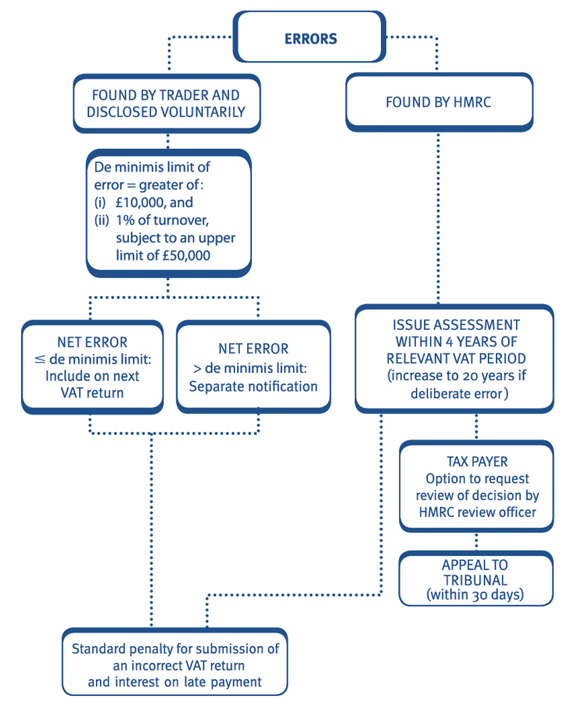

# VAT: Administration and overseas aspects

## VAT computation

All registered traders have to: 

- complete a VAT return every return period', and 
- pay net VAT due to HMRC or reclaim net VAT repayable from HMRC. 

Details of output and input VAT must be included, together with claims for *relief for impairment losses* and *any errors* made on earlier returns below a (***de minimis limit***). 

#### Example 1: VAT computation

Cart Ltd is registered for VAT, and its sales are all **standard-rated**.            

The following information relates to the company’s VAT return for the quarter ended 31 December 2025: 

1. Standard-rated sales amounted to £240,000. 
2. In addition to the above Cart Ltd issued a sales invoice for **£25,000** on 1 December 2025. The customer was offered a **5% discount** if the invoice was paid within 14 days. The customer paid within the 14 day period. 
3. Standard-rated *purchases and expenses* amounted to **£71,280**. This *figure includes £960 for entertaining UK customers*. 
4. On 15 December 2025, the company wrote off **irrecoverable debts** of £4,000 and £1,680, in respect of invoices due for payment on 10 May and 5 August 2025 respectively. ---> Only accept 6m prior 
5. On 30 December 2025, the company purchased a car at a cost of £32,900, for the use of a director, and machinery at a cost of £42,300. Both these figures are **inclusive of VAT**. The car is used for both business and private mileage. 

Unless stated otherwise, all of the above figures are exclusive of VAT.              
***Calculate the amount of VAT payable by Cart Ltd for the quarter.*** 

**Solution**

| ***Output VAT***                                              | £        |
|---------------------------------------------------------------|----------|
| Sales (£240,000 × 20%)                                        | 48,000   |
| Discounted sale (£25,000 × 95% × 20%)                         | 4,750    |
| **Total output VAT**                                          |**52,750**|
| ***Input VAT***                                               |          |
| Purchases and expenses (£71,280 – £960) × 20%                 | 14,064   |
| Relief for irrecoverable debts (£4,000 × 20%)                 | 800      |
| Machinery (£42,300 × 1/6)                                     | 7,050    |
| **Total input VAT**                                           |**21,914**|
| VAT payable (£52,750 – £21,914)                               |**30,836**|

> Input VAT on business entertaining (for UK customers) cannot be reclaimed.

> Input VAT on cars not used wholly for business purposes cannot be reclaimed.

#### Example 2: VAT computation

Hairby Ltd has provided the following information for the quarter to 31 March 2026. All figures exclude VAT.

1. Sales consisted of £45,000 of standard-rated sales and £15,000 of zero-rated sales.

2. Purchases for resale were all standard-rated and totalled £31,000.

3. Standard-rated expenses were £7,600, including £350 for entertaining UK customers.

4. One gift to a customer out of inventory costing £250 was made. The replacement cost of the goods was £300.

5. A photocopier costing £6,400 was purchased.

**Calculate the amount of VAT payable by Hairby Ltd for the quarter ended 31 March 2026.**

**Solution**

## VAT return and payment procedures

### Normal VAT accounting 

VAT return periods are normally *three months long*, but traders who regularly receive repayments, can opt to have monthly return periods to receive their repayments earlier. 

- VAT returns show total output VAT and total input VAT for the period. 
- All businesses must file their VAT return and pay VAT electronically. 
- The deadline for filing and payment online is ***One month and seven days*** after the end of the return period. 

Under the Government’s **Making Tax Digital** (MTD) regime, all VAT registered businesses are required to keep VAT records digitally. These digital records of supplies, purchases, output VAT payable and input VAT recoverable must be used, in conjunction with *MTD compatible software*, to automatically compile a digital VAT return. The business is then required to review the digital VAT return and confirm that it is correct and can be submitted to HMRC. 

**VAT refunds** 

- VAT refunds are normally made within 30 days. 
- Where it is discovered that VAT has been overpaid in the past, the time limit for claiming a refund is *four years* from the date by which the return for the accounting period was due.

:::{.callout-tip}
***Substantial traders***        
Substantial traders are those with a VAT liability exceeding ***£2.3 million p.a***. 

- Monthly payments on account are required. 
- Payments at the end of months 2 and 3 in every quarter are 1/24th of the annual liability for the previous year. 
- Any additional amounts are paid with the normal VAT return. Other methods can be agreed with HMRC for calculating the payments on account. 

:::

:::{.callout-tip}
***VAT records***     
Records must be kept of all goods and services received and supplied in the course of a business. Records must be kept up-to-date and must be preserved for **six years**. 

In practice, the main records that must be kept are as follows: 

- Copies of all VAT invoices issued. 
- A record of all outputs (e.g. a sales day book). 
- Evidence supporting claims for the recovery of input VAT (e.g. invoices). 
- A record of all inputs (e.g. purchase day book). 
- VAT account. 

VAT registered businesses are required to keep the records required to complete the VAT return digitally. 

The records must be sufficient to allow the VAT return to be completed and to allow HMRC to check the return.

:::

:::{.callout-tip}
***VAT invoices***              
A VAT invoice must be issued when a standard-rated supply is made to a VAT registered business.       
The invoice can be sent electronically provided the customer agrees.               
No invoice is required if the supply is exempt, zero-rated or to a non-VAT registered customer.      
A VAT invoice should be issued *within 30 days* of the date that the taxable supply is treated as being made.                  
The original VAT invoice is sent to the customer and forms their evidence for reclaiming input VAT, and a copy must be kept by the supplier to support the calculation of output VAT. 

:::

A VAT invoice must contain the following:

- Supplier's name and address
- VAT registration number
- Sequential and unique identifying number
- Date of issue
- Tax point (time of supply)
- Customer's name and address
- Description that identifies goods or services supplied and quantity supplied
- Amount payable excluding VAT
- Total VAT exclusive amount
- Rate of VAT
- Amount of VAT payable
- Rate of any discount offered

***Simplified VAT invoices***    
VAT registered businesses can provide UK customers with an invoice which is less detailed than a standard invoice, if the consideration for the supply is £250 (VAT-inclusive) or less. 

This less detailed invoice must show the following information: 

- The supplier's name, address and VAT registration number. 
- The date of supply. 
- A description of the goods or services supplied. 
- The consideration for the supply. 
- The rate of VAT in force at the time of supply.

#### Example 3: VAT invoices

For each of the following statements, state whether they are true or false: 

1. All VAT invoices must show the rate of VAT on the supply. 
2. A VAT invoice should show the customer’s VAT registration number. 
3. All VAT registered businesses must always supply a full VAT invoice to their customers when requested. 
4. Where the value of a supply is more than £250, a business must always issue a detailed VAT invoice. 

**Solution**

## Penalties for late filing and late payment  

### late filing of VAT returns 

Taxpayers are not charged an automatic financial penalty for failure to submit a VAT return on time. 

Instead, a ***points-based system applies***. This will only be examined in the context of **quarterly returns**. 

- One penalty point is incurred each time a quarterly return is submitted late. 
- A penalty of £200 applies per late return once the taxpayer has reached the threshold of **four penalty points**. 
- Points expire after **two years** as long as the penalty threshold has not been reached. 
- If the threshold has been reached, the points will reset to zero when all returns are submitted on time for a 12 month period (i.e. four quarterly returns).  

### Penalties for late payment of VAT 

In addition to late filing penalties, if the VAT due is also paid late, a late payment penalty will be incurred. 

| Days late          | Penalty                                          |
|--------------------|--------------------------------------------------|
| Up to 15 days      | None                                             |
| 16 to 30 days      | 3%                                               |
| More than 30 days  | 6% plus a daily penalty at an annual rate of 10% |

Penalty percentage is applied to VAT outstanding. 

The additional 10% daily penalty is only charged after the initial 30 days. If this is tested in the exam, the requirement would state to do the calculation in days (as usually calculations are to the nearest month). 

Late payment interest would also be charged, running from the date the tax should have been paid to the actual date of payment.

#### Example 4: VAT return

Mole Ltd’s VAT return for the quarter ended 30 June 2025, was submitted late, and the VAT due of £14,500 was paid *29 days late*. Mole Ltd already has **3 outstanding penalty points** for previous late VAT return submissions. The interest rate on late payments of tax is 8.5%.

**State the consequences for Mole Ltd.**

**Solution**

::::: {.columns}

::: {.column width="50%"}
### 📋 Late submission 

- **1 additional penalty point** for late submission
- **£200 penalty** as threshold of four penalty points reached
- Points will reset to zero if all quarterly returns are submitted on time for **12 month period** (i.e. quarterly returns up to and including quarter ended 30 June 2026)
:::

::: {.column width="50%"}
### 💰 Late payment

- Payment due on or before **7 August 2025**
- Payment made between **16‑30 days late**
- Penalty charged: **£435** (3% × £14,500)
- Interest charged: **£103** (£14,500 × 8.5% × ¹⁄₁₂)
:::

:::::

#### Example 5: VAT return

**Fill in the missing words in the following statements:**

1. If a business submits its VAT return late then HMRC will issue a **penalty point** (2 words).

2. **Four** outstanding penalty points will give rise to a £200 penalty.

3. If the penalty threshold has been reached in order to reset the points to zero, a business must submit all VAT returns on time for a period of **12** months.

4. If VAT is paid between 16-30 days late a penalty of **3%** is issued.

## Errors on VAT returns 

### Self-assessment 

VAT is a self-assessed tax. Traders calculate their own liability or repayment. 

- HMRC make occasional control visits to check that returns are correct. 
- HMRC have the power to enter business premises, inspect documents, 

including statements of profit or loss and statements of financial position, take samples, and inspect computers records. 

Errors found on earlier VAT returns 

If a trader realises that there is an error, this may lead to a standard penalty as there has been a submission of an incorrect VAT return. The calculation of the **standard penalty** is covered in Chapter 12. 

#### Example 5: Errors on VAT returns

Bella is a registered trader who prepares VAT returns quarterly. In the quarter to 30 June 2025, she has a ***turnover of £103,450*** and she discovers the following errors in earlier returns:

1. Bella incorrectly recorded the total of output VAT for the previous quarter as £45,590, when it should have been £54,590.

2. Input VAT on UK customer entertaining of £180, was wrongly reclaimed as input tax in the same quarter.

3. No input tax was reclaimed on the purchase of a computer in September 2024, costing £1,680 plus VAT.

**State the action Bella should take to correct these errors.**

**Solution**

| Item | Description                 | Amount (£) | Error type |
|------|-----------------------------|------------|------------|
| 1    | Output VAT underpaid  (£54,590 – £45,590) | 9,000      | Net underpaid VAT |
| 2    | UK customer entertaining     | 180        | Disallowable input VAT |
| 3    | Computer input VAT (£1,680 × 20%) | (336)      | Underclaimed input VAT |
| **Total net error**           |                             | **8,844**  | Net underpaid VAT |

De minimis limit = greater of:

(i) £10,000  
(ii) (1% × £103,450) = £1,034  

As the net error of **£8,844** < the de minimis limit of **£10,000**, Bella should include the amounts on her next return to 30 September 2025.

This will increase her VAT payable for the quarter ended 30 September 2025 by **£8,844**.

A standard penalty may be charged for the submission of an incorrect VAT return if HMRC believe Bella made the errors deliberately or carelessly. The penalty can be reduced if Bella makes an unprompted disclosure of the errors to HMRC.

Interest will also be imposed by HMRC.

### Interest 

A taxable person may be charged interest where: 

- payment of VAT is late, or 
- an amendment is needed, or 
- HMRC raise an assessment. 

Interest is charged from the date that the outstanding VAT should have been paid, to the actual date of payment.

#### Example 6: Interest

Hem Ltd discovers that in the quarter ended 31 May 2025, it made an error on its VAT return and output VAT of £12,800 was under declared.  

The company voluntarily disclosed the amount to HMRC, paying the VAT due on 7 October 2025. 

Assuming the rate of interest is 8.5%, calculate the interest on late paid tax payable by Hem Ltd. 

**Solution** 

The under declared VAT should have been paid on 7 July 2025. 
Interest will be charged from 7 July to 7 October 2025. This will be (£12,800 × 8.5% × 3/12) = £272.

#### Example 7: Interest

HMRC issue an assessment on 30 April 2025 showing £4,100 VAT payable, for the quarter ended 31 May 2024. Grab Ltd paid the outstanding sum on 7 May 2025. 

Assume the rate of interest is 7.75%. Calculate the interest charged on Grab Ltd.

**Solution**

# VAT schemes

## The cash accounting scheme 

### Purpose of the scheme 

Normally VAT is accounted for on the basis of invoices issued and received in a return period. Accordingly: 

- output VAT is paid to HMRC by reference to the period in which the invoice is issued regardless of whether payment has been received from the customer. 
- input VAT is reclaimed from HMRC by reference to the invoices received in the return period, even if payment has not been made to the supplier.

This can give cash flow and impaired debt problems, particularly in the case of smaller businesses. As a result: 

- ‘Smaller’ businesses may optionally use the cash accounting scheme if the conditions are met:
- Under the cash accounting scheme VAT is accounted for on the basis of cash receipts and payments, rather than on the basis of the dates of invoices issued and received. 
- The tax point becomes the time of receipt or payment. 

### Conditions 

The scheme is aimed at smaller businesses, hence, there are a number of conditions: 

- The trader must be up-to-date with VAT returns and payments and must have committed no VAT offences in the previous 12 months. 
- Taxable turnover, including zero-rated sales, but excluding sales of capital assets, must not exceed £1,350,000 p.a. 
- A trader must leave the scheme once taxable turnover (excluding VAT) exceeds £1,600,000 p.a. 
- The cash accounting scheme cannot be used for goods that are invoiced more than six months in advance of the payment date, or where an invoice is issued prior to the supply actually taking place. 

#### Example 1: Cash accounting scheme

State which of the following businesses would benefit from joining the cash accounting scheme: 

1. JB Ltd, which operates a retail shop selling directly to the public (standard-rated supplies). All sales are for cash. 
2. Amber and Co, which manufactures and sells computer printers to other businesses (standard-rated supplies) on credit terms. 
3. Janet, who manufactures children’s shoes and sells them to retailers (zero-rated supplies). 

**Solution**

## Annual accounting 

### Purpose of the scheme 

Smaller businesses may find it costly or inconvenient to submit (the normal) four quarterly VAT returns. 

An ‘annual’ accounting scheme is available, whereby, a single VAT return is filed for a 12 month period (normally, the accounting period of the business).           
This helps *relieve the burden of administration*. 

### How the scheme works 

Only one *VAT return is submitted each year, but VAT payments must still be made regularly*. The scheme works as follows: 

• The annual return must be **filed within two months** of the end of the annual return period. 
• Normally, **nine payments on account of the VAT liability for the year**, are made at the end of months 4 to 12 of the year. **Each payment represents 10% of the VAT liability for the previous year**. 
• Regular payments aid budgeting and possibly cash flow if the VAT liability is increasing year on year. 
• A new business will base its payments on an estimate of the VAT liability for the year. 
• A balancing payment (or repayment) is made when the return is filed. 
• Businesses may apply to HMRC to agree *quarterly payments on account instead of the normal nine monthly payments*.

### Conditions 

As with cash accounting the scheme is aimed at smaller businesses: 

- Businesses can join the scheme provided their taxable turnover (excluding the sale of capital assets) does not exceed £1,350,000 p.a. 
- The business must be up-to-date with its VAT returns and payments. 
- Businesses must leave the scheme if taxable turnover exceeds £1,600,000 p.a. in the previous 12 months or is expected to exceed it in the next 12 months.

#### Example 2: Annual accounting scheme

Jump Ltd applied to use the annual accounting scheme from 1 February 2025. The company’s net VAT liability for the year ended 31 January 2025, was £3,600. The actual net VAT liability for the year ended 31 January 2026, is £3,821. 

Explain the returns and payments Jump Ltd must make for the year ended 31 January 2026.

**Solution**

## The flat rate scheme 

### Purpose of the scheme 

The optional flat rate scheme simplifies the way in which *very small businesses* calculate their VAT liability. 

Under the flat rate scheme, a business calculates its VAT liability by simply applying a flat rate percentage to total turnover. 

This removes the need to calculate and record output VAT and input VAT and can save the business money. 

### How the scheme works 

- The flat rate percentage is applied to the gross (VAT-inclusive) total turnover figure (inclusive of zero-rated and exempt supplies); with no input VAT being recovered. 
- The percentage varies according to the type of trade that the business is involved in, and will be given to you in the examination. 
- A higher flat rate of 16.5% applies to all types of business with limited, or no purchases of goods. You will not be expected to identify when to use this percentage but it could be provided to you in a question in the examination. 
- The flat rate scheme percentage is only used to calculate the VAT due to HMRC. 

In other respects, VAT is dealt with in the same way: 

- A VAT invoice must still be issued to customers and VAT at the rate of 20% is still charged on standard-rated supplies. 
- A VAT account must still be maintained. 

### Conditions 

- Like the cash accounting and annual accounting schemes, the flat rate scheme is aimed at small businesses. However, the turnover thresholds applied to determine eligibility for the flat rate scheme are much lower than those for the other two schemes. 
- To join the scheme the expected taxable turnover (excluding VAT) for the next twelve months must not exceed £150,000. 
- A business has to leave the scheme if total VAT-inclusive turnover (including taxable and exempt supplies) exceeds £230,000. 
- The business must have committed no VAT offences in the previous 12 months. 
- The flat rate scheme can be used with the ***annual accounting scheme***. 
- It is not possible to join both the flat rate scheme and the cash accounting scheme. However, it is possible for a trader to request to apply the flat rate percentage to the cash amount actually received in relation to VAT inclusive supplies during the period, rather than applying it to the VAT inclusive turnover in the period.

#### Example 3: Flat rate scheme

In the year ended 31 December 2025, Apple Ltd has annual sales of £90,500, all of which are standard-rated and to the general public. The company incurs standard-rated expenses of £4,500 p.a. These figures are inclusive of VAT. 

Calculate Apple Ltd’s VAT liability using: 

1. The normal method.
2. The flat rate scheme.
 
Assume a relevant flat rate percentage for Apple Ltd’s trade of 10%. 

**Solution**

# Overseas aspects of VAT 

## Imports of goods and postponed VAT accounting 

All imports of goods are treated in the same way, wherever in the world those goods have come from. 

Under the system of **postponed VAT accounting**, VAT does not have to be paid at the time of importation, *which offers a cash flow advantage*. Instead, the import VAT chargeable is included on the importer’s VAT return as output VAT, and is also reclaimed on the same VAT return as input VAT.  

The import VAT is included on the VAT return for the period in which the goods are imported. This means that the transaction is normally tax neutral, as the output VAT and input VAT will cancel each other out on the return. 

There will be a VAT cost if the imported goods are of a type for which input VAT is not recoverable (such as cars for private use) or if the business makes exempt supplies, and therefore cannot reclaim the input VAT.  

It is not compulsory to use postponed accounting and in some situations it cannot be used. However, in the examination it should be assumed that postponed accounting applies to all imports of goods.  

#### Example 1: Postponed VAT accounting

During the VAT quarter ended 31 December 2025, Daley Ltd imported goods costing £30,500 from a supplier situated outside the UK. Daley Ltd’s sales are all standard-rated.  

What amounts of output and input VAT should be included on Daley Ltd’s VAT return for the quarter ended 31 December 2025? 

**Solution** 

Daley Ltd will include output VAT and input VAT of £6,100 (£30,500 × 20%) on its VAT return for the quarter ended 31 December 2025. Therefore there is no net VAT cost to the company.

## Exports of goods 

For TX purposes, a UK VAT registered business should zero rate all exports, regardless of where in the world they are supplied. This is a favourable treatment for the exporter as it allows them to recover input tax. It also means the customer is not charged VAT. 

## Services 

The rules governing VAT on the supply of services are complex. These notes just cover the basic principles needed for the TX examination. 

For services, VAT is generally charged at the place of supply. For business customers the place of supply is where the customer is established. 

These rules can be applied to B2B transactions involving a UK business as follows: 

| UK business                                | Accounting for VAT |
|-----------------------------|-----------------------------------|
| Supplies services to overseas business customer | - Place of supply is overseas (i.e. where customer established).   - Outside the scope of UK VAT. |
| Receives services from overseas business   | - Place of supply is UK.   - Reverse charge procedure:      UK business accounts for 'output VAT' at standard UK rate on VAT return.     This VAT can then be reclaimed as input VAT. |

Time of supply for cross border supplies of services For single supplies, the tax point will occur on the earlier of: 

- when the service is completed, or 
- when it is paid for. 

#### Example 2: Overseas VAT

Overseas Ltd is a UK resident company and is VAT registered. It has been importing computers from Ruritania since 1 January 2026.  

Overseas Ltd makes only taxable supplies. For the quarter ended 31 March 2026 imports of £100,000 have been made. This amount excludes any VAT. 

Explain how Overseas Ltd will have to account for VAT on the computers imported from Ruritania. 

**Solution**

#### Example 3: Overseas VAT

Foreign Ltd, a UK resident company registered for VAT, has the following international transactions. 

(a) Sale of children’s toys to a customer in Germany.           
(b) Purchase of silk fabric from Hong Kong. 

Outline the VAT treatment in each case for Foreign Ltd.

**Solution**

# Practices on Additional aspects

## Objective Test (OT) questions

### Q1: VAT payable - Flat rate scheme

:::{.callout}

Yannick is a sole trader. He is registered for VAT and uses the flat rate scheme. In his quarter ended 31 December 2025 he had a VAT
inclusive turnover of £132,000.                      
This is comprised of standard-rated sales of £96,000 and zero-rated sales of £36,000.           
Yannick’s VAT-inclusive expenses for the period were £25,000. The flat rate scheme percentage for his business is 9.5%. 

What is the VAT payable by Yannick for the quarter ended 31 December 2025? 

A. £7,600          
B. £9,120          
C. £11,833          
D. £12,540         

:::

### Q2: VAT payable - Flat rate scheme

:::{.callout}

Y Ltd is registered for value added tax (VAT) and uses the flat rate scheme. 

In the VAT quarter ended 31 March 2026, the company had a VATinclusive turnover of £110,000. This comprises standard-rated sales of £80,000, zero-rated sales of £20,000 and exempt sales of £10,000. The flat rate scheme percentage for the company’s trading sector is 9%. 

The VAT payable by Y Ltd for the quarter ended 31 March 2026 is: 

A. £9,900             
B. £7,200             
C. £9,000             
D. £8,100             

:::

### Q3: Quarterly VAT returns

:::{.callout}

X Ltd is a VAT registered trader that prepares quarterly VAT returns. When should the VAT for the quarter ending 30 April 2025 be paid to HM Revenue & Customs (HMRC)? 

A. 31 May 2025        
B. 7 June 2025        
C. 7 July 2025        
D. 7 August 2025        

:::

### Q4: Output VAT and Input VAT

:::{.callout}

Meurig runs a UK VAT registered business. He exports a large amount of goods overseas. His UK sales and purchases are all standard-rated.

In the quarter ended 31 December 2025 he makes the following sales and purchases (all figures are stated exclusive of VAT):

- **Sales to UK businesses**       
  70,000

- **Export sales outside the UK**      
  22,400

- **Purchases from UK businesses**      
  38,500

---

What is Meurig’s output VAT and input VAT for the quarter?

| Option | Output VAT | Input VAT |
|--------|------------|-----------|
| A      | £14,000    | £7,700    |
| B      | £18,480    | £7,700    |
| C      | £14,000    | £12,180   |
| D      | £14,000    | £4,480    |

:::

### Q5: VAT invoice

:::{.callout}
Which of the following must be shown on a simplified (or less detailed) VAT invoice where the supply is entirely standard-rated? 
     
1. Supplier's name and address 
2. A unique and sequential invoice number 
3. Customer's name and address 
4. Description of goods or services supplied 

A. 2 and 4        
B. 1 and 4        
C. 2 and 3        
D. 1 and 3       

:::

### Q6: Cash accounting scheme

:::{.callout}
Which of the following statements concerning the VAT cash accounting scheme is/are correct? 

1. The business calculates its output tax on sales for a VAT return period by applying the VAT fraction (20/120) to gross (VAT inclusive) total cash receipts (inclusive of zero-rated and exempt supplies). 
2. The scheme would not be beneficial for a business that makes wholly zero-rated sales and standard-rated purchases on credit terms. 
3. The tax point for output tax is always determined by the date of payment. 

A. 1 and 3      
B. 2 and 3      
C. 1 and 2      
D. 2 only       

:::

## Constructed response questions

### Q1: 

