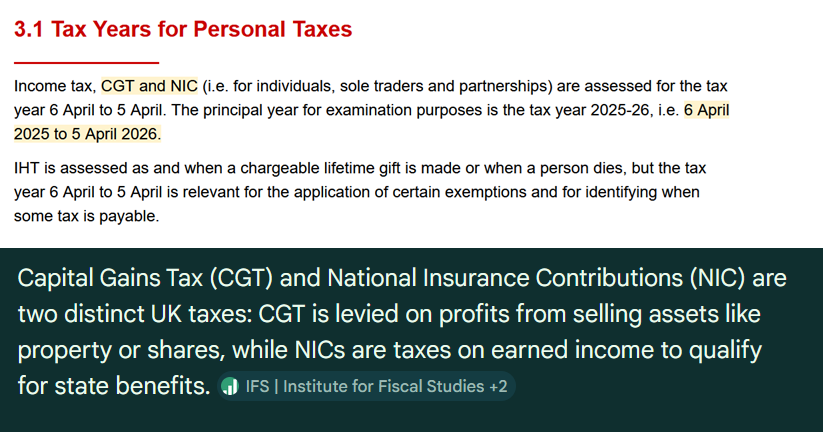
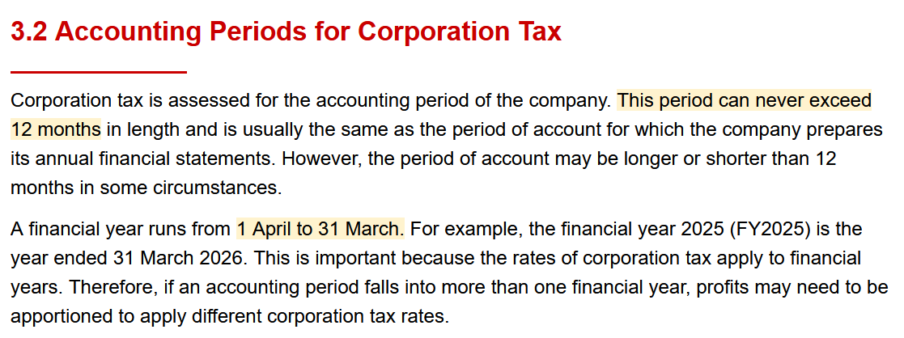
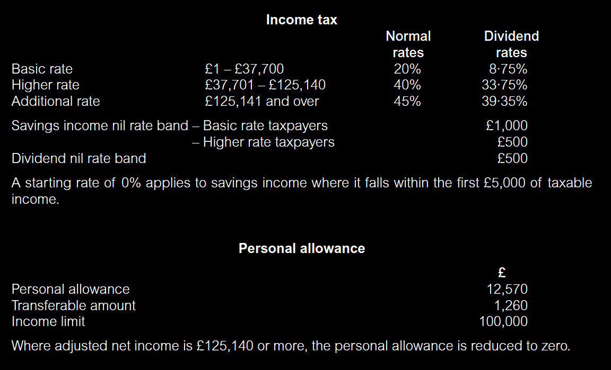
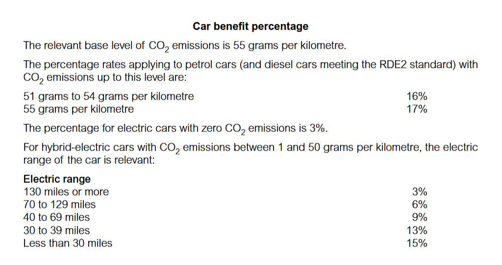
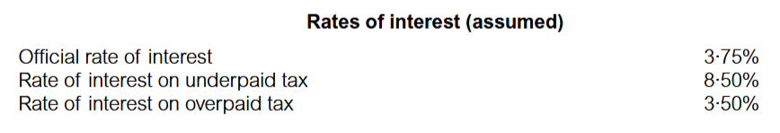
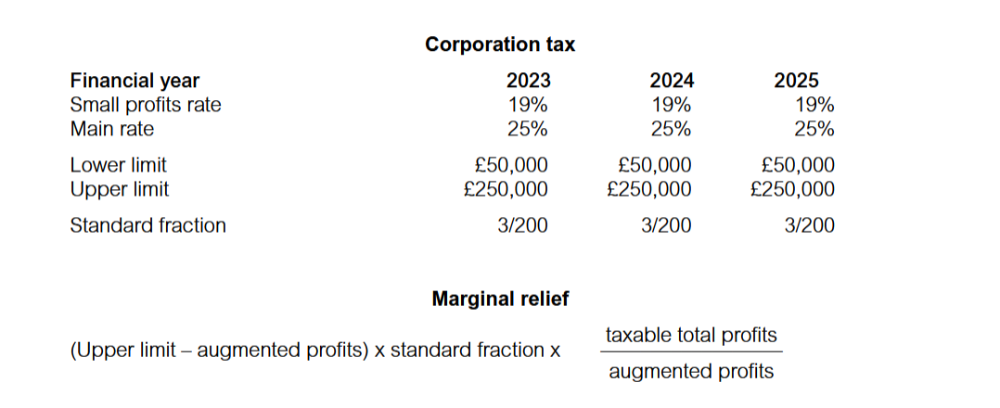
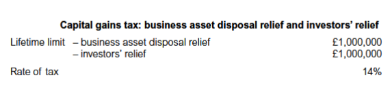

# Snippets

***VAT is assessed for a tax period, normally of three months.***

***Approved mileage allowances AMAP***

***Capital allowances: rates of allowance***

***Company Van*** 

**Rates of Interest**

***Corporate Tax***

***Capital gains tax: business asset disposal relief BADR and investors' relief***

